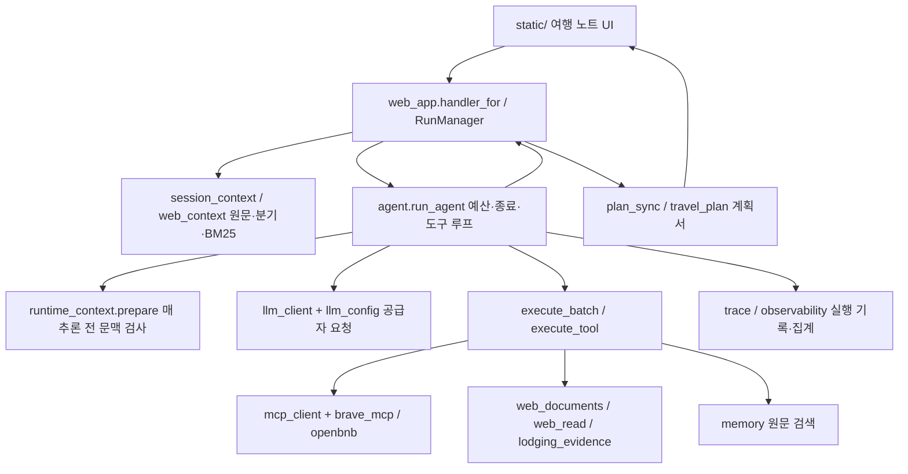

# 구조 지도

검토 기준: 2026-10-25 · 제품 커밋 cc6c513. 이 문서는 기존 구현의 역할 지도다. 새 계층·서비스를 도입하지 않는다.

화살표는 주요 호출·데이터 흐름이며 전체 import 그래프나 새로 강제한 계층 제약이 아니다. 공급자는 요청 설정에 따르며 실패 시 임의의 다른 공급자로 바꾸지 않는다.

| 역할 | 소스와 진입점 | 변경 시 함께 볼 검사·문서 |
| --- | --- | --- |
| 웹 요청·대화·저장·삭제 | [web_app.py](src/travel_agent/web_app.py), `handler_for`, `RunManager` | `tests/test_web_app.py`, [웹 사용법](docs/web-interface.md) |
| 모델 행동과 도구 실행 | [agent.py](src/travel_agent/agent.py), `run_agent`, `execute_batch`, `execute_tool` | `tests/test_agent.py`, [Agentic RAG](docs/agentic-rag.md) |
| 공급자와 출력/입력 설정 | [llm_client.py](src/travel_agent/llm_client.py), [llm_config.py](src/travel_agent/llm_config.py) | [공급자](docs/llm-providers.md), [현재 기본값](docs/knowledge/current-state.md) |
| 추론 전 문맥·요약 | [runtime_context.py](src/travel_agent/runtime_context.py), `prepare` | `tests/test_runtime_context.py`, [096](docs/research/2026-10-24-096-conservative-context.md) |
| 원문 저장·웹 BM25·분기 | [memory.py](src/travel_agent/memory.py), [session_context.py](src/travel_agent/session_context.py), [web_context.py](src/travel_agent/web_context.py) | `tests/test_session_memory.py`, [메모리 RAG](docs/memory-rag.md) |
| CLI 검색과 학습 | [memory_cli.py](src/travel_agent/memory_cli.py), [lexical.py](src/travel_agent/lexical.py) | [메모리 경로 차이](docs/memory-rag.md) |
| MCP 허용 도구·어댑터 | [mcp_client.py](src/travel_agent/mcp_client.py), [brave_mcp.py](src/travel_agent/brave_mcp.py), [openbnb.py](src/travel_agent/openbnb.py) | [MCP](docs/mcp.md), 허용 도구와 실제 인자 |
| 원문 수집·본문·선별 | [web_documents.py](src/travel_agent/web_documents.py), [web_read.py](src/travel_agent/web_read.py), [search_selection.py](src/travel_agent/search_selection.py) | [문서 수집](docs/web-documents.md), [검색 평가](docs/travel-search-evaluation.md) |
| 숙소별 관측 | [lodging_evidence.py](src/travel_agent/lodging_evidence.py) | [근거 범위](docs/lodging-evidence.md) |
| 계획서·대화 후 동기화 | [travel_plan.py](src/travel_agent/travel_plan.py), [plan_sync.py](src/travel_agent/plan_sync.py) | [계획서](docs/travel-plan.md), `tests/test_plan_viewer.cjs` |
| 기록·지표·품질 기준 | [trace.py](src/travel_agent/trace.py), [observability.py](src/travel_agent/observability.py), [quality.py](src/travel_agent/quality.py), [acceptance.py](src/travel_agent/acceptance.py) | [평가의 한계](docs/knowledge/evidence-and-evaluation.md) |

UI 정적 자산은 `src/travel_agent/static/`에서 제공한다. 계획서·실행·원문·요약·도구 로그는 실행 저장소에 보존하며 개인 데이터의 기본 위치는 `data/private/`다. 공개 예시는 `examples/`에 둔다.

Google HTTP·webserp·과거 검색 재현 모듈과 검사는 연구 이력으로 남아 있다. 파일이 존재한다는 이유로 현재 기본 공급자나 다음 개발 과제로 해석하지 않는다. 실제 추천 근거0/2라는 한계와 현재 설정은 [현재 상태](docs/knowledge/current-state.md)를 따른다.
