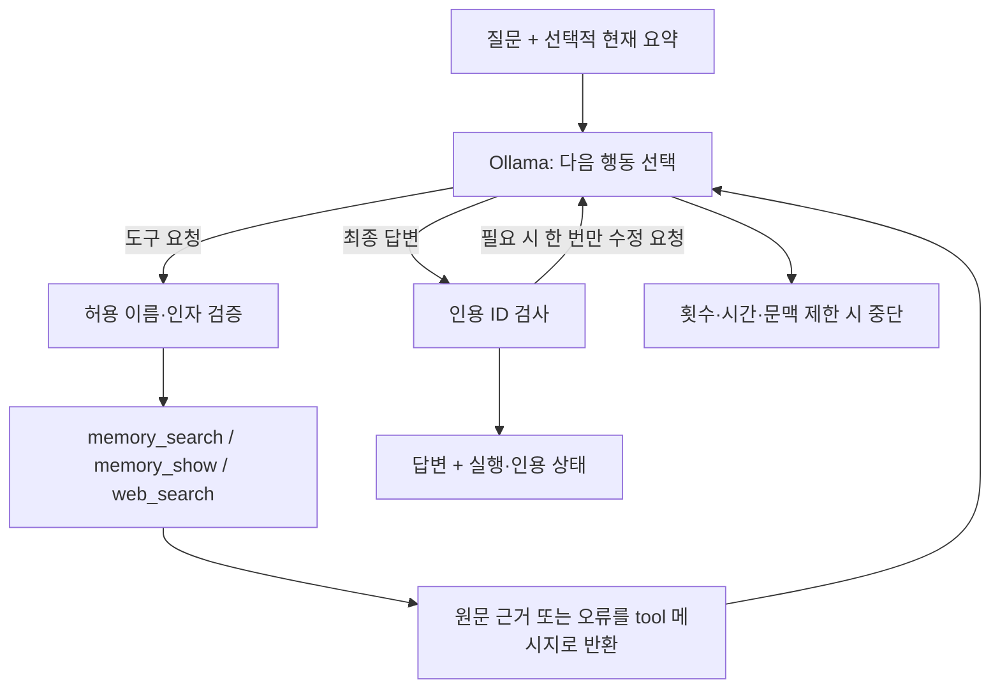

# Agentic RAG — 선택적 메모리 도구 호출

075부터 기본 모델40회·도구36회·실행360초다. 공식 Brave MCP 검색은 첫 후보 탐색에서 count=20을 권장하고 검색 응답은 최대96000 UTF-8바이트, 에이전트의 web_read는 호출당12000바이트를 전달한다. 전체 입력196608바이트·문맥65536토큰·출력4096토큰은 유지한다. 더 많은 조회를 허용하는 설정이며 실제 검색 횟수와 종료 판단은 모델에 있다.


## 두 경로의 차이

057부터 웹은 부모 경로의 원본을 자동 저장·BM25 색인한다. 요약 이후에는 현재 질문으로 과거 원문을 자동 검색해 먼저 넣고, 모델이 memory_search·memory_show를 추가로 선택할 수도 있다. 자동 검색은 툴콜이 아니라 memory_recalled 이벤트다. CLI의2-Step·하이브리드 경로는 유지한다. 설정과 한계는 [웹 메모리](web-interface.md)를 따른다.

056부터 출력 기본 상한은4096토큰이다(이전1024). 065부터 모델 호출 최대24회·도구 호출20회이며 웹180초는 유지한다. 컨텍스트65536은 Ollama 설정이며 Nexus의 실제 문맥 길이는 공급자가 결정한다. Python·2-Step·CLI·웹이 공통 생성 설정을 사용한다. 실제 생성량이 항상4096인 것은 아니다.

056부터 기본 completion_protocol은native다. 실제 tool_calls가 있으면 실행하고 결과를 다시 모델에 전달하며 도구 호출 없는 일반 답변이면 종료한다. 최종 태그·finish 도구·본문 검토 및 인용 수정 재요청을 기본 경로에서 요구하지 않는다. 인용 상태는 보고하며 completed는 품질 통과가 아니다. 실행 가능한 추가 확인은 실제 도구로 수행하고, 필수 사용자 조건이 없으면 질문하며 외부 한계는 설명하도록 시스템 지침을 보강했다.

시간·입력·출력·모델/도구 호출 제한은 유지한다. 한도 때문에 마지막 답변을 요청하면 step_limit·tool_limit로 구분한다. explicit 태그 방식과 legacy 보완 재요청 방식은 과거 비교 재현용 Python 옵션이다. native에는 태그 신호가 없으므로 completion_signal_received=false가 정상이며 실패 지표로 해석하지 않는다.

기존 `memory answer`는 프로그램이 먼저 검색하고 근거를 넣어 생성하는 2-Step RAG다. 새 `memory agent`는 모델이 검색 필요성과 질의를 선택한다. 둘 다 검색 결과는 결국 생성 입력 문맥에 들어간다. RAG 자체가 tool calling을 요구하는 것은 아니다.



현재 기능은 메모리와 웹검색 도구를 선택하는 단일 요청 루프다. 웹검색은 제목·URL·검색 요약까지이며 [웹검색 도구](web-search.md)에 범위와 실행법을 정리했다. 장기 채팅 UI·자동 대화 저장·자동 압축은 아직 없다. 모델에 기억을 자동으로 사전 주입하는 경로와 혼동하지 않는다.

## 실행

저장소 루트에서 기존 가상환경·Ollama·합성 원문 인덱스를 사용한다. `import/index`가 이미 완료됐다면 반복할 필요 없다.

```powershell
.\.venv\Scripts\Activate.ps1
travel-agent doctor
travel-agent memory --user demo --session trip import examples/memory-history.jsonl
travel-agent memory --user demo --session trip index

# 2-Step: 프로그램이 먼저 검색
travel-agent memory --user demo --session trip answer "강릉 제외 이유가 뭐였지?" --summary examples/compressed-summary.txt

# Agentic: 모델이 도구 사용 여부 선택
travel-agent memory --user demo --session trip agent "강릉 제외 이유가 뭐였지?" --summary examples/compressed-summary.txt
travel-agent memory --user demo --session trip agent "안녕!"

# 반환된 request_id를 지정
travel-agent trace show REQUEST_ID
```

실제 요청 ID는 32자리 소문자 16진수다. trace show는 JSONL 기록을 읽어 JSON으로 보여준다. 웹 대시보드는 없다.

## 도구와 범위

044부터 현재 사용자·세션에 저장 이벤트가 없으면 memory_search·memory_show를 모델 스키마에서 제외한다. 저장된 기록이 있을 때만 메모리 도구를 노출하며, 데이터는 있지만 색인이 없거나 오래됐을 때의 오류는 그대로 알린다. 현재 질문에 새로 주어진 조건을 빈 메모리에서 찾던 실제 실패를 줄이기 위한 실행 조건이다.

- `memory_search(query, top_k=3)`: 기존 BM25/dense/hybrid 검색을 사용한다. query 1..500자, top_k 1..5. `--mode`와 `--rerank`는 호스트 실행 옵션이다.
- `memory_show(event_id)`: 해당 범위의 원본 이벤트 전체를 조회한다. 원문 출처·역할·추가 메타데이터를 보존한다.

사용자·세션·DB 경로는 호스트가 정한다. 모델의 도구 인자로 범위를 바꿀 수 없으며 추가 필드를 거부한다. 이는 로컬 범위 검사이며 서비스 로그인·권한 검증은 아니다. 알 수 없는 도구·잘못된 타입·빈 검색어·동일 반복 호출은 오류를 도구 결과로 반환한다. 임의 코드나 명령을 실행하지 않는다.

도구 출력은 3500 UTF-8 바이트 이내로 제한한다. 검색 결과는 전체 청크 단위로 담고 제외된 수를 반환한다. 원본 이벤트 전체가 한도를 넘으면 자르지 않고 오류로 반환한다. 이때 모델은 검색어를 좁히거나 확인 불가로 답할 수 있다.

`web_search(query, top_k=3)`는 공개 웹의 제목·URL·검색 요약을 조회한다. query 1..500자, top_k 1..5. `--no-web`이면 스키마에서 제외하고 호출도 거부한다. `memory answer`에는 웹검색을 추가하지 않았다.

## 종료와 예산

기본값은 모델 호출 최대 6회, 도구 호출 최대 8회, 시간 예산 120초다. 인용 수정 호출도 모델 호출 한도에 포함된다. 한 응답의 여러 web_search는 기본 최대3개를 병렬 실행한다. 메모리 도구는 SQLite·로컬 검색 모델을 공유하므로 호출 스레드에서 순차 실행하며 웹 I/O와는 겹칠 수 있다. 도구 호출 수에는 묶음 안의 거부된 인자·반복 시도·기한 초과로 실행되지 않은 요청도 포함한다.

`--tool-workers 1`은 요청 순서대로 모두 순차 실행한다. 허용 범위는1..4다. 병렬에서는 완료 순서가 달라도 결과를 원래 요청 순서와 tool_call_id에 맞춰 묶어 다음 모델 호출에 전달한다. 한 호출의 오류가 다른 호출 결과를 버리지는 않는다. 앞선 검색 결과를 사용해야 하는 후속 검색은 다음 모델 턴에서 요청한다.

```powershell
travel-agent memory --user demo --session trip agent "최신 예산은?" --max-steps 4 --max-tool-calls 3 --timeout 90
```

Ollama 호출은 `AGENT_CONTEXT_TOKENS`를 읽으며 기본 `num_ctx=65536`이다. Agentic과 2-Step answer가 공통 설정을 사용한다. 앱의 바이트 제한은 별도로 `AGENT_MAX_INPUT_BYTES`(기본196608), 에이전트 CLI의 `--max-input-bytes`로 조정한다. 기존 10000바이트 기본값과 12000바이트 상한은 제거했다. 바이트는 정확한 Qwen 토큰 수가 아니므로 설정한 num_ctx에 항상 맞는다는 보장은 없다. 앱의 바이트 한도를 넘으면 `context_limit`으로 중단한다. 생성 출력은 기본4096토큰이며 AGENT_MAX_OUTPUT_TOKENS(128~8192)로 조정한다. 길이 종료는 `output_limit`으로 구분한다. 호스트Python은`.env`를 자동으로 읽지 않으므로 환경변수는 실행할 터미널에 설정한다. Docker Compose는`.env`의명시값이 기본값보다 우선한다.

시간 예산은 요청 전·모델 응답 후·도구 단계 경계에서 검사하고 남은 시간을 HTTP timeout에 전달한다. CPU 모델 로딩이나 동기 검색 실행을 강제 중단하는 hard deadline은 아니다. 한 단계가 오래 걸리면 실제 종료가 예산보다 늦을 수 있다.

병렬 작업도 실제 시작 직전에 남은 시간을 검사한다. 이미 실행 중인 스레드는 강제 종료하지 않고 완료를 기다린다. 병렬 실행은 검색 개수·토큰 예산을 늘리지 않으며 여러 결과가 쌓이면 기존 context_limit에 도달할 수 있다.

종료 상태: completed, step_limit, tool_limit, timeout, context_limit, output_limit, model_error, protocol_error, empty_answer. completed는 루프가 최종 답변으로 끝났다는 뜻이며 내용 품질 통과를 뜻하지 않는다. CLI는 completed만 종료 코드0, 나머지는1을 반환한다.

tool_limit는044의 중간 실행까지 사용한 종료 상태다. 현재는 호출 예산 초과 제안을 실행하지 않고 남은 모델 호출로 정리하며, 도구를 비활성화한 정리 단계에서도 도구를 요구하면 protocol_error로 종료한다.

## 인용 검사와 한 번의 수정

044부터 웹 출처는 있지만 본문 읽기 성공이 없는 초안에는 최대 한 번 근거 검토를 요청한다. 모델이 필요한 본문을 선택해 읽거나 미확인으로 답할 수 있으며 특정 검색어·사이트·호출 순서를 강제하지 않는다. 마지막 모델 호출 또는 도구 예산 소진 시에는 도구 스키마를 비우고 확보 근거와 미확인 항목으로 정리하도록 한다. 이 단계에서도 도구를 요구하면 실행하지 않고 오류로 종료한다. 추가 검토와 최종 답변 호출도 기존 모델 호출·시간 예산 안에서만 수행한다. evidence_review_attempts·finalization_for_budget와 trace의 evidence_review·tool_budget_finalization으로 확인할 수 있다. 이 처리는 답변의 사실성을 보장하지 않는다.

web_read도043의 문장·줄 경계와 한국어 bigram·BM25Plus 발췌를 사용한다. body_signal 레이아웃 경고를 간결한 모델 입력에도 남긴다. web research 전체를 web_search에 합친 것은 아니다.

모델이 `[m-...]`, `[event:...]` 또는 `[web:...]`를 쓰면 실제 도구로 제공한 근거 ID 안에 있는지 검사한다. 잘못된 ID나, 근거가 있는데 인용 형식이 없는 답변에는 최대 한 번 형식 수정을 요청한다. 실제 허용 ID를 제공하고 새 사실을 추가하지 말라고 지시하며, 근거를 못 찾은 유보 답변에는 인용을 강요하지 않는다. 코드가 임의로 인용을 붙이지 않는다.

`citation_status`는 valid/invalid/missing/no_evidence다. 검색은 했지만 해당 질문의 근거를 못 찾은 유보 답변도 missing일 수 있다. 이 필드만으로 사실성·답변 성공률을 산정하지 않는다. 수정 뒤에도 실패하면 그 상태를 노출한다. ID 존재 검사이므로 의미적 뒷받침이나 사실 검증과는 다르다. `[e01]`처럼 지원하지 않는 표기는 정상 인용으로 인정하지 않는다.

## 실행 관측

기본 저장 위치는 `data/private/traces/<request_id>.jsonl`이며 Git에서 제외된다. 질문·요약·모델 입력·실제 도구 인자와 결과·최종 답변을 포함하므로 개인 원문처럼 취급한다. `--trace-dir`로 다른 위치를 고르면 그 위치의 Git 제외 여부는 별도 확인해야 한다.

주요 레코드:

- run_start/run_end: 요청 ID, 사용자·세션, 모델 태그, 옵션·제한, 종료 결과.
- model_start/model_end/model_error: 단계, 입력, 실제 assistant 응답·도구 요청, 지연, 입력·출력 토큰, 오류.
- tool_start/tool_end/tool_error: 단계·span, 도구 이름·인자, 실제 제공 결과, 지연·오류.
- tool_batch_start/tool_batch_end: 한 모델 응답의 도구 묶음과 worker 수. 호출별 시작·종료가 겹치는지 확인할 수 있다. 스레드 간 sequence 증가와 파일 쓰기는 Lock으로 보호한다.
- retrieval_index: 원문 snapshot 해시와 임베딩·청킹 설정.
- citation_repair: 인용 수정 이유와 실제 피드백.

내부 thinking 필드는 저장하지 않는다. 추적하는 것은 외부로 관찰 가능한 행동이다. 각 줄은 즉시 파일에 append하고 닫지만 트랜잭션 로그·변조 방지·장애 복구 시스템은 아니다. 프로세스 강제 종료나 기록 자체의 I/O 실패에서는 run_end가 없을 수 있다. 로그 회전·보존 기간·마스킹·집계 대시보드·분산 추적은 후속이다.

이것은 로컬 실행을 재구성할 수 있는 첫 tracing이며 운영 관측 체계 전체가 완성된 것은 아니다. Ollama 모델 태그는 기록하지만 태그가 가리키는 가중치 digest를 매 요청마다 고정·조회하지는 않는다.

## 검증

```powershell
python -m unittest discover -s tests -v
python scripts/evaluate_agent.py --output artifacts/agent-eval-final.json
```

평가 스크립트는 demo/trip 원문이 공개 합성 fixture와 같은지 검사하고 기존 색인을 사용한다. 메모리 평가에서는 웹을 비활성화해 외부 결과가 섞이지 않게 한다. 9개 시나리오는 인사, 요약으로 답변, 과거 이유, 최신·최초 예산, 없는 정보, 현재 가격, 원문 직접 조회, 색인 오류다. 이 중3개는 기존 2-Step 답변도 실행한다. 웹 통합 실험은 scripts/evaluate_web.py로 분리한다.

질문과 기대 행동을 만든 작은 개발용 실험이며 독립 평가셋이 아니다. 프롬프트와 입력 예산이 다르고, 최초 검색 모델 로딩·재사용 상태도 섞인다. 모델 우열·토큰 절감·대규모 품질을 주장하지 않는다. 결과·실패와 실제 코드 발췌는 연구일지009에 기록한다.
