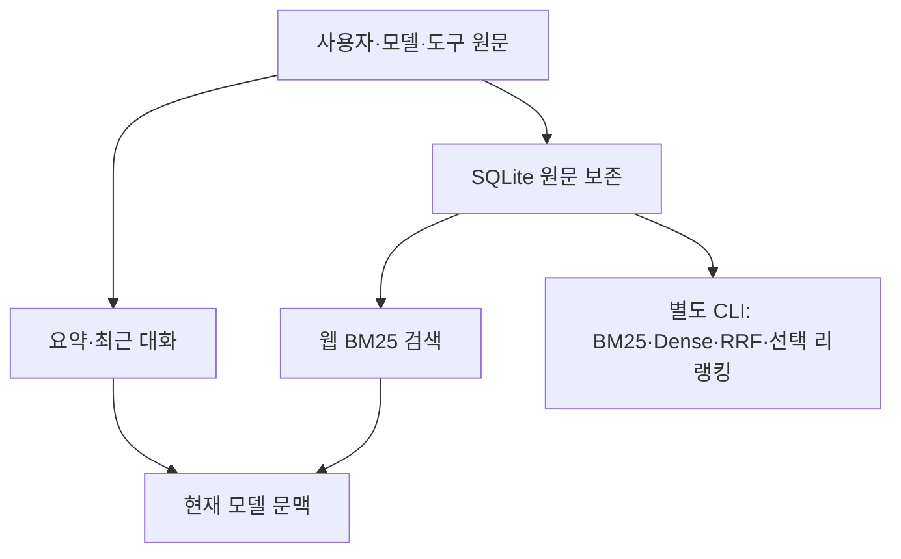

> RAG는 이미 구현과 비교 결과가 있는 항목입니다. 문맥 요약으로 빠진 근거를 원문에서 다시 찾는 문제를 다뤘습니다.

## 공고에 대한 답

Memory·데이터 정제·기술 선택과 트레이드오프를 설명합니다. 원문·요약·최근 대화의 역할을 나누고, 검색 알고리즘 선택과 실제 복원 결과를 함께 제시합니다.

## 기존 문제와 실제 답변

007의 합성 여행 대화에는 강릉 제외 이유가 있었지만 요약에는 빠져 있었습니다.

<callout icon="💬">
	강릉을 후보에서 제외한 이유가 뭐였지?
</callout>

**요약만 제공한 실제 답변**

<callout icon="🤖">
	제공된 과거 기록에는 강릉을 후보에서 제외한 구체적인 이유가 명시되어 있지 않습니다.
</callout>

**같은 질문에 원문 검색을 추가한 실제 답변**

<callout icon="🤖">
	강릉을 후보에서 제외한 이유는 기차로 이동 후 숙소까지 환승하는 시간이 길어 이동 부담이 컸기 때문입니다. [m-afccc527afe2b91ebcaa]
</callout>

검색된 원문에서 이유를 복원했습니다. 작은 합성 사례이며 당시 프롬프트 포장도 달라 일반적인 기억 정확도 향상이나 토큰 절감을 입증하지는 않습니다.

## 검색 알고리즘 비교도 이미 수행했습니다

007의 정답 이벤트가 하나씩 있는4문항 결과입니다. 새 회귀 성적이 아닙니다.

| 방법 | 정답 근거 상위3개 포함 | MRR@3 |
|---|---|---|
| BM25 | 3/4 | 0.625 |
| Dense | 4/4 | 1.0 |
| Hybrid RRF | 4/4 | 0.875 |

Hybrid는 최신 예산 질의에서 옛40만 원을1위, 정정25만 원을2위에 뒀습니다. 별도 한 질의에서 리랭킹으로 정정 기록을1위에 올렸습니다. ‘Hybrid가 항상 더 좋다’고 결론 내리지 않은 이유입니다. 첫 리랭킹168.611초에는 다운로드·로딩이 포함돼 검색 지연으로 사용하지 않습니다.

057의 별도 실험에서는 계단87개를 검색으로 복원했지만, 답변에 근거 없는 관계 해석이 추가됐습니다. 세부 복원 성공과 답변 전체의 근거 준수를 구분합니다.

## 현재 구조와 선택 이유



웹은 임베딩 다운로드 없는 BM25로 운영하고, CLI는 하이브리드/리랭킹 학습·비교 경로를 유지합니다. 원문 이벤트·역할·시점·문자 위치를 보존하며 대화 조상 경로로 검색 범위를 나눕니다. 이는 로그인이나 사용자 인증을 구현했다는 뜻이 아닙니다.

<details>
<summary>실제 코드 · RRF가 순위를 결합하는 방법</summary>
	`src/travel_agent/memory.py` · `rrf` · 기준07634dc. 점수 크기가 다른 두 검색의 원점수를 그대로 합산하지 않고 순위로 합칩니다.
	```python
def rrf(rankings: list[list[int]], k=60) -> dict[int, float]:
    scores: dict[int, float] = {}
    for ranking in rankings:
        for rank, index in enumerate(ranking, 1):
            scores[index] = scores.get(index, 0.0) + 1 / (k + rank)
    return scores
	```
	[원문 저장·검색 코드](https://github.com/yuchanahn/travel-agent/blob/07634dc/src/travel_agent/memory.py)
	[007 실제 질문·답변·검색 실행](https://github.com/yuchanahn/travel-agent/blob/07634dc/docs/research/2026-10-17-007-conversation-memory-rag.md)
	[057 웹 연결과 대조의 한계](https://github.com/yuchanahn/travel-agent/blob/07634dc/docs/research/2026-10-19-057-web-session-memory.md)
</details>

## 082 진행 결과

고정 합성12문항에서 BM25 정답 근거 포함8/8·MRR@3=0.875·범위 밖 누출0/2를 확인했다. 대표4질문×3조건의 실제 Qwen12응답에서 예산·이유 복원은 원문 전체2/2·손실 요약0/2·요약+검색2/2였고, 미기록 이름·날짜는 세 조건 모두 지어내지 않았다. 위 계획 중 BM25와 생성 대조를 완료했으며 Dense/Hybrid/리랭킹 새 실행은 하지 않았다. 짧은 합성 입력·직접 만든 손실 요약의 결과이며 실사용 전체의 품질 개선으로 일반화하지 않는다.

[실제 질문·답변과 실행 기록](https://app.notion.com/p/402d058c022e8187bcb3e98348157693)
