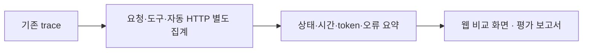

> 기록을 남기는 기능에서, 실패를 분류하고 같은 조건의 결과를 비교하는 도구로 발전시키려 합니다.

## 공고에 대한 답

Eval 데이터셋·하네스·Observability·trajectory 추적에 해당합니다. 모델 내부 사고나 가중치를 관찰하는 기능은 아닙니다. 모델 입력·출력·도구 인자·응답·시간·종료 상태를 연결합니다.

## 이미 있는 근거

JSONL trace는 요청 ID·단계·도구 호출 ID를 연결합니다. 웹 화면에는 실행 과정·검색어·도구 결과와 모델/도구 호출·입출력 token 합계가 이미 있습니다.079 고정 질문은2개 모두 종료했지만 엄격한 근거 검토0/2였습니다. 기능 검사273개는078 결과이며 답변 정확도로 환산하지 않습니다.

<mention-page url="https://app.notion.com/p/3ffd058c022e8143a521f4ae83244936">실제 질문·답변·모델 요청과 반환 로그</mention-page>

## 이번에 추가할 것 — 아직 구현 전

기존 trace를 읽는 실행 요약과 웹의 간단한 비교 화면을 추가합니다. 새 SaaS나 별도 서버는 사용하지 않습니다.

| 표시 항목 | 의미와 검증 |
|---|---|
| 종료 상태·시간 | 모델 오류/한도/시간 소진을 정상 답변과 구분 |
| 도구 요청·성공·오류·중복 거절 | 모델 요청 수와 실제 네트워크 실행 수를 분리 |
| 저장 본문 읽기·자동 HTTP | 모델이 선택한 열람과 래퍼 선행 수집을 구분 |
| 입력·출력 token | 공급자 보고 합계, 미수집은 빈 값. 비용이나 단일 문맥 길이가 아님 |
| 실행 전후 비교 | 같은 문항·설정별 결과와 표본 수를 표시 |

합성2정상+1실패와 실제079 저장 기록을 사람이 센 값으로 확인합니다. 두 자료를 합쳐 제품 성공률로 쓰지 않습니다. p95·드리프트·대규모 안정성은 이번 검증 대상이 아닙니다.

## 실패→성공을 발표할 기준

먼저 문항·기대 근거·기준과 수정 전 결과를 저장합니다. 같은 조건에서 고친 결과를 비교하고, 성적이 나쁜 문항을 제거하지 않습니다. 합성 도구 계약·실제 로컬 모델·실시간 외부 검색은 표를 나눕니다. 기존 여행2질문은 계속 보존합니다.

실시간 검색은 추가 비용 없이 가능한지 확인된 경우에만 합니다. 저장 자료 재생은 오프라인이라고 표시하고 새 요청에 자료가 없으면 fixture_miss를 반환하며 자동으로 인터넷에 나가지 않습니다.

기존 코드와 새 작업의 경계

	기준c688d90에서 `trace.py`와 `static/app.js`의 기존 표시를 재사용합니다. 집계·비교 기능은 이 계획에서 아직 구현하지 않았습니다.
	[기존 Trace](https://github.com/yuchanahn/travel-agent/blob/c688d90/src/travel_agent/trace.py)
	[기존 웹 지표와 이벤트 표시](https://github.com/yuchanahn/travel-agent/blob/c688d90/src/travel_agent/static/app.js)

\[실행 요약·오류 분류·전후 비교 화면 사진\]

## 082 구현·검증 결과

계획 중 실행별 요약을 `observability.summarize`로 구현했다. 도구 성공·오류·중복 거절·저장 본문 읽기·자동 HTTP 관측을 웹과 trace summary CLI에 제공한다. token 미수집은0이 아니며 일부 합계에 완전성 표시를 남긴다.079 저장 펜션의13요청=성공9+중복3+HTTP오류1과 자동 수집6을 확인했다. Python278개와JS 핸들러4종 검사를 통과하고50733에서 재시작했다. 실행 간 비교 목록·집계 완료율은 아직 후속이다.

[실제 집계·검증과 코드](https://app.notion.com/p/402d058c022e8187bcb3e98348157693)
