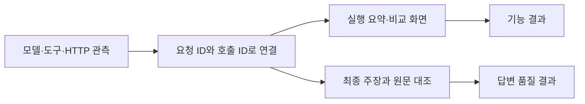

> 답변 완료와 사실 정확도를 따로 측정하고, 실패를 실행 기록으로 설명합니다.

## 해결하려던 문제

검색과 본문 읽기가 성공해도 다른 숙소의 시설을 섞거나 질문과 다른 공식 페이지를 근거로 소개했습니다. completed는 실행 종료 상태일 뿐 좋은 답변의 판정이 아니었습니다.

문항과 기준을 먼저 고정하고, 모델 요청 → 실제 도구 결과 → 다음 모델 입력 → 최종 주장을 대조하도록 구성했습니다. 내부 사고 원문을 관찰하는 기능은 아닙니다.

## 구현한 장치

| 장치 | 확인하는 것 | 해석의 한계 |
|---|---|---|
| JSONL trace | 실행·단계·호출 ID, 모델 입력/출력, 도구 인자/응답, 시간 | 기록 자체가 사실 검증은 아님 |
| 실행별 요약 | 요청·성공·오류·중복 거절·저장 본문 읽기 | 모델 요청과 자동 HTTP 수집은 별도 집계 |
| token 완전성 | 공급자 보고 합계와 보고된 호출 수 | 미수집은0이 아니며 비용·단일 문맥 길이가 아님 |
| 개별 실행 비교 | 질문·설정·최초 입력 지문, 상태·시간·호출 지표 | 같은 초기 입력이어도 후속 검색 결과는 다를 수 있음 |
| 고정 여행 평가 | 같은 두 질문의 주소·시설·출처 근거 | 각 질문1회·구현자 검토, 일반 성능으로 확대하지 않음 |



## 실제 결과

| 검증 | 결과 | 결론 |
|---|---|---|
| 079 실제 여행 두 질문 | 모두 종료, 근거 검토0/2 | 시설 혼합·주소 누락/생성·공식 근거 오인이 남음 |
| 082 저장 trace 집계 | 펜션13요청 = 성공9 + 중복3 + HTTP오류1, 자동 수집6 | 원본과 집계값 대조. 새 검색/품질 평가가 아님 |
| 082 합성 메모리 평가 | BM25 근거 포함8/8, MRR@3=0.875, 범위 누출0/2 | 고정 합성 자료의 원문 검색 확인 |
| 083 SYSTEM 대조 | 저장 마지막 입력으로 실제 Qwen4회 | 새 지침은 추가 도구가 필요해 최종 품질 미확인 |
| 083 비교 기능 | API·실제 JS 렌더 함수 검사 통과 | 085에서 실제 브라우저의 지표·비교 화면 확인·캡처 완료 |

<mention url="https://app.notion.com/p/3ffd058c022e8143a521f4ae83244936" />

<mention url="https://app.notion.com/p/402d058c022e8187bcb3e98348157693" />

<mention url="https://app.notion.com/p/402d058c022e81d38d2ad15fa9ee6425" />

<details>
<summary>실제 코드 · token이 일부만 보고된 경우</summary>

`src/travel_agent/observability.py` · `summarize` · 기준 cbaa4ea. 보고된 합계와 완전성을 함께 제공합니다.

```python
**{key: {'reported_sum': sum(v for v in values if v is not None) if any(v is not None for v in values) else None,
         'reported_calls': sum(v is not None for v in values), 'expected_calls': model_starts,
         'complete': len(values) == model_starts and all(v is not None for v in values)}
   for key, values in tokens.items()},
```

[집계 코드](https://github.com/yuchanahn/travel-agent/blob/cbaa4ea/src/travel_agent/observability.py) · [비교 화면 코드](https://github.com/yuchanahn/travel-agent/blob/cbaa4ea/src/travel_agent/static/comparison.js)
</details>


## 성과로 설명할 범위

Eval 데이터셋·실행기·trajectory 추적·오류 분류·조건별 비교를 연결한 경험을 설명합니다. 기능 검사 통과 수를 추천 정확도로 바꾸지 않습니다. p95·드리프트·대규모 안정성은 측정하지 않았습니다.
