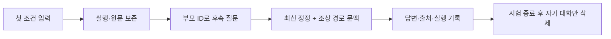

> 후속 대화와 조건 정정을 지원하는 로컬 웹 프로토타입입니다.

## 구현한 사용자 흐름

같은 대화에서 조건을 추가하거나 바꿀 수 있습니다. 실행마다 부모 ID를 저장하고 선택한 대화의 조상 경로만 문맥과 원문 검색에 포함합니다. 새 대화와 다른 분기는 구분합니다.

화면에는 답변·출처·접힌 실행 기록·실행별 지표와 개별 실행 비교가 있습니다. 대화 전체 삭제는 자식 분기를 포함하며 실행 중에는 거절합니다. 로컬 주소는127.0.0.1:50733 하나로 고정했고 재시작 시 같은 포트를 재사용합니다.



## 실제 검증을 구분했습니다

| 검증 | 실제 결과 | 입증하지 않은 것 |
|---|---|---|
| 068 여행 추천3턴 | 보완3턴 모두 종료, 근거 검토fail | 가격 조건·시설 혼합이 남아 제품 품질 통과 아님 |
| 083 검색 없는 조건 확인3턴 | 실제 Qwen이 날짜·성인2명·이천 출발·자가용을 유지하고 숙박비40→30만 원 정정 반영 | 검색·추천 정확도, 실제 브라우저 조작 성공 |
| 083 시험 기록 정리 | 비공개 RunManager 실행3개 삭제, 남은 시험 실행0개 | 일반 사용자 기록 자동 삭제 아님 |

083 첫 답변은 불필요한 날짜 질문을 덧붙였습니다. 조건 유지와 응답의 간결함을 별도로 판단했습니다. 실제 세 질문과 답변은 아래 기록에 있습니다.

<mention url="https://app.notion.com/p/402d058c022e81d38d2ad15fa9ee6425" />

## 응답 지침 적용과 검증의 경계

083에서 결론부터 간결하게 쓰기, 표를 통한 비교, 주장 가까이 출처 표시, 숙소별 근거를 섞지 않기, 필요한 근거가 없으면 다른 안내나 추가 검색을 선택하기를 SYSTEM에 반영했습니다. native 종료는 유지합니다.

이전 여행 질문의 마지막 모델 입력을 고정해 SYSTEM만 바꾼4회 대조를 수행했습니다. 새 펜션과 수목원 응답은 추가 도구를 요청했습니다. 해당 도구를 실행하지 않았으므로 최종 답변이 개선됐다고 결론 내리지 않았습니다.

<details>
<summary>실제 코드 · 개별 턴 목록과 대화 목록 구분</summary>

`src/travel_agent/web_app.py` · `RunManager.executions` · 기준 cbaa4ea. 비교 화면은 대화의 최신 턴만 보여주는 목록과 별도로 모든 보존 턴을 선택할 수 있습니다.

```python
def executions(self):
    """List retained individual turns, including earlier turns in a conversation."""
    with self.lock:
        return [{k:j.get(k) for k in ('id','query','state','created_at','parent_id')}
            for j in sorted(self.jobs.values(),key=lambda j:j['created_at'],reverse=True)]
```

[웹 실행·삭제 코드](https://github.com/yuchanahn/travel-agent/blob/cbaa4ea/src/travel_agent/web_app.py) · [조건 확인3턴 실행기](https://github.com/yuchanahn/travel-agent/blob/cbaa4ea/scripts/smoke_local_journey.py)
</details>

## 085 실제 브라우저 시연

083과 같은 합성 세 질문을 웹 화면에서 직접 입력했습니다. 실제 Qwen3응답이 모두 종료했고 날짜·인원·출발지·자가용을 유지하며 예산40→30만 원 정정을 반영했습니다. 도구·자동HTTP는0회이며 압축 후 RAG 복원 시험이 아닙니다. 재시작 후에도 저장 대화를 복원했고 시험 실행3개를 화면에서 삭제한 뒤 API404·목록0개를 확인했습니다.


## 현재 제품 경계

로컬 개인용 프로토타입이며 실제 예약·결제·다중 사용자 인증·금융 컴플라이언스·대규모 운영 경험을 포함하지 않습니다. 화면 캡처는 실제 브라우저에서 확인한 자료만 추가하며 기능 검사 결과를 화면 시연처럼 소개하지 않습니다.
