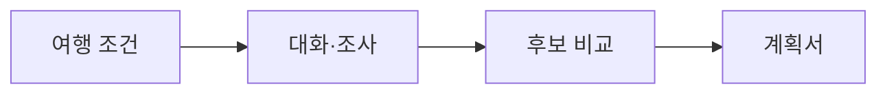
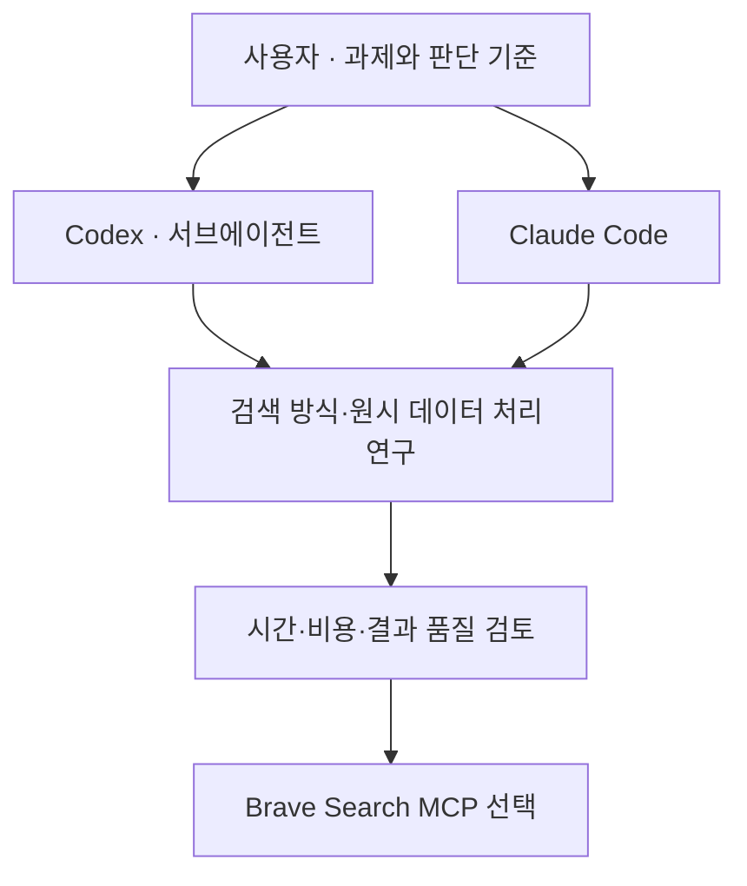
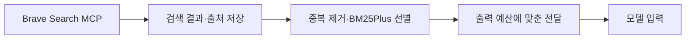
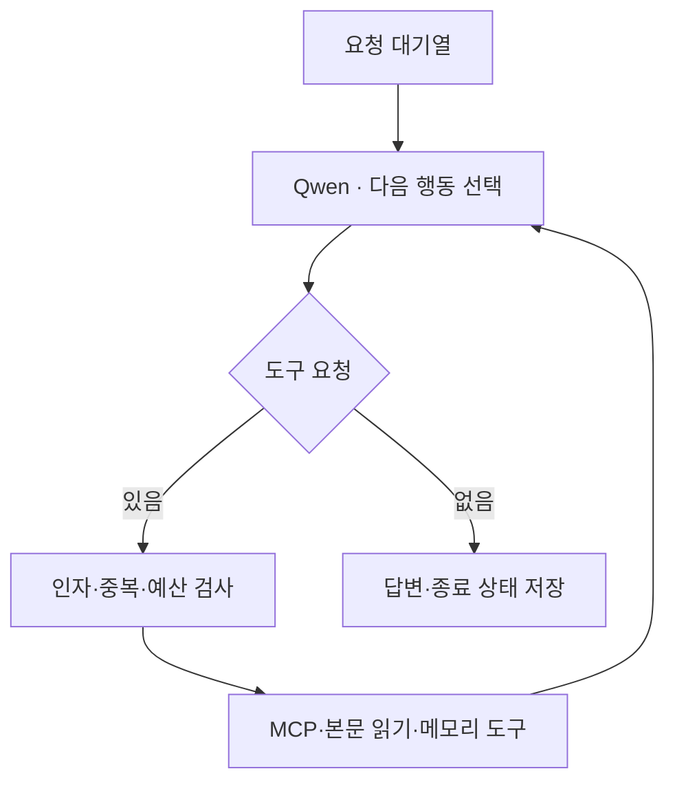
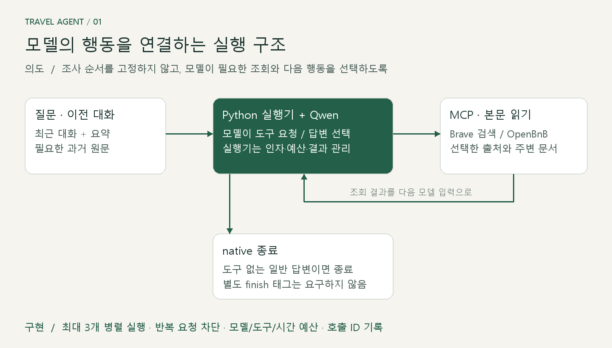
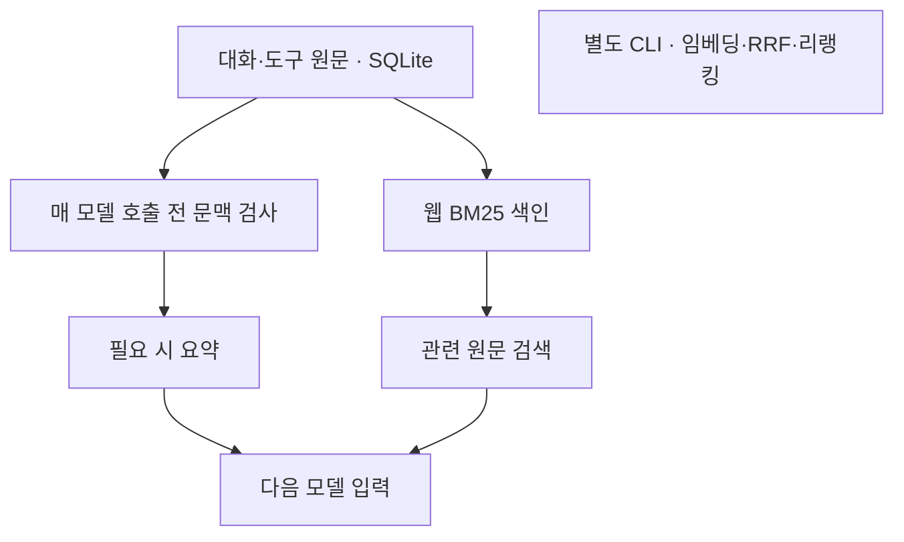
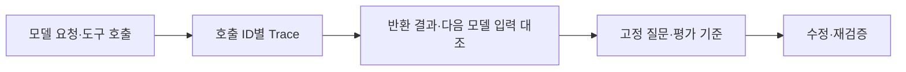
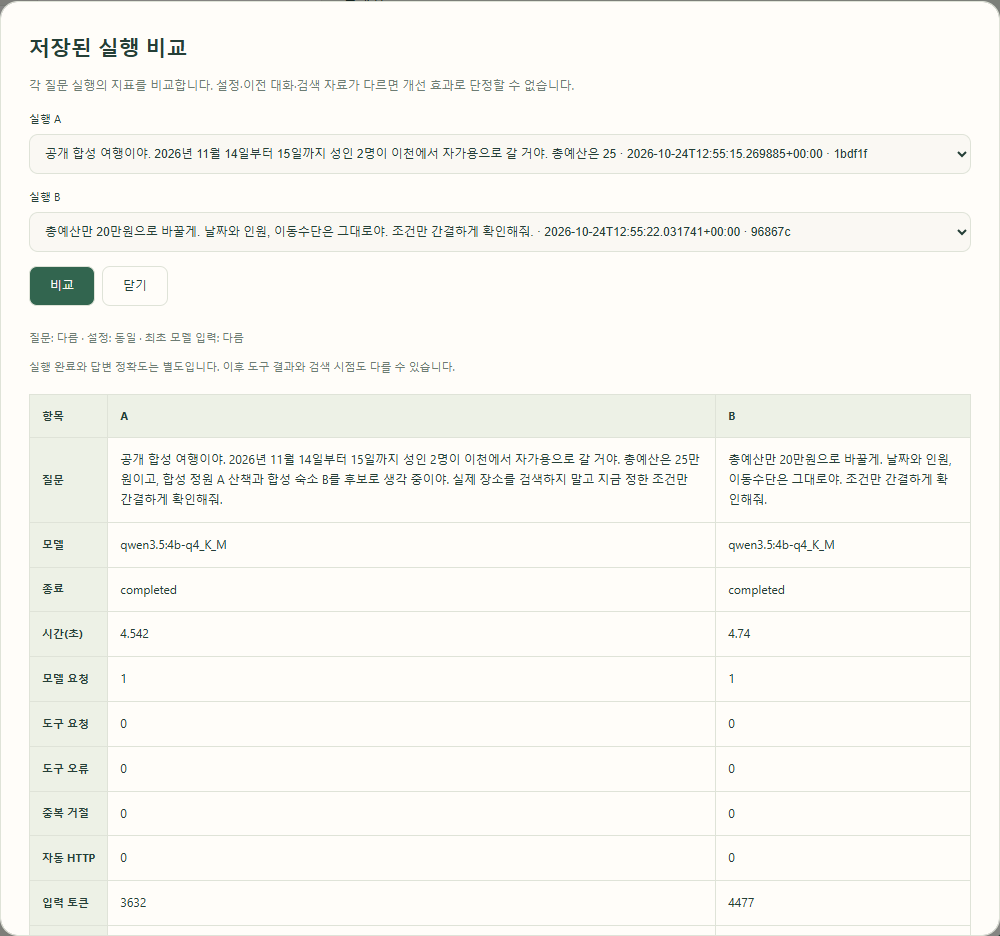
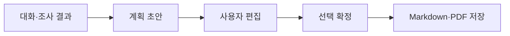

# 여행 에이전트 · 개발 흐름과 시각 구성안

## 01 · 여행 준비를 하나의 흐름으로

---

## 02 · 에이전트 협업으로 검색 전략 결정하기

[Bing·DuckDuckGo 연구를 맡긴 에이전트별 작업 화면]

[검색 방식별 결과와 선택 근거를 비교한 연구 화면]

---

## 03 · 검색 결과를 모델이 읽을 근거로

[검색 원시 결과와 모델 전달 결과를 나란히 보여주는 화면]

---

## 04 · 도구 호출과 실행 상태를 관리하는 하네스

[실제 도구 인자·반환 결과·오류 상태를 펼친 실행 화면]

---

## 05 · 대화 원문과 필요한 기억을 연결하기

[같은 질문에서 요약만 사용한 답변과 원문 검색을 더한 답변 비교 화면]

---

## 06 · 실행을 추적하고 평가로 개선하기

[동일 질문의 변경 전후 답변과 평가 근거를 함께 보는 화면]

---

## 07 · 조사에서 편집·확정 가능한 계획서로

