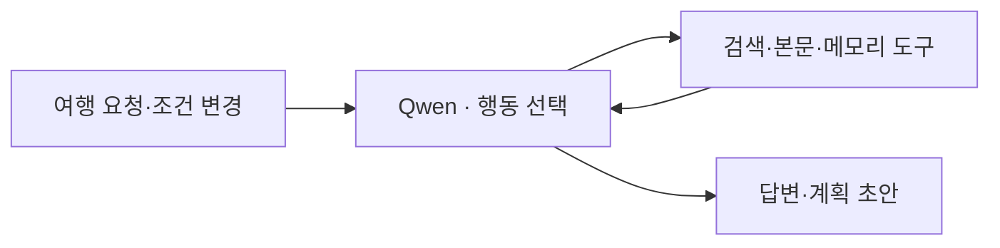
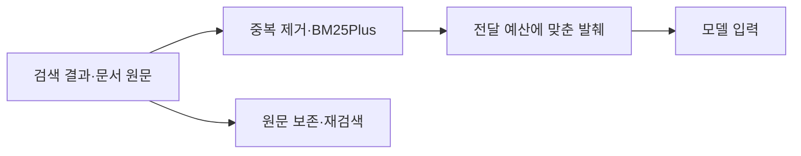

# 여행 노트 · 대화에서 조사와 계획서까지

여행 조건은 대화 중 계속 바뀌고, 조사한 정보는 여러 답변에 흩어집니다. 조건을 이어받아 필요한 근거를 찾고, 사용자가 직접 고칠 수 있는 계획서로 연결하는 AI 에이전트를 만들었습니다.

## 01 · Tool Calling·MCP — 대화를 실제 작업으로 연결

답변만 생성해서는 검색과 계획 정리가 이어지지 않았습니다. Qwen이 필요한 도구를 선택하고 Python 실행기가 인자·중복·호출 예산을 확인하는 구조로 나눴습니다. MCP는 서버가 제공하는 도구와 스키마를 발견해 연결하는 데 사용했습니다.

[호출 경로 화면: 사용자 요청 → 모델의 도구 선택 → 실제 호출 인자·결과 → 다음 모델 입력]

## 02 · SQLite·BM25 RAG — 요약에 없는 선택 이유 찾기

여행 후보를 제외한 이유가 요약에서 빠지면 요약만 다시 읽어서는 답할 수 없었습니다. 대화와 조사 원문을 SQLite에 보존하고, 웹 대화에는 BM25 검색을 연결해 필요한 원문을 문맥에 보완했습니다. 문맥 크기는 매 모델 호출 전에 확인합니다.

[Context 추적 화면: 같은 질문에 사용된 최근 대화·요약·검색 원문과 출처 위치]

## 03 · Codex·Claude Code·Brave MCP — 검색 전략을 비교하고 선택

검색엔진을 연결하는 것과 여행에 필요한 자료를 얻는 것은 달랐습니다. Codex 서브에이전트와 Claude Code에 검색 방식과 원시 결과 처리를 나눠 조사하게 하고, 시간·비용·결과 품질을 기준으로 검토했습니다. Bing·DuckDuckGo 직접 검색 연구를 거쳐 Brave를 도입했고, 이후 추가 발췌를 전달하는 공식 MCP를 통합했습니다.

[개발 협업 화면: 에이전트별 조사 과제와 결과를 검토해 검색 방식을 결정한 장면]

## 04 · BM25Plus·Context Engineering — 원문은 보존하고 입력은 선별

검색 결과와 문서 목록이 누적되면서 모델 입력이 커졌습니다. 같은 URL과 출처 내 반복 문장을 정리하고 BM25Plus로 관련 자료를 골라 전달했습니다. 선별에서 빠진 원문도 저장·색인해 필요할 때 다시 찾도록 했습니다.

[Context 추적 화면: 도구 원시 결과 → 선별된 발췌 → 모델에 실제 전달된 문맥]

## 05 · JSONL Trace·Eval Harness — 답변에서 실행 과정으로 거슬러 확인

최종 답변만 보면 자료를 못 찾았는지, 전달 과정에서 빠졌는지, 모델이 잘못 해석했는지 구분하기 어렵습니다. 호출 ID로 모델 요청·도구 인자·반환 결과·다음 입력을 연결했습니다. 고정 질문과 근거 기준으로 변경을 확인하고, 메모리는 같은 질문에 제공 문맥을 달리해 선택 이유의 복원을 대조했습니다.

[Trajectory 화면: 한 답변의 모델 요청·도구 실행·반환·다음 입력을 단계별로 펼친 기록]

## 06 · Human-in-the-loop·JSON — 조사 결과를 편집 가능한 계획서로

일정·숙소·비용을 다시 정리해야 하는 불편 때문에 대화 중 구조화한 초안을 저장하도록 했습니다. 계획서를 열 때는 같은 저장 데이터를 읽어 요약·시간표·예산으로 보여줍니다. 사용자가 직접 수정하고 선택을 확정하며, 내용이 바뀌면 확정 상태를 해제합니다.

[GitHub](https://github.com/yuchanahn/travel-agent)
