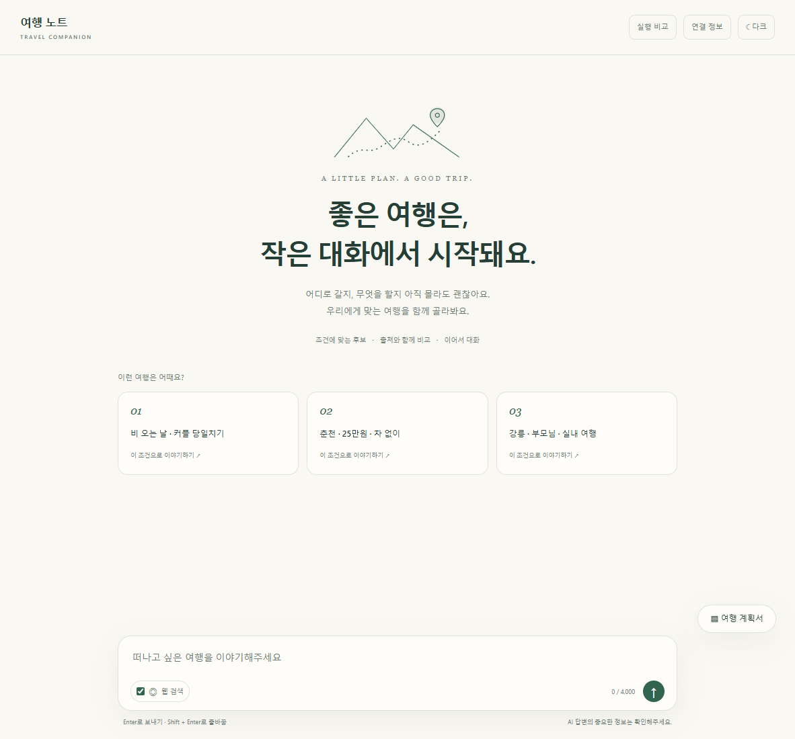
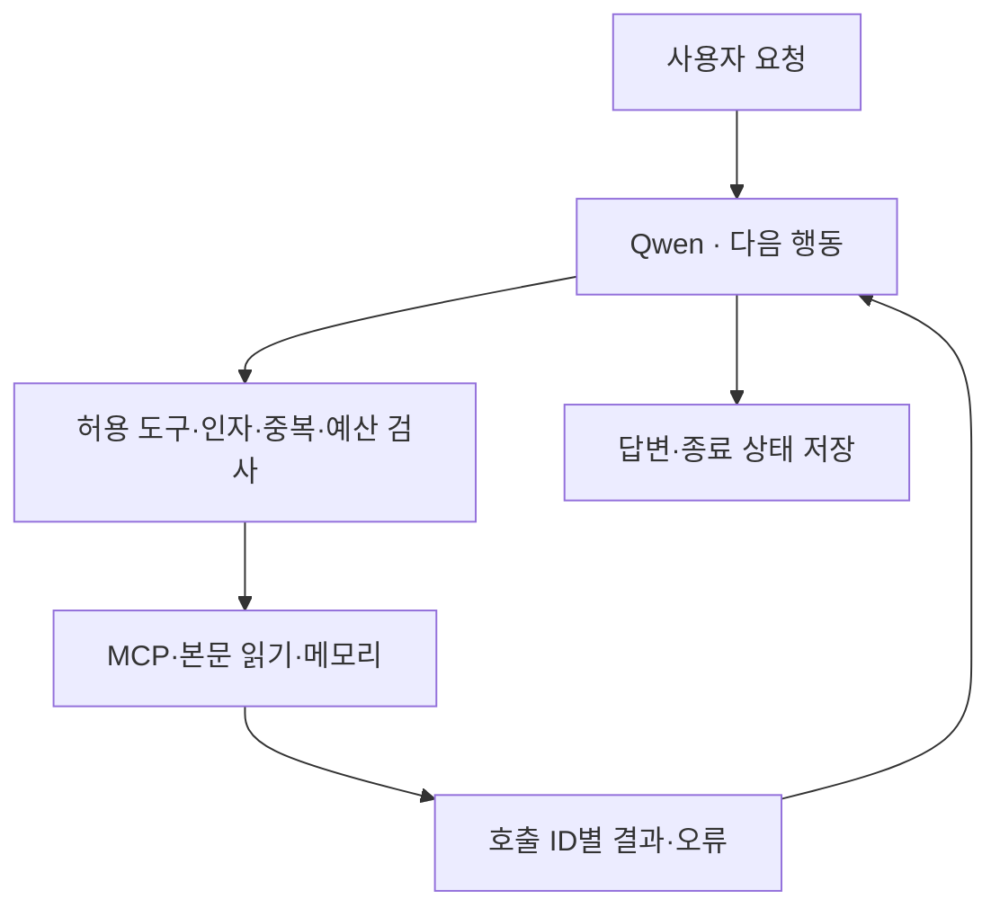
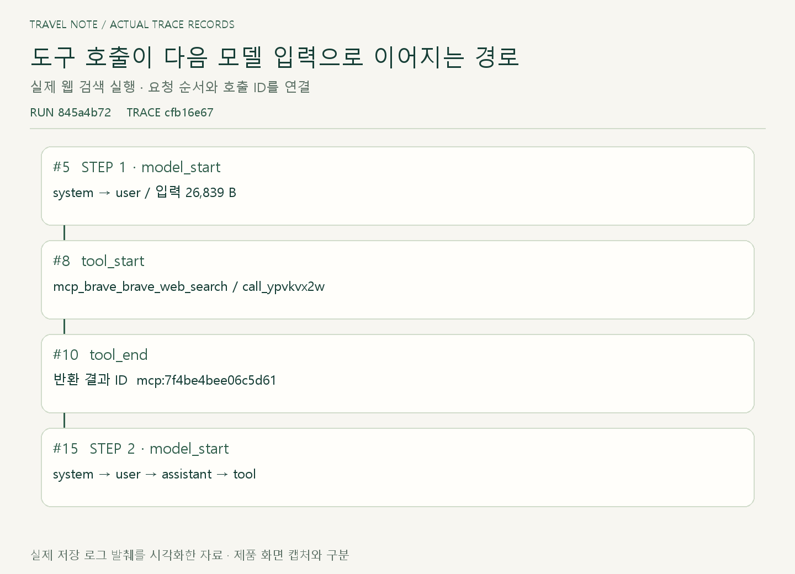
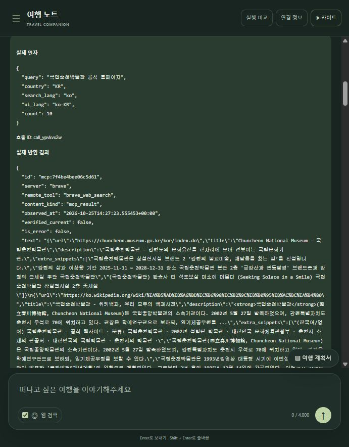
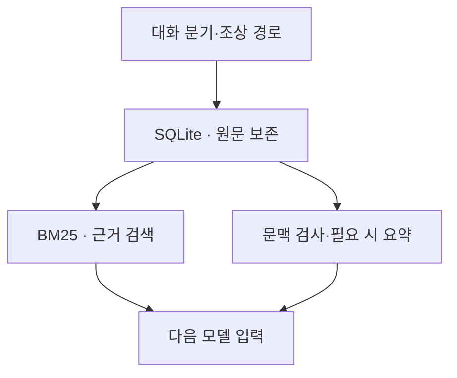
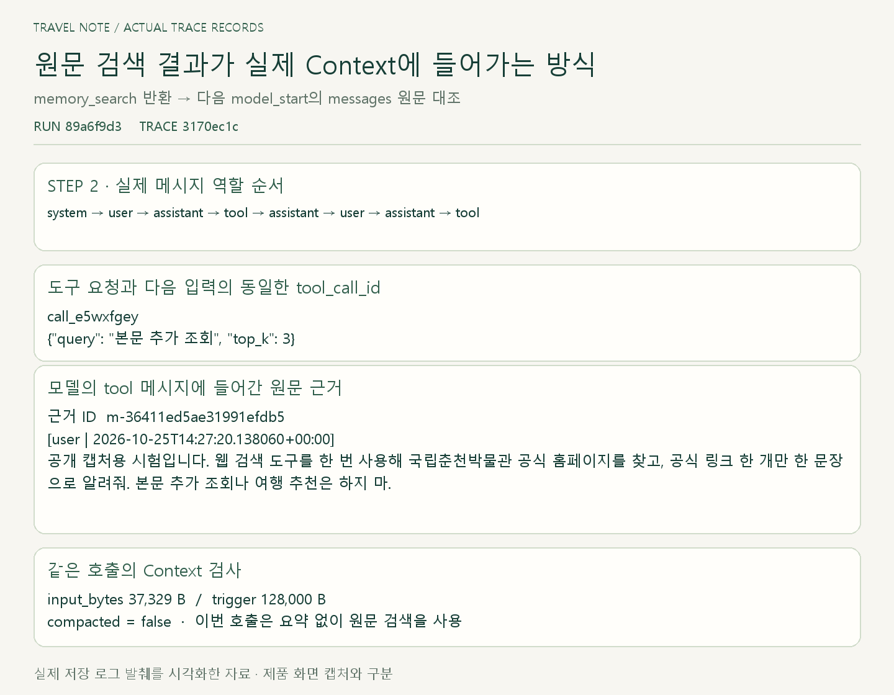
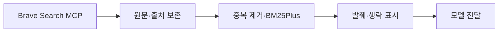
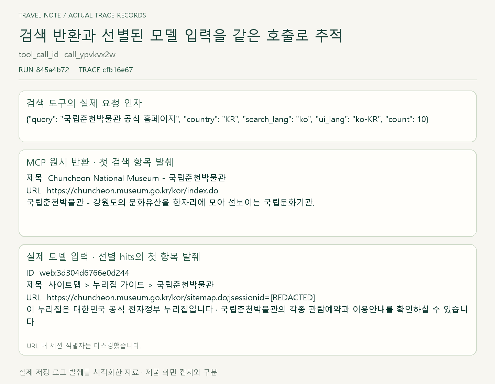
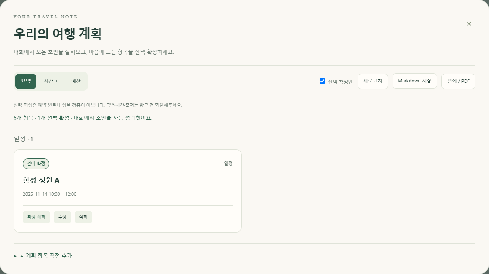

# 여행 노트 · 실행을 추적하고 제어하는 AI 에이전트

여행 준비에 범용 에이전트를 사용하며 겪은 토큰 소비와 기대에 못 미치는 결과에서 출발했습니다. 여행 조건·조사 근거·계획서를 이어가는 제품을 만들면서, 모델의 판단과 실행기의 제어를 나누고 요청의 실행 경로·문맥·저장 상태를 추적하도록 설계했습니다.

**Ollama·Qwen — 실행 환경과 모델 선택**

8GB GPU 환경에서 실행한 Qwen3.5 4B 양자화 모델을 사용했습니다. 구조화된 도구 호출과 결과를 받아 답하는 흐름을 확인했고, 외부 공급자 의존을 줄여 같은 환경에서 실험을 이어가기 위해 Ollama를 선택했습니다.

## 01 · Tool Calling·MCP — 모델의 판단과 실행 제어 분리

모델이 도구를 선택하더라도 실제 실행은 일관되게 관리해야 했습니다. 허용 도구와 인자 검증, 중복 요청 제어, 호출·시간 예산을 실행기에 모았습니다. 네트워크 도구는 병렬로 처리하고 호출 ID에 맞춰 결과와 오류를 연결합니다.

## 02 · JSONL Trace·Observability — 결과를 만든 경로 확인

최종 응답만으로는 실패 지점을 좁히기 어려웠습니다. 모델 요청부터 도구 인자·반환 결과·다음 모델 입력까지 연결해 보존하고, 실행 시간·종료 상태·토큰 사용을 분리해 확인하도록 했습니다. 같은 읽기의 반복이나 결과 전달 문제는 원본과 실제 입력을 대조해 조사했습니다.

## 03 · SQLite·BM25 RAG — 분기별 원문과 Context 관리

대화가 길어져도 선택 이유와 수정 조건을 다시 찾을 수 있도록 원문·요약·최근 문맥을 분리했습니다. 실행에는 조상 대화 경로의 원문만 넣고, BM25로 관련 근거를 검색합니다. 매 추론 전 문맥 크기를 검사하며 요약과 원문 검색의 사용 내역도 따로 남깁니다.

## 04 · Brave MCP·BM25Plus — 출처를 유지하는 검색 데이터 흐름

모델이 활용할 자료의 품질과 전달 범위를 먼저 확인했습니다. Codex 서브에이전트와 Claude Code에 검색 방식·원시 결과 처리를 연구하게 하고, 결과와 유지 부담을 검토해 Brave 도입과 공식 MCP 통합을 결정했습니다. 수집 원문을 보존하고 중복 제거·BM25Plus 선별·발췌 예산을 적용해 모델 입력으로 연결했습니다.

## 05 · Eval Harness — 실행 동작과 근거 사용을 나눠 평가

정상 종료 여부만으로 품질을 판단하지 않도록 고정 질문·정답 근거·대화 범위를 평가 기준으로 정했습니다. 메모리는 동일 질문에 원문 전체·요약·요약과 검색을 제공해 대조하고, 여행 답변은 후보별 주소·시설·가격과 출처의 연결을 확인했습니다. 평가 조건을 고정한 뒤 변경의 영향을 추적합니다.

[평가 검토 화면: 동일 질문·기준 근거·실제 사용 문맥·답변을 한 흐름에서 확인하는 장면]

## 06 · Checkpoint·Human-in-the-loop — 실행 복원과 사용자 결정

중단과 재시작을 고려해 대화·계획서를 저장하고, 요청 대기열과 실행 예산을 관리했습니다. 계획서 열람은 저장 데이터를 읽으며, 수정·확정은 사용자 동작과 연결합니다. 모델은 초안을 제안하고 사용자는 항목을 편집·확정하도록 권한을 나눴습니다.

[상태 복원 화면: 같은 대화·계획서가 재시작 후 이어지는 장면]

[GitHub](https://github.com/yuchanahn/travel-agent)
