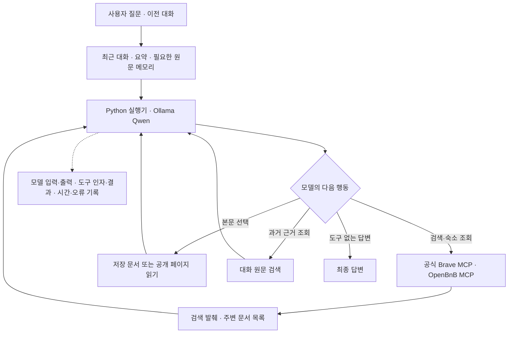
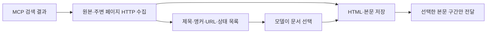

> 여행 정보를 찾는 에이전트를 만들며, 도구 선택·대화 메모리·실행 추적과 답변 평가를 직접 설계한 개인 프로젝트입니다.

<columns>
	<column ratio="60">
		

		[GitHub](https://github.com/yuchanahn/travel-agent) · <mention-page url="https://app.notion.com/p/3ffd058c022e8143a521f4ae83244936">같은 질문으로 검증한 실제 답변·호출 기록</mention-page>
	</column>
	<column ratio="40">
		**프로젝트 정보**
		<table fit-page-width="true" header-row="true">
			<tr><td>항목</td><td>내용</td></tr>
			<tr><td>형태</td><td>개인 여행 에이전트 · 로컬 웹 프로토타입</td></tr>
			<tr><td>기간</td><td>2026.10–현재</td></tr>
			<tr><td>담당</td><td>문제 정의·실행기 설계·도구/메모리 연결·검증 기준과 실패 분석</td></tr>
			<tr><td>기술</td><td>Python · Ollama/Qwen · MCP · SQLite · BM25 · 임베딩/RRF</td></tr>
		</table>
	</column>
</columns>

<table_of_contents color="gray"/>

---

## 01 · 프로젝트 개요

여자친구와 여행을 준비하면서 Codex에 여행 계획을 요청했습니다. 검색을 반복하면서도 원하는 조건과 근거를 충분히 확인하지 못하는 불편을 느껴, 조건에 맞는 후보를 조사하고 비교하는 여행 에이전트를 만들기 시작했습니다.

개발 과정에서 관심은 ‘여행 질문에 답하기’에서 **‘모델이 어떤 도구를 골랐고, 어떤 자료를 받은 뒤, 왜 부정확한 답변을 냈는지 확인할 수 있는 실행 환경’**으로 넓어졌습니다. 프레임워크에 실행 흐름을 맡기기보다 Python으로 도구 호출 루프와 기록을 구현하고, 실제 응답으로 설계를 검증했습니다. 구현에는 Codex를 활용했으며, 기술 선택·검증 기준·실험 범위와 결과 해석을 프로젝트 기록으로 남겼습니다.

현재는 로컬 Qwen 모델이 공식 Brave 검색 MCP·OpenBnB 숙소 조회 MCP·본문 읽기·대화 메모리를 선택하는 웹 프로토타입입니다. 실제 예약과 대규모 사용자 운영은 수행하지 않았습니다.



---

## 02 · 구현 과정

### 주제별 개발 기록과 검증 결과

- <mention url="https://app.notion.com/p/402d058c022e81e59994fff9ca840992" />
- <mention url="https://app.notion.com/p/402d058c022e810595d6d6e5d8842436" />
- <mention url="https://app.notion.com/p/402d058c022e811db68fc26e5d81be8d" />
- <mention url="https://app.notion.com/p/402d058c022e8158ba5ec381d0874718" />

<mention url="https://app.notion.com/p/402d058c022e81459344ca7aa34dc045" />

### 도구 호출을 연결하고, 멈춘 이유를 남기기

모델이 검색을 예고하고도 일반 답변으로 종료하거나, 같은 본문 요청을 반복하는 문제가 있었습니다. 모델의 판단과 실행기의 역할을 나눠, 다음 행동은 모델이 선택하고 실행기는 인자 검증·호출·예산·실행 기록을 담당하도록 구성했습니다.

한 응답에서 요청한 외부 도구는 기본 최대3개까지 병렬 실행합니다. 모델·도구 호출 횟수와 실행 시간은 별도로 제한하고, 정상 답변·시간 초과·모델 오류·출력 한도 등을 구분해 저장합니다. 동일 인자의 반복 요청은 재실행을 막지만, 모델이 다른 행동으로 전환하는 것까지 보장하지는 않습니다.

종료 태그를 별도로 요구하는 방식도 실험했습니다. 태그 형식 때문에 재요청이 늘어나는 동작을 관찰한 뒤, 현재는 도구 호출이 없는 일반 답변으로 종료하는 native 방식을 사용합니다.

도구 실행 사례는 아래 접힌 실제 로그에서 확인할 수 있습니다. 화면 캡처의 조건 확인 시연에는 도구 호출이 없습니다.

<details>
<summary>코드 · 도구 요청과 모델 응답을 연결하는 실행 기록</summary>

요청 ID·단계·도구 호출 ID를 연결해, 모델이 요청한 인자와 실제 결과를 대조합니다. 자동 HTTP 수집은 모델의 별도 도구 요청과 구분합니다. 내부 사고 원문을 추적하는 기능은 아닙니다.
`src/travel_agent/agent.py` · `execute_batch.emit_start` · 기준07634dc:
```python
def emit_start(index, name, call):
    trace.emit("tool_start", step=step, span=f"{step}.{index + 1}", name=name,
               call_index=index, tool_call_id=call.get("id"), arguments=call["function"].get("arguments"))
```
`src/travel_agent/trace.py` · `Trace._emit` · 같은 기준:
```python
record = {"request_id": self.request_id, "sequence": self.sequence,
          "timestamp": datetime.now(timezone.utc).isoformat(),
          "elapsed_seconds": round(time.perf_counter() - self.started, 6),
          "kind": kind, **fields}
with self.path.open("a", encoding="utf-8") as output:
    output.write(json.dumps(record, ensure_ascii=False) + "\n")
```
[도구 실행·기록 코드](https://github.com/yuchanahn/travel-agent/blob/07634dc/src/travel_agent/agent.py) · [Trace 코드](https://github.com/yuchanahn/travel-agent/blob/07634dc/src/travel_agent/trace.py)
</details>

### 요약에서 빠진 과거 근거를 다시 찾는 메모리

대화가 길어져 문맥을 요약하면, 예전에 후보를 제외한 이유나 예산을 정정한 내용이 빠질 수 있습니다. 요약과 사용자·모델·도구 원문을 분리해 저장하고, 필요한 경우 원문을 다시 검색하도록 RAG를 도입했습니다.

웹에서는 SQLite에 대화 원문을 저장하고, 요약 후 관련 원문을 BM25로 먼저 제공하는 경로와 모델이 추가 조회를 선택하는 경로를 함께 사용합니다. 대화 분기별로 조상 경로의 기록만 넣어 다른 대화와 검색 범위를 분리했습니다.

별도 CLI에서는 BM25와 임베딩 검색, 두 순위를 합치는 RRF, 선택적 리랭킹을 구현·실험했습니다. **웹 기본 경로는 BM25이며, CLI의 하이브리드 검색 전체를 웹에 연결한 것은 아닙니다.**

<details>
<summary>코드 · BM25와 임베딩 검색 순위 결합</summary>

두 검색 점수의 크기를 직접 더하는 대신 순위에 따라 합산합니다. 과거 발언을 찾는 기능이며, 저장된 내용의 사실성이나 최신성을 검증하는 것은 아닙니다.
`src/travel_agent/memory.py` · `rrf` · 기준07634dc:
```python
def rrf(rankings: list[list[int]], k=60) -> dict[int, float]:
    scores: dict[int, float] = {}
    for ranking in rankings:
        for rank, index in enumerate(ranking, 1):
            scores[index] = scores.get(index, 0.0) + 1 / (k + rank)
    return scores
```
[검색·메모리 코드](https://github.com/yuchanahn/travel-agent/blob/07634dc/src/travel_agent/memory.py) · [웹/CLI 적용 범위](https://github.com/yuchanahn/travel-agent/blob/07634dc/docs/memory-rag.md)
</details>


### 검색 발췌와 본문을 분리하고, 주변 페이지를 선택하게 하기

검색 결과의 짧은 설명만으로는 숙소의 주소와 시설 적용 조건을 확인하기 어려웠습니다. 반대로 본문을 한꺼번에 넣으면 불필요한 내용을 함께 읽게 됩니다. 공식 Brave MCP의 추가 발췌를 보존하고, 본문은 모델이 선택한 출처만 읽도록 나눴습니다.

이후 검색 페이지에 딸린 시설·객실 안내도 선택할 수 있도록 검색 MCP 결과를 래핑했습니다. 상위 원본3개와 같은 호스트의 주변 링크를 각각 최대3개, 한 단계만 수집합니다. HTML·추출문은 별도로 저장하고, 모델에는 제목·설명·링크 이름·부모 관계·상태의 목록을 제공합니다. 본문은 `web_read`로 선택할 때 전달합니다.

저장 문서는 문자 위치를 기준으로 이어 읽게 했습니다. 기존 관련 발췌 경로에서는 공백 정리만 달라져도 ‘부분 전달’로 표시되는 문제를 발견했으며, 새 저장 문서 경로는 실제 반환 위치로 남은 내용을 판단합니다. 기존 경로 전체를 수정한 것으로 표현하지 않았습니다.



<details>
<summary>코드 · 저장된 본문의 다음 읽기 위치</summary>

공백이 달라졌는지 비교하는 대신 실제로 반환한 문자 위치와 전체 길이를 비교합니다. 본문 저장·전달이 정확한 것과 모델이 올바른 문서를 고르는 것은 별개로 검증했습니다.
`src/travel_agent/web_documents.py` · `DocumentCollection.read` · 기준07634dc:
```python
end = start_index+len(fragment)
out.update(text=fragment, truncated=end < len(text), next_start_index=end if end < len(text) else None,
           text_is_fragment=start_index > 0 or end < len(text))
```
[문서 수집·읽기 코드](https://github.com/yuchanahn/travel-agent/blob/07634dc/src/travel_agent/web_documents.py)
</details>

검색·주변 문서 수집과 선택한 본문의 실제 흐름은 아래079 도구 로그와 위 구조도로 설명합니다.

---

## 03 · 테스트와 답변 품질 검증

도구가 실행되고 답변이 끝났다는 사실만으로 품질이 좋아졌다고 판단하지 않았습니다. 검색어·도구 인자·실제 반환 자료·다음 모델 입력·최종 주장을 연결하고, 같은 질문으로 이전 결과를 비교했습니다.

### 같은 Qwen 모델, 다른 실행 환경 비교

우리 에이전트와 Claude Code 모두 같은 로컬 Qwen 가중치를 사용했습니다. Claude Code는 공식 Brave 검색 MCP만 사용하는 기존 실행 결과를 보존했고, 우리 쪽은 같은 질문으로 재실행했습니다. 도구 구성·프롬프트·검색 시점이 달라 특정 변경 하나의 효과를 분리한 실험은 아닙니다.

<callout icon="💬" color="gray_bg">
	**고정 검증 질문 · 가평 펜션**
	가평에서 성인 두 명이 갈 펜션을 찾아줘. 수영장과 개별 바비큐가 둘 다 있는 후보를 최대 3곳 찾아서 이름, 실제 주소, 두 시설의 확인 근거와 출처 링크를 비교해줘. 날짜는 아직 미정이라 확정 가격이나 예약 가능 여부는 필요 없어. 공식 숙소 안내를 우선하고, 확인되지 않은 항목은 그대로 구분해줘.
</callout>

<callout icon="🤖">
	**최신 실제 답변의 시설 주장 발췌**
	수영장: ✅ 개별실내수영장 (웹검색에서 명시)
</callout>

위 주장은 아쿠아밸리에 붙은 설명이었지만, 실제 읽은 블로그에서 ‘개별실내수영장’ 문구는 다음 숙소인 화인스톤빌리지 단락에 있었습니다. 본문을 더 읽는 것만으로는 숙소별 근거 연결이 해결되지 않았습니다.

<table fit-page-width="true" header-row="true">
	<tr><td>검증 항목</td><td>관측 결과</td><td>해석</td></tr>
	<tr><td>문서 수집·읽기 등 기능 검사</td><td>078 기준 Python 검사273개 통과</td><td>기능 동작 확인. 추천 정확도와 별개</td></tr>
	<tr><td>가평 펜션 · 최신079</td><td>모델12회·도구13회·171.221초, 답변 완료</td><td>숙소 간 시설 혼합·정확한 주소 미충족으로 근거 검토 실패</td></tr>
	<tr><td>수목원 · 최신079</td><td>모델3회·도구2회·60.910초, 답변 완료</td><td>질문과 다른 공식 본문을 읽고 요금 근거로 표시, 근거 없는 주소 생성</td></tr>
</table>

최신 두 질문은 모두 종료했지만 엄격한 근거 검토는 **0/2 통과**였습니다. 이전 Claude 답변도 주소·링크·출처 오류가 있어 정답으로 취급하지 않았습니다. 각 질문1회이며 검토자는 구현자 자신으로, 일반적인 모델·하네스 우열을 주장하지 않습니다.

<details>
<summary>문제 분석 · 반복 읽기에서 무엇을 확인했나</summary>

이전076 펜션 실행은 검색1회·본문 성공3회 뒤 중복 거절26회를 기록하고360초에 실패했습니다. 검색 결과20개는 모델에 모두 전달됐으므로 단순한 검색 결과 유실은 아니었습니다.
본문 추출 전후 공백 차이를 내용 누락으로 표시하는 구현 문제를 확인했습니다. 그러나 전체 전달로 표시된 문서도 재요청해, 그 버그만 반복의 원인이라고 결론 내리지 않았습니다. 오류 뒤 새로운 검색으로 전환하지 못한 행동과, 시간 소진 전에 정리하지 못한 실행 흐름도 함께 분석했습니다.
최신079는 펜션 답변까지 종료했지만, 검색 결과와 도구 선택도 달라 한 가지 수정으로 해결됐다고 해석하지 않았습니다.
<mention-page url="https://app.notion.com/p/3ffd058c022e8167bff8fe5492ec199f">반복 실패 원인 분석</mention-page>
</details>

<details>
<summary>실제 도구 호출 발췌 · 검색과 저장 본문 선택</summary>

최신079 펜션 실행에서 모델이 요청한 실제 기록입니다. 전체 호출과 두 질문의 실제 답변은 아래 평가 기록에 있습니다.
**5.1 · 검색** · 요청2026-10-20T13:15:01.139509+00:00 → 결과 관측13:15:02.245347+00:00。도구: `mcp_brave_brave_web_search` · 호출 ID: `call_hk3zd2dg` · 결과 ID: `mcp:117000491cee1995`
```json
{
  "query": "가평 펜션 수영장 개별 바비큐 시설",
  "country": "KR",
  "search_lang": "ko",
  "ui_lang": "ko-KR",
  "count": 10
}
```
검색 결과10개를 전달했고, 래퍼의 자동 HTTP 수집은6개 URL 중4개 ready·429 1개·403 1개였습니다. 자동 수집을 모델이 요청한 도구 호출6회로 세지 않았습니다.
**6.1 · 저장 본문 읽기** · 요청2026-10-20T13:15:13.909757+00:00。도구: `web_read` · 호출 ID: `call_92ph0it1`
```json
{
  "query": "수영장 개별 바비큐 시설",
  "source_id": "web:9bfb57a07ed32264"
}
```
콜린 바비큐 본문358자를 저장소에서 읽었고 truncated=false였습니다. 실제 다음 모델 입력에 본문을 전달했습니다. 전체 문맥에 있었던 수영장 주변 문서는 선택하지 않았습니다. ‘목록에 제공됨’과 ‘실제 본문을 읽음’을 구분했습니다.
<mention-page url="https://app.notion.com/p/3ffd058c022e8143a521f4ae83244936">고정 질문·양쪽 실제 답변·전체 도구 기록</mention-page>
</details>


### 현재 한계와 마무리 범위

실행 기록으로 오류를 재현하고 분석하는 기반을 만들었습니다. 082에서 고정 합성 메모리 평가와 실행별 요약을, 083에서 개별 실행 비교와 간결한 답변·후보별 근거 분리 지침을 구현했습니다. 실제 Qwen의 검색 없는3턴 조건 정정도 확인했습니다.

082 메모리 평가에서는 BM25 근거 포함8/8·MRR@3=0.875·다른 범위 누출0/2였습니다. 대표4질문×3조건의 실제12응답에서 세부 복원은 원문 전체2/2·손실 요약0/2·요약+검색2/2였습니다. 통제한 손실 요약의 합성 소표본이며 일반적인 품질 향상이나 비용 절감으로 확대하지 않았습니다.

083은 이전 여행 질문의 저장된 마지막 입력으로 SYSTEM만 바꾼4회 대조입니다. 새 지침은 추가 도구를 요청했고 해당 도구를 실행하지 않아 최종 추천 품질은 미확인입니다. 기존079의 품질0/2는 그대로 유지합니다.

새 MCP나 멀티 에이전트 확장보다, 이 범위를 정리하고 소수 사용자 피드백을 받는 데 집중하려고 합니다. 실제 사용자 운영·비용 절감·일반적인 품질 향상은 아직 검증한 성과로 포함하지 않았습니다.

---

## 04 · 코드·실제 화면

[전체 소스 코드](https://github.com/yuchanahn/travel-agent) · [로컬 검사 실행기](https://github.com/yuchanahn/travel-agent/blob/b01fa69/scripts/verify_local.ps1)

<mention url="https://app.notion.com/p/3fcd058c022e81dda6eff44a0bb29d4f" />


<callout icon="📝">
	실제 앱 내 브라우저로 화면을 확인하고 캡처했습니다. 시연은 외부 검색/MCP 없이 로컬 Qwen으로 조건을 확인한 합성3턴입니다. 실제 여행 검색·시설 검증 결과는079 기록과 구분합니다. 시험 실행3개는 보존 자료를 비공개로 남긴 뒤 삭제했습니다.
</callout>
