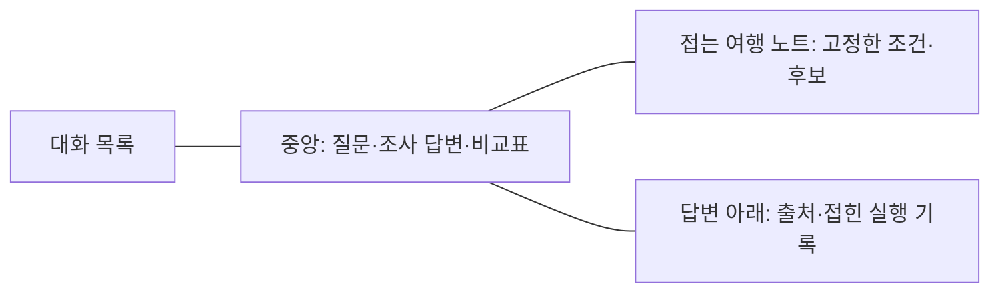

# 여행 조사 노트로 다듬는 UI 방향

상태: 088에서 첫 단계 화면 개편을 구현했다. ‘여행 노트’ 첫 화면·질문 카드·다크/라이트·대화·실행 지표/비교를 정돈하고 모델/문맥 정보는 접는 연결 정보로 옮겼다. 아래 여행 노트 패널·자동 후보 카드는 여전히 제안이다.

목표는 ‘여행 대화를 하면서 조건과 후보의 근거를 놓치지 않는 화면’이다. 첫 화면의 기술 정보보다 사용자의 여행 준비를 앞세우고, 실행 기록은 필요할 때 펼쳐 보게 한다.

## 우선순위

| 순서 | 바꿀 부분 | 목적 |
|---|---|---|
| 1 | 제품명·여행 준비 문구·자연스러운 예시 질문, 모델명은 접힌 실행 정보로 | 개발 도구보다 여행 도우미로 인식되게 |
| 2 | 데스크톱의 대화 옆에 접을 수 있는 ‘여행 노트’, 모바일은 서랍 | 사용자가 고정한 조건과 후보를 대화 중에도 확인 |
| 3 | 주장 가까운 출처와 ‘확인됨/미확인/조회 실패’의 분리, 로그는 아래 토글 | 잘 꾸민 결과가 실제 확인된 정보처럼 보이지 않게 |

여행 노트는 우선 사용자가 고정한 항목을 보여주는 방식이 적합하다. 자동 조건 추출·후보 카드 생성은 현재 자유문 응답을 안정적으로 구조화하는 추가 구현과 검증이 필요하다. 이번 UI 제안만으로 이미 존재하는 기능처럼 쓰지 않는다.

현재 답변의 비교표·인용·실행 로그는 유지한다. 확인하지 않은 가격·재고·지도 위치를 장식용 카드에 넣지 않는다. 사진은 실제 출처와 이용 조건이 확보된 경우에만 사용한다.

## 화면 구성

새 모델·유료 API·지도 서비스 도입 없이 현재 웹부터 다듬는 제안이다. 화면 개편 후에는 대화 연결·모바일 스크롤·출처 열기·삭제·실행 비교를 실제 브라우저에서 다시 확인한다.
