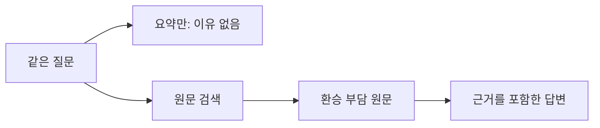

# 007 — 문맥 압축에 대비한 대화 원문 메모리 RAG

## 문제에서 검증까지 — 요약에서 사라진 이유를 원문으로 복원하기

보강일: 2026-10-17. 아래는 기존 기록·보존 산출물에 근거한 보강이며, 당시 기록은 뒤에 남겼다. 재실행 출력에는 시점과 코드 버전을 별도로 표시한다.

**흐름:** 강릉 제외 이유 쿼리 → 요약만으로는 모름 → 원문 검색 → 근거를 포함한 답변


### 1. 문제 정의 — 요청과 초기 결과

같은 질문 ‘강릉을 후보에서 제외한 이유가 뭐였지?’에 답하려면 요약에서 빠진 환승 부담을 복원해야 했다. 좋은 답변의 기준은 원문에 있는 이유를 복원하고 실제 조회하지 않은 현재 정보는 확정하지 않는 것이다.

출처: `artifacts/memory-eval-console.json`. 종류: **당시 stdout 캡처의 초기 답변 원문 발췌**. 원본 파일 SHA-256: `7e9834f96d3f9ea186e4df91415cf47f88479901117727ad2242350ca79989a7`. 발췌 내용은 고치지 않았다.

```json
  "summary_only": "제공된 과거 기록에는 강릉을 후보에서 제외한 구체적인 이유가 명시되어 있지 않습니다.",
```


### 2. 문제 분석

요약에 이유가 없으면 생성 모델이 읽을 근거 자체가 없다. 요약만 재검색해도 빠진 정보를 복구할 수 없으므로 사용자·assistant·도구의 원문을 별도로 보관하고 검색해야 한다.

### 3. 연구 과정

합성 원문7개와 의도적으로 이유·예산 금액을 뺀 요약을 준비했다. BM25/dense/hybrid를 같은4질의로 비교했고 최신 정정과 현재 가격 미확인도 살폈다. 자동 압축기가 만든 요약이 아니라 사람이 만든 통제 예시다.

### 4. 문제 해결

SQLite 원문 보존·청킹·E5 임베딩과 검색 후 근거를 입력에 넣는2-Step 경로를 만들었다. 요약은 원문을 대체하지 않고, 검색 근거만 생성 문맥에 추가한다. 아래 기존 상세 기록과008에 실제 코드·구조도가 있다.

### 5. 검증 — 개선 결과·대가·남은 한계

실행 명령: `python scripts/evaluate_memory.py`. 기존 stdout 파일은 스크립트가 저장한 결과 JSON 뒤에 출력 개행이 붙은 것과 바이트 단위로 일치함을 확인했다. 아래는 해당 stdout에서 검색 근거를 추가한 결과를 그대로 발췌했다.

출처: `artifacts/memory-eval-console.json`. 종류: **당시 stdout 캡처의 개선 답변 원문 발췌**. 원본 파일 SHA-256: `7e9834f96d3f9ea186e4df91415cf47f88479901117727ad2242350ca79989a7`. 발췌 내용은 고치지 않았다.

```json
  "summary_plus_retrieval": {
    "answer": "강릉을 후보에서 제외한 이유는 기차로 이동 후 숙소까지 환승하는 시간이 길어 이동 부담이 컸기 때문입니다. [m-afccc527afe2b91ebcaa]",
    "evidence_ids": [
      "m-20a93251a9ccc6145f31",
      "m-afccc527afe2b91ebcaa",
      "m-bbc7d792c2d3567fbc82",
      "m-6eaf105c95dec4dc7825",
      "m-324855b9f4bc17d82d7a"
    ],
    "historical_only": true,
    "web_search_performed": false,
    "cited_ids": [
      "m-afccc527afe2b91ebcaa"
    ],
    "citation_ids_valid": true,
    "input_bytes": 2975,
    "done_reason": "stop",
    "total_seconds": 1.0262069,
    "output_tokens": 46,
    "note": "Citations and factual support still require evaluation; memory is not current web verification."
  },
```

이유 복원은 관찰됐지만 요약만/검색 추가의 프롬프트 포장이 완전히 같은 실험은 아니다. 인용 ID 존재 확인은 사실성 검증이 아니며 토큰 절감·일반 기억 성능은 입증하지 않았다.

## 기존 상세 기록 — 작성 당시의 구현·실험·해설

날짜: 2026-10-17 (Asia/Seoul). 상태: 첫 대화 메모리 RAG 구현과 합성 실험 완료.

## 도입 이유와 이전 검토의 변경

사용자가 RAG의 첫 용도를 확정했다. 문맥 요약·압축에서 세부 근거가 빠져도 대화와 조사 원본은 보존하고, 이후 질문에 필요한 원문을 다시 검색해 답변에 넣는다. 요약본만 저장·검색하는 것으로는 이미 빠진 정보를 복원할 수 없다.

첫 코퍼스는 외부 관광 안내 문서가 아니라 사용자·세션별 대화와 도구 결과다. 정해진 여행 사이트에 매번 도구 호출하는 구조를 전제로 하지 않는다. 이번 CLI는 메모리 기능의 독립 검증용이며, 에이전트가 언제 검색할지 자율적으로 선택하는 연결은 후속 작업이다.

과거 사용자 발언·assistant의 추측·도구 결과를 구분한다. 최신 조건은 사용자 정정을 반영해야 하고, 당시 판단을 묻는 경우 당시 기록을 확인해야 한다. 과거 가격·운영 정보는 현재 유효성을 보장하지 않는다.

근거: [MemGPT](https://arxiv.org/abs/2310.08560), [LongMemEval](https://arxiv.org/abs/2410.10813). 이 논문들이 우리 구현의 성능을 입증하는 것은 아니며 메모리 계층과 검색·시간·갱신 평가의 연구 배경으로 참조했다.

## 구현한 구성

- SQLite 원본 이벤트 저장. event_id, turn_id, 시간대 포함 timestamp, 역할, content와 추가 출처 메타데이터를 보존한다.
- 원문을 덮어쓰지 않고 정정을 새 이벤트로 추가한다. 같은 내용의 중복 import는 추가하지 않는다. 충돌하거나 잘못된 입력은 트랜잭션으로 롤백한다.
- user/session 범위 안에서 저장·검색한다. 이는 로컬 네임스페이스이지 로그인이나 외부 서비스 인증이 아니다.
- 인접한 같은 turn_id의 발언·도구 결과를 묶고 E5 토크나이저 기준 240토큰 창, 32토큰 overlap으로 청킹한다. 원본 이벤트와 문자 범위·역할·시점·출처를 참조한다.
- Kiwi + BM25Okapi, multilingual-e5-small CPU + 정규화 벡터 정확 검색, RRF(k=60)를 구현한다.
- 인덱스에 모델 commit revision·청킹·prefix·패키지 버전을 기록한다. 원문이 바뀌면 검색을 거부하고 재인덱싱을 요구한다.
- 선택형 BGE reranker CPU 경로도 실행 확인했다.
- 원문 근거와 선택적인 요약을 Ollama에 전달해 답한다. 검색하지 않은 웹검색을 했다고 표시하지 않는다.
- 인용 ID가 실제 제공한 근거 ID에 속하는지 검사한다. 인용의 의미적 뒷받침까지 자동 검증했다는 뜻은 아니다.
- 답변을 기억에 자동 재저장하지 않는다. 모델의 오류가 반복해서 사실로 굳어지는 순환을 피하기 위한 초기 동작이다.

## 환경과 재현 조건

Windows / Python 3.12 / Ollama 0.40.5 / qwen3.5:4b-q4_K_M.
CPU i7-11800H, RAM 약 64GB, GPU RTX 3080 Laptop 8GB.
임베딩·리랭킹은 CPU, 생성은 기존 Ollama를 사용한다. CPU 스레드 초기값 4.

E5 revision: 614241f622f53c4eeff9890bdc4f31cfecc418b3.
BGE reranker revision: 953dc6f6f85a1b2dbfca4c34a2796e7dde08d41e.
sentence-transformers 5.7.0, rank-bm25 0.2.2, kiwipiepy 0.24.0, numpy 2.5.4.
실제 가상환경 패키지 버전은 requirements-lock.txt로 저장했다. Python 패키지와 검색 모델을 설치했으며, Ollama 생성 모델은 변경하지 않았다.

## 입력 데이터와 압축 비교 방식

직접 작성한 합성 이벤트 7개를 사용해 청크 6개를 생성했다. 실제 커플의 개인정보나 이 개발 대화는 가져오지 않았다.

가상 기록:
- 처음 총예산은 40만 원, 차량 없음.
- 강릉 제외 이유는 기차 이후 숙소까지의 환승·이동 부담.
- 이후 총예산을 25만 원으로 정정.
- 도구 결과의 숙소 A 8만 원은 가상·미검증 가격.

별도 요약에는 강릉 제외와 예산 변경이 있었다는 사실만 남기고 구체적 이유·금액은 넣지 않았다. 자동 압축기를 구현해 평가한 것이 아니라, 손실된 요약을 수동으로 준비한 통제 예시다.

## 검색 실험 결과

원문 근거 이벤트를 사람이 지정한 질의 4개로 BM25/dense/hybrid를 비교했다. 각 질의의 정답 이벤트는 하나다. 따라서 여기의 hit@3 비율은 이 작은 라벨 집합에서의 Recall@3와 같다.

- BM25: 정답 근거 상위 3개 포함 3/4, MRR@3=0.625.
- Dense: 4/4, MRR@3=1.0.
- Hybrid RRF: 4/4, MRR@3=0.875.

실패를 함께 기록한다. BM25는 최신 예산 정정 이벤트를 상위 3개에서 놓쳤다. Hybrid도 최신 예산 질의에서 옛 40만 원 기록을 1위, 정정 25만 원 기록을 2위에 놓았다. Dense는 해당 질의에서 정정 기록을 1위로 반환했다.

추가 단일 reranking 실험에서 같은 최신 예산 질의의 정정 기록을 1위로 올렸다. BGE 첫 실행 전체 168.611초에는 모델 다운로드·로딩이 포함되어 steady-state 검색 지연으로 사용할 수 없다. 나머지 지연도 모델 로딩과 warm 상태가 섞여 있어 운영 성능 비교로 주장하지 않는다.

질의 4개/합성 7개 이벤트로 모델 우열·일반 성공률·토큰 절감률을 입증하지 않는다. 리랭킹의 전체 4질의 회귀 비교와 더 긴 이력은 후속이다.

## 실제 생성 결과

요약만:
“제공된 과거 기록에는 강릉을 후보에서 제외한 구체적인 이유가 명시되어 있지 않습니다.”

요약 + 원문 검색:
기차 이동 후 숙소까지 환승 시간이 길어 이동 부담이 컸기 때문이라고 원문 근거 ID와 함께 답했다. 해당 호출의 Ollama 전체 응답 시간은 약 1.026초.

최신 총예산:
정정된 25만 원으로 답하고 정정 이벤트가 담긴 근거 ID를 인용했다. 약 0.905초.

현재 숙소 가격:
현재 가격·예약 가능 여부는 확인하지 못했으며 과거 8만 원은 가상·미검증 정보라고 구분했다. 약 2.124초. 답변에 불필요한 여행 조건 설명도 덧붙여 간결성은 개선 여지가 있다.

세 답변의 인용 ID는 제공한 근거 ID에 속했다. 이것과 문장별 사실성 자동 평가를 혼동하지 않는다. 요약-only와 검색 추가는 근거 패키징 프롬프트 차이가 있으며 단일 사례의 탐색 비교다.

## 검증과 산출물

- 단위 테스트 9개 통과: 원문 왕복 보존, 중복 import, 정정의 추가형 보존, 사용자·세션 분리, 시간대에 따른 정렬, 실패 시 롤백, 원문 변경 후 인덱스 거부, 근거 없을 때 모델 미호출, 과대한 입력의 네트워크 전 거부, 역할 전달·인용 ID 검사 등을 테스트 묶음으로 확인.
- pip check 통과, 기존 doctor 명령 동작 확인.
- 합성 데이터 재import inserted=0 확인.
- 실제 search/index/answer와 rerank 실행.
- data/private와 artifacts의 Git 제외 확인.

코드: src/travel_agent/memory.py, memory_cli.py.
사용법: docs/memory-rag.md.
예시: examples/memory-history.jsonl, examples/compressed-summary.txt.
재현: scripts/evaluate_memory.py.
원본 평가 JSON·로컬 DB는 Git에서 제외하고 문서에는 합성 결과 요약만 남긴다.

## 실행 예시

가상환경 활성화 후 프로젝트 루트에서:
```powershell
travel-agent memory --user demo --session trip import examples/memory-history.jsonl
travel-agent memory --user demo --session trip index
travel-agent memory --user demo --session trip answer "강릉을 후보에서 제외한 이유가 뭐였지?" --summary examples/compressed-summary.txt
```

처음 index는 E5 다운로드, --rerank는 BGE 다운로드가 필요하다. 모델 파일 다운로드는 외부 통신하지만 대화 텍스트 임베딩·리랭킹은 로컬 CPU에서 수행한다.

## 현재 한계와 다음 단계

현재는 명시적인 import/index/search/answer다. 자동 채팅·도구 기록 수집, 자동 문맥 압축, 검색 필요성을 LLM이 선택하는 에이전트 루프는 아직 연결하지 않았다.

구체적인 문맥 패킹은 UTF-8 본문 합 3000바이트의 보수적인 초기 상한으로 전체 청크만 선택한다. Qwen 토크나이저로 잔여 예산을 계산한 것은 아니다. 긴 근거가 들어가지 않으면 원문 show로 확인하며, 주변 문맥 자동 확장과 실제 토큰 기반 패킹은 후속이다.

최신 사실 갱신 엔진이나 의미적 무응답 임계값은 없다. Dense 검색은 관계없는 질의에도 후보를 반환할 수 있고, 답변의 유보는 현재 프롬프트와 평가에 의존한다. 외부 서비스로 공개할 때는 별도 인증·접근 통제가 필요하다.

다음 작업은 에이전트의 대화·도구 이벤트 저장과 요약 생성 경로를 이 메모리에 연결하고, 긴 대화에서 원문 전체 / 요약만 / 요약+검색을 비교하는 것이다. 학습 목표인 BM25·하이브리드·리랭킹 비교는 계속 유지한다.
