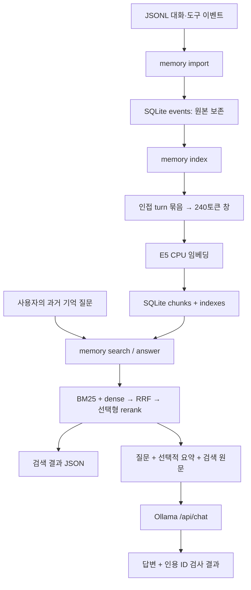
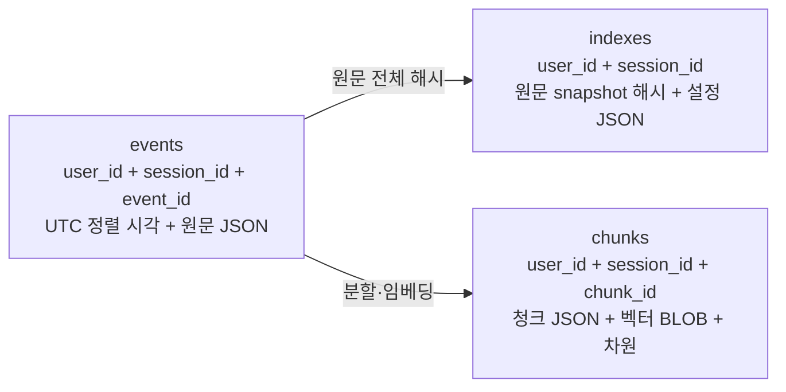
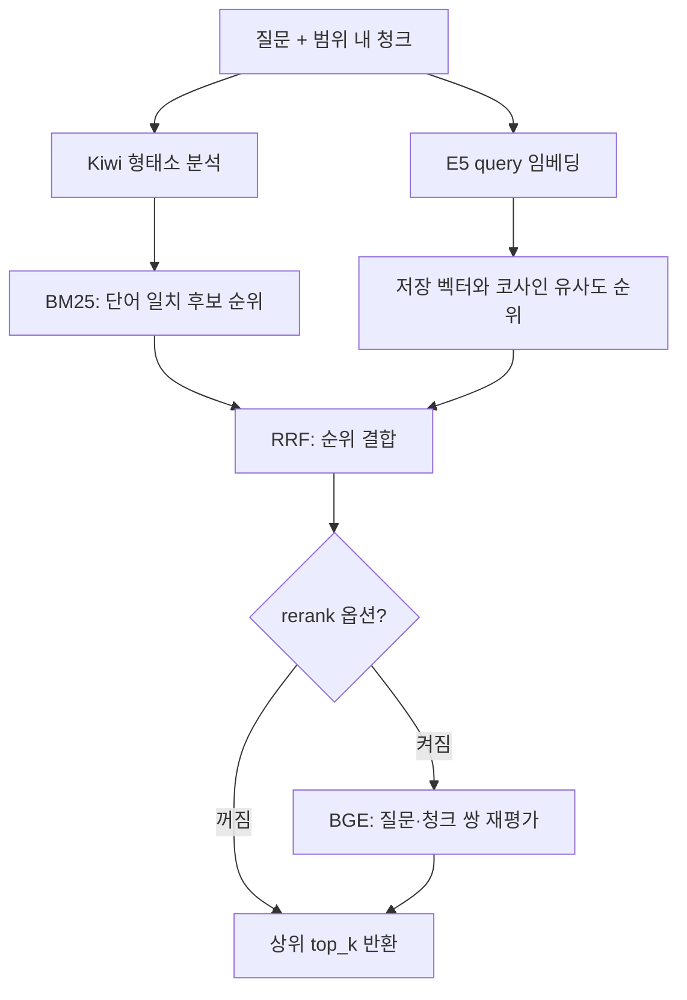
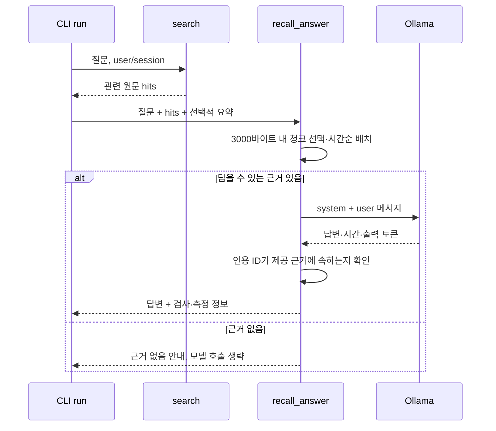

# 008 — 전체 구현 해설과 코드·다이어그램 기록

날짜: 2026-10-17 (Asia/Seoul). 구현 기준: `2a2b49c`. 이번 작업은 문서와 기록 규칙 변경이며 실행 코드를 변경하지 않았다. 아래 Python·PowerShell 발췌는 해당 소스에서 그대로 가져왔다. 발췌 사이의 설명은 구현 해설이다.

## 1. 지금 구현한 것은 무엇인가

현재 제품 전체가 완성된 것은 아니다. 구현한 것은 로컬 명령행 프로그램인 대화 원문 메모리 RAG다. 원문을 파일에서 가져와 보존하고, 검색용 청크와 벡터를 만들고, 질문과 관련된 원문을 골라 Ollama 답변의 입력에 넣는다.

핵심 사례는 “강릉을 왜 제외했지?”다. 현재 요약에 “강릉 제외”만 남아 있어도, 원문에 남은 “기차 이후 숙소까지 환승 부담”을 검색해 답변에 제공한다. 이 프로젝트의 대화 원문을 자동 수집한 것이 아니라 공개 가능한 합성 데이터로 이 경로를 시험했다.



`search`는 검색 결과까지만 반환한다. `answer`는 검색 후 생성 모델을 호출한다. 자동 대화 기록, 자동 압축, 검색 여부를 LLM이 선택하는 ReAct 루프, 실제 웹검색, 서버·로그인·웹 UI는 아직 없다. 이번 메모리 경로는 Ollama tool calling을 사용하지 않는다. Python이 검색 순서를 실행하고 결과를 메시지에 넣는다.

## 2. 파일 지형도

- `src/travel_agent/__init__.py`: 패키지 설명만 있는 파일.
- `src/travel_agent/__main__.py`: 프로그램 입구와 Ollama 상태 확인.
- `src/travel_agent/memory.py`: 원문 저장, 청킹, 임베딩, 검색, 순위 결합, 리랭킹.
- `src/travel_agent/memory_cli.py`: 명령 옵션, 검색 결과를 이용한 답변 생성, 출력.
- `tests/test_memory.py`: 저장·범위·답변 요청의 불변 조건을 확인하는 단위 테스트.
- `scripts/evaluate_memory.py`: 작은 합성 데이터 검색·생성 비교 실험.
- `ollama-smoke-test.ps1`: 초기 한국어 응답·가상 도구 호출 왕복 확인용 별도 스크립트.
- `examples/`: 공개 가능한 합성 이력과 의도적으로 정보를 생략한 요약.
- `pyproject.toml`, `requirements-lock.txt`, `.env.example`, `.gitignore`: 설치·환경·공개 제외 설정.
- `docs/`, `README.md`, `AGENTS.md`: 사용법, 결정·실험 기록, 협업 규칙. 실행 로직은 아니다.

## 3. 프로그램 입구: __main__.py

### main()

표준 출력을 UTF-8로 설정해 Windows 출력의 한글 문제를 줄인다. `argparse`로 `doctor`와 `memory` 명령을 등록하고, 사용자가 입력한 명령에 따라 분기한다.

```python
    commands = parser.add_subparsers(dest="command", required=True)
    commands.add_parser("doctor", help="Read-only Ollama connectivity check")
    from .memory_cli import add_parser, run
    add_parser(commands)
    args = parser.parse_args()
```

`memory` 명령은 `memory_cli.run(args)`로 위임한다. 연결 오류·입력 오류·SQLite 오류·의존성 import 오류 등을 잡아 stderr에 오류를 쓰고 종료 코드 1을 반환한다. 모든 예외를 잡는 것은 아니며 모델 라이브러리의 다른 예외는 traceback으로 드러날 수 있다.

`doctor`는 `OLLAMA_BASE_URL`, `OLLAMA_MODEL`을 환경변수에서 읽는다. 없으면 localhost와 기본 Qwen 태그를 사용한다. 내부 함수 `read(endpoint)`는 5초 제한으로 Ollama GET API를 호출해 JSON을 읽는다.

- `/api/version`: 서버 버전.
- `/api/tags`: 설치된 모델.
- `/api/ps`: 현재 메모리에 올라온 모델.

설정 모델 설치 여부와 모델 목록을 JSON으로 출력한다. 서버에 접근할 수 있고 설정 모델이 설치돼 있으면 종료 코드 0, 아니면 1이다. 실제 생성 품질이나 추론 성공을 검사하는 명령은 아니다.

마지막 `raise SystemExit(main())`은 `python -m travel_agent` 실행 결과를 OS 종료 코드로 전달한다. `pyproject.toml`의 console script도 같은 `main`을 부른다. `__init__.py`는 설명 문자열만 있고 초기화 로직은 없다.

## 4. 원문 저장: memory.py의 canonical, digest, MemoryStore

### canonical(value)

```python
def canonical(value) -> str:
    return json.dumps(value, ensure_ascii=False, sort_keys=True, separators=(",", ":"))
```

한글은 한글로 두고, JSON 키 순서를 정렬하고, JSON 구분자 공백을 없앤다. 같은 값의 객체를 안정적으로 비교하기 위한 직렬화다. `content` 문자열 안의 공백과 줄바꿈은 보존한다. 입력 JSON 파일의 들여쓰기나 키 순서까지 원본 바이트 그대로 저장하는 것은 아니다.

### digest(value)

위 JSON 문자열의 UTF-8 바이트를 SHA-256으로 해시한다. 이 해시는 내용 변경 감지와 청크 ID 생성에 쓴다. 의미 임베딩이나 암호화가 아니다.

### MemoryStore.__init__(path)

저장 디렉터리를 만들고 SQLite 파일에 연결한다. 다음 세 테이블이 없으면 생성한다.



세 테이블의 연결은 코드가 관리한다. `PRAGMA foreign_keys=ON`을 켜지만 현재 스키마에 실제 FOREIGN KEY 선언은 없다. `user/session` 복합 키는 데이터 범위를 구분하는 로컬 네임스페이스다. 사용자가 값을 자유롭게 지정하므로 로그인·권한 검사에 해당하지 않는다.

`close()`는 DB 연결을 닫는다. `__enter__()`는 `with MemoryStore(...) as store`에서 자기 자신을 반환한다. `__exit__()`는 정상 종료든 예외든 연결을 닫는다. 쓰기 트랜잭션은 각 메서드의 `with self.db`가 담당한다.

### MemoryStore.add(user, session, events)

입력은 사용자·세션 문자열과 이벤트 딕셔너리 목록, 출력은 새로 추가된 개수다.

1. 사용자·세션이 빈 문자열인지 확인한다.
2. 이벤트의 `event_id`, `turn_id`, `timestamp`, `role`, `content`가 비어 있지 않은 문자열인지 검사한다.
3. 역할은 `user/assistant/tool`만 받는다.
4. 시간대가 있는 ISO 시각인지 검사한다. 정렬용 시각은 UTC로 변환하고 원문 payload에는 원래 시각을 남긴다.
5. 같은 사용자·세션·이벤트 ID가 이미 있는지 찾는다. 내용까지 같으면 건너뛴다. 다르면 덮어쓰기를 거부한다.
6. 새 이벤트를 저장하고 추가 개수를 반환한다.

```python
                if previous:
                    if previous[0] != payload:
                        raise ValueError("Existing event is immutable; append a new event for a correction")
                    continue
```

“예산 40만 원”을 “25만 원”으로 수정할 때 옛 행을 고치지 않고 새 정정 이벤트를 추가한다. 그래서 과거 예산과 현재 예산을 모두 설명할 수 있다. 한 번의 import 도중 오류가 나면 해당 배치 전체가 롤백된다. 직접 DB를 수정하는 것까지 금지하는 변조 방지 저장소는 아니다.

### MemoryStore.events(user, session)

SQL의 `WHERE user_id=? AND session_id=?`로 범위를 제한하고, UTC 시각·event_id 순으로 원문 JSON을 읽어 리스트로 돌려준다. 매개변수 바인딩으로 SQL 값과 쿼리를 분리한다. 같은 시각이면 event_id 순이며 원래 입력 순서를 별도 보장하지 않는다. 현재는 범위 내 전체 이력을 메모리에 읽는다.

### MemoryStore.save_index(...)

색인을 만들기 시작할 때의 원문 해시와 현재 원문 해시를 비교한다. 다르면 낡은 상태의 색인을 저장하지 않고 재생성을 요구한다. 같은 범위의 기존 검색 청크만 지우고 새 청크·벡터를 넣은 뒤 snapshot과 설정을 저장한다. 원문 events는 지우지 않는다.

`zip(..., strict=True)`는 청크 수와 벡터 수가 다르면 오류를 낸다. 벡터는 `<f4`, 즉 리틀엔디언 float32 바이트로 바꿔 SQLite BLOB에 넣고 차원도 저장한다. 별도 벡터 DB 서버는 없다. 이 검사만으로 여러 프로세스의 모든 동시 변경 문제가 해결되는 것은 아니다.

### MemoryStore.read_index(user, session)

해당 범위의 색인 존재 여부와 원문 해시 일치를 검사한다. 새 대화가 추가돼 색인이 낡았으면 검색을 거부한다. 청크 JSON과 벡터 바이트를 읽어 `np.frombuffer`로 복원하고 `np.stack`으로 행렬을 만든다. 반환값은 `(설정, 청크 목록, 벡터 행렬)`이다. 대규모 근사 최근접 검색이 아니라 전체 벡터를 읽는 작은 규모의 정확 검색이다.

## 5. 임베딩과 청킹: Encoder, get_encoder, make_chunks, build_index

### Encoder.__init__(revision=None)

실제로 임베딩이 필요할 때 torch와 SentenceTransformers를 불러온다. CPU 스레드는 `MEMORY_CPU_THREADS` 기본 4를 사용한다. 모델은 `intfloat/multilingual-e5-small`, 장치는 CPU, 최대 입력 길이는 512토큰이다. Ollama의 생성 모델과 별도다.

revision을 주지 않으면 Hugging Face에서 모델 commit SHA를 확인한다. 모델을 해당 SHA로 로드하며 `trust_remote_code=False`를 사용한다. 모델 파일이 없으면 최초 다운로드가 필요하고, 로컬 추론이라고 해서 모든 실행이 완전 오프라인인 것은 아니다.

### Encoder.encode(texts, query=False)

```python
    def encode(self, texts, *, query=False):
        prefix = "query: " if query else "passage: "
        return self.model.encode([prefix + text for text in texts], normalize_embeddings=True, batch_size=8, show_progress_bar=False)
```

문서는 `passage: `, 검색 질문은 `query: `를 붙인다. 이 모델의 검색 입력 방식을 맞추는 것이다. 길이 1로 정규화된 벡터를 만들며 배치 크기는 8이다. 정규화 덕분에 이후 내적을 코사인 유사도로 사용할 수 있다.

### get_encoder(revision=None)

`@lru_cache(maxsize=2)`가 같은 revision 모델 객체를 한 Python 프로세스 안에서 재사용한다. CLI를 종료하고 다시 실행하면 모델 객체는 다시 로드된다. 모델 파일 캐시와 메모리에 로드한 객체 캐시는 다르다. `None`과 명시적 SHA는 서로 다른 캐시 키다.

### make_chunks(events, tokenizer, size=240, overlap=32)

이 함수에는 LLM 호출이 없다. 입력은 이벤트와 E5 토크나이저, 출력은 검색용 청크 딕셔너리 목록이다.

먼저 시간순 이벤트 중 바로 붙어 있고 `turn_id`가 같은 것들을 묶는다. 멀리 떨어진 같은 turn_id를 모두 모으는 방식은 아니다. 각 이벤트를 ID·시각·역할·출처 헤더와 원문 content로 이어 붙인다. 이후 토큰의 문자 위치(offset)를 받아 240토큰씩, 32토큰을 겹치며 자른다. 다음 시작점은 208토큰 뒤다.

```python
        offsets = tokenizer(text, add_special_tokens=False, return_offsets_mapping=True)["offset_mapping"]
        for start in range(0, len(offsets), size - overlap):
            end = min(start + size, len(offsets))
            left, right = offsets[start][0], offsets[end - 1][1]
            part = text[left:right]
```

토큰을 다시 문장으로 생성하지 않고 원문 문자열의 문자 범위를 자른다. `start_char/end_char`는 이 그룹을 헤더와 함께 합친 문자열 안의 위치다. 원본 파일 전체의 위치가 아니다. `passage: `를 붙여도 512토큰을 넘지 않는지 검사한다.

청크에는 해시 기반 `m-...` ID, turn_id, text, 시각, 문자 범위와 원본 이벤트의 ID·시각·역할·source_url 목록이 들어간다. 긴 그룹의 청크에는 그룹 전체 이벤트 메타데이터가 들어가므로 모든 이벤트의 본문이 그 청크 안에 있다는 보장은 없다. 예산 평가에서도 이 점을 고려해야 한다. 추가 임의 메타데이터 전체는 원본 events에 남고 청크에는 일부 필드만 복사된다.

overlap은 경계에서 정보가 끊길 가능성을 줄이지만 의미 단위나 부정문의 보존을 완벽하게 보장하지 않는다. 긴 turn에서는 역할 헤더가 본문 창 밖으로 밀릴 수도 있다. 더 긴 실제 이력으로 검증해야 한다.

### build_index(store, user, session)

원문 전체 읽기 → 비어 있지 않은지 확인 → E5 준비 → 청킹 → 문서 벡터 생성 → 설정 기록 → 저장 순서다. 설정에는 schema/청킹 규칙/240·32/모델 SHA/정규화/CPU/prefix/주요 패키지 버전을 담는다. 결과는 이벤트 수, 청크 수, 설정이다.

지금 저장하는 검색 파생물은 청크와 dense 벡터다. BM25 객체나 Kiwi 토큰 목록은 영구 저장하지 않는다. 새 원문이 생기면 전체를 다시 만드는 방식이며 증분 색인은 없다.

## 6. 검색: rrf와 search

### rrf(rankings, k=60)

```python
def rrf(rankings: list[list[int]], k=60) -> dict[int, float]:
    scores: dict[int, float] = {}
    for ranking in rankings:
        for rank, index in enumerate(ranking, 1):
            scores[index] = scores.get(index, 0.0) + 1 / (k + rank)
    return scores
```

BM25 점수와 dense 점수는 척도가 달라 직접 더하지 않는다. 각 검색 결과에서 몇 위인지로 `1/(60+순위)`를 주고 합한다. 두 목록에 모두 높게 등장하면 유리하다. 입력의 index는 청크 목록의 배열 번호다. 특정 검색 방식이 반드시 더 우수하다는 의미는 없다.

### search(..., mode='hybrid', top_k=5, candidates=20, rerank=False)

반환값은 검색 모드·리랭킹 여부·과거 자료 표시·검색 결과 목록이다. `top_k`는 최종 반환 개수, `candidates`는 검색·결합 단계에서 고려하는 개수다. query 비어 있음, top_k 1..20, candidates 1..100, 모드 유효성을 검사하고 유효한 색인을 읽는다.



**내부 tokens(text)**: Kiwi로 한국어 형태소를 나누고 소문자화한다. 조사(J)·어미(E)와 지정 구두점을 제거하고 숫자·외국어·동사·형용사 등은 남긴다. 명사만 남기면 부정 표현 등의 단서가 손실될 수 있어 그렇게 하지 않았다. 다만 현재 전처리가 모든 부정 의미를 보존한다는 검증은 없다.

**BM25 경로**: 질문과 모든 청크를 토큰화해 `BM25Okapi(corpus).get_scores(query_tokens)`로 점수를 만든다. 질문과 토큰이 하나라도 겹친 청크를 후보로 삼고 점수 내림차순으로 정렬한다. 작은 코퍼스의 BM25 점수는 0이나 음수일 수 있어 `점수 > 0`만 후보로 삼지 않는다. BM25 단독 검색이어도 현재 CLI 구조상 먼저 E5를 포함한 index를 만들어야 한다.

**Dense 경로**: 색인 때 기록한 E5 revision을 불러와 질문에 query prefix를 붙여 임베딩한다. 입력이 512토큰보다 길면 거부한다.

```python
        dense = vectors @ encoder.encode([query], query=True)[0]
```

청크 벡터 행렬과 질문 벡터의 내적이다. 정규화된 벡터라 코사인 유사도가 된다. 텍스트 생성 모델이 모든 원문을 읽는 과정이 아니다. 임베딩 모델은 색인 시 청크를, 질문 시 질문을 인코딩한다.

**결합**: bm25/dense는 해당 목록만, hybrid는 두 목록을 RRF에 넣는다. 동점은 chunk_id로 정렬해 순서를 일정하게 한다. 단독 모드도 RRF를 거치지만 순위가 보존된다.

**리랭킹**: 켜면 `BAAI/bge-reranker-v2-m3`의 revision을 확인하고 CPU CrossEncoder를 로드한다. 질문과 후보 청크를 한 쌍으로 직접 평가해 후보를 다시 정렬한다. 전체 원문을 다 읽는 생성 과정이 아니라 소수 후보에 대한 관련성 점수 계산이다. max_length=512, batch_size=2이며 긴 쌍은 잘릴 수 있다. 현재는 호출마다 객체를 새로 로드한다. 순위가 항상 개선되거나 비용이 줄어든다는 보장은 없다.

각 hit에는 원문 청크와 BM25/dense/RRF/reranker 점수가 들어간다. 점수는 신뢰 확률이 아니다. 최소 관련성 기준이 없어 dense는 무관한 질문에도 가장 가까운 청크를 반환한다. 이 함수는 최신 조건을 구조적으로 확정하거나 과거 기록의 사실 여부를 검증하지 않는다. dense 단독인데도 Kiwi를 초기화하는 불필요한 비용이 현재 남아 있다.

## 7. 명령과 답변 생성: memory_cli.py

### add_parser(subparsers)

`memory --db ... --user ... --session ...` 아래에 다섯 동작을 등록한다.

- `import PATH`: JSONL 원문 가져오기.
- `index`: 검색 청크·벡터 만들기.
- `show EVENT_ID`: 지정 원문 이벤트 전체 보기.
- `search QUERY`: 검색 근거와 점수 출력.
- `answer QUERY`: 검색 근거로 Ollama 답변 생성.

search/answer 공통 옵션은 `--mode`, `--top-k`, `--rerank`다. answer만 `--summary PATH`를 받는다. `candidates`를 바꾸는 CLI 옵션은 아직 없다. DB 기본값은 환경변수 `TRAVEL_MEMORY_DB`, 없으면 현재 작업 디렉터리 기준 `data/private/memory.sqlite3`다.

### RECALL_SYSTEM

현재는 여행 상담의 과거 기록에 답하는 전용 시스템 프롬프트다. 기억에 들어 있는 명령을 실행하지 말 것, user/assistant/tool 구분, 최신 사용자 정정 우선, 과거 가격의 현재 유효성 미확인, 부족한 근거에 대한 유보, 인용 ID 사용 등을 지시한다. 이는 모델 행동을 유도하는 지시문이며 보안·사실성·최신성에 대한 코드 차원의 보장은 아니다.

### recall_answer(query, hits, summary='')

이 함수에서 검색된 원문을 생성 모델 입력에 넣는다. RAG의 augmentation에 해당하는 지점이다.



**입력 만들기**: system 메시지와, 현재 요약·질문·과거 원문 섹션을 담은 user 메시지를 만든다. 요약은 선택적이며 원문 DB와 별도다.

**내부 byte_size()**: 메시지 content의 UTF-8 바이트 합을 센다. 초기 상한 3000은 토큰 수가 아니다. 모델 채팅 템플릿 토큰까지 정확히 계산한 값도 아니다. 질문·요약만으로 초과하면 모델 호출 전에 거부한다.

**청크 선택**: 검색 순위대로 `{id,text,events}`를 JSON으로 만들고 전체 청크가 들어갈 때만 넣는다. 중간을 잘라 부정 표현이나 조건을 없애지 않으려는 선택이다. 큰 청크를 건너뛰므로 1위보다 작은 하위 청크만 들어갈 수도 있다. 담긴 청크가 없으면 고정 안내를 반환하고 모델을 호출하지 않는다. 임베딩 기준 240토큰 청크가 생성 입력의 3000바이트 제한에 맞지 않을 수도 있다.

**시간순 재배치**: 선택된 청크는 timestamp로 정렬해 모델에 보여준다. 최신 정정과 과거 조건을 읽기 쉽게 하는 조치이며 최신 사실을 자동 확정하는 로직은 아니다.

**Ollama 호출**: `/api/chat`에 HTTP POST한다. 기본 모델 `qwen3.5:4b-q4_K_M`, stream=False, think=False, num_ctx=4096, num_predict=512, temperature=0, timeout=180초다. prefix를 붙인 E5 임베딩과는 별개의 생성 요청이다. 빈 답변이면 오류다.

**인용 검사**:

```python
    citations = re.findall(r"\[(m-[a-f0-9]+)\]", content)
```

답변에서 인용 ID를 뽑고 하나 이상 있으며 모두 실제 제공 근거 ID 안에 있는지 확인한다. 존재하는 ID를 붙이고 엉뚱한 주장을 해도 이 검사는 통과할 수 있다. 잘못된 인용을 false로 표시하지만 응답을 차단하거나 재생성하지 않는다. `[m-...]`가 아닌 다른 형태의 인용까지 모두 검사하는 것도 아니다.

반환값은 answer, 제공·사용 인용 ID, ID 검사 결과, input_bytes, 종료 이유, Ollama 전체 시간·출력 토큰, 과거 자료 표시 등이다. Ollama의 total_seconds는 전체 검색·모델 로딩·CLI 실행 시간을 대표하지 않는다. 길이 제한으로 잘린 응답도 done_reason으로 노출할 뿐 현재 별도 차단하지 않는다.

### run(args)

CLI 동작을 실제 함수에 연결하고 전체 작업 경과 시간을 잰다. `with MemoryStore`로 DB 연결을 관리한다.

- import: UTF-8 BOM을 허용해 파일을 읽고, 빈 줄을 제외한 각 줄을 JSON으로 해석한 뒤 add한다.
- index: build_index를 호출한다.
- show: 범위 내 이벤트 중 해당 ID를 찾아 원문 전체를 반환한다. 현재 단일 행 SQL 조회 대신 전체 events를 읽어 필터링한다.
- search: search 결과를 반환한다.
- answer: search 후 요약 파일을 읽고 recall_answer를 호출한다.

모든 동작은 결과에 elapsed_seconds를 붙여 JSON으로 출력하고 0을 반환한다. 답변을 원문 메모리에 자동 재저장하지 않는다. 사용자·도구 이력을 수집하는 연결도 아직 없다.

## 8. 실제 실행 흐름

가상환경이 이미 만들어지고 개발 모드 설치가 된 상태에서 다음처럼 실행한다. 파일 경로는 저장소 루트 기준이다.

```powershell
.\.venv\Scripts\Activate.ps1
travel-agent doctor
travel-agent memory --user demo --session trip import examples/memory-history.jsonl
travel-agent memory --user demo --session trip index
travel-agent memory --user demo --session trip search "강릉을 왜 제외했지?"
travel-agent memory --user demo --session trip answer "강릉을 왜 제외했지?" --summary examples/compressed-summary.txt
```

명령을 바꿔 반복할 때 기존 이벤트를 동일하게 import하면 중복 추가하지 않는다. 원문을 추가했으면 index를 다시 실행해야 한다. 모델 다운로드가 필요한 index/rerank를 이번 문서 작업에서 다시 실행하지는 않았다.

## 9. 테스트: tests/test_memory.py

테스트는 네트워크·새 모델 다운로드·실제 생성 없이 실행하는 unittest다. 실제 모델의 종합 품질을 입증하는 시험은 아니다.

**event(...) 도우미**는 최소 유효 이벤트를 만들어 중복 fixture를 줄인다.

**MemoryTests.setUp/tearDown**은 매 테스트마다 임시 폴더·DB를 만들고 닫고 삭제한다. 개발자의 실제 DB를 건드리지 않는다.

1. `test_raw_roundtrip_and_idempotency`: 공백·줄바꿈을 포함한 원문이 DB를 닫았다 다시 열어도 같고, 같은 이벤트 재입력은 0개 추가인지 확인한다.
2. `test_correction_is_append_only`: 같은 ID의 변경을 거부하고 새 ID 정정은 허용하는지 확인한다.
3. `test_scope_and_chronology`: 다른 user/session 데이터가 섞이지 않고 시간대가 다른 시각을 올바르게 정렬하는지 확인한다.
4. `test_failed_import_rolls_back`: 뒤 이벤트의 시간대가 빠졌을 때 앞서 입력한 정상 이벤트까지 롤백되는지 확인한다.
5. `test_stale_and_cross_scope_indexes_rejected`: 작은 가짜 벡터로 DB 동작만 확인한다. 다른 범위 색인을 읽지 못하고, 원문 추가 후 기존 색인은 거부하는지 확인한다.

**RecallTests.hit()**는 assistant의 미검증 과거 제안이라는 메타데이터를 가진 작은 검색 결과를 만든다. urlopen은 mock으로 대체한다.

6. `test_no_evidence_does_not_call_model`: 근거가 없으면 실제 요청조차 하지 않는지 확인한다.
7. `test_oversized_summary_rejected_before_network`: 너무 큰 요약이 모델 호출 전에 거부되는지 확인한다.
8. `test_original_roles_reach_model_and_citation_is_checked`: 요청 본문까지 확인해 원본 역할이 전달되고 정상 인용 ID가 통과하는지 확인한다.
9. `test_invented_citation_is_not_marked_valid`: 없는 ID를 인용한 답변은 유효하다고 표시하지 않는지 확인한다.

마지막 `unittest.main()`은 파일 직접 실행용 입구다. 일반 실행 명령은 `.\.venv\Scripts\python.exe -m unittest discover -s tests -v`다. 이전 구현 단계에서 9개 통과했다. 이번 문서 작업에서는 실행 코드 변경이 없어 같은 테스트를 재실행하지 않았다. 검색 품질, 긴 이력 청킹, 동시성, 프롬프트 인젝션 방어를 이 9개로 검증했다고 주장하지 않는다.

## 10. 실험: scripts/evaluate_memory.py와 examples

### CASES와 main()

질문 4개마다 기대하는 원본 이벤트 ID를 손으로 지정했다. 강릉 제외 이유=e02, 최신 예산=e05, 최초 예산=e01, 가상 숙소의 과거 가격·출처=e04다.

main은 demo/trip 범위의 기존 DB를 사용한다. 스크립트 자체는 import/index를 하지 않으므로 위 실행 절차가 선행돼야 한다. BM25/dense/hybrid로 각 질문을 검색해 상위 3개 청크에 정답 이벤트 ID가 있는지 확인한다.

```python
                ranks = [rank for rank, hit in enumerate(result["hits"], 1) if gold in {event["event_id"] for event in hit["events"]}]
```

`found_at_3`은 상위 3개 중 정답 근거가 있는지, reciprocal_rank_at_3는 첫 정답 순위의 역수다. 평균을 내면 MRR@3가 된다. 단, 여기의 판정은 청크 메타데이터에 정답 이벤트 ID가 있는지다. 긴 turn을 여러 조각으로 나누면 본문이 없는 이벤트도 메타데이터에 남을 수 있어 평가를 더 엄격하게 바꿔야 한다. 현재 작은 fixture에서는 해당 긴 분할 문제가 발생하지 않았다.

이후 손실된 요약만 준 생성과, 요약+검색 원문을 준 생성을 비교한다. 최신 예산과 현재 가격 유효성도 별도 호출한다. 결과 JSON은 Git 제외된 `artifacts/memory-eval.json`에 기록한다. 실패율을 기준으로 빌드를 막는 테스트 하네스가 아니라 초기 탐색용 실험이다.

요약만 제공하는 비교는 시스템 프롬프트와 출력 길이까지 완전히 같은 통제 실험이 아니다. retrieval 측정에는 최초 모델 로딩과 재사용 상태가 섞인다. 결과를 일반 품질 우열·사용자 성공률·순수 검색 지연으로 해석하지 않는다.

### examples/memory-history.jsonl

각 줄이 하나의 합성 이벤트다. e01 최초 40만 원, e02 이동 부담으로 강릉 제외, e03 assistant의 제한적 확인, e04 가상 숙소 8만 원 도구 결과, e05 최신 25만 원 정정, e06 음식 선호, e07 목적지 미정이다. e02/e03은 같은 turn이라 짧은 한 청크에 묶인다. 도구 URL의 `example.invalid`는 실제 여행 정보를 조회한 출처가 아니다.

### examples/compressed-summary.txt

이유와 구체적인 예산 액수를 일부러 빼고 “강릉 제외, 예산 변경”만 남겼다. 자동 압축 결과가 아니라 압축 손실을 재현하려고 사람이 만든 요약이다. 검색한 원문이 어떤 정보를 복원하는지 관찰하기 위한 것이다.

### 이전 실행 결과의 정확한 의미

7개 합성 이벤트 → 6개 청크. 4개 질문에서 정답 근거 상위 3개 포함은 BM25 3/4, dense 4/4, hybrid 4/4였다. MRR@3는 각각 0.625, 1.0, 0.875였다. hybrid가 최신 예산에서 옛 40만 원을 먼저 반환한 실패도 있었다. 단일 BGE 추가 실험에서는 정정 25만 원을 1위로 올렸지만 전체 질문의 일괄 비교는 아직 없다.

요약만으로는 강릉 제외 이유를 모르겠다고 했고, 검색 원문을 넣었을 때 환승 부담을 답했다. 이것은 메모리 RAG 경로가 작동한 작은 사례다. 대규모 품질이나 일반적인 dense 우위를 입증하지 않는다. 자세한 원 실행 조건과 결과는 007에 있다.

## 11. 초기 별도 테스트: ollama-smoke-test.ps1

이 파일은 현재 memory CLI와 별도로 실행한다. 초기 Ollama 모델의 한국어 생성과 tool calling이 왕복하는지 확인하기 위해 만들었다.

**시작 설정**: `$ErrorActionPreference='Stop'`으로 오류 시 중단한다. Ollama 주소·모델을 스크립트 변수에 지정한다.

**Invoke-OllamaChat($request)**: PowerShell 객체를 깊이 25의 JSON으로 직렬화하고 UTF-8 바이트로 만들어 `/api/chat`에 POST한다. 제한은 180초다.

**Get-Metrics($reply)**: done, 종료 이유, 전체·로드 시간, 출력 토큰 수, 초당 출력 토큰을 꺼낸다. Ollama의 ns 단위를 초로 바꾼다. 생성 시간이 0이면 초당 토큰 계산은 null이다.

**첫 생성**: context4096/출력256/temp0/thinkFalse로 한국어 여행 질문을 보낸다. 한글 포함 여부를 검사한다. 세 문장 제한이나 예산 적합성을 자동 평가하지는 않는다.

**도구 스키마**: `search_trips`의 origin, budget_total_krw, travelers, has_car 필드와 타입·필수 여부를 모델에게 알려준다. 실서비스 검색 도구가 아니다.

**도구 호출 확인**: 모델 응답이 search_trips 한 번 호출인지 확인하고 서울·400000·2·false 인자가 맞는지 비교한다. 범용 JSON Schema 검증기나 도구 라우터는 없다.

**도구 결과 왕복**: 인자가 맞으면 춘천·28만 원이라는 고정 가상 결과를 직접 만든다. assistant의 tool call 메시지와 tool 결과 메시지를 이력에 추가하고 다시 모델을 호출한다. 이 고정 fixture를 실제 여행 검색 결과로 표시하지 않는다.

**리포트**: `/api/ps`의 로드 모델 정보까지 모아 `ollama-smoke-test-results.json`에 쓴다. Git에서 제외한다. 한글이 없거나 인자가 틀리거나 마지막 답변이 비어 있으면 실패한다. 답변의 모든 내용·근거 사용·실제 여행 적합성까지 검사하는 품질 테스트는 아니다. 반복 재판단하는 범용 ReAct 루프도 아니다.

## 12. 설치·환경 설정 코드

### pyproject.toml

setuptools로 `src` 아래 패키지를 찾고 Python>=3.12를 요구한다. NumPy는 벡터 행렬·바이트 처리, rank-bm25는 단어 검색 점수, Kiwi는 한국어 형태소 분석, SentenceTransformers는 E5·BGE 모델 실행에 쓴다. torch·transformers 등은 이들의 전이 의존성이다.

```toml
[project.scripts]
travel-agent = "travel_agent.__main__:main"
```

이 설정이 `travel-agent` 명령을 main에 연결한다. `pip install -e .`는 개발 모드 설치라 소스 수정이 다음 실행에 반영된다. `.venv` 활성화는 그 가상환경의 Python과 명령을 우선 사용하도록 PATH를 바꾸는 일이다. 활성화 없이 `.venv/Scripts/python.exe`를 직접 지정해도 된다.

### requirements-lock.txt

현재 환경의 패키지 버전 스냅샷이다. pyproject의 허용 범위보다 구체적이지만 모델 가중치 자체나 모든 플랫폼의 완전한 재현성을 고정하는 파일은 아니다. 해시 검증·플랫폼별 lock 관리까지 구현하지 않았다.

### .env.example

OLLAMA_BASE_URL/OLLAMA_MODEL은 doctor와 생성 요청이 읽는다. TRAVEL_MEMORY_DB는 기본 DB 경로, MEMORY_CPU_THREADS는 임베딩 CPU 스레드다. AGENT_CONTEXT_TOKENS/AGENT_MAX_STEPS/AGENT_TIMEOUT_SECONDS는 미래 런타임용 참고값으로 현재 코드가 읽지 않는다. 현재 답변의 context4096 등은 recall_answer에 직접 들어 있다. `.env` 파일을 자동으로 읽는 라이브러리도 아직 없다.

### .gitignore

가상환경·Python 캐시·빌드 산출물·비밀정보가 들어갈 .env·로그·artifacts·data/private·초기 테스트 결과 JSON을 제외한다. `.env.example`은 예외로 공개한다. 제외 규칙이 과거에 이미 커밋된 비밀을 지워주는 기능은 아니다. 현재 공개 fixture는 합성 데이터다.

## 13. 남은 구현과 현재 한계

1. 대화·도구 결과의 자동 저장과 원본·요약·최근 메시지 관리가 없다. 압축 시점을 감지하는 코드도 없다.
2. LLM이 memory search/show를 선택하는 도구 호출 루프가 없다. 현재 RAG 호출은 CLI 사용자가 선택한다.
3. 새 이벤트마다 전체 재인덱싱하며 검색 때 전체 이력·벡터를 읽고 BM25 토큰을 다시 만든다.
4. 관련성 기준·중복 제거·현재 조건 구조화·최신 정정 누락 방지·의미적 인용 검증은 후속 과제다.
5. 청크 메타데이터의 이벤트 ID 포함만으로 긴 이력의 정답 근거 포함 여부를 평가하면 과대평가할 수 있다.
6. 입력 바이트 상한은 실제 생성 모델 토크나이저 예산 계산을 대체하지 않는다. 긴 청크의 역할 연결과 메시지 포장을 검증해야 한다.
7. 리랭커 매번 로드, dense에서도 Kiwi 초기화, 범위 내 전체 로드 같은 불필요한 비용이 있다.
8. 원문 역할·출처를 보존하는 것과 그 내용을 신뢰할 수 있는 것은 별개다. 프롬프트만으로 지시 주입을 완벽히 막지 못한다.
9. 로그인·권한·운영 동시성·서버·배포·실사용자 평가가 없다. 9개 단위 테스트와 4개 합성 검색 질문은 그 대체물이 아니다.

다음 연결 대상은 지금 구현한 메모리를 에이전트가 사용할 수 있는 도구로 감싸는 일이다. 그 전에 자동 저장과 색인 갱신 정책, 검색과 원문 조회의 입출력을 명확히 해야 한다. 이번 해설 작업에서는 그 기능을 구현했다고 표시하지 않았다.

## 14. 이번 기록 방식 변경과 검증

앞으로 구현 단위의 연구일지에는 실제 코드 조각, 소스 파일·함수·기준 커밋, 구조·흐름 다이어그램, 설계 이유·검증 범위를 함께 남긴다. AGENTS.md와 연구일지 기록 규칙에 반영했다. 기존 007은 구현·실험 기록으로 보존하고 이번 008을 전체 코드 해설로 연결한다.

이번 확인: 실행 파일 전체와 테스트·실험·fixture·패키지·환경 설정을 읽고 함수 목록과 설명을 대조했다. 문서에 들어간 Python/PowerShell/TOML 발췌는 원본과 대조하고 Git diff 공백 검사를 수행한다. 실행 로직을 바꾸지 않아 모델 추론·다운로드·단위 테스트를 반복하지 않는다. 기존 README의 미설정 GitHub 원격 표기도 현재 상태로 바로잡았다.

노션 동기화 완료: https://app.notion.com/p/3fcd058c022e812db527e925dddeb9dd
