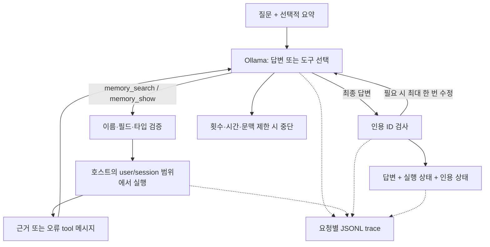
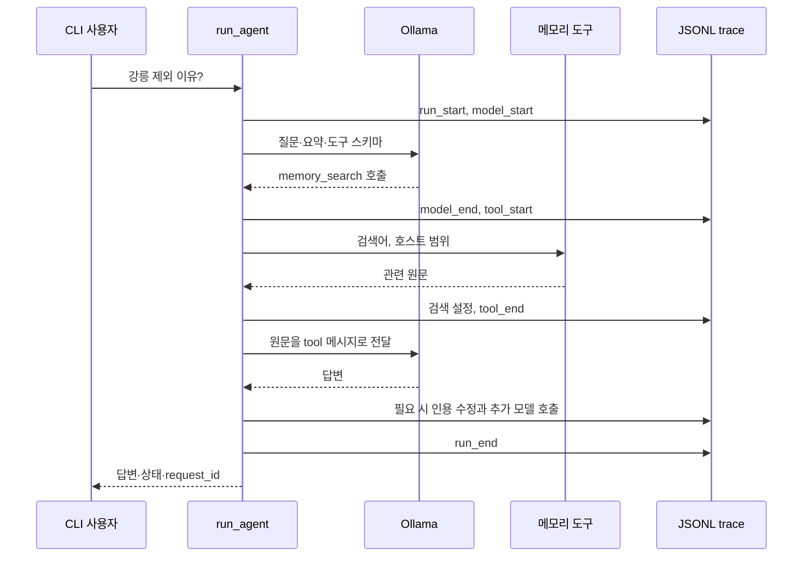

# 009 — Agentic RAG와 요청별 실행 추적

## 답은 맞았는데, 어디서 찾은 답인지 알 수 없었다

### 문제 정의

먼저 테스트 상황을 정리했다. 두 사람의 여행 예산은 처음40만 원이었고, 다음 날25만 원으로 변경됐다. 에이전트가 받은 요약에는 예산이 바뀌었다는 사실만 있고 금액은 없었다. 따라서 정확히 답하려면 과거 대화를 검색해야 했다. 아래 대화는 모두 실험용 합성 데이터다.

> **🗨️ 이전 대화 — 예산을 바꾼 발언**
>
> 예산 변경할게. 이번 여행의 최신 총예산은 둘이 합쳐 25만 원이야. 차가 없다는 조건은 그대로야.

> **💬 테스트 질문**
>
> 현재 우리가 정한 총예산은 얼마야?

**🤖 처음 구현에서 받은 답변**

```text
현재 총예산은 25만 원입니다.
```


### 문제 분석

검색과 금액 복원은 성공했다. 문제는 답변에서 원문 근거를 확인할 수 없었다는 점이다. 도구를 잘 선택하는 것과 최종 답변 형식을 지키는 것은 따로 검증해야 했다.

### 연구 과정

처음에는 시스템 프롬프트의 인용 지시를 강화해 봤다. 그런데 다른 질문에서 없는 근거 ID를 붙이는 회귀가 생겼다. 이 질문은 요약에 답이 있어 도구 없이 답할 수 있는 경우였다.

> **💬 테스트 질문**
>
> 이번 여행은 몇 명이고 어떤 이동수단을 쓰기로 했지?

**🤖 인용 지시만 강화했을 때 나온 답변**

```text
여행을 준비하는 사람은 2명이며, 이동 수단은 대중교통입니다.

근거: [m-1]
```

검색도 하지 않았고 제공한 ID도 없는데 m-1을 붙였다. 지시를 강하게 쓰는 것만으로는 충분하지 않았다. 가격 질문에서 검색을 생략한 사례도 있어 이 변경은 채택하지 않았다.

### 문제 해결

인용 지시만 강화한 변경은 되돌리고, 실행기가 제공된 근거 ID와 답변의 인용을 비교하도록 했다. 누락되거나 잘못된 인용이 있으면 실제 ID 목록을 주고 한 번만 수정을 요청한다. 임의로 출처를 붙이는 방식은 쓰지 않았다.

### 결과와 남은 문제

같은 질문을 현재 구현에 다시 보내 확인했다.

> **💬 테스트 질문**
>
> 현재 우리가 정한 총예산은 얼마야?

**🤖 수정 경로를 적용한 뒤의 답변**

```text
현재 총예산은 25만 원입니다. [m-bbc7d792c2d3567fbc82]
```

금액은 그대로25만 원이고, 이번에는 실제 제공한 정정 기록의 ID가 붙었다.

| 비교할 점 | 초기 구현 | 수정 후 |
|---|---|---|
| 답한 금액 | 25만 원 | 25만 원 |
| 제공 근거 ID 인용 | 없음 | 있음 |
| 모델 호출 | 2회 | 3회 |
| 메모리 도구 호출 | 1회 | 1회 |

근거를 확인하기 쉬워졌지만 모델 호출이 늘었다. ID가 맞다는 것이 답변 내용까지 검증됐다는 뜻은 아니다. 필요한 사실을 못 찾아 모른다고 답한 경우에도 불필요한 수정 요청이 발생한 점은 남은 과제다.

### 다른 질문에는 어떻게 답했나

같은 합성 여행 대화로 확인한 다른 사례들이다. 질문과 실제 응답을 함께 남겼다.

#### 인사에는 검색하지 않기

> **💬 테스트 질문**
>
> 안녕!

**🤖 실제 답변**

```text
안녕하세요! 여행 계획에 도움이 되기를 바랍니다.

현재 두 분의 최종 목적지가 아직 정해지지 않았고, 강릉은 제외된 상태입니다. 대중교통을 고려하고 예산도 변경되었으니, 구체적인 이동 경로나 일정 수립이 필요하시면 언제든 말씀해 주세요.
```

검색 없이 답했다. 다만 인사에 필요 없는 여행 맥락을 덧붙였다.

#### 요약에 이미 답이 있는 질문

> **💬 테스트 질문**
>
> 이번 여행은 몇 명이고 어떤 이동수단을 쓰기로 했지?

**🤖 실제 답변**

```text
여행을 준비하는 사람은 2명입니다. 이동 수단은 대중교통으로 정했습니다.
```

요약에2명·대중교통이 있어 검색하지 않았다.

#### 과거에 결정한 이유 찾기

> **💬 테스트 질문**
>
> 강릉을 후보에서 제외한 이유가 뭐였지?

**🤖 실제 답변**

```text
[m-afccc527afe2b91ebcaa] 강릉을 후보에서 제외한 이유는 기차로 이동한 후 숙소까지 환승하는 시간이 길어 여행 시간보다 이동에 시간을 많이 써야 한다는 부담 때문이었습니다.
```

제외 이유를 검색하고 환승 부담을 답했다.

#### 최신 금액이 아닌 최초 금액 묻기

> **💬 테스트 질문**
>
> 처음 정한 여행 예산은 얼마였어?

**🤖 실제 답변**

```text
처음 정한 여행 예산은 40만 원이었습니다. [m-20a93251a9ccc6145f31]
```

최신25만 원과 구분해 최초40만 원을 답했다.

#### 기록에 없는 정보를 묻기

> **💬 테스트 질문**
>
> 내가 지난번에 말한 여권번호가 뭐였지?

**🤖 실제 답변**

```text
과거 대화 기록을 확인한 결과, 여권번호에 대한 언급이 없습니다. 모릅니다.
```

번호를 지어내지는 않았다. 다만 일부 검색 결과만으로 전체 기록에 언급이 없다고 단정한 표현은 과했다.

#### 과거 가격이 지금도 유효한지 묻기

> **💬 테스트 질문**
>
> 지난번 숙소 A는 지금도 8만 원에 예약할 수 있어?

**🤖 실제 답변**

```text
과거 기록에 따르면 숙소 A의 당시 표시 가격은 1박 8만 원이었으나, 실제 검색이 아니며 현재 예약 가능 여부와 가격은 확인하지 않았습니다. [m-41f1436aedd9826af2cb]

따라서 지금도 8만 원에 예약할 수 있는지 알 수 없습니다.
```

당시 가상 가격과 현재 미확인을 구분했다.

#### 이벤트 원문을 직접 확인하기

> **💬 테스트 질문**
>
> 과거 이벤트 e02의 원문을 확인해서 강릉 제외 이유를 알려줘.

**🤖 실제 답변**

```text
강릉을 제외했던 이유는 기차로 이동한 후 숙소까지 환승하는 시간이 길어 여행 시간보다 이동에 시간을 많이 할애한다는 부담감이 있었기 때문입니다. [event:e02]
```

memory_show를 선택해 원문을 읽었다.

#### 검색할 색인이 없는 세션

> **💬 테스트 질문**
>
> 지난번에 정한 여행 예산이 얼마였지?

**🤖 실제 답변**

```text
죄송합니다. 과거 대화 기록을 검색할 수 없습니다. 여행 예산에 대한 정보는 현재 제공된 요약이나 기억에 포함되어 있지 않습니다.
```

이 사례만 검색 색인이 없는 세션에서 실행했다. 오류를 받은 뒤 예산을 지어내지 않았다.

## 구현과 실험 상세

날짜: 2026-10-17 (Asia/Seoul). 기준: 기존 구현 `2a2b49c`, 코드 해설 `1d998b6` 위에 추가한 이번 작업. 실제 구현 커밋은 문서와 함께 생성한다. 상태: 구현·단위 테스트·로컬 모델 합성 실험 완료.

## 질문과 결정

사용자는 RAG가 반드시 도구여야 하는지 의문을 제기했고, 2-Step RAG와 Agentic RAG를 구분한 뒤 후자도 도입·검증하도록 요청했다. RAG는 검색 자료를 생성의 근거로 사용하는 구성이다. 검색을 프로그램이 먼저 실행하거나 LLM이 도구로 선택할 수 있다. 모든 기능을 tool calling으로 만들어야 한다는 원칙은 없다.

기존 `memory answer`는 2-Step으로 유지한다. 새 `memory agent`에서만 모델이 검색 여부·검색어·원문 조회를 선택한다. 첫 단계에서 원문을 자동 검색해 넣거나 특정 키워드로 도구를 강제하지 않는다. 입력은 질문과 선택적 현재 요약이다.

배경 근거: [LangChain의 RAG 구조 구분](https://docs.langchain.com/oss/python/deepagents/retrieval), [Ollama tool calling 공식 문서](https://docs.ollama.com/capabilities/tool-calling), [Ollama chat API](https://docs.ollama.com/api/chat). 라이브러리 API는 이번 작업 시점의 공식 문서를 확인했다. 프레임워크를 새로 설치하지 않고 기존 표준 라이브러리 HTTP 요청을 사용했다.

## 구현 구조



추가 소스는 `src/travel_agent/agent.py`, `trace.py`다. 명령 등록을 위해 `memory_cli.py`, `__main__.py`를 수정했다. 실행법·옵션·한계는 `docs/agentic-rag.md`에 정리했다.

## agent.py — 실제 코드와 함수별 역할

### TOOLS와 SYSTEM

허용 도구는 memory_search(query, top_k), memory_show(event_id) 두 개다. 시스템 프롬프트는 인사·현재 문맥으로 답할 수 있으면 바로 답하고, 과거 정보가 필요하면 검색하도록 지시한다. 역할·시점·최신 정정·과거 가격과 현재 가격을 구분하도록 한다. 프롬프트 준수 자체를 보장했다고 표시하지 않는다.

### chat()

```python
    body = {"model": model, "messages": messages, "tools": TOOLS, "stream": False, "think": False,
            "options": {"num_ctx": 4096, "num_predict": 512, "temperature": 0}}
```

기존 Ollama `/api/chat`에 메시지와 도구 스키마를 보낸다. `tools`가 있다는 점이 기존 recall_answer의 요청과 다르다. 응답의 tool_calls를 읽고 후속 요청에 assistant 호출과 tool 결과를 함께 넣는다. 전체 모델 코드를 새로 구현하거나 LangGraph를 도입한 것은 아니다.

### validate_call()

도구 이름을 허용 목록과 비교하고, 문자열 JSON 인자라면 해석한다. 알 수 없는 필드와 잘못된 타입을 거부한다. bool도 Python에서 int의 하위 타입이므로 top_k는 `type(top_k) is int`로 검사한다. 검색어 1..500자, top_k 1..5, 이벤트 ID 1..128자를 허용한다. user/session/DB 경로를 모델이 인자로 넘겨 범위를 바꾸는 것은 허용하지 않는다.

### execute_tool()

memory_search는 기존 search를 재사용한다. 반환 청크를 도구 출력에 맞게 포장하되 전체 청크 단위로 3500 UTF-8 바이트 안에 넣고, 빠진 청크 개수도 반환한다. 모델에는 실제로 전달한 근거만 인용 가능 목록에 등록한다.

memory_show는 다음 SQL로 원문 한 건을 읽는다.

```python
        row = store.db.execute("SELECT payload FROM events WHERE user_id=? AND session_id=? AND event_id=?",
                               (user, session, args["event_id"])).fetchone()
```

호스트가 정한 범위에서만 조회한다. 원문 전체와 메타데이터를 반환하며 제한보다 큰 원문은 자르지 않고 오류로 돌려준다. 도구 결과는 현재 가격 조회가 아닌 과거 자료다.

### run_agent()

입력·제한을 검사하고 요청 trace를 만든 뒤 모델 호출을 반복한다. 기본 모델 호출 한도6, 도구 시도8, 시간 예산120초다. 동일한 이름·정규화된 인자의 반복 실행은 막고 오류로 알려준다. 여러 도구를 한 번에 요청하면 순차 실행한다.

실제 도구 결과를 다음 모델 호출에 연결하는 부분이다.

```python
            tool_message = {"role": "tool", "tool_name": name, "content": canonical(result)}
            if call.get("id"):
                tool_message["tool_call_id"] = call["id"]
            messages.append(tool_message)
```

tool call 메시지도 앞서 assistant 메시지로 추가한다. 모델이 도구를 요청하지 않고 내용 있는 답변을 내면 종료한다. 단계·도구·문맥·출력 길이 제한은 별도 status로 반환한다. HTTP·모델 응답 오류와 도구 오류도 기록한다. 인자 오류·색인 오류는 tool 메시지로 돌려줘 모델이 유보하거나 다른 검색을 선택할 수 있다.

메시지와 스키마 합산 10000 UTF-8 바이트 제한을 두지만 정확한 Qwen 토큰 계산은 아니다. 시간 예산은 단계 경계와 HTTP timeout에 적용한다. 동기 CPU 검색·모델 로드를 강제로 취소하는 hard deadline은 아니다.

### 내부 finish()와 인용 수정

finish는 답변, 상태, 모델·도구 호출 수, 토큰 합, 제공·인용 ID, 인용 상태와 trace 위치를 반환하고 run_end를 남긴다. completed는 실행 종료 의미이며 품질 통과가 아니다.

인용 ID는 실제 전달한 근거와 비교한다. 잘못된 ID나 근거가 있는데 인용 표기가 없는 답변에는 최대 한 번 수정을 요청한다. 다음 코드는 별도 무한 재시도가 아니라 기존 모델 호출 한도 안에서 실행된다.

```python
            if (invalid or missing) and citation_repairs == 0 and step < max_steps:
                citation_repairs += 1
```

피드백은 실제 허용 ID 목록을 제공하고 새 사실을 추가하지 말라고 지시한다. 필요한 사실을 찾지 못한 유보 답변에는 ID를 만들지 않도록 한다. 코드가 인용을 임의로 붙이거나 의미적 검증 없이 출처를 확정하지 않는다. 수정 후에도 실패하면 결과에 그대로 표시한다.

## trace.py — 첫 실행 관측 장치

Trace.__init__는 UUID 요청 ID와 전용 JSONL 파일을 만든다. emit은 순서·UTC 시각·경과 시간·이벤트 종류를 붙여 한 줄씩 append한다.

```python
        with self.path.open("a", encoding="utf-8") as output:
            output.write(json.dumps(record, ensure_ascii=False) + "\n")
```

모델 입력·assistant 행동, 도구 인자·결과·오류, 모델별 입력·출력 토큰과 시간, 원문 snapshot·검색 설정, 인용 수정과 최종 상태를 연결한다. message.thinking은 저장하지 않는다. 내부 사고를 추적하는 것이 아니라 실행한 행동을 기록한다.

read_trace는 32자리 요청 ID를 검증해 경로 이탈을 거부하고 파일의 요청 ID도 확인한다. add_parser/run은 `trace show ID`를 등록하고 JSON으로 보여준다.



저장 위치는 `data/private/traces/`이며 공개 Git에 넣지 않는다. 자동 마스킹·로그 회전·보존 기간·분산 tracing·웹 대시보드는 아직 없다. 강제 종료나 기록 I/O 오류 시 완료 레코드가 없을 수 있다. 로컬 관측의 시작이지 프로덕션 관측 체계 완성이 아니다.

## 검증 조건

- Windows / Python3.12 / Ollama0.40.5 / qwen3.5:4b-q4_K_M.
- 기존 E5 CPU와 원문7개·청크6개의 공개 합성 fixture. 새 모델·새 패키지 설치 없음.
- hybrid 검색, rerank=False, context4096, output512, think=False, temperature0.
- questions9개는 개발 중 직접 작성했고 같은 사례로 개선도 수행했다. 독립 검증셋이 아니다.
- 직접 답변2개, 과거 조회5개, 정보 없음1개, 색인 오류1개. 과거 조회5개는 이유·최신 예산·최초 예산·가격 시점·원문 조회다.
- 같은 질의3개에서 기존 2-Step도 실행했지만 프롬프트·근거 패킹·출력 제한이 다르므로 공정한 우열 비교로 사용하지 않는다.

## 첫 실패와 변경 근거

첫 실행은 기대한 검색/비검색 경로가9/9였고, 답변 내용은 이유·25만 원·40만 원을 복원했다. 그러나 과거 근거 질문5개 중 정상 형식의 제공 ID 인용은1개뿐이었다. 나머지는 생략하거나 `[e01]`처럼 다른 표기를 썼다.

인용 지시를 시스템 프롬프트 끝에서 강화한 실험도 했다. 최신 예산은 정상 ID를 붙였지만, 요약만으로 답한 질문에 가짜 `[m-1]`을 붙이고 가격 질문에서 검색을 생략하는 회귀가 나타났다. 단순 프롬프트 강화는 채택하지 않았다. 이 결과를 지우지 않고 `artifacts/agent-eval-prompt-only.json`에 보존했다.

최종적으로 원래 프롬프트로 되돌리고 런타임의 한 번짜리 인용 수정 경로를 채택했다. 초기 결과는 `artifacts/agent-eval-initial.json`, 최종은 `artifacts/agent-eval-final.json`에 보존한다. 모두 합성 실험이지만 향후 개인 입력이 섞일 수 있는 실행 산출물 경로이므로 Git에서 제외한다.

## 최종 실제 모델 실행 결과

| 사례 | 모델 호출 | 도구 시도 | 인용 수정 | 실행 결과 확인 |
|---|---:|---:|---:|---|
| 인사 | 1 | 0 | 0 | 검색하지 않음. 다소 불필요한 여행 맥락 덧붙임 |
| 요약의 인원·교통 | 1 | 0 | 0 | 2명·대중교통, 검색하지 않음 |
| 강릉 제외 이유 | 3 | 1 | 1 | 환승 부담, 해당 청크 ID 인용 |
| 최신 예산 | 3 | 1 | 1 | 정정된25만 원, 정정 청크 ID 인용 |
| 최초 예산 | 3 | 1 | 1 | 초기40만 원, 초기 청크 ID 인용 |
| 없는 여권번호 | 3 | 1 | 1 | 번호를 만들어내지 않고 모른다고 답함 |
| 숙소의 현재 가격 | 2 | 1 | 0 | 당시 가상8만 원과 현재 미확인을 구분 |
| e02 원문 확인 | 3 | 1 | 1 | memory_show 선택, event:e02 인용 |
| 색인 없는 세션 | 2 | 1 | 0 | tool_error 기록 후 확인 불가 답변 |

9개 모두 루프의 최종 답변으로 종료했다. 기대한 도구 사용 여부는9/9, 정답 이벤트가 있는5개는 모두 해당 이벤트 메타데이터를 포함한 근거를 반환했다. 그5개의 최종 답변에는 모두 제공 ID가 포함됐다. 이 ID 포함 검사를 의미적 사실 검증이라고 부르지 않는다. 실행 결과 본문도 읽어 위와 같이 확인했지만 독립 평가자나 대규모 평가를 대체하지 않는다.

이벤트 ID 기반 검색 판정은 긴 turn의 일부 청크에 그룹 전체 이벤트 메타데이터가 붙는 기존 한계를 그대로 가진다. 현재 작은 fixture는 긴 turn 분할 사례가 아니다. 검색 점수 최소 기준이 없어 없는 여권번호 질문에도 무관한 후보가 나왔다. 모델은 유보했지만 원문 전체에 번호가 없음을 검색 결과만으로 증명한 것은 아니다. “전체 기록에 언급이 없다”는 표현은 과한 단정으로 남았다.

유보 답변인 여권번호 사례도 인용 누락으로 한 번 수정을 요청했다. 결과의 citation_status는 missing이지만 필요한 사실을 못 찾았다는 답변에 인용을 붙이지 않은 것 자체는 오류라고 단정할 수 없다. 의미적 인용 필요성을 판별하지 못해 추가 호출이 발생한 비용을 숨기지 않는다.

최종 모델 호출 총21회, 도구 시도7회, 인용 수정5회다. 과거 조회에서 인용 형식은 개선됐지만 단순2-Step보다 모델 호출이 늘었다. 세 비교 질문은 2-Step에서도 이유·최신 예산·가격 미확인을 답했다. 이번 실험으로 Agentic RAG가 더 저렴하거나 더 정확하다고 결론내리지 않는다.

첫 이유 조회18.699초에는 새 프로세스의 검색 모델 초기화가 포함됐다. 이후 최신 예산4.519초, 최초 예산4.836초 등도 로컬 한 번의 관측치다. 기존 2-Step 결과의 total_seconds는 Ollama 호출 시간인 반면 agent.elapsed_seconds는 전체 루프 시간이다. 이 값들을 그대로 나란히 놓고 속도 우열을 계산하지 않는다.

## 자동 테스트와 통합 확인

`tests/test_agent.py`의17개와 기존9개, 총26개 단위 테스트 통과. scripted 모델 응답으로 검색 결과 전달·직접 답변·사용자/세션 분리·잘못된 인자·출력 예산·중복·여러 도구·모델/도구 오류·횟수/시간/문맥/출력 제한·인용 검사·수정 한도·trace 읽기·기존 show 종료 코드 보존을 검증한다. 실제 모델 품질 검증과 구분한다.

실제 trace 명령도 실행해 이유 질문 요청 `2fe85743e1794a6f940e6683f319134d`의 아래 흐름을 확인했다.

```text
run_start
→ model_start / model_end
→ tool_start / retrieval_index / tool_end
→ model_start / model_end
→ citation_repair
→ model_start / model_end
→ run_end
```

문맥 예산 초과의 CLI 종료 코드1도 확인했다. pip check와 Python compileall을 통과했다. 커밋 전 실제 코드 발췌를 소스와 대조하고 staged diff 공백·제외 규칙을 확인한다.

## 남은 과제

- 자동 세션 대화 저장·압축과 색인 갱신을 연결한다. 현재 agent는 요청 간 대화를 자동 저장하지 않는다.
- 정확한 토큰 예산, 긴 원문·역할 재구성, 검색 관련성·정정 누락을 검증한다.
- ID 형식 검사와 의미적 근거 검증을 분리하고 불필요한 인용 수정 호출을 줄인다.
- 생성 모델 프롬프트 변화가 도구 선택에 주는 회귀를 더 다양한 별도 평가셋으로 확인한다.
- 장시간 동기 작업 취소·추적 데이터 마스킹·보존·운영 관측은 후속이다.
- 실제 여행 검색 도구·웹 서비스·소수 실사용자는 아직 구현·검증하지 않았다.

노션 동기화 완료: https://app.notion.com/p/3fcd058c022e81c9b671c1ed757cc8b1
