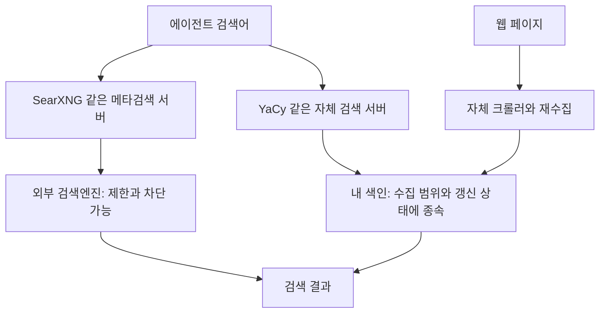

# 014: 검색 비용과 실제 로컬 검색기의 차이

## 질문과 조사 결과

관리형 검색 API를 검토하자 호출 요금과 무료 사용량 제한이 새로운 문제가 됐다. 현재 요구는 외부 API 요금·할당량에 덜 의존하면서 범용 여행 검색을 유지하는 것이다.

<callout icon="💬" color="blue_bg">
	**실제 조사 요청 중 질문**
	보통 데이터들을 직접 저장하고 Vector DB나 알고리즘으로 직접 서빙해주나?
	왜 비싸지? 아니면, 제대로됀 로컬용 검색기없나 확인해봐.....
</callout>

**조사 결과:** 자체 크롤러·색인·검색 API를 제공하는 YaCy가 있다. 하지만 검색 소프트웨어를 설치하는 것과 넓고 최신인 웹 색인을 확보하는 것은 별개다. SearXNG는 자체 운영할 수 있지만 외부 검색엔진을 중계하므로 그쪽의 차단·제한이 남는다. 이번에는 문서와 저장소 상태를 조사했다. 후보를 설치하거나 여행 에이전트로 실행한 결과는 아직 없다.

좋은 답변의 기준은 요금 없는 소프트웨어를 나열하는 데 그치지 않고, 검색할 데이터의 출처·갱신 주체·남는 제한을 밝히는 것이다.

## 비용은 어디서 생기나

[Google의 검색 구조 설명](https://developers.google.com/search/docs/fundamentals/how-search-works)은 수집, 색인, 결과 제공을 구분한다. 새 URL 발견, 페이지 다운로드·렌더링, 중복 처리, 색인 저장, 변경 내용 갱신과 질의에 맞는 결과 선택이 필요하다. 이 구조를 보면 검색 서비스의 운영비가 단순한 질의 처리에만 있지 않음을 알 수 있다. 다만 이것만으로 개별 API의 판매 가격이 적정하다거나 원가가 얼마인지 판단할 수는 없다.

벡터 DB는 필수가 아니다. [Tantivy](https://github.com/quickwit-oss/tantivy)는 역색인과 BM25를 제공하는 전문 검색 라이브러리다. 임베딩·벡터 검색을 추가할 수 있어도 모든 웹검색이 그 구조라는 뜻은 아니다. Tantivy 자체에는 검색할 전체 웹 데이터가 딸려오지 않는다.

[Common Crawl](https://commoncrawl.org/overview)은 웹 수집 데이터와 메타데이터·텍스트를 공개한다. 데이터를 무료로 구할 수 있어도 내려받기, 정제, 저장, 키워드 색인, 랭킹과 갱신은 별도 작업이다. URL 색인을 곧바로 일반 키워드 검색 API로 볼 수도 없다.

자체 운영하면 외부 호출 과금 대신 내 CPU·저장공간·네트워크·관리 시간이 들어간다. 로컬 색인 조회 자체는 외부 검색 API 쿼터와 독립적이지만, 새 자료를 수집하는 원격 사이트의 접근 제한까지 없어지지는 않는다.

## 후보를 실제 역할로 나누기

| 후보 | 검색 데이터는 어디에 있나 | 이번 판단 |
| --- | --- | --- |
| [YaCy](https://github.com/yacy/yacy_search_server) | 자체 크롤러·색인. 독립 모드 또는 선택적인 P2P 공유 | 실제 로컬 검색기 실험 후보. HTTP JSON/XML API 제공. 최신 소스는 Java 17+·Ant 또는 Docker 경로 검토 필요 |
| [SearXNG](https://docs.searxng.org/user/about.html) | 다른 검색엔진의 결과를 취합 | 범용 검색 연결은 상대적으로 직접적이지만 외부 차단·속도 제한을 해결한다고 보장하지 못함 |
| [Marginalia](https://github.com/MarginaliaSearch/MarginaliaSearch) | 자체 크롤러·색인, 텍스트 중심의 작은 웹 지향 | 독립 검색의 사례. 큰 색인은 많은 메모리·SSD·수집 저장공간이 필요하고 한국어 여행 품질은 미검증 |
| [Mwmbl](https://github.com/mwmbl/mwmbl) | 분산 수집과 자체 중앙 색인 | 자체 검색 사례지만 문서가 상용 검색보다 작은 색인임을 명시. 서버 소스나 수집기 설치가 전체 운영 색인 확보를 의미하지 않음 |
| [Tantivy](https://github.com/quickwit-oss/tantivy) | 개발자가 넣은 문서 | 검색 라이브러리. 크롤러·웹 코퍼스·완성된 웹검색 서비스는 따로 필요 |
| [Stract](https://github.com/StractOrg/stract) | 자체 수집·Tantivy 기반 색인 | 구조 참고용. 조사 당시 저장소가 archived 상태여서 유지보수되는 도입 후보로 추천하지 않음 |

YaCy의 P2P 검색은 다른 노드에 의존할 수 있으므로 완전한 로컬 단독 조회와 구분해야 한다. 독립 모드에서는 내 색인에 없는 페이지를 자동으로 알 수 없다. [YaCy 공식 사이트](https://yacy.net/)와 저장소에서 크롤러·검색 서버 구성을 확인했다. 오래된 배포본의 Java 요구사항을 최신 소스 설치 요구사항으로 옮겨 적지 않는다.

SearXNG의 [검색 API](https://docs.searxng.org/dev/search_api.html)는 JSON 출력을 설정으로 활성화해야 하며 공개 인스턴스에서 꺼져 있을 수 있다. 자체 서버 설정을 제어하는 것과 원격 검색엔진의 응답을 제어하는 것은 다르다. OpenSERP도 013에서 검토한 외부 검색 중계 범주이며 독립 웹 색인으로 보지 않는다.

## 구조와 선택 이유



현재 선택은 **자체 운영을 우선 조사하고 YaCy를 독립 색인 실험 후보로 남기는 것**이다. 아직 공급자를 확정하거나 DDGS 런타임을 교체하지 않았다. 범용 여행 에이전트의 목적을 임의로 특정 문서 전용 검색으로 바꾸지도 않는다.

설치 없이 공식 문서·저장소 API만 확인했으므로 한국어 검색 성공률, 응답 시간, 디스크 크기, 비용 절감 수치는 없다. 64GB RAM·8GB VRAM만으로 넓은 웹 색인 운영이 충분하다고 판정할 수도 없다. 여기서는 LLM 추론용 VRAM보다 색인의 범위·RAM·저장공간·수집 시간이 중요한 검토 항목이다.

다음 실험을 한다면 013의 동일한 10개 질문으로 공식 출처 발견 여부와 지연 시간을 비교한다. 자체 색인에서는 먼저 해당 페이지가 수집됐는지와 마지막 갱신 시점을 기록해, 코퍼스 누락과 랭킹 실패를 구분한다. 메타검색은 원격 HTTP 오류·차단도 따로 기록한다. 작은 수집 범위의 성공을 전체 웹 검색 성능으로 확대하지 않는다. 이 실험은 아직 실행하지 않았다.

<details>
<summary>이번에 반영한 정책과 검증 범위</summary>
	기준 상태는 fe8c077이며 이번 변경은 문서·정책이다. 실행 코드 변경은 없다.
	AGENTS.md의 실행 지침에 실제로 추가한 문장:
	```text
	사용자는 검색의 종량 요금뿐 아니라 무료 API의 사용량 할당 제한도 강하게 꺼린다. 현재 검색 공급자 검토는 외부 API 요금·무료 쿼터 의존을 줄이는 자체 운영을 우선한다.
	```
	docs/web-search.md와 docs/roadmap.md에도 현재 선호와 미실행 상태를 반영했다. 기존 기능 테스트로 새 검색기의 품질을 증명하지 않는다. 이번 검증은 문서 diff, 링크 대상과 연구일지 동기화 확인이다.
</details>

<details>
<summary>실제 조사 툴콜 로그: 검색어·조회 대상·응답</summary>
	이번 로그는 개발 중인 에이전트의 호출이 아니라 조사에 사용한 도구 호출이다. 실행 순서는 검색 → 공식 문서와 저장소 열기 → 문서 내 항목 확인이며, 별도 GitHub API 조회는 5개 저장소를 최대 3개씩 병렬 요청했다. 개별 호출 ID와 소요 시간은 이 조사 기록에 저장되지 않아 기재하지 않는다.
	1. web.run search_query에 실제 전달한 검색어:
	```json
	["site:yacy.net decentralized search engine local index crawl", "site:docs.mwmbl.org self host search engine index", "site:github.com Stract search engine self hosted index tantivy", "site:docs.searxng.org metasearch search engines rate limit"]
	```
	반환된 결과와 후속 공식 문서를 함께 읽었다. 검색 결과의 노출 순위를 제품 품질 평가로 사용하지 않았다.
	2. web.run open으로 확인한 주요 대상: https://yacy.net/ , https://github.com/yacy/yacy_search_server , https://github.com/MarginaliaSearch/MarginaliaSearch , https://github.com/mwmbl/mwmbl , https://github.com/StractOrg/stract , https://docs.searxng.org/user/about.html , https://developers.google.com/search/docs/fundamentals/how-search-works , https://commoncrawl.org/overview . 후속으로 원본 README·Stract CONTRIBUTING·Tantivy 저장소를 확인했다. 문서 find로 self/index/English/BM25 항목도 확인했다. 언어 지원을 확인하지 못한 것을 영어 전용이라는 주장으로 바꾸지 않았다.
	3. Python urllib로 api.github.com/repos/{아래 저장소}를 실제 조회한 결과 발췌. 날짜는 API의 UTC 값이며, 마지막 push가 출시일이나 품질을 보장하지 않는다.
	```json
	[
	  {
	    "full_name": "yacy/yacy_search_server",
	    "pushed_at": "2026-09-23T06:34:22Z",
	    "archived": false
	  },
	  {
	    "full_name": "StractOrg/stract",
	    "pushed_at": "2025-03-24T08:42:45Z",
	    "archived": true
	  },
	  {
	    "full_name": "mwmbl/mwmbl",
	    "pushed_at": "2026-10-17T12:44:43Z",
	    "archived": false
	  },
	  {
	    "full_name": "MarginaliaSearch/MarginaliaSearch",
	    "pushed_at": "2026-10-09T12:18:59Z",
	    "archived": false
	  },
	  {
	    "full_name": "searxng/searxng",
	    "pushed_at": "2026-10-17T09:19:07Z",
	    "archived": false
	  }
	]
	```
</details>
