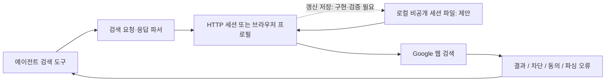

# 015: 구글 웹 검색 요청 재현과 로컬 세션 재사용 후보

## 질문과 조사 결과

사용자는 직접 구현을 시작하기 전에 공개 저장소를 먼저 조사하도록 방향을 정정했다. 원하는 것은 자체 웹 색인 구축보다 구글 웹 검색 요청을 재현하고 로컬에 보관한 쿠키·세션을 재사용하는 프로그램이다.

<callout icon="💬" color="blue_bg">
	**실제 조사 요청 중 질문**
	깃헙에서 웹리버스 방식으로 구현된 구글서치용 프로그램 공개 리포중에 뭐있는지부터 찾아보삼....
	인증정보를 로컬에 저장해놓고 쓰는 방식으로 가고싶음.....
</callout>

**조사 결과:** `PaperBoardOfficial/webserp`가 브라우저 없이 구글 웹 요청을 재현하는 경량 Python 후보다. `karust/openserp`는 구글 검색 결과를 추출하는 서버·CLI로 실제 브라우저와 raw HTTP 경로가 있다. 하지만 둘 모두 확인한 기본 경로가 곧바로 디스크의 로그인 세션을 재사용하는 완제품은 아니다. `nodriver`에는 쿠키 파일 저장·로드와 지속 프로필 기능이 있지만 검색 결과 파서는 별도로 필요하다. 이번 결과는 소스 검토이며 로컬 검색 성공 실험은 아니다.

좋은 후보의 기준은 구글 일반 검색을 실제 대상으로 하는지, 외부 유료 API를 단순 중계하는지, 브라우저가 필요한지, 세션이 요청·프로세스·재시작 중 어디까지 유지되는지 확인하는 것이다. 이름에 reverse나 stealth가 있다고 동작을 보장하지 않는다.

## 후보 비교

| 저장소 | 실제 계층·방식 | 로컬 쿠키·세션 관점 | 판단 |
| --- | --- | --- | --- |
| [PaperBoardOfficial/webserp](https://github.com/PaperBoardOfficial/webserp) | Python·curl_cffi, Google 웹 요청과 HTML 파싱, JSON CLI | 호출 안에서 AsyncSession 사용. Google 엔진은 고정 동의 쿠키를 넣음. 확인한 CLI·호출 경로에 사용자 쿠키 파일의 디스크 저장·로드가 없음 | HTTP 요청 재현의 첫 검토 후보. 작은 프로젝트이며 성공률 미검증 |
| [karust/openserp](https://github.com/karust/openserp) | Go·실제 브라우저 렌더링 또는 raw HTTP·검색 API | LaneStore에서 엔진·세션별 쿠키를 메모리에 보관. 확인한 구성은 디스크 세션 저장과 구분해야 함. 화면 표시 옵션 있음 | 완성된 검색 서버가 필요할 때 비교 후보. 디스크 지속성은 추가 확인·구현 필요 |
| [Nv7-GitHub/googlesearch](https://github.com/Nv7-GitHub/googlesearch) | Python requests·BeautifulSoup으로 /search HTML 파싱 | 고정 CONSENT/SOCS 동의 쿠키. 검색 함수에 사용자 쿠키 파일 인자가 없음 | 단순 비교 기준. 오래된 마지막 push와 HTML 의존성 고려 |
| [shaikhsajid1111/google-serp](https://github.com/shaikhsajid1111/google-serp) | Python·Selenium 브라우저 실행과 파서 분리 | 확인한 브라우저 설정·README에서 디스크 쿠키 재사용 옵션을 확인하지 못함 | 구조 참고. 낮은 채택 신호를 숨기지 않고 도입 우선순위는 낮춤 |
| [ultrafunkamsterdam/nodriver](https://github.com/ultrafunkamsterdam/nodriver) | Python·Chrome CDP 자동화 라이브러리 | CookieJar.save/load와 user_data_dir 지원 | 세션 재사용 기반 부품. 구글 검색 완제품은 아님 |
| [XD06/google-ai-mode](https://github.com/XD06/google-ai-mode) | Google AI Mode 웹 요청 재현, curl_cffi와 Chrome 보조 경로 | cookie_file을 읽고 저장하는 CookieManager 존재 | 원하는 파일 기반 인증 형태의 참고 사례. 일반 검색 결과 목록 도구와는 출력·목표가 다름 |

별점과 마지막 push는 아래 실제 API 조회에 남겼다. 저장소 존재·설명·소스 확인과, 지금 이 PC에서 한국어 검색이 성공한다는 주장은 구분한다. 모든 후보를 설치하지 않았다.

## 소스로 확인한 차이

`webserp`의 Google.build_request는 /search에 asearch=arc와 async 파라미터를 보낸다. 브라우저 화면을 클릭하는 방식과 다르고, curl_cffi는 브라우저 특성에 맞춘 네트워크 요청을 담당한다. JavaScript 렌더러를 실행하는 것과도 다르다. README의 탐지 회피·지연 시간 주장은 이번 환경에서 검증하지 않았다.

기본 언어 헤더와 hl은 영어로 고정되어 있다. 한국어 여행 질의 비교 전에 언어·지역 전달도 확인해야 한다. `search.py`는 호출마다 AsyncSession을 만들고 종료하며, `client.py`는 요청에 쿠키를 전달할 수 있어도 디스크의 세션을 자동으로 보존하지 않는다.

OpenSERP의 `core/proxy_lane.go`는 메모리 map과 mutex로 상태를 관리하고 `SaveCookies`는 상태의 Cookies 필드를 바꾼다. 함수 이름의 Save를 디스크 저장으로 읽으면 안 된다. `config.yaml`에는 head·raw_requests와 메모리 lane 설정이 있다. 디스크 쿠키 파일 가져오기를 지원하는 것으로 단정하지 않는다.

일반 검색 후보의 고정 동의 쿠키는 Google 계정 로그인 인증정보와 다르다. 로그인 세션을 파일에 저장하더라도 만료·서버 측 무효화·추가 확인이 생길 수 있으므로 영구 무인 인증이라고 표현하지 않는다. 쿠키 파일만 있으면 IP·요청 특성에 따른 검색 제한이 사라진다는 근거도 없다. 이번에는 사용자 브라우저의 쿠키나 인증정보를 읽지 않았다.

## 현재 판단과 다음 검증

직접 Playwright 검색기를 만들기 전에 **webserp의 HTTP 경로와 OpenSERP의 검색 서버 경로를 먼저 비교**하는 것이 현재 요구에 맞다. 파일 기반 세션을 재사용하는 구조는 별도 요구사항으로 유지한다. 기존 DDGS를 교체하거나 새 공급자를 확정하지 않았다.

향후 구현한다면 로컬 비공개 쿠키 저장소 → 세션 로드 → 구글 요청 → 결과/차단 분류 → 갱신된 쿠키 저장의 경로를 검증한다. 파일의 이름만 남기고 값·인증 헤더는 공개 로그·노션·Git에 넣지 않는다. 이미 제외된 `data/private/` 아래 같은 위치를 사용할 수 있으나 이번에 파일을 생성한 것은 아니다. 재시작 후 유지, 만료 시 오류, 로그인 불필요 경로와 로그인 경로의 차이도 확인한다. 유료 프록시·캡차 서비스가 켜져 있지 않은 조건으로 평가한다.



이 그림은 향후 구조 제안이다. OpenSERP나 webserp의 현재 구현에 파일 지속성이 이미 있다는 그림이 아니다. 014의 YaCy는 자체 색인 계층, Crawl4AI는 본문 수집 계층이므로 지금 원하는 Google 웹 요청 재현과 비교 목적이 다르다.

<details>
<summary>실제 외부 소스 조각과 기준 커밋</summary>
	아래는 우리 프로젝트에 구현한 코드가 아니라 조사한 저장소에서 가져온 일부다. 링크는 확인한 커밋으로 고정한다.
	[webserp Google.build_request](https://github.com/PaperBoardOfficial/webserp/blob/e13148334995745f104a69ce7127179785ee741e/src/webserp/engines/google.py): 어떤 요청을 재현하는지 보여준다.
	```python
	"asearch": "arc",
	"async": f"arc_id:{arc_id},use_ac:true,_fmt:prog",
	```
	[OpenSERP LaneStore.SaveCookies](https://github.com/karust/openserp/blob/112593b8e17c084f3e9943b8fd9861c6570feca0/core/proxy_lane.go): 이 저장은 메모리 상태 갱신이다.
	```go
	state.Cookies = cloneCookies(cookies)
	```
	[nodriver Browser.create](https://github.com/ultrafunkamsterdam/nodriver/blob/219a60d65d82fb3d137d0c2c5b1fb285a9f837d0/nodriver/core/browser.py)는 user_data_dir와 headless 인자를 받고 CookieJar에는 save/load가 있다. 전체 브라우저 프로필 보존과 쿠키만 파일로 저장하는 선택지는 구분한다.
</details>

<details>
<summary>실제 조사 툴콜: 검색어와 소스 검토</summary>
	개발 중 에이전트의 실행 로그가 아니라 이번 저장소 조사 도구의 호출 기록이다. 호출 ID·개별 시간은 별도로 저장되지 않았다.
	web.run search_query에 실제 전달한 검색어 중 후속 조사 묶음:
	```json
	["site:github.com googlesearch-python cookie consent Google search requests", "site:github.com \"google-search-scraper\" \"cookies\"", "site:github.com \"google\" \"search\" \"curl_cffi\" scraper cookies"]
	```
	반환 후보에서 유료 서비스 중계, Scholar·Flights·Gemini와 일반 Search를 구분했다. web.run open으로 공식 README·Google 엔진·HTTP client·OpenSERP 설정·LaneStore·nodriver Browser 코드를 확인했다. Google AI Mode README의 main 주소는 조회 실패했고 GitHub API에서 기본 브랜치 master를 확인해 다시 읽었다.
	Python urllib로 6개 저장소의 GitHub repos API와 git/trees API를 조회하고, 나온 커밋의 raw 소스를 읽었다. 메타데이터와 소스 수집은 성공했다. 출력 중 한 번 Windows cp949에서 중국어 문자열 인쇄가 실패했고 UTF-8 stdout으로 다시 확인했다. 소스 다운로드 실패로 오해하지 않는다.
	재시작 이후 파일 쿠키 유지나 Google 검색 성공은 실행하지 않았다. 아래 표는 API 조회 응답의 일부다. 마지막 push는 UTC 날짜이며 최신 릴리스나 검색 성능을 의미하지 않는다.
	```json
	[
	  {
	    "full_name": "karust/openserp",
	    "stargazers_count": 1480,
	    "pushed_at": "2026-09-28T22:25:47Z",
	    "archived": false
	  },
	  {
	    "full_name": "PaperBoardOfficial/webserp",
	    "stargazers_count": 16,
	    "pushed_at": "2026-02-21T11:02:28Z",
	    "archived": false
	  },
	  {
	    "full_name": "Nv7-GitHub/googlesearch",
	    "stargazers_count": 784,
	    "pushed_at": "2025-02-03T08:13:41Z",
	    "archived": false
	  },
	  {
	    "full_name": "shaikhsajid1111/google-serp",
	    "stargazers_count": 0,
	    "pushed_at": "2026-06-30T05:48:44Z",
	    "archived": false
	  },
	  {
	    "full_name": "ultrafunkamsterdam/nodriver",
	    "stargazers_count": 4848,
	    "pushed_at": "2026-10-08T15:08:29Z",
	    "archived": false
	  },
	  {
	    "full_name": "XD06/google-ai-mode",
	    "stargazers_count": 1,
	    "pushed_at": "2026-08-11T11:45:35Z",
	    "archived": false
	  }
	]
	```
</details>

환경 확인: 직전 중단된 작업의 Playwright 설치 명령은 실제로 완료되어 가상환경에 1.64.0이 남아 있었다. 이번에는 패키지를 추가로 설치하지 않았고 프로젝트 의존성·런타임 코드는 바꾸지 않았다.
