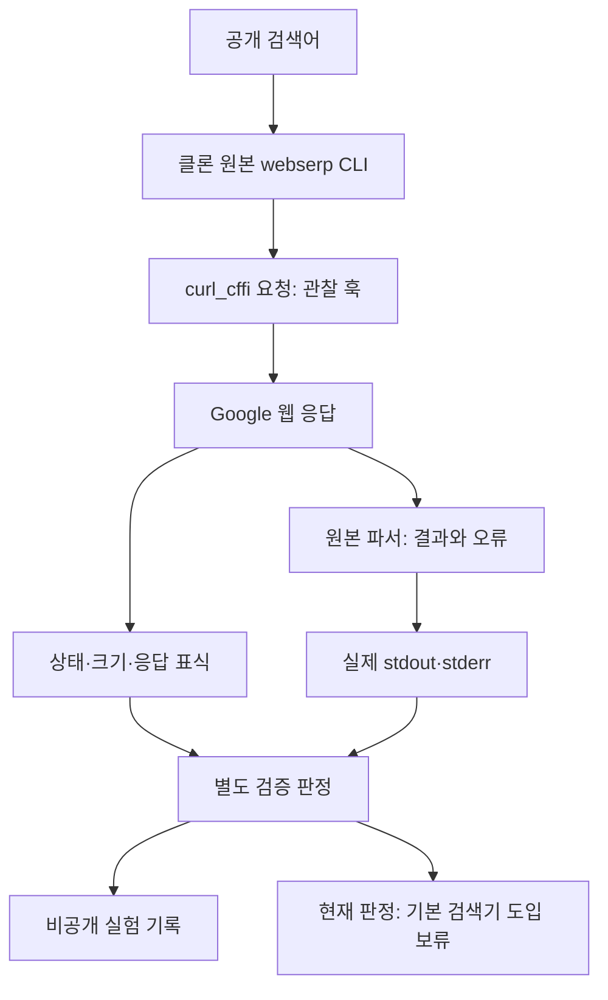

# 016: webserp 클론 검증 — 성공 표시와 검색 성공을 구분하다

## 도입 전에 확인하려던 것

<callout icon="💬" color="blue_bg">
	**실제 개발 요청**
	오케이 이것부터 일단 도입해보자, 도입전에 클론 후, 검증부터 ㄱㄱ
</callout>

015의 첫 검토 후보인 webserp를 클론하고 원본을 별도 가상환경에 설치했다. 현재 에이전트의 검색기를 교체하기 전에, 이전에 실패했던 두 공개 검색어가 실제로 동작하는지 검증했다.

좋은 결과의 기준은 HTTP 200이나 CLI 종료 코드 0이 아니다. top 5 안에 제목·URL이 있는 관련 공식 출처가 나오고, 접근 실패·파싱 실패·진짜 빈 결과를 구분해야 한다. 링크가 반환되면 공식 도메인과 제목·URL의 대응도 검토할 예정이었다.

## 실제 질문과 프로그램 응답

이번에는 LLM을 호출하지 않고 검색 CLI만 실행했다. 다음은 원본 CLI가 실제 출력한 stdout이다. 사람에게 보여주는 stderr의 성공 메시지도 함께 놓았다.

<callout icon="🔎" color="blue_bg">
	**실제로 보낸 검색어**
	춘천 삼악산 호수케이블카 공식 홈페이지
</callout>

```json
{
  "query": "춘천 삼악산 호수케이블카 공식 홈페이지",
  "number_of_results": 0,
  "results": [],
  "suggestions": [],
  "unresponsive_engines": []
}
```

```text
Succeeded: google
```

<callout icon="🔎" color="blue_bg">
	**실제로 보낸 검색어**
	국립춘천박물관 공식 홈페이지
</callout>

```json
{
  "query": "국립춘천박물관 공식 홈페이지",
  "number_of_results": 0,
  "results": [],
  "suggestions": [],
  "unresponsive_engines": []
}
```

```text
Succeeded: google
```

두 실행 모두 결과는 0개인데 `Succeeded: google`, 종료 코드 0이었다. 오류 목록도 비어 있었다. 이 출력을 실제 검색 성공이나 공식 사이트 부재로 받아들이면 안 된다.

## 소스 검토와 환경

- [webserp 원본](https://github.com/PaperBoardOfficial/webserp/tree/e13148334995745f104a69ce7127179785ee741e), 버전 0.1.4, 커밋 e13148334995745f104a69ce7127179785ee741e를 클론했다. 클론의 작업 트리는 변경하지 않았다.
- Python 3.12의 별도 검증 환경에 클론을 설치했다. curl_cffi 0.16.3, lxml 6.1.3, certifi 2026.7.22, cffi 2.1.1, pycparser 3.11. pip check는 충돌 없음이었다.
- 이번 실험은 google 엔진만 지정했고 유료 API 키·유료 프록시·캡차 서비스·로그인 쿠키를 설정하지 않았다. 프록시 환경변수 HTTP_PROXY/HTTPS_PROXY/ALL_PROXY도 없었다.
- 원본은 고정 동의 쿠키와 무작위 Chrome 요청 프로필을 사용한다. 디스크에서 인증·세션을 읽고 저장하는 기능은 이번에 구현하지 않았다. 개인 브라우저의 쿠키를 가져오지도 않았다.

## 왜 결과 0개였나

원본 `search._fetch_engine`은 HTTP 요청과 파서에서 예외만 없으면 결과 배열이 비어 있어도 오류 없음으로 반환한다. `cli.main`은 이 오류 목록으로 성공 메시지를 만들고 마지막에 0을 반환한다. 따라서 CLI의 성공 표시는 품질 판정으로 사용할 수 없다.

첫 두 실행은 상태 200·각 2,031바이트였고, 결과 컨테이너와 h3가 모두 0이었다. 초기 진단기는 이를 empty_unclassified로 기록했다. 이후 박물관 질문의 응답을 한 번 더 메모리에서 확인하자 비동기 프레임과 설정·스크립트가 보였다. 이 확인에서 얻은 동적 응답 내용은 공개 기록에 복사하지 않았다. 처음 두 응답 본문을 보관하지 않았으므로 두 원본의 전체 내용이 같다고 소급 확정하지 않는다.

진단기에 비동기 프레임 표식을 추가하고 박물관 질문을 한국어 설정으로 실행했을 때도 200·결과 0개·비동기 프레임 표식을 확인했다. 결과 링크를 담은 정상 응답으로 처리할 근거는 없었다. 어떤 내부 파라미터나 구글 측 정책이 직접 원인인지까지 확정한 것은 아니다.

추가로 진단 프로세스 안에서만 `asearch`와 `async`를 제거한 일반 검색 요청을 실행했다. 두 한국어 질문에서 JavaScript 활성화 안내 경로(`/httpservice/retry/enablejs`) 표식이 나왔고 결과 컨테이너·h3는 없었다. 박물관 질문은 영어 설정에서도 같은 표식을 확인했다. 언어 설정만 바꾸어 해결된 문제가 아니었다. 원본의 요청 프로필이 매번 달라지므로 요청 모드 하나만의 인과 효과나 성능 차이를 측정한 실험으로 해석하지 않는다.

## 실제 실행 결과

| 질문 | 요청 모드 | 언어 | HTTP | 추출 수 | 관찰 | 소요 시간(초) |
| --- | --- | --- | --- | --- | --- | --- |
| 케이블카 | upstream | en(원본) | 200 | 0 | 빈 응답 원인 미분류(초기 진단) | 0.233 |
| 박물관 | upstream | en(원본) | 200 | 0 | 빈 응답 원인 미분류(초기 진단) | 0.234 |
| 케이블카 | standard | ko | 200 | 0 | JS 활성화 안내 표식 | 0.275 |
| 박물관 | standard | ko | 200 | 0 | JS 활성화 안내 표식 | 0.287 |
| 박물관 | upstream | ko | 200 | 0 | 비동기 프레임, 결과 추출 실패 | 0.246 |
| 박물관 | standard | en(원본) | 200 | 0 | JS 활성화 안내 표식 | 0.297 |

모두 CLI 종료 코드 0, 오류 목록 없음이었다. 진단 스크립트는 이러한 미통과 상태에서 종료 코드 1을 돌려준다. 표의 짧은 시간은 쓸 수 있는 검색 결과가 없는 요청의 종료 시간이며, 검색 속도 향상으로 주장하지 않는다. 두 질문·6개 기록 실행과 응답 확인 1회만 수행했다. 10개 평가 질문 전체나 에이전트 답변 품질 검증은 실행하지 않았다.

## 이번에 만든 검증 장치

현재 프로젝트의 기준 커밋은 5b9f87d다. 이번 변경의 `scripts/validate_webserp.py`는 LLM 없이 원본 CLI를 실행하면서 해당 프로세스의 HTTP 경계만 관찰한다. 검색어·실제 요청 파라미터·Chrome 프로필·HTTP 상태·응답 크기·표식·stdout/stderr를 남긴다. 쿠키 값·헤더·응답 HTML은 저장하지 않는다. 기본값은 원본 요청이고, 언어·일반 검색 모드는 명시적인 진단 옵션이다.

`document_signals`는 응답 표식을 추출하고 `classify_result`는 요청 오류, 접근 안내, 검토할 결과, 해석되지 않은 비동기 응답, 명시적 빈 결과, 원인 미분류를 나눈다. 표식 분류는 진단이며 모든 구글 응답을 완벽히 판별하는 서비스 구현은 아니다. `run_case`는 모델 도구가 아니라 원본 CLI의 관찰 실행기다.



## 결정과 한계

**클론·격리 설치·검증은 완료했고, 기본 검색기로 도입하는 것은 보류했다.** 라이브 검증에서 실제 쓸 수 있는 검색 결과가 0개인 후보를 현재 DDGS 대신 연결하지 않는다. 프로젝트 의존성에도 webserp를 추가하지 않았다. 지금은 검증용 설치만 남아 있다.

진단 판정 6개 테스트를 추가했다. 기존 테스트를 포함한 49개 단위 테스트가 통과했다. 이 테스트 통과는 진단의 분류·기존 동작을 확인하는 것이며 Google 검색 품질이 통과했다는 뜻이 아니다. 실제 인증 파일 재사용·갱신은 미구현·미검증이다. 다음 후보로 OpenSERP의 브라우저 경로를 검증하거나 webserp 프로토콜을 더 조사하는 선택지가 남아 있으며 이번에 자동으로 다른 후보를 설치하지 않았다.

<details>
<summary>실제 코드: classify_result와 재현 실행법</summary>
	`scripts/validate_webserp.py`의 실제 분류 함수다. HTTP 200과 파서의 빈 배열을 품질 성공으로 바꾸지 않기 위해 필요하다.
	```python
	def classify_result(result, events):
	    signals = [event.get("signals", {}) for event in events]
	    if result["unresponsive_engines"]:
	        return "provider_error"
	    if any(s.get(k) for s in signals for k in ("captcha", "unusual_traffic", "consent")):
	        return "access_interstitial"
	    if result["results"]:
	        return "results_returned_requires_review"
	    if any(s.get("enable_js") for s in signals):
	        return "access_interstitial"
	    if any(s.get("async_framed") for s in signals):
	        return "unparsed_async_response"
	    if any(s.get("explicit_no_results") for s in signals):
	        return "explicit_no_results"
	    return "empty_unclassified"

	```
	검증 환경은 메인 가상환경과 분리했다. 저장소 루트의 PowerShell에서:
	```powershell
	git clone https://github.com/PaperBoardOfficial/webserp.git artifacts/vendor/webserp
	git -C artifacts/vendor/webserp checkout e13148334995745f104a69ce7127179785ee741e
	.\.venv\Scripts\python.exe -m venv artifacts/webserp-venv
	.\artifacts\webserp-venv\Scripts\python.exe -m pip install ./artifacts/vendor/webserp
	.\artifacts\webserp-venv\Scripts\python.exe scripts/validate_webserp.py "국립춘천박물관 공식 홈페이지"
	.\artifacts\webserp-venv\Scripts\python.exe scripts/validate_webserp.py "국립춘천박물관 공식 홈페이지" --language ko --request-mode standard --output artifacts/webserp-standard-ko.json
	```
	미분류·접근 안내·결과 해석 실패에서 진단 명령의 종료 코드 1은 예상된 미통과 결과다. 재설치 때의 간접 의존성은 달라질 수 있으므로 이 실험의 버전 목록과 비교한다.
	단위 테스트 실제 출력:
	```text
	.................................................
	----------------------------------------------------------------------
	Ran 49 tests in 0.533s

	OK
	```
</details>

<details>
<summary>실제 툴콜 로그: 검색어·요청 파라미터·응답·시간</summary>
	각 실행은 google 도구 하나를 순차 실행했다. LLM 호출 ID는 없으며 아래 순서는 실행 순서다. stdout은 앞의 질문·답변과 같아 이 영역에서는 요청·응답 조건을 중심으로 표시한다.

	실행 1
	```json
	{
	  "query": "춘천 삼악산 호수케이블카 공식 홈페이지",
	  "language_override": null,
	  "argv": [
	    "춘천 삼악산 호수케이블카 공식 홈페이지",
	    "--engines",
	    "google",
	    "--max-results",
	    "5",
	    "--timeout",
	    "15",
	    "--verbose"
	  ],
	  "upstream_exit_code": 0,
	  "status": "empty_unclassified",
	  "elapsed_seconds": 0.233,
	  "http": [
	    {
	      "method": "GET",
	      "endpoint": "https://www.google.com/search",
	      "params": {
	        "q": "춘천 삼악산 호수케이블카 공식 홈페이지",
	        "num": "5",
	        "hl": "en",
	        "asearch": "arc",
	        "async": "arc_id:srp_okhcPP5QGnamw791PC8CX5T_1,use_ac:true,_fmt:prog"
	      },
	      "impersonate": "chrome124",
	      "http_status": 200,
	      "response_bytes": 2031,
	      "final_host": "www.google.com",
	      "final_path": "/search",
	      "signals": {
	        "captcha": false,
	        "unusual_traffic": false,
	        "enable_js": false,
	        "consent": false,
	        "explicit_no_results": false,
	        "result_containers": 0,
	        "h3_count": 0
	      },
	      "elapsed_seconds": 0.228
	    }
	  ]
	}
	```

	실행 2
	```json
	{
	  "query": "국립춘천박물관 공식 홈페이지",
	  "language_override": null,
	  "argv": [
	    "국립춘천박물관 공식 홈페이지",
	    "--engines",
	    "google",
	    "--max-results",
	    "5",
	    "--timeout",
	    "15",
	    "--verbose"
	  ],
	  "upstream_exit_code": 0,
	  "status": "empty_unclassified",
	  "elapsed_seconds": 0.234,
	  "http": [
	    {
	      "method": "GET",
	      "endpoint": "https://www.google.com/search",
	      "params": {
	        "q": "국립춘천박물관 공식 홈페이지",
	        "num": "5",
	        "hl": "en",
	        "asearch": "arc",
	        "async": "arc_id:srp_tlRPIrFhr1MqjFbihTDYrat_1,use_ac:true,_fmt:prog"
	      },
	      "impersonate": "chrome120",
	      "http_status": 200,
	      "response_bytes": 2031,
	      "final_host": "www.google.com",
	      "final_path": "/search",
	      "signals": {
	        "captcha": false,
	        "unusual_traffic": false,
	        "enable_js": false,
	        "consent": false,
	        "explicit_no_results": false,
	        "result_containers": 0,
	        "h3_count": 0
	      },
	      "elapsed_seconds": 0.23
	    }
	  ]
	}
	```

	실행 3
	```json
	{
	  "query": "춘천 삼악산 호수케이블카 공식 홈페이지",
	  "language_override": "ko",
	  "argv": [
	    "춘천 삼악산 호수케이블카 공식 홈페이지",
	    "--engines",
	    "google",
	    "--max-results",
	    "5",
	    "--timeout",
	    "15",
	    "--verbose"
	  ],
	  "upstream_exit_code": 0,
	  "status": "access_interstitial",
	  "elapsed_seconds": 0.275,
	  "http": [
	    {
	      "method": "GET",
	      "endpoint": "https://www.google.com/search",
	      "params": {
	        "q": "춘천 삼악산 호수케이블카 공식 홈페이지",
	        "num": "5",
	        "hl": "ko"
	      },
	      "impersonate": "chrome124",
	      "http_status": 200,
	      "response_bytes": 92886,
	      "final_host": "www.google.com",
	      "final_path": "/search",
	      "signals": {
	        "async_framed": false,
	        "captcha": false,
	        "unusual_traffic": false,
	        "enable_js": true,
	        "consent": false,
	        "explicit_no_results": false,
	        "result_containers": 0,
	        "h3_count": 0
	      },
	      "elapsed_seconds": 0.269
	    }
	  ]
	}
	```

	실행 4
	```json
	{
	  "query": "국립춘천박물관 공식 홈페이지",
	  "language_override": "ko",
	  "argv": [
	    "국립춘천박물관 공식 홈페이지",
	    "--engines",
	    "google",
	    "--max-results",
	    "5",
	    "--timeout",
	    "15",
	    "--verbose"
	  ],
	  "upstream_exit_code": 0,
	  "status": "access_interstitial",
	  "elapsed_seconds": 0.287,
	  "http": [
	    {
	      "method": "GET",
	      "endpoint": "https://www.google.com/search",
	      "params": {
	        "q": "국립춘천박물관 공식 홈페이지",
	        "num": "5",
	        "hl": "ko"
	      },
	      "impersonate": "chrome124",
	      "http_status": 200,
	      "response_bytes": 92370,
	      "final_host": "www.google.com",
	      "final_path": "/search",
	      "signals": {
	        "async_framed": false,
	        "captcha": false,
	        "unusual_traffic": false,
	        "enable_js": true,
	        "consent": false,
	        "explicit_no_results": false,
	        "result_containers": 0,
	        "h3_count": 0
	      },
	      "elapsed_seconds": 0.281
	    }
	  ]
	}
	```

	실행 5
	```json
	{
	  "query": "국립춘천박물관 공식 홈페이지",
	  "language_override": "ko",
	  "argv": [
	    "국립춘천박물관 공식 홈페이지",
	    "--engines",
	    "google",
	    "--max-results",
	    "5",
	    "--timeout",
	    "15",
	    "--verbose"
	  ],
	  "upstream_exit_code": 0,
	  "status": "unparsed_async_response",
	  "elapsed_seconds": 0.246,
	  "http": [
	    {
	      "method": "GET",
	      "endpoint": "https://www.google.com/search",
	      "params": {
	        "q": "국립춘천박물관 공식 홈페이지",
	        "num": "5",
	        "hl": "ko",
	        "asearch": "arc",
	        "async": "arc_id:srp_TwUKWScKY46pSBB7KxJZyQ2_1,use_ac:true,_fmt:prog"
	      },
	      "impersonate": "chrome119",
	      "http_status": 200,
	      "response_bytes": 2653,
	      "final_host": "www.google.com",
	      "final_path": "/search",
	      "signals": {
	        "async_framed": true,
	        "captcha": false,
	        "unusual_traffic": false,
	        "enable_js": false,
	        "consent": false,
	        "explicit_no_results": false,
	        "result_containers": 0,
	        "h3_count": 0
	      },
	      "elapsed_seconds": 0.241
	    }
	  ]
	}
	```

	실행 6
	```json
	{
	  "query": "국립춘천박물관 공식 홈페이지",
	  "language_override": null,
	  "argv": [
	    "국립춘천박물관 공식 홈페이지",
	    "--engines",
	    "google",
	    "--max-results",
	    "5",
	    "--timeout",
	    "15",
	    "--verbose"
	  ],
	  "upstream_exit_code": 0,
	  "status": "access_interstitial",
	  "elapsed_seconds": 0.297,
	  "http": [
	    {
	      "method": "GET",
	      "endpoint": "https://www.google.com/search",
	      "params": {
	        "q": "국립춘천박물관 공식 홈페이지",
	        "num": "5",
	        "hl": "en"
	      },
	      "impersonate": "chrome131",
	      "http_status": 200,
	      "response_bytes": 92631,
	      "final_host": "www.google.com",
	      "final_path": "/search",
	      "signals": {
	        "async_framed": false,
	        "captcha": false,
	        "unusual_traffic": false,
	        "enable_js": true,
	        "consent": false,
	        "explicit_no_results": false,
	        "result_containers": 0,
	        "h3_count": 0
	      },
	      "elapsed_seconds": 0.292
	    }
	  ]
	}
	```
</details>
