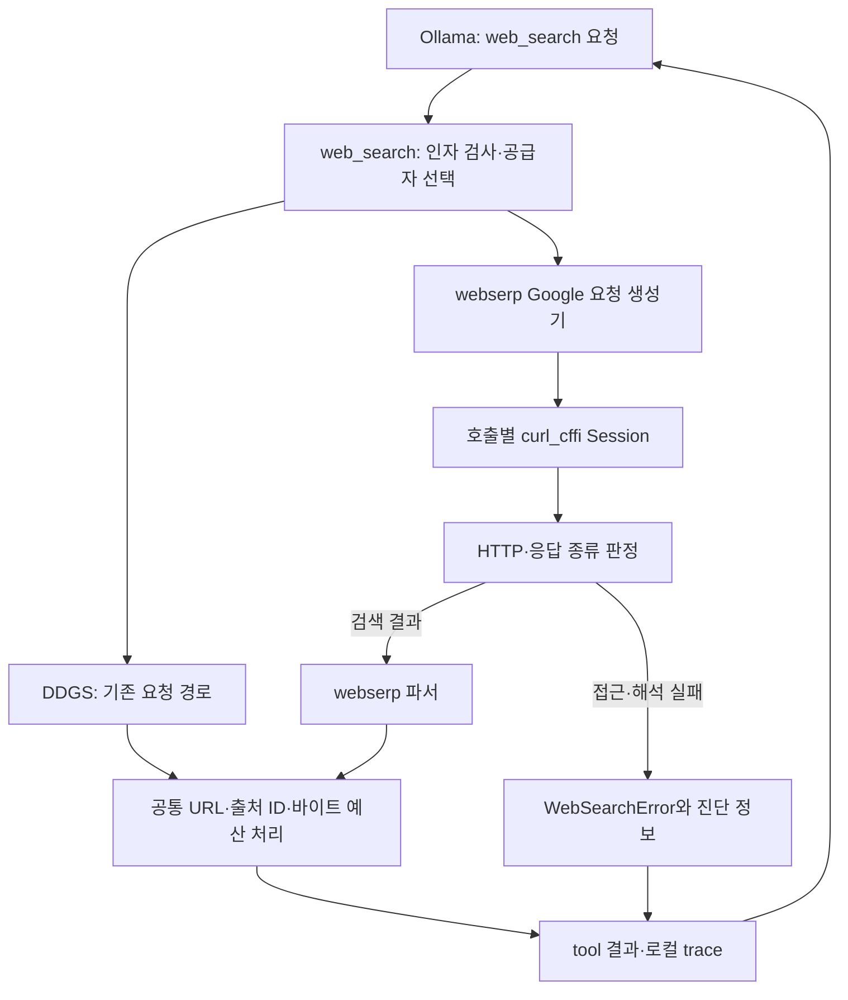

# 017: webserp 공급자 연결과 DDGS 비교 — 연결과 품질을 구분하다

## 요청과 좋은 답변의 기준

<callout icon="💬" color="blue_bg">
	**실제 개발 요청**
	동작 확인했으면, 바로 도입 ㄱㄱ 그리고 이전과 비교 ㄱㄱ 연구일지 작성 ㄱㄱ
</callout>

016에서 확인한 것은 webserp의 검색 성공이 아니라 결과 미추출이었다. 이번에는 사용자의 요청에 따라 연결 자체를 진행하되, 실제 검색 품질과 기능 연결을 구분했다. 기존 DDGS와 선택형 webserp가 같은 web_search 인터페이스를 사용하도록 만들고 같은 입력으로 비교했다.

좋은 답변은 두 장소의 공식 주소를 실제 검색 근거와 함께 제시해야 한다. 자료를 얻지 못했다면 그 실패를 숨기거나 URL을 지어내지 않아야 한다. 두 번째 조건을 만족해도 첫 번째 여행 요청을 해결한 것으로 점수를 주지 않는다.

## 같은 질문, 실제로 돌아온 답변

두 실행 모두 같은 Qwen3.5 4B 모델과 같은 도구 스키마·시스템 프롬프트를 사용했다. 바꾼 것은 호스트의 검색 공급자·엔진 설정이다. 메모리 자료를 주입하지 않았다.

<callout icon="🔎" color="blue_bg">
	**에이전트에 실제로 보낸 동일 질문**
	춘천 삼악산 호수케이블카와 국립춘천박물관의 공식 홈페이지 주소를 각각 찾아줘. 서로 독립적인 두 웹검색을 한 응답의 도구 요청 묶음으로 보내고, 각 검색은 top_k=1로 해줘. 반환된 주소와 출처를 간결하게 알려줘. 본문을 읽었다고 말하지 마.
</callout>

### 이전 공급자: DDGS

```text
죄송합니다. 현재 웹 검색을 통해 공식 홈페이지를 찾을 수 없었습니다.

*   **춘천 삼악산 호수케이블카**: 공식 홈페이지가 확인되지 않았습니다.
*   **국립춘천박물관**: 공식 홈페이지가 확인되지 않았습니다.

다른 검색어로 시도하거나, 과거에 기록된 정보를 찾아보시는 것이 좋을 것 같습니다.
```

### 연결한 공급자: webserp Google

```text
죄송합니다. 현재 웹 검색에서 공식 홈페이지 정보를 찾을 수 없습니다.

춘천 삼악산 호수케이블카와 국립춘천박물관의 공식 홈페이지 주소는 기억에 없으며, 웹 검색도 실패했습니다. 정확한 정보는 공식 웹사이트나 관련 기관을 직접 확인하시는 것을 권장합니다.
```

두 답변 모두 실제 반환된 문자열이다. 주소를 지어내지는 않았지만 요청한 두 공식 홈페이지를 찾지 못했으므로 **답변 품질 개선은 확인되지 않았다.** webserp 답변의 “기억에 없으며”라는 표현은 모델 발언이며 실제 메모리 검색을 실행했다는 뜻이 아니다. 두 실행의 도구는 web_search 두 번씩뿐이었다.

## 무엇을 연결했나

기준 상태는 8cf055a이며, 이 연구일지와 함께 들어가는 변경에서 선택형 공급자 어댑터를 추가했다. webserp의 검토한 커밋 e13148334995745f104a69ce7127179785ee741e를 선택 의존성으로 고정했다. 현재 가상환경에는 같은 커밋의 로컬 클론을 설치했다.

- `web.py`의 web_search는 provider 인자 또는 WEB_SEARCH_PROVIDER로 공급자를 선택한다. 모델에 공급자 선택 권한을 추가한 것이 아니다. 도구 인자는 여전히 query와 top_k뿐이다.
- `webserp_provider.py`의 search_google은 원본 Google.build_request와 parse_response를 사용한다. 원본 영어·arc 요청을 유지하고 curl_cffi 동기 Session을 요청마다 만들고 닫는다. 병렬 도구에서 세션을 공유하지 않는다.
- `web.py`의 기존 공통 처리로 HTTP(S) URL 정리·중복 제거·출처 ID·제목/요약 길이·응답 바이트 한도를 적용한다. 본문을 읽었다고 표시하지 않는다.
- HTTP 오류, 접근 안내, 결과를 해석하지 못한 응답을 WebSearchError로 전달한다. 빈 파싱 배열을 정상적인 검색 결과 없음으로 바꾸지 않는다. 명시적인 빈 결과 표식이 있을 때만 빈 결과 경로를 허용한다.
- `agent.py`는 오류 세부 정보인 공급자·상태·HTTP·응답 종류를 tool_error와 다음 모델 입력에 보존한다. run_start에도 선택된 공급자·엔진을 기록한다. 호출 ID·요청 순서와 병렬 실행 구조는 유지한다.



기본 공급자는 DDGS로 유지하고 webserp는 명시적으로 선택한다. 이것은 연결·비교를 완료했다는 뜻이며 검색 품질이 통과했다는 뜻이 아니다. 자동으로 다른 공급자로 대체하지 않는다. 로컬 인증·세션 파일의 저장·재사용은 아직 구현하지 않았고 이번에는 로그인 쿠키를 읽지 않았다.

## 검색 단계의 같은 입력 비교

기존에 계획해 둔 공개 질의10개를 각각 DDGS와 webserp에 보냈다. top_k=5, 도구 반환 예산 10,000바이트, 요청 timeout 15초로 같게 두고 질문마다 DDGS 다음 webserp를 순차 실행했다. 모델을 거치지 않은 검색 단계 실험이다.

| 항목 | DDGS: duckduckgo,bing | webserp: google |
| --- | --- | --- |
| 결과가 반환된 질문 | 1/10 | 0/10 |
| 공급자 오류·해석 실패 | 9/10 | 10/10 |
| 미리 정한 공식 도메인 발견 | 1/2 | 0/2 |
| 관찰 | 케이블카 질의에서 공식 도메인 반환, 나머지는 공급자 예외 | 모든 질의가 HTTP 200이지만 async_framed, 결과 추출 실패 |

공식 도메인 지표는 케이블카와 박물관 두 질문에만 적용했다. 나머지 질문의 관련성·최신성·사실성에 자동 점수를 붙이지 않는다. 마지막 질문은 가상의 장소명을 사용한 음성 사례이며, 오류가 난 것을 올바른 “없는 장소” 판정으로 취급하지 않는다.

| 실제 검색어 | DDGS | webserp |
| --- | --- | --- |
| 춘천 삼악산 호수케이블카 공식 홈페이지 | ok (5개) | unparsed_response (0개) |
| 국립춘천박물관 공식 홈페이지 | provider_error (0개) | unparsed_response (0개) |
| 국립춘천박물관 관람시간 휴관일 공식 안내 | provider_error (0개) | unparsed_response (0개) |
| 춘천 삼악산 호수케이블카 기상 악화 운행 중단 공식 안내 | provider_error (0개) | unparsed_response (0개) |
| 춘천 비 오는 날 실내 관광지 대중교통 | provider_error (0개) | unparsed_response (0개) |
| 서울 출발 춘천 1박 2일 대중교통 여행 | provider_error (0개) | unparsed_response (0개) |
| 국립춘천박물관 관람료 공식 안내 | provider_error (0개) | unparsed_response (0개) |
| 춘천 삼악산 호수케이블카 버스 대중교통 이용 안내 | provider_error (0개) | unparsed_response (0개) |
| 춘천 관광 공식 홈페이지 | provider_error (0개) | unparsed_response (0개) |
| "traveldemo-no-such-place-20261017" 공식 홈페이지 | provider_error (0개) | unparsed_response (0개) |

검색 단계의 케이블카 질문에서는 DDGS가 아래 제목·URL·요약을 실제 반환했다.

<callout icon="🔎" color="blue_bg">
	**이 결과에 보낸 질문**
	춘천 삼악산 호수케이블카 공식 홈페이지
</callout>

```text
춘천 삼악산 호수 케이블카
https://samaksancablecar.com/
삼천동에서 의암호를 가로질러 삼악산을 연결하는 3.61km의 국내 최장 케이블카
```

같은 질문에 webserp는 아래 오류를 반환했다. 이것은 모델 답변이 아니라 실행기의 도구 오류다.

```text
webserp Google yielded no usable results (async_framed); not a proven empty search
```

같은 날의 실제 모델 실행에서는 DDGS도 두 웹 요청이 모두 실패했다. 검색 단계에서 한 번 성공한 결과가 다음 호출이나 병렬 호출의 성공을 보장하지 않는다는 한계다. 이번 기록만으로 병렬 실행 때문에 실패했다고 단정할 수도 없다.

## 실제 모델 실행의 관찰과 비용

| 공급자 | 모델 호출 | 도구 호출 | 입력 토큰 | 출력 토큰 | 검색 완료 | 결과 |
| --- | --- | --- | --- | --- | --- | --- |
| ddgs | 2 | 2 | 2127 | 170 | False | 주소 확보 실패 |
| webserp | 2 | 2 | 2271 | 158 | False | 주소 확보 실패 |

각 실행은 한 응답의 두 도구 요청을 받아 병렬로 처리했다. 두 결과를 모아 모델에 전달했고, 예외가 답변 루프를 종료시키지는 않았다. status=completed는 모델 응답 생성이 끝났다는 뜻이며 여행 질문 해결을 뜻하지 않는다.

이 실험의 입력 토큰은 webserp 쪽이 더 많았다. 진단 정보와 오류 문자열이 모델 입력에 추가되는 비용도 고려해야 한다. 모델 초기 로드·캐시 상태가 통제되지 않았고 공급자별로 한 번씩만 실행했으므로 지연·비용 우위를 주장하지 않는다. 외부 유료 검색 API나 유료 프록시를 설정하지 않았지만 로컬 자원 비용을 0원으로 측정했다는 뜻도 아니다.

## 검증·문제 해결·남은 문제

처음 단위 테스트에서 curl_cffi 예외 클래스의 잘못된 import를 발견해 실제 설치 소스의 RequestException으로 고쳤다. 원본 파서 테스트의 HTML fixture도 실제 문서처럼 루트 아래에 결과 컨테이너가 있도록 바로잡았다. 실제 검색 성공을 가짜 fixture 결과로 대신하지 않았다.

라우팅·환경 설정·허용 엔진 검사·공통 결과 규격·진단 정보의 에이전트 전달·원본 파서 변환·200의 해석 실패·정상 빈 결과·HTTP 오류·민감할 수 있는 전송 예외 문자열 제외를 검사했다. 전체 단위 테스트58개와 pip check가 통과했다. 선택 의존성은 프로젝트 설치 메타데이터에 반영했고, 새 공급자를 실제 CLI와 실제 로컬 모델에서 호출했다.

**해결한 것은 공급자 연결과 실패의 정직한 전달이다. 해결하지 못한 것은 Google에서 쓸 수 있는 검색 결과를 얻는 문제다.** 새로운 전송 경로의 도입만으로 품질 향상이 생기지 않았다. 범용 여행 검색의 안정성, Google 비동기 응답 처리, 로컬 세션 파일 재사용·만료·갱신은 후속 과제로 남긴다.

<details>
<summary>실제 코드와 실행법</summary>
	`src/travel_agent/webserp_provider.py`의 실제 소스다. 응답 종류를 판정하고 호출마다 닫히는 세션을 사용하는 이유는 오류 정보와 병렬 실행 경계를 명확히 하기 위해서다.
	```python
	"""Google adapter using the reviewed webserp request builder and parser.

	Each invocation owns its HTTP session, including when agent tools run in threads.
	This does not import browser credentials or persist cookies between invocations.
	"""

	from .web import WebSearchError


	def response_kind(text):
	    """Conservative diagnostics: ambiguous empty pages are never proven no-results."""
	    from lxml import html

	    lower = text.lower()
	    tree = html.fromstring(text or "<html></html>")
	    if tree.xpath('//form[contains(@action,"/sorry/")] | //iframe[contains(@src,"recaptcha")] '
	                  '| //*[@id="captcha-form"]') or "unusual traffic from your computer network" in lower:
	        return "captcha"
	    if "before you continue to google" in lower:
	        return "consent"
	    if tree.xpath('//h3'):
	        return "html_with_headings"
	    if "/httpservice/retry/enablejs" in lower:
	        return "javascript_required"
	    if text.lstrip().startswith(")]}'"):
	        return "async_framed"
	    if "did not match any documents" in lower:
	        return "explicit_no_results"
	    return "unclassified"


	def search_google(query, top_k, timeout):
	    try:
	        from curl_cffi.requests import Session
	        from curl_cffi.requests.exceptions import RequestException
	        from lxml.etree import LxmlError
	        from webserp.client import random_impersonate
	        from webserp.engines.google import Google
	    except ImportError as exc:
	        raise WebSearchError("webserp is not installed; install the project's [webserp] extra",
	                             details={"provider": "webserp", "status": "dependency_missing"}) from exc

	    engine = Google()
	    spec = engine.build_request(query, top_k)
	    profile = random_impersonate()
	    metadata = {"provider": "webserp", "backend_requested": "google", "impersonate": profile,
	                "request_mode": "upstream_arc", "request_language": spec.params.get("hl")}

	    def fail(status, message):
	        raise WebSearchError(message, details={**metadata, "status": status})

	    try:
	        with Session() as session:
	            response = session.request(spec.method, spec.url, params=spec.params, data=spec.data or None,
	                                       headers=spec.headers, cookies=spec.cookies, timeout=timeout,
	                                       impersonate=profile)
	            metadata["http_status"] = response.status_code
	            metadata["response_bytes"] = len(response.content)
	            if response.status_code != 200:
	                fail("http_error", f"webserp Google returned HTTP {response.status_code}")
	            try:
	                kind = response_kind(response.text)
	                metadata["response_kind"] = kind
	                if kind in {"captcha", "consent", "javascript_required"}:
	                    fail("access_interstitial", f"webserp Google returned {kind}; no search evidence")
	                hits = engine.parse_response(response.text)
	            except (ValueError, TypeError, LxmlError) as exc:
	                fail("parse_error", f"webserp could not parse Google response ({type(exc).__name__})")
	            if not hits and kind != "explicit_no_results":
	                fail("unparsed_response", f"webserp Google yielded no usable results ({kind}); not a proven empty search")
	            rows = [{"href": hit.url, "title": hit.title, "body": hit.content} for hit in hits[:top_k]]
	            return rows, {key: value for key, value in metadata.items() if key not in {"provider", "backend_requested"}}
	    except RequestException as exc:
	        # Exception strings can contain URLs or transport internals; keep them out of traces.
	        fail("transport_error", f"webserp transport failed ({type(exc).__name__})")

	```
	원본 Google 요청 생성기·파서는 [고정한 외부 커밋](https://github.com/PaperBoardOfficial/webserp/tree/e13148334995745f104a69ce7127179785ee741e)을 사용한다.
	저장소 루트에서 프로젝트 가상환경을 활성화한 뒤:
	```powershell
	python -m pip install -e ".[webserp]"
	travel-agent web search "국립춘천박물관 공식 홈페이지" --provider webserp --backend google
	$env:WEB_SEARCH_PROVIDER = 'webserp'
	$env:WEB_SEARCH_BACKEND = 'google'
	travel-agent memory --user demo --session trip agent "국립춘천박물관 공식 홈페이지를 찾아줘"
	python scripts/compare_search_providers.py
	python scripts/compare_search_providers.py --agent-only --output artifacts/provider-agent-comparison.json
	# 기존 기본 공급자로 돌아갈 때는 두 설정을 함께 바꾼다.
	$env:WEB_SEARCH_PROVIDER = 'ddgs'
	$env:WEB_SEARCH_BACKEND = 'duckduckgo,bing'
	```
	검증 출력:
	```text
	..........................................................
	----------------------------------------------------------------------
	Ran 58 tests in 0.722s

	OK
	No broken requirements found.
	```
</details>

<details>
<summary>실제 에이전트 툴콜 로그: 인자·호출 ID·병렬 완료 순서·오류</summary>
	같은 질문의 모델 호출은 두 공급자 각각 한 번씩 실행했다. 아래는 실제 trace의 tool_start/tool_end/tool_error이며 이름·인자·호출 ID·순서·시간·오류를 보존한다. 모델의 비공개 사고 과정은 수집하지 않는다.

	공급자: ddgs
	```json
	[
	  {
	    "request_id": "348d466112e344978fbc6368f70e3360",
	    "sequence": 5,
	    "timestamp": "2026-10-17T13:35:31.031375+00:00",
	    "elapsed_seconds": 6.082713,
	    "kind": "tool_start",
	    "step": 1,
	    "span": "1.1",
	    "name": "web_search",
	    "call_index": 0,
	    "tool_call_id": "call_68k4dpjx",
	    "arguments": {
	      "query": "춘천 삼악산 호수케이블카 공식 홈페이지",
	      "top_k": 1
	    }
	  },
	  {
	    "request_id": "348d466112e344978fbc6368f70e3360",
	    "sequence": 6,
	    "timestamp": "2026-10-17T13:35:31.031895+00:00",
	    "elapsed_seconds": 6.083221,
	    "kind": "tool_start",
	    "step": 1,
	    "span": "1.2",
	    "name": "web_search",
	    "call_index": 1,
	    "tool_call_id": "call_z1valkjw",
	    "arguments": {
	      "query": "국립춘천박물관 공식 홈페이지",
	      "top_k": 1
	    }
	  },
	  {
	    "request_id": "348d466112e344978fbc6368f70e3360",
	    "sequence": 7,
	    "timestamp": "2026-10-17T13:35:31.435111+00:00",
	    "elapsed_seconds": 6.48685,
	    "kind": "tool_error",
	    "step": 1,
	    "span": "1.1",
	    "name": "web_search",
	    "result": {
	      "error": "Web search provider failed: No results found.",
	      "error_type": "WebSearchError",
	      "web_search_performed": false
	    },
	    "elapsed_seconds_call": 0.403706
	  },
	  {
	    "request_id": "348d466112e344978fbc6368f70e3360",
	    "sequence": 8,
	    "timestamp": "2026-10-17T13:35:31.504890+00:00",
	    "elapsed_seconds": 6.556593,
	    "kind": "tool_error",
	    "step": 1,
	    "span": "1.2",
	    "name": "web_search",
	    "result": {
	      "error": "Web search provider failed: No results found.",
	      "error_type": "WebSearchError",
	      "web_search_performed": false
	    },
	    "elapsed_seconds_call": 0.472876
	  }
	]
	```

	공급자: webserp
	```json
	[
	  {
	    "request_id": "230800cd2bf1459cb63f0f3722d4b49f",
	    "sequence": 5,
	    "timestamp": "2026-10-17T13:35:33.549418+00:00",
	    "elapsed_seconds": 1.094194,
	    "kind": "tool_start",
	    "step": 1,
	    "span": "1.1",
	    "name": "web_search",
	    "call_index": 0,
	    "tool_call_id": "call_umjyrzdv",
	    "arguments": {
	      "query": "춘천 삼악산 호수케이블카 공식 홈페이지",
	      "top_k": 1
	    }
	  },
	  {
	    "request_id": "230800cd2bf1459cb63f0f3722d4b49f",
	    "sequence": 6,
	    "timestamp": "2026-10-17T13:35:33.549941+00:00",
	    "elapsed_seconds": 1.09474,
	    "kind": "tool_start",
	    "step": 1,
	    "span": "1.2",
	    "name": "web_search",
	    "call_index": 1,
	    "tool_call_id": "call_iat38lor",
	    "arguments": {
	      "query": "국립춘천박물관 공식 홈페이지",
	      "top_k": 1
	    }
	  },
	  {
	    "request_id": "230800cd2bf1459cb63f0f3722d4b49f",
	    "sequence": 7,
	    "timestamp": "2026-10-17T13:35:33.828341+00:00",
	    "elapsed_seconds": 1.374719,
	    "kind": "tool_error",
	    "step": 1,
	    "span": "1.2",
	    "name": "web_search",
	    "result": {
	      "error": "webserp Google yielded no usable results (async_framed); not a proven empty search",
	      "error_type": "WebSearchError",
	      "web_search_performed": false,
	      "provider": "webserp",
	      "backend_requested": "google",
	      "impersonate": "chrome124",
	      "request_mode": "upstream_arc",
	      "request_language": "en",
	      "http_status": 200,
	      "response_bytes": 2031,
	      "response_kind": "async_framed",
	      "status": "unparsed_response"
	    },
	    "elapsed_seconds_call": 0.279614
	  },
	  {
	    "request_id": "230800cd2bf1459cb63f0f3722d4b49f",
	    "sequence": 8,
	    "timestamp": "2026-10-17T13:35:33.835221+00:00",
	    "elapsed_seconds": 1.380202,
	    "kind": "tool_error",
	    "step": 1,
	    "span": "1.1",
	    "name": "web_search",
	    "result": {
	      "error": "webserp Google yielded no usable results (async_framed); not a proven empty search",
	      "error_type": "WebSearchError",
	      "web_search_performed": false,
	      "provider": "webserp",
	      "backend_requested": "google",
	      "impersonate": "chrome116",
	      "request_mode": "upstream_arc",
	      "request_language": "en",
	      "http_status": 200,
	      "response_bytes": 2031,
	      "response_kind": "async_framed",
	      "status": "unparsed_response"
	    },
	    "elapsed_seconds_call": 0.285561
	  }
	]
	```
</details>

<details>
<summary>검색 단계의 실제 요청·결과 20개</summary>
	LLM 없는 검색 비교의 실제 실행 순서다. 각 항목의 query는 실제 web_search 인자이며 provider/backend는 호스트 설정이다. top_k=5, timeout=15, max_bytes=10000. DDGS 응답에는 원격 HTTP 상태가 보존되지 않아 추가하지 않았다.

	```json
	{
	  "query": "춘천 삼악산 호수케이블카 공식 홈페이지",
	  "provider": "ddgs",
	  "backend": "duckduckgo,bing",
	  "elapsed_seconds": 0.884,
	  "result": {
	    "provider": "ddgs",
	    "backend_requested": "duckduckgo,bing",
	    "searched_at": "2026-10-17T13:34:41.033476+00:00",
	    "content_kind": "search_snippet",
	    "page_fetched": false,
	    "web_search_performed": true,
	    "status": "ok",
	    "omitted_results": 0,
	    "hits": [
	      {
	        "id": "web:42a1dc11003496ff",
	        "title": "춘천 삼악산 호수 케이블카",
	        "url": "https://samaksancablecar.com/",
	        "snippet": "삼천동에서 의암호를 가로질러 삼악산을 연결하는 3.61km의 국내 최장 케이블카",
	        "snippet_truncated": false
	      },
	      {
	        "id": "web:3f8e4c7976822b9d",
	        "title": "춘천 삼악산 호수케이블카 온라인 예매",
	        "url": "https://www.samaksancablecar.com/ticketOffice/index.php",
	        "snippet": "강원특별자치도 춘천시 삼천동 392-10 춘천 삼악산호수 케이블카 | 대표전화 : 1588-4888 COPYRIGHT © SONO INTERNATIONAL Co, Ltd. All Rights Reserved.",
	        "snippet_truncated": false
	      },
	      {
	        "id": "web:bc576076b720db07",
	        "title": "춘천 삼악산 호수 케이블카 요금·예약·가는 법 (2026년 최신)",
	        "url": "https://oh-my-gat.com/samaksan-lake-cablecar-guide/",
	        "snippet": "강풍·기상 악화 등 안전상의 이유로 사전 공지 없이 조기 마감되거나 휴장되는 경우가 있으므로, 방문 당일 오전에 공식 홈페이지 공지사항을 한 번 더 확인하고 출발하시는 것을 권장합니다. 탑승권은 온라인 사전 예약과 현장 매표 모두 가능합니다. 주말·공휴일에는 현장 대기가 길어지는 경우가 많으니 사전 예약을 추천드립니다. 공식 홈페이지: samaksancablecar.com 예약 페이지에서 날짜·시간·캐빈 종류를 선택해 결제합니다. 제휴 플랫폼: 카카오톡 예약하기, 마이리얼트립, 와그 등에서도 동일하게 구매 가능합니다.",
	        "snippet_truncated": false
	      },
	      {
	        "id": "web:64e36da511ac6691",
	        "title": "춘천 삼악산 호수 케이블카 예약 https://samaksancablecar.com/",
	        "url": "https://shortnewsdaily.kr/samaksan-cablecar-booking/",
	        "snippet": "춘천 삼악산 호수 케이블카 예약은 공식 홈페이지에서 시간대별로 진행됩니다. 예약 방법, 소요시간, 이용 조건, 실제 방문 흐름까지 한 번에 확인할 수 있도록 정리했습니다.",
	        "snippet_truncated": false
	      },
	      {
	        "id": "web:c09e0a807d0d8687",
	        "title": "춘천 삼악산호수케이블카 운영시간·코스·요금·예약방법 ...",
	        "url": "https://info.diveinsight.net/chuncheon-samaksan-lake-cable-car/",
	        "snippet": "춘천 삼악산호수 케이블카 가기 전 꼭 확인하세요. 운영시간, 코스, 요금, 예약방법까지 한 번에 정리했습니다. 놓치면 헛걸음할 수 있는 운휴·요금 정보를 미리 챙기세요.",
	        "snippet_truncated": false
	      }
	    ]
	  }
	}
	```

	```json
	{
	  "query": "춘천 삼악산 호수케이블카 공식 홈페이지",
	  "provider": "webserp",
	  "backend": "google",
	  "elapsed_seconds": 0.273,
	  "result": {
	    "provider": "webserp",
	    "backend_requested": "google",
	    "error": "webserp Google yielded no usable results (async_framed); not a proven empty search",
	    "web_search_performed": false,
	    "status": "unparsed_response",
	    "impersonate": "chrome119",
	    "request_mode": "upstream_arc",
	    "request_language": "en",
	    "http_status": 200,
	    "response_bytes": 2031,
	    "response_kind": "async_framed"
	  }
	}
	```

	```json
	{
	  "query": "국립춘천박물관 공식 홈페이지",
	  "provider": "ddgs",
	  "backend": "duckduckgo,bing",
	  "elapsed_seconds": 0.343,
	  "result": {
	    "provider": "ddgs",
	    "backend_requested": "duckduckgo,bing",
	    "error": "Web search provider failed: No results found.",
	    "web_search_performed": false,
	    "status": "provider_error"
	  }
	}
	```

	```json
	{
	  "query": "국립춘천박물관 공식 홈페이지",
	  "provider": "webserp",
	  "backend": "google",
	  "elapsed_seconds": 0.248,
	  "result": {
	    "provider": "webserp",
	    "backend_requested": "google",
	    "error": "webserp Google yielded no usable results (async_framed); not a proven empty search",
	    "web_search_performed": false,
	    "status": "unparsed_response",
	    "impersonate": "chrome131",
	    "request_mode": "upstream_arc",
	    "request_language": "en",
	    "http_status": 200,
	    "response_bytes": 2031,
	    "response_kind": "async_framed"
	  }
	}
	```

	```json
	{
	  "query": "국립춘천박물관 관람시간 휴관일 공식 안내",
	  "provider": "ddgs",
	  "backend": "duckduckgo,bing",
	  "elapsed_seconds": 0.331,
	  "result": {
	    "provider": "ddgs",
	    "backend_requested": "duckduckgo,bing",
	    "error": "Web search provider failed: No results found.",
	    "web_search_performed": false,
	    "status": "provider_error"
	  }
	}
	```

	```json
	{
	  "query": "국립춘천박물관 관람시간 휴관일 공식 안내",
	  "provider": "webserp",
	  "backend": "google",
	  "elapsed_seconds": 0.231,
	  "result": {
	    "provider": "webserp",
	    "backend_requested": "google",
	    "error": "webserp Google yielded no usable results (async_framed); not a proven empty search",
	    "web_search_performed": false,
	    "status": "unparsed_response",
	    "impersonate": "chrome133a",
	    "request_mode": "upstream_arc",
	    "request_language": "en",
	    "http_status": 200,
	    "response_bytes": 2031,
	    "response_kind": "async_framed"
	  }
	}
	```

	```json
	{
	  "query": "춘천 삼악산 호수케이블카 기상 악화 운행 중단 공식 안내",
	  "provider": "ddgs",
	  "backend": "duckduckgo,bing",
	  "elapsed_seconds": 0.328,
	  "result": {
	    "provider": "ddgs",
	    "backend_requested": "duckduckgo,bing",
	    "error": "Web search provider failed: No results found.",
	    "web_search_performed": false,
	    "status": "provider_error"
	  }
	}
	```

	```json
	{
	  "query": "춘천 삼악산 호수케이블카 기상 악화 운행 중단 공식 안내",
	  "provider": "webserp",
	  "backend": "google",
	  "elapsed_seconds": 0.21,
	  "result": {
	    "provider": "webserp",
	    "backend_requested": "google",
	    "error": "webserp Google yielded no usable results (async_framed); not a proven empty search",
	    "web_search_performed": false,
	    "status": "unparsed_response",
	    "impersonate": "chrome116",
	    "request_mode": "upstream_arc",
	    "request_language": "en",
	    "http_status": 200,
	    "response_bytes": 2031,
	    "response_kind": "async_framed"
	  }
	}
	```

	```json
	{
	  "query": "춘천 비 오는 날 실내 관광지 대중교통",
	  "provider": "ddgs",
	  "backend": "duckduckgo,bing",
	  "elapsed_seconds": 0.322,
	  "result": {
	    "provider": "ddgs",
	    "backend_requested": "duckduckgo,bing",
	    "error": "Web search provider failed: No results found.",
	    "web_search_performed": false,
	    "status": "provider_error"
	  }
	}
	```

	```json
	{
	  "query": "춘천 비 오는 날 실내 관광지 대중교통",
	  "provider": "webserp",
	  "backend": "google",
	  "elapsed_seconds": 0.244,
	  "result": {
	    "provider": "webserp",
	    "backend_requested": "google",
	    "error": "webserp Google yielded no usable results (async_framed); not a proven empty search",
	    "web_search_performed": false,
	    "status": "unparsed_response",
	    "impersonate": "chrome110",
	    "request_mode": "upstream_arc",
	    "request_language": "en",
	    "http_status": 200,
	    "response_bytes": 2031,
	    "response_kind": "async_framed"
	  }
	}
	```

	```json
	{
	  "query": "서울 출발 춘천 1박 2일 대중교통 여행",
	  "provider": "ddgs",
	  "backend": "duckduckgo,bing",
	  "elapsed_seconds": 0.332,
	  "result": {
	    "provider": "ddgs",
	    "backend_requested": "duckduckgo,bing",
	    "error": "Web search provider failed: No results found.",
	    "web_search_performed": false,
	    "status": "provider_error"
	  }
	}
	```

	```json
	{
	  "query": "서울 출발 춘천 1박 2일 대중교통 여행",
	  "provider": "webserp",
	  "backend": "google",
	  "elapsed_seconds": 0.207,
	  "result": {
	    "provider": "webserp",
	    "backend_requested": "google",
	    "error": "webserp Google yielded no usable results (async_framed); not a proven empty search",
	    "web_search_performed": false,
	    "status": "unparsed_response",
	    "impersonate": "chrome116",
	    "request_mode": "upstream_arc",
	    "request_language": "en",
	    "http_status": 200,
	    "response_bytes": 2031,
	    "response_kind": "async_framed"
	  }
	}
	```

	```json
	{
	  "query": "국립춘천박물관 관람료 공식 안내",
	  "provider": "ddgs",
	  "backend": "duckduckgo,bing",
	  "elapsed_seconds": 0.322,
	  "result": {
	    "provider": "ddgs",
	    "backend_requested": "duckduckgo,bing",
	    "error": "Web search provider failed: No results found.",
	    "web_search_performed": false,
	    "status": "provider_error"
	  }
	}
	```

	```json
	{
	  "query": "국립춘천박물관 관람료 공식 안내",
	  "provider": "webserp",
	  "backend": "google",
	  "elapsed_seconds": 0.216,
	  "result": {
	    "provider": "webserp",
	    "backend_requested": "google",
	    "error": "webserp Google yielded no usable results (async_framed); not a proven empty search",
	    "web_search_performed": false,
	    "status": "unparsed_response",
	    "impersonate": "chrome119",
	    "request_mode": "upstream_arc",
	    "request_language": "en",
	    "http_status": 200,
	    "response_bytes": 2030,
	    "response_kind": "async_framed"
	  }
	}
	```

	```json
	{
	  "query": "춘천 삼악산 호수케이블카 버스 대중교통 이용 안내",
	  "provider": "ddgs",
	  "backend": "duckduckgo,bing",
	  "elapsed_seconds": 0.317,
	  "result": {
	    "provider": "ddgs",
	    "backend_requested": "duckduckgo,bing",
	    "error": "Web search provider failed: No results found.",
	    "web_search_performed": false,
	    "status": "provider_error"
	  }
	}
	```

	```json
	{
	  "query": "춘천 삼악산 호수케이블카 버스 대중교통 이용 안내",
	  "provider": "webserp",
	  "backend": "google",
	  "elapsed_seconds": 0.237,
	  "result": {
	    "provider": "webserp",
	    "backend_requested": "google",
	    "error": "webserp Google yielded no usable results (async_framed); not a proven empty search",
	    "web_search_performed": false,
	    "status": "unparsed_response",
	    "impersonate": "chrome116",
	    "request_mode": "upstream_arc",
	    "request_language": "en",
	    "http_status": 200,
	    "response_bytes": 2031,
	    "response_kind": "async_framed"
	  }
	}
	```

	```json
	{
	  "query": "춘천 관광 공식 홈페이지",
	  "provider": "ddgs",
	  "backend": "duckduckgo,bing",
	  "elapsed_seconds": 0.326,
	  "result": {
	    "provider": "ddgs",
	    "backend_requested": "duckduckgo,bing",
	    "error": "Web search provider failed: No results found.",
	    "web_search_performed": false,
	    "status": "provider_error"
	  }
	}
	```

	```json
	{
	  "query": "춘천 관광 공식 홈페이지",
	  "provider": "webserp",
	  "backend": "google",
	  "elapsed_seconds": 0.205,
	  "result": {
	    "provider": "webserp",
	    "backend_requested": "google",
	    "error": "webserp Google yielded no usable results (async_framed); not a proven empty search",
	    "web_search_performed": false,
	    "status": "unparsed_response",
	    "impersonate": "chrome119",
	    "request_mode": "upstream_arc",
	    "request_language": "en",
	    "http_status": 200,
	    "response_bytes": 2031,
	    "response_kind": "async_framed"
	  }
	}
	```

	```json
	{
	  "query": "\"traveldemo-no-such-place-20261017\" 공식 홈페이지",
	  "provider": "ddgs",
	  "backend": "duckduckgo,bing",
	  "elapsed_seconds": 0.316,
	  "result": {
	    "provider": "ddgs",
	    "backend_requested": "duckduckgo,bing",
	    "error": "Web search provider failed: No results found.",
	    "web_search_performed": false,
	    "status": "provider_error"
	  }
	}
	```

	```json
	{
	  "query": "\"traveldemo-no-such-place-20261017\" 공식 홈페이지",
	  "provider": "webserp",
	  "backend": "google",
	  "elapsed_seconds": 0.327,
	  "result": {
	    "provider": "webserp",
	    "backend_requested": "google",
	    "error": "webserp Google yielded no usable results (async_framed); not a proven empty search",
	    "web_search_performed": false,
	    "status": "unparsed_response",
	    "impersonate": "chrome124",
	    "request_mode": "upstream_arc",
	    "request_language": "en",
	    "http_status": 200,
	    "response_bytes": 2031,
	    "response_kind": "async_framed"
	  }
	}
	```
</details>
