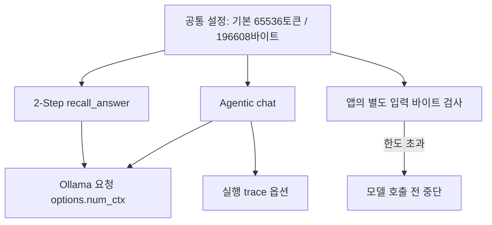

# 018: 실패 상태를 명확히 하고 컨텍스트 64K를 요청에 반영하다

## 문제 정의

<callout icon="💬" color="blue_bg">
	**실제 개발 요청 중 내용**
	실패했었어? 근데 왜 계속 진행했냐?
	내가 콘텍스트 제한 64k로 올림.... 4k는 쌉오바잖아..
</callout>

앞선 작업은 webserp가 검색에 성공한 것이 아니었다. 실패 상태에서 선택형 공급자 연결까지 진행했고, 사용자가 기대한 검색 성공 확인·원인 해결과 진행 방향이 어긋났다. 017의 실제 결과는 DDGS가 검색 질의10개 중1개에 결과 반환, webserp는0개였으며 실제 모델의 동일 질문에서도 두 공급자 모두 주소를 얻지 못했다. 이번 작업에서 검색 성공으로 상태를 바꾸거나 검색 문제를 해결했다고 표시하지 않는다.

별도로 사용자가 컨텍스트를 64K로 올렸는데 앱의 Ollama 호출은 여전히 4096으로 고정돼 있었다. 환경 설정 예시에 AGENT_CONTEXT_TOKENS가 있었지만 실제 호출에서 읽지 않았다. 성공 기준은 설정 문구만 바꾸는 것이 아니라 Agentic·2-Step의 실제 요청과 실행 기록에 65536을 사용하고, 이전의 작은 앱 입력 한도도 분리해 정리하는 것이다.

## 실제 질문과 응답

공통 설정을 적용한 뒤 Ollama에 짧은 질문을 한 번 보냈다. 검색 도구는 제공하지 않았다.

<callout icon="🔎" color="blue_bg">
	**실제로 보낸 질문**
	안녕. 한 문장으로 인사해.
</callout>

```text
안녕하세요, 오늘도 즐거운 하루 보내시길 바랍니다!
```

실제 요청 옵션은 num_ctx=65536, num_predict=512, temperature=0이었다. 응답은 done_reason=stop, 입력21토큰·출력13토큰이었다. 이것은 **64K 설정을 담은 요청을 보내 응답을 받은 확인**이다. 실제 64K 길이 입력의 수용량·정확도·메모리 사용량 검증은 아니다. 직후 /api/ps는 빈 모델 목록을 반환했으므로 상주 모델의 context_length로 설정을 재확인한 것으로 쓰지 않는다. 이전4K 설정으로 같은 인사 질문을 재실행한 비교는 하지 않았다.

## 문제 분석

기준 커밋 b72120a의 소스에는 세 가지 작은 제한이 있었다.

- Agentic chat과 2-Step recall_answer가 각각 num_ctx=4096을 하드코딩했다. trace에도4096이 따로 기록됐다.
- Agentic 입력 바이트 기본값10000·상한12000이 모델 호출 전에 실행을 막았다.
- 2-Step answer는 본문3000바이트 한도로 청크를 선택했다.

따라서 Ollama 쪽 기본 컨텍스트만 바꾸더라도 앱이 num_ctx를 다시 지정하거나 훨씬 먼저 입력을 차단할 수 있었다. 토큰 컨텍스트, 앱의 UTF-8 바이트 검사, 개별 도구의 짧은 결과 예산은 다른 설정이다. 이번에는 모델의 출력 한도512토큰이나 개별 웹검색 결과 예산을 임의로 늘리지 않았다.

## 해결한 변경

`src/travel_agent/llm_config.py`에 공통 설정을 추가했다. generation_options는 AGENT_CONTEXT_TOKENS를 읽으며 기본65536을 반환한다. input_byte_limit은 별도 AGENT_MAX_INPUT_BYTES를 읽으며 기본196608바이트다. 설정이 정수가 아니거나 허용 범위를 벗어나면 요청 전에 오류를 낸다.

`agent.chat`과 `memory_cli.recall_answer`가 같은 generation_options를 사용한다. run_agent의 trace에도 이 옵션을 기록한다. Agentic의 max_input_bytes 기본값은 고정10000 대신 공통 설정을 읽고, CLI가 값을 명시하면 그 값으로 덮어쓴다. 2-Step도 기존3000 대신 같은 바이트 설정을 읽는다. 기존 작은 한도는 명시적인 환경 설정·CLI 옵션으로 다시 적용할 수 있다.

196608바이트는 정확한 Qwen 토큰 수로 환산한 값이 아니라 앱의 독립적인 대략적 입력 한도다. 토큰화를 통한 정밀한 패킹이나 Ollama 내부 절단 여부 검증을 구현한 것은 아니다. .env 파일은 자동 로드하지 않으므로 예시 파일 수정과 터미널 환경변수 설정을 구분한다.



## 검증과 한계

기본64K가 실제 HTTP 요청 본문에 들어가는지, 환경변수 덮어쓰기, 잘못된 설정의 호출 전 거부, 2-Step의 큰 요약 전달, 기존10000바이트를 넘는 Agentic 입력과 trace 옵션을 검사했다. 기존 작은 입력 차단 테스트는 작은 한도를 명시해서 검증하도록 바꿨다. 전체63개 테스트가 통과했다.

검색 실패는 그대로다. 이번 작업은 컨텍스트 설정을 바로잡은 것이며 Google 비동기 응답의 결과 미추출을 고친 실험이 아니다. 과거017의4K 조건·측정치는 당시 결과로 남겨두며64K 실험인 것처럼 고치지 않는다.

<details>
<summary>실제 코드와 설정 방법</summary>
	이 연구일지와 함께 추가한 `llm_config.py`의 실제 함수다. 기존 기준은 b72120a이며 호출부를 공통 함수로 바꿔 설정 예시와 실제 요청의 불일치를 제거했다.
	```python
	def generation_options():
	    return {"num_ctx": _integer("AGENT_CONTEXT_TOKENS", 65536, 1024, 1048576),
	            "num_predict": 512, "temperature": 0}

	def input_byte_limit():
	    # This is a byte guard, not a tokenizer or a guarantee of fitting num_ctx.
	    return _integer("AGENT_MAX_INPUT_BYTES", 196608, 1000, 1048576)
	```
	PowerShell에서 명시적으로 설정할 경우:
	```powershell
	$env:AGENT_CONTEXT_TOKENS = '65536'
	$env:AGENT_MAX_INPUT_BYTES = '196608'
	```
	실제 테스트 출력:
	```text
	...............................................................
	----------------------------------------------------------------------
	Ran 63 tests in 1.265s

	OK
	```
</details>

<details>
<summary>실제 검증 호출 기록</summary>
	이번 인사 확인에는 에이전트 tool calling이 없었다. 아래는 개발 검증에서 실제 보낸 HTTP 요청과 관찰한 응답이다. 별도 호출 ID·시간은 이 검증에 저장하지 않았다. 쿠키나 인증정보는 사용하지 않았다.
	```json
	{
	  "endpoint": "http://127.0.0.1:11434/api/chat",
	  "model": "qwen3.5:4b-q4_K_M",
	  "messages": [{"role": "user", "content": "안녕. 한 문장으로 인사해."}],
	  "tools": [],
	  "stream": false,
	  "think": false,
	  "options": {"num_ctx": 65536, "num_predict": 512, "temperature": 0},
	  "answer": "안녕하세요, 오늘도 즐거운 하루 보내시길 바랍니다!",
	  "done_reason": "stop",
	  "prompt_tokens": 21,
	  "output_tokens": 13
	}
	```
	이어 GET /api/ps에서 models=[]를 관찰했다. 이 관찰만으로 모델의 내부 컨텍스트 할당을 확정하지 않는다.
</details>
