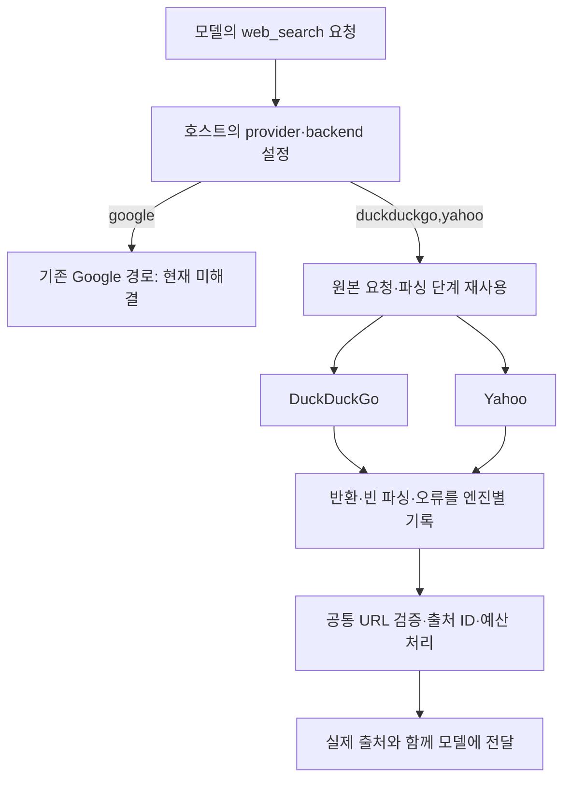

# 019: webserp 재검증 — Google 실패와 다중 엔진 동작을 구분하다

## 문제를 다시 정의하기

<callout icon="💬" color="blue_bg">
	**실제 개발 요청**
	고쳐쓸 수 있는지 검증하고, 제대로 파악해봐, 이슈도 찾아보고 실제로 어떻게 쓰는건지도 테스트 하면서 스스로 정리도 좀 하고 ㅇㅋ? 리드미만 너무 믿지말고 절대로
</callout>

앞선 실패는 Google 경로만 시험한 결과였다. 이번에는 저장소 전체의 사용 가능성, Google 결과 수신 문제, 파서 문제, 우리 어댑터의 제약을 분리했다. 좋은 결과의 기준은 공식 도메인이 실제 검색 결과에 나타나고 같은 에이전트 질문에서 그 URL과 제공된 출처를 답하는 것이다. Google이 여전히 실패하면 다른 엔진의 성공을 Google 수리라고 쓰지 않는다.

## 같은 질문에서 실제로 달라진 결과

이전017은4K 조건이었으므로 그대로 통제 비교로 쓰지 않고, Google 기준 실행도 이번에64K로 다시 수행했다. 두 실행은 같은 모델·질문·시스템 프롬프트, max_steps=4, max_tool_calls=4를 사용했다. 바꾼 것은 호스트가 지정한 검색 엔진 조합이다. 실행 시점과 서버 상태는 동일하게 고정할 수 없었다.

<callout icon="🔎" color="blue_bg">
	**두 실행에 실제로 보낸 질문**
	춘천 삼악산 호수케이블카와 국립춘천박물관의 공식 홈페이지 주소를 각각 찾아줘. 서로 독립적인 두 웹검색을 한 응답의 도구 요청 묶음으로 보내고, 각 검색은 top_k=1로 해줘. 반환된 주소와 출처를 간결하게 알려줘. 본문을 읽었다고 말하지 마.
</callout>

### Google 경로

최종 답변은 생성되지 않았다. 실제 answer는 빈 문자열이고 status는 tool_limit이었다. 두 검색을 시도한 뒤 질문을 조금 바꾸어 다시 시도했지만 실행된 네 도구 호출 모두 HTTP200의 비동기 응답에서 결과를 얻지 못했다. 모델은 세 번 호출됐고 추가 도구 요청은 한도 때문에 실행되지 않았다. 실패 답변 문장을 임의로 만들어 넣지 않는다.

### 명시적으로 선택한 DuckDuckGo·Yahoo 경로

```text
**춘천 삼악산 호수케이블카 공식 홈페이지**: https://samaksancablecar.com/
출처: [web:42a1dc11003496ff]

**국립춘천박물관 공식 홈페이지**: https://chuncheon.museum.go.kr/kor/index.do
출처: [web:7dbf48b80cbb29b7]
```

두 주소와 인용은 실제 반환된 검색 결과와 일치했다. 도구 호출2개가 한 묶음으로 실행됐고 모델 호출2번으로 답변을 마쳤다. 이 성공은 **Google을 고친 결과가 아니라 원본 webserp의 다른 엔진 경로를 제대로 연결한 결과**다.

## 이슈·변경 이력에서 확인한 것

[webserp 공개 저장소](https://github.com/PaperBoardOfficial/webserp)를 GitHub API로 조회했다. state=all의 공개 이슈0개·PR0개였다. Google 파일의 변경 이력을 따라가면 초기 릴리스와 패키지 이름 변경이 확인됐고 이후 Google 요청·파서 개선 이력은 찾지 못했다. 마지막 push는2026-02-21이었다. 공개 이슈가 없다고 정상 동작이 검증됐다는 뜻은 아니다. 저장소 트리에는 별도 테스트 디렉터리도 없었다.

참고할 직접 이슈가 없어 [SearXNG Google 토론 #6359](https://github.com/searxng/searxng/issues/6359)과 [현재 Google 구현](https://github.com/searxng/searxng/blob/master/searx/engines/google.py)을 읽었다. 일반 웹 결과의 JS 의존성, 대체 요청 형식, 대체 경로도 이후 막혔다는 사용 보고가 함께 있었다. 현재 소스의 WML 경로도 이 PC에서 실제로403을 반환했다. 소스나 이슈의 설명을 현재 동작 보장으로 취급하지 않았다. 과거 [비동기 모바일 요청 토론 #159](https://github.com/searxng/searxng/issues/159)은 실험 형식을 정하는 참고로만 사용했다.

## Google 실패를 어디까지 좁혔나

원본의 무작위 TLS 프로필이 비교를 흐리지 않도록 arc 실험에는 chrome133a를 고정했다. 원본·HTML 형식·PC 형식과 현재 SearXNG가 쓰는 WML 경로를 두 질문에서 각각 실행했다. WML은 요청 경로와 User-Agent·프로필이 함께 다른 별도 구성이지 한 변수만 바꾼 실험은 아니다.

| 실제 질의 | 요청 구성 | HTTP | 추출된 결과 |
| --- | --- | --- | --- |
| 국립춘천박물관 공식 홈페이지 | upstream | 200 | 0 |
| 국립춘천박물관 공식 홈페이지 | arc_html | 429 | 0 |
| 국립춘천박물관 공식 홈페이지 | arc_pc | 429 | 0 |
| 국립춘천박물관 공식 홈페이지 | wml | 403 | 0 |
| Python official website | upstream | 200 | 0 |
| Python official website | arc_html | 429 | 0 |
| Python official website | arc_pc | 429 | 0 |
| Python official website | wml | 403 | 0 |

원본 prog 응답은200·2031바이트였다. 응답을 비공개로 보존해 오프라인에서 분석하니, 16진수 길이 접두어를 가진5개 프레임으로 정확히 나뉘었다. 마크업 프레임에는 스크립트1개가 있었고 검색 링크·h3는0개였다. 단순히 길이 프레임을 제거하면 결과가 나타나는 상황은 아니었다. 스크립트를 실행하거나 외부 토큰을 추측해서 채우지 않았다.

다른 두 비동기 형식은429와 /sorry/index를, WML은403을 반환했다. 별도 Chrome 창을 띄운 진단에서도 검색 후 /sorry/index에 도착했고 제목 링크는0개였다. 개인 브라우저의 기존 로그인 프로필은 사용하지 않았다. 따라서 Google 로그인 세션을 가진 평소 브라우저도 동일하게 실패한다고 확대할 수는 없다.

새 익명 브라우저가 받은 쿠키4개를 비공개 로컬 파일에 저장하고, 별도 Python 프로세스의 HTTP 세션으로 다시 읽어 일반 검색을 한 번 수행했다.200이었지만 JS 활성화 안내 표식과 결과0개였다. **쿠키 파일 저장·로드 자체는 수행했으나 검색 접근 문제를 해결하지 못했다.** 로그인 인증정보·장기 세션 만료·갱신은 시험하지 않았으며 제품의 인증 파일 기능을 구현한 것도 아니다.

현재 증거로는 Google 요청 경로에서 결과 마크업 자체를 안정적으로 받지 못하는 문제가 먼저다. 파서를 더 고치면 무조건 해결된다고도, 이 IP는 영원히 불가능하다고도 결론 내리지 않는다.

## 원본 프로그램을 실제로 사용해 본 결과

원본 CLI에서 엔진을 지정하지 않은 영어 질의를 실행하니6개 결과가 나왔다. Google·Mojeek·Startpage는 결과를 제공하지 않았는데도 성공 목록에 포함됐고 Presearch는530 오류였다. 결과의 engine 필드를 보니 DuckDuckGo·Brave·Yahoo가 반환한 결과였다. 원본의 성공 메시지보다 실제 결과 배열과 엔진을 봐야 했다.

<callout icon="🔎" color="blue_bg">
	**원본 CLI에 보낸 확인 질문**
	Python official website
</callout>

원본 출력에서 DuckDuckGo는 “Welcome to Python.org”와 https://www.python.org/ 를 반환했다. Google 결과라고 표시하지 않는다. 이어 DuckDuckGo·Yahoo만 지정해 케이블카와 박물관 질문을 실행했더니 두 공식 도메인을 반환했다.

우리 기존 어댑터는 Google만 지원했으므로 이런 작동 경로를 사용할 수 없었다. 라이브러리 전체가 못 쓰는 것이 아니라 **Google의 실패와 우리 연결 범위가 겹쳐 있었던 것**이다.

## 무엇을 고쳐 연결했나

프로젝트 기준 커밋은2bab155, 외부 의존성은 기존 e13148334995745f104a69ce7127179785ee741e를 유지했다. 원본 클론은 수정하지 않았다.

어댑터가 원본의 내부 함수에 의존하므로 해당 커밋을 고정했다. 향후 의존성을 갱신하면 이 호출 규약과 실제 검색을 다시 검증해야 한다.

- `webserp_provider.search_html`은 원본의 엔진 요청 생성·수신·파싱 단계인 _fetch_engine을 재사용한다. 현재 직접 시험한 DuckDuckGo·Yahoo 단독/조합만 노출한다. 한 도구 호출 안에서 두 요청을 병렬로 실행하며 세션은 해당 호출이 소유한다.
- 모든 엔진이 빈 결과를 내면 정상 빈 검색으로 단정하지 않는다. 한 엔진이 결과를 냈어도 다른 엔진의 빈 파싱 결과·오류를 숨기지 않는다.
- `web.web_search`는 Google 단독과 HTML 엔진 조합을 명시적으로 라우팅한다. Google을 요청했는데 Yahoo 결과를 대신 돌려주는 자동 대체는 없다.
- 제목·URL·출처 ID·바이트 예산의 공통 처리를 재사용하고 결과별 실제 engine을 남긴다. 원본 최종 orchestrator는 URL 전체를 소문자로 만들어 중복 제거하므로 그 이전의 결과를 가져와 URL 경로의 대소문자를 보존한다.



## 반복 검증과 판정

같은 세 질의를 두 번씩 실행해6회 모두 top5 안에서 기대한 공식 도메인을 발견했다. 반복 실행에서 실제 결과를 낸 엔진은 Yahoo였고 DuckDuckGo는 빈 파싱 결과였다. 원본 CLI의 앞선 실행에서는 DuckDuckGo도 결과를 냈으므로 그 엔진이 영구적으로 실패한다고 해석하지 않는다.

| 실제 질의 | 기대 도메인 | 첫 실행 | 두 번째 실행 |
| --- | --- | --- | --- |
| 춘천 삼악산 호수케이블카 공식 홈페이지 | samaksancablecar.com | True | True |
| 국립춘천박물관 공식 홈페이지 | chuncheon.museum.go.kr | True | True |
| Python official website | python.org | True | True |

실제 모델 비교도 모두64K였다. Google 기준 실행은 최종 답변 없이 tool_limit, HTML 엔진 조합은 두 주소와 유효한 제공 ID 인용을 반환했다. 검색 엔진과 실행 순서가 달라졌으므로 성능 차이를 파서 수정 하나의 효과나 공급자 전체의 우열로 설명하지 않는다. 세 개발 질의·두 반복과 모델 한 번씩의 결과이며 장기 가용성·추천 품질·현재 운영 정보의 정확성은 별도다.

67개 단위 테스트가 통과했다. 엔진별 빈 결과 보존, 모두 빈 결과일 때 오류, 외부 예외 문자열의 민감 정보 제외, URL 경로 대소문자 보존과 엔진 표시를 추가 검증했다. 모델 다운로드나 추가 유료 서비스 도입은 없었다.

판정은 **일부 경로를 고쳐 쓸 수 있음**이다. Google 검색을 수리했다고 말할 근거는 아직 없다. 현재 바로 재현할 수 있는 것은 명시적인 DuckDuckGo·Yahoo 조합이며 결과는 Yahoo에 의존한 사례다. 로그인 세션을 자동으로 보존하면 Google도 해결될 것이라는 약속은 하지 않는다.

<details>
<summary>실제 코드와 재현 실행법</summary>
	`src/travel_agent/webserp_provider.py`의 이번 구현이다. 원본의 결과 배열을 그대로 성공으로 취급하지 않고 엔진별 상태와 실제 출처를 보존한다.
	```python
	def search_html(query, top_k, timeout, engines):
	    """Reuse pinned upstream fetch/parse steps, before its lossy URL deduplication.

	    Only the engines exercised by this project are exposed. Empty parsing is
	    reported separately, including when another engine returned useful results.
	    """
	    import asyncio
	    import re

	    if not engines or any(name not in {"duckduckgo", "yahoo"} for name in engines):
	        raise ValueError("webserp HTML engines must be duckduckgo and/or yahoo")
	    engines = list(dict.fromkeys(engines))
	    try:
	        from curl_cffi.requests import AsyncSession
	        from webserp.engines import ALL_ENGINES
	        from webserp.search import _fetch_engine
	    except ImportError as exc:
	        raise WebSearchError("webserp is not installed; install the project's [webserp] extra",
	                             details={"provider": "webserp", "status": "dependency_missing"}) from exc

	    async def fetch_all():
	        async with AsyncSession() as session:
	            return await asyncio.gather(*[
	                _fetch_engine(ALL_ENGINES[name], query, top_k, timeout, None, session) for name in engines
	            ])

	    outcomes = asyncio.run(fetch_all())
	    rows, empty, failures = [], [], []
	    returned = []
	    for name, hits, error in outcomes:
	        if error:
	            # The upstream exception text is not guaranteed to exclude secrets.
	            status_match = re.search(r"HTTP Error (\d{3})", error)
	            failures.append({"engine": name, "status": "upstream_error",
	                             **({"http_status": int(status_match[1])} if status_match else {})})
	        elif not hits:
	            empty.append(name)
	        else:
	            returned.append(name)
	            rows.extend({"href": hit.url, "title": hit.title, "body": hit.content, "engine": name} for hit in hits)
	    metadata = {"request_mode": "upstream_html", "engines_requested": engines,
	                "engines_returned": returned, "empty_or_unparsed_engines": empty, "engine_errors": failures}
	    if not rows:
	        raise WebSearchError("webserp HTML engines returned no usable evidence; empty parsing is not a proven empty search",
	                             details={"provider": "webserp", "backend_requested": ",".join(engines),
	                                      "status": "no_usable_evidence", **metadata})
	    return rows, metadata

	```
	프로젝트 가상환경에서:
	```powershell
	# 원본 CLI의 사용 방식: 엔진을 지정하지 않으면 여러 엔진을 호출한다.
	webserp "Python official website" --max-results 3 --verbose
	webserp "국립춘천박물관 공식 홈페이지" --engines duckduckgo,yahoo --max-results 3 --verbose
	# 우리 에이전트의 검색 도구 경로
	travel-agent web search "국립춘천박물관 공식 홈페이지" --provider webserp --backend duckduckgo,yahoo
	$env:WEB_SEARCH_PROVIDER = 'webserp'
	$env:WEB_SEARCH_BACKEND = 'duckduckgo,yahoo'
	travel-agent memory --user demo --session trip agent "춘천 삼악산 호수케이블카와 국립춘천박물관의 공식 홈페이지를 찾아줘"
	# 반복 검색과 실제 모델 검증
	python scripts/evaluate_webserp_repair.py --agent
	# Google 기준 실행: 별도 파일에 저장해 성공 경로의 결과를 덮어쓰지 않는다.
	python scripts/evaluate_webserp_repair.py --agent-only --backend google --output artifacts/webserp-google-baseline-64k.json
	# Google 요청 형식 진단은 접근 차단을 유발할 수 있으므로 필요할 때만 실행한다.
	python scripts/investigate_webserp.py
	```
	원본 CLI를 Windows에서 실행할 때 콘솔 문자 인코딩 오류가 있으면 PYTHONUTF8=1을 설정한다. 프로젝트 CLI는 UTF-8 출력을 설정한다.
	실제 테스트 출력:
	```text
	...................................................................
	----------------------------------------------------------------------
	Ran 67 tests in 0.872s

	OK
	```
</details>

<details>
<summary>실제 에이전트 툴콜: 동일 질문의 실패·성공</summary>
	공개 기록에는 실제 인자·호출 ID·순서·시간·오류와 결과의 제목·URL·출처·엔진을 실었다. 전체 응답·HTML·브라우저 상태는 비공개로 보존하고 쿠키 값·동적 응답 토큰은 싣지 않는다.

	Google 기준 실행
	```json
	{
	  "query": "춘천 삼악산 호수케이블카와 국립춘천박물관의 공식 홈페이지 주소를 각각 찾아줘. 서로 독립적인 두 웹검색을 한 응답의 도구 요청 묶음으로 보내고, 각 검색은 top_k=1로 해줘. 반환된 주소와 출처를 간결하게 알려줘. 본문을 읽었다고 말하지 마.",
	  "options": {
	    "num_ctx": 65536,
	    "num_predict": 512,
	    "temperature": 0,
	    "think": false
	  },
	  "status": "tool_limit",
	  "tool_log": [
	    {
	      "request_id": "f269ed48b52143759923684827ed226f",
	      "sequence": 5,
	      "timestamp": "2026-10-17T15:55:06.329196+00:00",
	      "elapsed_seconds": 1.37778,
	      "kind": "tool_start",
	      "step": 1,
	      "span": "1.1",
	      "name": "web_search",
	      "call_index": 0,
	      "tool_call_id": "call_z3tevaa6",
	      "arguments": {
	        "query": "춘천 삼악산 호수케이블카 공식 홈페이지",
	        "top_k": 1
	      }
	    },
	    {
	      "request_id": "f269ed48b52143759923684827ed226f",
	      "sequence": 6,
	      "timestamp": "2026-10-17T15:55:06.329772+00:00",
	      "elapsed_seconds": 1.37832,
	      "kind": "tool_start",
	      "step": 1,
	      "span": "1.2",
	      "name": "web_search",
	      "call_index": 1,
	      "tool_call_id": "call_wm9promg",
	      "arguments": {
	        "query": "국립춘천박물관 공식 홈페이지",
	        "top_k": 1
	      }
	    },
	    {
	      "request_id": "f269ed48b52143759923684827ed226f",
	      "sequence": 7,
	      "timestamp": "2026-10-17T15:55:06.645030+00:00",
	      "elapsed_seconds": 1.695308,
	      "kind": "tool_error",
	      "step": 1,
	      "span": "1.1",
	      "name": "web_search",
	      "result": {
	        "error": "webserp Google yielded no usable results (async_framed); not a proven empty search",
	        "error_type": "WebSearchError",
	        "web_search_performed": false,
	        "provider": "webserp",
	        "backend_requested": "google",
	        "impersonate": "chrome131",
	        "request_mode": "upstream_arc",
	        "request_language": "en",
	        "http_status": 200,
	        "response_bytes": 2031,
	        "response_kind": "async_framed",
	        "status": "unparsed_response"
	      },
	      "elapsed_seconds_call": 0.317084
	    },
	    {
	      "request_id": "f269ed48b52143759923684827ed226f",
	      "sequence": 8,
	      "timestamp": "2026-10-17T15:55:06.673658+00:00",
	      "elapsed_seconds": 1.724205,
	      "kind": "tool_error",
	      "step": 1,
	      "span": "1.2",
	      "name": "web_search",
	      "result": {
	        "error": "webserp Google yielded no usable results (async_framed); not a proven empty search",
	        "error_type": "WebSearchError",
	        "web_search_performed": false,
	        "provider": "webserp",
	        "backend_requested": "google",
	        "impersonate": "chrome124",
	        "request_mode": "upstream_arc",
	        "request_language": "en",
	        "http_status": 200,
	        "response_bytes": 2031,
	        "response_kind": "async_framed",
	        "status": "unparsed_response"
	      },
	      "elapsed_seconds_call": 0.345472
	    },
	    {
	      "request_id": "f269ed48b52143759923684827ed226f",
	      "sequence": 13,
	      "timestamp": "2026-10-17T15:55:07.968743+00:00",
	      "elapsed_seconds": 3.01852,
	      "kind": "tool_start",
	      "step": 2,
	      "span": "2.1",
	      "name": "web_search",
	      "call_index": 0,
	      "tool_call_id": "call_t1195u66",
	      "arguments": {
	        "query": "춘천 삼악산 호수케이블카 홈페이지",
	        "top_k": 1
	      }
	    },
	    {
	      "request_id": "f269ed48b52143759923684827ed226f",
	      "sequence": 14,
	      "timestamp": "2026-10-17T15:55:07.968743+00:00",
	      "elapsed_seconds": 3.019195,
	      "kind": "tool_start",
	      "step": 2,
	      "span": "2.2",
	      "name": "web_search",
	      "call_index": 1,
	      "tool_call_id": "call_bfue9x8z",
	      "arguments": {
	        "query": "국립춘천박물관 홈페이지",
	        "top_k": 1
	      }
	    },
	    {
	      "request_id": "f269ed48b52143759923684827ed226f",
	      "sequence": 15,
	      "timestamp": "2026-10-17T15:55:08.198333+00:00",
	      "elapsed_seconds": 3.24789,
	      "kind": "tool_error",
	      "step": 2,
	      "span": "2.1",
	      "name": "web_search",
	      "result": {
	        "error": "webserp Google yielded no usable results (async_framed); not a proven empty search",
	        "error_type": "WebSearchError",
	        "web_search_performed": false,
	        "provider": "webserp",
	        "backend_requested": "google",
	        "impersonate": "chrome131",
	        "request_mode": "upstream_arc",
	        "request_language": "en",
	        "http_status": 200,
	        "response_bytes": 2031,
	        "response_kind": "async_framed",
	        "status": "unparsed_response"
	      },
	      "elapsed_seconds_call": 0.228838
	    },
	    {
	      "request_id": "f269ed48b52143759923684827ed226f",
	      "sequence": 16,
	      "timestamp": "2026-10-17T15:55:08.201755+00:00",
	      "elapsed_seconds": 3.249978,
	      "kind": "tool_error",
	      "step": 2,
	      "span": "2.2",
	      "name": "web_search",
	      "result": {
	        "error": "webserp Google yielded no usable results (async_framed); not a proven empty search",
	        "error_type": "WebSearchError",
	        "web_search_performed": false,
	        "provider": "webserp",
	        "backend_requested": "google",
	        "impersonate": "chrome120",
	        "request_mode": "upstream_arc",
	        "request_language": "en",
	        "http_status": 200,
	        "response_bytes": 2031,
	        "response_kind": "async_framed",
	        "status": "unparsed_response"
	      },
	      "elapsed_seconds_call": 0.230072
	    }
	  ]
	}
	```

	검증한 HTML 엔진 조합
	```json
	{
	  "query": "춘천 삼악산 호수케이블카와 국립춘천박물관의 공식 홈페이지 주소를 각각 찾아줘. 서로 독립적인 두 웹검색을 한 응답의 도구 요청 묶음으로 보내고, 각 검색은 top_k=1로 해줘. 반환된 주소와 출처를 간결하게 알려줘. 본문을 읽었다고 말하지 마.",
	  "options": {
	    "num_ctx": 65536,
	    "num_predict": 512,
	    "temperature": 0,
	    "think": false
	  },
	  "status": "completed",
	  "tool_log": [
	    {
	      "request_id": "6f37adec4bf743e08028865c8867cdc0",
	      "sequence": 5,
	      "timestamp": "2026-10-17T15:52:48.947228+00:00",
	      "elapsed_seconds": 6.319977,
	      "kind": "tool_start",
	      "step": 1,
	      "span": "1.1",
	      "name": "web_search",
	      "call_index": 0,
	      "tool_call_id": "call_e7bkw1y2",
	      "arguments": {
	        "query": "춘천 삼악산 호수케이블카 공식 홈페이지",
	        "top_k": 1
	      }
	    },
	    {
	      "request_id": "6f37adec4bf743e08028865c8867cdc0",
	      "sequence": 6,
	      "timestamp": "2026-10-17T15:52:48.948294+00:00",
	      "elapsed_seconds": 6.320961,
	      "kind": "tool_start",
	      "step": 1,
	      "span": "1.2",
	      "name": "web_search",
	      "call_index": 1,
	      "tool_call_id": "call_wqe71tkn",
	      "arguments": {
	        "query": "국립춘천박물관 공식 홈페이지",
	        "top_k": 1
	      }
	    },
	    {
	      "request_id": "6f37adec4bf743e08028865c8867cdc0",
	      "sequence": 7,
	      "timestamp": "2026-10-17T15:52:49.971237+00:00",
	      "elapsed_seconds": 7.34375,
	      "kind": "tool_end",
	      "step": 1,
	      "span": "1.2",
	      "name": "web_search",
	      "result": {
	        "provider": "webserp",
	        "backend_requested": "duckduckgo,yahoo",
	        "request_mode": "upstream_html",
	        "engines_requested": [
	          "duckduckgo",
	          "yahoo"
	        ],
	        "engines_returned": [
	          "yahoo"
	        ],
	        "empty_or_unparsed_engines": [
	          "duckduckgo"
	        ],
	        "engine_errors": [],
	        "searched_at": "2026-10-17T15:52:49.970602+00:00",
	        "content_kind": "search_snippet",
	        "page_fetched": false,
	        "web_search_performed": true,
	        "status": "ok",
	        "omitted_results": 0,
	        "hits": [
	          {
	            "id": "web:7dbf48b80cbb29b7",
	            "title": "국립춘천박물관 - Museum",
	            "url": "https://chuncheon.museum.go.kr/kor/index.do",
	            "engine": "yahoo"
	          }
	        ]
	      },
	      "elapsed_seconds_call": 1.022409
	    },
	    {
	      "request_id": "6f37adec4bf743e08028865c8867cdc0",
	      "sequence": 8,
	      "timestamp": "2026-10-17T15:52:50.145636+00:00",
	      "elapsed_seconds": 7.518617,
	      "kind": "tool_end",
	      "step": 1,
	      "span": "1.1",
	      "name": "web_search",
	      "result": {
	        "provider": "webserp",
	        "backend_requested": "duckduckgo,yahoo",
	        "request_mode": "upstream_html",
	        "engines_requested": [
	          "duckduckgo",
	          "yahoo"
	        ],
	        "engines_returned": [
	          "yahoo"
	        ],
	        "empty_or_unparsed_engines": [
	          "duckduckgo"
	        ],
	        "engine_errors": [],
	        "searched_at": "2026-10-17T15:52:50.145636+00:00",
	        "content_kind": "search_snippet",
	        "page_fetched": false,
	        "web_search_performed": true,
	        "status": "ok",
	        "omitted_results": 0,
	        "hits": [
	          {
	            "id": "web:42a1dc11003496ff",
	            "title": "춘천 삼악산 호수 케이블카",
	            "url": "https://samaksancablecar.com/",
	            "engine": "yahoo"
	          }
	        ]
	      },
	      "elapsed_seconds_call": 1.197763
	    }
	  ]
	}
	```
</details>

<details>
<summary>실제 반복 검색 6회: 요청·엔진 상태·공식 주소</summary>
	동일한 top_k=5·기본 timeout15초·도구 반환 예산10000바이트 조건이다.

	```json
	{
	  "repeat": 1,
	  "query": "춘천 삼악산 호수케이블카 공식 홈페이지",
	  "expected_domain": "samaksancablecar.com",
	  "domain_found": true,
	  "elapsed_seconds": 1.365,
	  "result": {
	    "provider": "webserp",
	    "backend_requested": "duckduckgo,yahoo",
	    "request_mode": "upstream_html",
	    "engines_requested": [
	      "duckduckgo",
	      "yahoo"
	    ],
	    "engines_returned": [
	      "yahoo"
	    ],
	    "empty_or_unparsed_engines": [
	      "duckduckgo"
	    ],
	    "engine_errors": [],
	    "searched_at": "2026-10-17T15:52:30.723732+00:00",
	    "content_kind": "search_snippet",
	    "page_fetched": false,
	    "web_search_performed": true,
	    "status": "ok",
	    "omitted_results": 0,
	    "hits": [
	      {
	        "id": "web:42a1dc11003496ff",
	        "title": "춘천 삼악산 호수 케이블카",
	        "url": "https://samaksancablecar.com/",
	        "engine": "yahoo"
	      },
	      {
	        "id": "web:68a334fb3e761b7d",
	        "title": "케이블카 소개｜춘천 삼악산 호수케이블카",
	        "url": "https://www.samaksancablecar.com/home/produce/produce.php",
	        "engine": "yahoo"
	      },
	      {
	        "id": "web:100e05e7c57af5c6",
	        "title": "삼악산 호수케이블카 | 춘천여행ON - 춘천 관광 포털",
	        "url": "https://www.chuncheon.go.kr/tour/destination/all-tour/detail/?tourId=212",
	        "engine": "yahoo"
	      },
	      {
	        "id": "web:bc576076b720db07",
	        "title": "춘천 삼악산 호수 케이블카 요금·예약·가는 법 (2026년 최신)",
	        "url": "https://oh-my-gat.com/samaksan-lake-cablecar-guide/",
	        "engine": "yahoo"
	      },
	      {
	        "id": "web:64e36da511ac6691",
	        "title": "춘천 삼악산 호수 케이블카 예약 https://samaksancablecar.com/",
	        "url": "https://shortnewsdaily.kr/samaksan-cablecar-booking/",
	        "engine": "yahoo"
	      }
	    ]
	  }
	}
	```

	```json
	{
	  "repeat": 1,
	  "query": "국립춘천박물관 공식 홈페이지",
	  "expected_domain": "chuncheon.museum.go.kr",
	  "domain_found": true,
	  "elapsed_seconds": 1.069,
	  "result": {
	    "provider": "webserp",
	    "backend_requested": "duckduckgo,yahoo",
	    "request_mode": "upstream_html",
	    "engines_requested": [
	      "duckduckgo",
	      "yahoo"
	    ],
	    "engines_returned": [
	      "yahoo"
	    ],
	    "empty_or_unparsed_engines": [
	      "duckduckgo"
	    ],
	    "engine_errors": [],
	    "searched_at": "2026-10-17T15:52:32.794142+00:00",
	    "content_kind": "search_snippet",
	    "page_fetched": false,
	    "web_search_performed": true,
	    "status": "ok",
	    "omitted_results": 0,
	    "hits": [
	      {
	        "id": "web:7dbf48b80cbb29b7",
	        "title": "국립춘천박물관 - Museum",
	        "url": "https://chuncheon.museum.go.kr/kor/index.do",
	        "engine": "yahoo"
	      },
	      {
	        "id": "web:3869b5bac7aabebd",
	        "title": "Chuncheon National Museum",
	        "url": "https://chuncheon.museum.go.kr/eng/index.do",
	        "engine": "yahoo"
	      },
	      {
	        "id": "web:bf68b2be09f99e75",
	        "title": "Museum - 국립중앙박물관",
	        "url": "https://www.museum.go.kr/",
	        "engine": "yahoo"
	      },
	      {
	        "id": "web:ebe39a985e210e84",
	        "title": "국립춘천박물관 홈페이지 바로가기(https://chuncheon.museum.go.kr/)",
	        "url": "https://shortcut.goodinterior.kr/%EA%B5%AD%EB%A6%BD%EC%B6%98%EC%B2%9C%EB%B0%95%EB%AC%BC%EA%B4%80-%ED%99%88%ED%8E%98%EC%9D%B4%EC%A7%80-%EB%B0%94%EB%A1%9C%EA%B0%80%EA%B8%B0https-chuncheon-museum-go-kr/",
	        "engine": "yahoo"
	      },
	      {
	        "id": "web:3436796a9a1405e0",
	        "title": "국립중앙박물관 - mvcm.museum.go.kr",
	        "url": "https://mvcm.museum.go.kr/MUSEUM/main/index.do",
	        "engine": "yahoo"
	      }
	    ]
	  }
	}
	```

	```json
	{
	  "repeat": 1,
	  "query": "Python official website",
	  "expected_domain": "python.org",
	  "domain_found": true,
	  "elapsed_seconds": 1.387,
	  "result": {
	    "provider": "webserp",
	    "backend_requested": "duckduckgo,yahoo",
	    "request_mode": "upstream_html",
	    "engines_requested": [
	      "duckduckgo",
	      "yahoo"
	    ],
	    "engines_returned": [
	      "yahoo"
	    ],
	    "empty_or_unparsed_engines": [
	      "duckduckgo"
	    ],
	    "engine_errors": [],
	    "searched_at": "2026-10-17T15:52:35.183511+00:00",
	    "content_kind": "search_snippet",
	    "page_fetched": false,
	    "web_search_performed": true,
	    "status": "ok",
	    "omitted_results": 0,
	    "hits": [
	      {
	        "id": "web:3a612d3b0026605c",
	        "title": "Welcome to Python.org",
	        "url": "https://www.python.org/",
	        "engine": "yahoo"
	      },
	      {
	        "id": "web:84ed1861359f79ce",
	        "title": "Download Python | Python.org",
	        "url": "https://www.python.org/downloads/",
	        "engine": "yahoo"
	      },
	      {
	        "id": "web:8f29c10c05ac4707",
	        "title": "Our Documentation | Python.org",
	        "url": "https://www.python.org/doc/",
	        "engine": "yahoo"
	      },
	      {
	        "id": "web:388fd65dc70040fd",
	        "title": "Python For Beginners | Python.org",
	        "url": "https://www.python.org/about/gettingstarted/",
	        "engine": "yahoo"
	      },
	      {
	        "id": "web:9d29541292eedc47",
	        "title": "Python Release Python 3.15.0 | Python.org",
	        "url": "https://www.python.org/downloads/latest/",
	        "engine": "yahoo"
	      }
	    ]
	  }
	}
	```

	```json
	{
	  "repeat": 2,
	  "query": "춘천 삼악산 호수케이블카 공식 홈페이지",
	  "expected_domain": "samaksancablecar.com",
	  "domain_found": true,
	  "elapsed_seconds": 1.187,
	  "result": {
	    "provider": "webserp",
	    "backend_requested": "duckduckgo,yahoo",
	    "request_mode": "upstream_html",
	    "engines_requested": [
	      "duckduckgo",
	      "yahoo"
	    ],
	    "engines_returned": [
	      "yahoo"
	    ],
	    "empty_or_unparsed_engines": [
	      "duckduckgo"
	    ],
	    "engine_errors": [],
	    "searched_at": "2026-10-17T15:52:37.372443+00:00",
	    "content_kind": "search_snippet",
	    "page_fetched": false,
	    "web_search_performed": true,
	    "status": "ok",
	    "omitted_results": 0,
	    "hits": [
	      {
	        "id": "web:42a1dc11003496ff",
	        "title": "춘천 삼악산 호수 케이블카",
	        "url": "https://samaksancablecar.com/",
	        "engine": "yahoo"
	      },
	      {
	        "id": "web:68a334fb3e761b7d",
	        "title": "케이블카 소개｜춘천 삼악산 호수케이블카",
	        "url": "https://www.samaksancablecar.com/home/produce/produce.php",
	        "engine": "yahoo"
	      },
	      {
	        "id": "web:100e05e7c57af5c6",
	        "title": "삼악산 호수케이블카 | 춘천여행ON - 춘천 관광 포털",
	        "url": "https://www.chuncheon.go.kr/tour/destination/all-tour/detail/?tourId=212",
	        "engine": "yahoo"
	      },
	      {
	        "id": "web:bc576076b720db07",
	        "title": "춘천 삼악산 호수 케이블카 요금·예약·가는 법 (2026년 최신)",
	        "url": "https://oh-my-gat.com/samaksan-lake-cablecar-guide/",
	        "engine": "yahoo"
	      },
	      {
	        "id": "web:64e36da511ac6691",
	        "title": "춘천 삼악산 호수 케이블카 예약 https://samaksancablecar.com/",
	        "url": "https://shortnewsdaily.kr/samaksan-cablecar-booking/",
	        "engine": "yahoo"
	      }
	    ]
	  }
	}
	```

	```json
	{
	  "repeat": 2,
	  "query": "국립춘천박물관 공식 홈페이지",
	  "expected_domain": "chuncheon.museum.go.kr",
	  "domain_found": true,
	  "elapsed_seconds": 1.022,
	  "result": {
	    "provider": "webserp",
	    "backend_requested": "duckduckgo,yahoo",
	    "request_mode": "upstream_html",
	    "engines_requested": [
	      "duckduckgo",
	      "yahoo"
	    ],
	    "engines_returned": [
	      "yahoo"
	    ],
	    "empty_or_unparsed_engines": [
	      "duckduckgo"
	    ],
	    "engine_errors": [],
	    "searched_at": "2026-10-17T15:52:39.395333+00:00",
	    "content_kind": "search_snippet",
	    "page_fetched": false,
	    "web_search_performed": true,
	    "status": "ok",
	    "omitted_results": 0,
	    "hits": [
	      {
	        "id": "web:7dbf48b80cbb29b7",
	        "title": "국립춘천박물관 - Museum",
	        "url": "https://chuncheon.museum.go.kr/kor/index.do",
	        "engine": "yahoo"
	      },
	      {
	        "id": "web:3869b5bac7aabebd",
	        "title": "Chuncheon National Museum",
	        "url": "https://chuncheon.museum.go.kr/eng/index.do",
	        "engine": "yahoo"
	      },
	      {
	        "id": "web:bf68b2be09f99e75",
	        "title": "Museum - 국립중앙박물관",
	        "url": "https://www.museum.go.kr/",
	        "engine": "yahoo"
	      },
	      {
	        "id": "web:ebe39a985e210e84",
	        "title": "국립춘천박물관 홈페이지 바로가기(https://chuncheon.museum.go.kr/)",
	        "url": "https://shortcut.goodinterior.kr/%EA%B5%AD%EB%A6%BD%EC%B6%98%EC%B2%9C%EB%B0%95%EB%AC%BC%EA%B4%80-%ED%99%88%ED%8E%98%EC%9D%B4%EC%A7%80-%EB%B0%94%EB%A1%9C%EA%B0%80%EA%B8%B0https-chuncheon-museum-go-kr/",
	        "engine": "yahoo"
	      },
	      {
	        "id": "web:3436796a9a1405e0",
	        "title": "국립중앙박물관 - mvcm.museum.go.kr",
	        "url": "https://mvcm.museum.go.kr/MUSEUM/main/index.do",
	        "engine": "yahoo"
	      }
	    ]
	  }
	}
	```

	```json
	{
	  "repeat": 2,
	  "query": "Python official website",
	  "expected_domain": "python.org",
	  "domain_found": true,
	  "elapsed_seconds": 1.213,
	  "result": {
	    "provider": "webserp",
	    "backend_requested": "duckduckgo,yahoo",
	    "request_mode": "upstream_html",
	    "engines_requested": [
	      "duckduckgo",
	      "yahoo"
	    ],
	    "engines_returned": [
	      "yahoo"
	    ],
	    "empty_or_unparsed_engines": [
	      "duckduckgo"
	    ],
	    "engine_errors": [],
	    "searched_at": "2026-10-17T15:52:41.609442+00:00",
	    "content_kind": "search_snippet",
	    "page_fetched": false,
	    "web_search_performed": true,
	    "status": "ok",
	    "omitted_results": 0,
	    "hits": [
	      {
	        "id": "web:3a612d3b0026605c",
	        "title": "Welcome to Python.org",
	        "url": "https://www.python.org/",
	        "engine": "yahoo"
	      },
	      {
	        "id": "web:84ed1861359f79ce",
	        "title": "Download Python | Python.org",
	        "url": "https://www.python.org/downloads/",
	        "engine": "yahoo"
	      },
	      {
	        "id": "web:8f29c10c05ac4707",
	        "title": "Our Documentation | Python.org",
	        "url": "https://www.python.org/doc/",
	        "engine": "yahoo"
	      },
	      {
	        "id": "web:388fd65dc70040fd",
	        "title": "Python For Beginners | Python.org",
	        "url": "https://www.python.org/about/gettingstarted/",
	        "engine": "yahoo"
	      },
	      {
	        "id": "web:9d29541292eedc47",
	        "title": "Python Release Python 3.15.0 | Python.org",
	        "url": "https://www.python.org/downloads/latest/",
	        "engine": "yahoo"
	      }
	    ]
	  }
	}
	```
</details>

<details>
<summary>조사·프로토콜·브라우저·로컬 쿠키 재사용 검증 로그</summary>
	별도 진단의 실제 요청 조건과 응답 지표다. 이 중 Google 형식 진단은 고정 프로필을 사용했고, 익명 브라우저와 쿠키 재사용은 별도 실험이었다.
	```json
	{
	  "protocol_runs": [
	    {
	      "query": "국립춘천박물관 공식 홈페이지",
	      "mode": "upstream",
	      "endpoint": "https://www.google.com/search",
	      "params": {
	        "q": "국립춘천박물관 공식 홈페이지",
	        "num": "5",
	        "hl": "en",
	        "asearch": "arc",
	        "async": "arc_id:srp_dUICJtTnYA4hGnWs8nHqZVw_1,use_ac:true,_fmt:prog"
	      },
	      "profile": "chrome133a",
	      "cookie_names_sent": [
	        "CONSENT"
	      ],
	      "http_status": 200,
	      "response_bytes": 2031,
	      "final_path": "/search",
	      "final_host": "www.google.com",
	      "upstream_hits": [],
	      "h3_count": 0,
	      "anchor_count": 0,
	      "wml_blocks": 0,
	      "async_framed": true,
	      "js_required": false,
	      "received_cookie_names": [
	        "AEC",
	        "NID",
	        "SEARCH_SAMESITE",
	        "__Secure-STRP"
	      ],
	      "elapsed_seconds": 0.216
	    },
	    {
	      "query": "국립춘천박물관 공식 홈페이지",
	      "mode": "arc_html",
	      "endpoint": "https://www.google.com/search",
	      "params": {
	        "q": "국립춘천박물관 공식 홈페이지",
	        "num": "5",
	        "hl": "en",
	        "asearch": "arc",
	        "async": "use_ac:true,_fmt:html"
	      },
	      "profile": "chrome133a",
	      "cookie_names_sent": [
	        "CONSENT"
	      ],
	      "http_status": 429,
	      "response_bytes": 3779,
	      "final_path": "/sorry/index",
	      "final_host": "www.google.com",
	      "upstream_hits": [],
	      "h3_count": 0,
	      "anchor_count": 3,
	      "wml_blocks": 0,
	      "async_framed": false,
	      "js_required": false,
	      "received_cookie_names": [
	        "AEC",
	        "NID",
	        "SEARCH_SAMESITE",
	        "__Secure-STRP"
	      ],
	      "elapsed_seconds": 0.656
	    },
	    {
	      "query": "국립춘천박물관 공식 홈페이지",
	      "mode": "arc_pc",
	      "endpoint": "https://www.google.com/search",
	      "params": {
	        "q": "국립춘천박물관 공식 홈페이지",
	        "num": "5",
	        "hl": "en",
	        "asearch": "arc",
	        "async": "use_ac:true,_fmt:pc"
	      },
	      "profile": "chrome133a",
	      "cookie_names_sent": [
	        "CONSENT"
	      ],
	      "http_status": 429,
	      "response_bytes": 3773,
	      "final_path": "/sorry/index",
	      "final_host": "www.google.com",
	      "upstream_hits": [],
	      "h3_count": 0,
	      "anchor_count": 3,
	      "wml_blocks": 0,
	      "async_framed": false,
	      "js_required": false,
	      "received_cookie_names": [
	        "AEC",
	        "NID",
	        "SEARCH_SAMESITE",
	        "__Secure-STRP"
	      ],
	      "elapsed_seconds": 0.727
	    },
	    {
	      "query": "국립춘천박물관 공식 홈페이지",
	      "mode": "wml",
	      "endpoint": "https://www.google.com/wml/search",
	      "params": {
	        "q": "국립춘천박물관 공식 홈페이지",
	        "hl": "en",
	        "ie": "utf8",
	        "oe": "utf8",
	        "sca_esv": "1"
	      },
	      "profile": "chrome99_android",
	      "cookie_names_sent": [
	        "CONSENT"
	      ],
	      "http_status": 403,
	      "response_bytes": 1759,
	      "final_path": "/wml/search",
	      "final_host": "www.google.com",
	      "upstream_hits": [],
	      "h3_count": 0,
	      "anchor_count": 1,
	      "wml_blocks": 0,
	      "async_framed": false,
	      "js_required": false,
	      "received_cookie_names": [],
	      "elapsed_seconds": 0.595
	    },
	    {
	      "query": "Python official website",
	      "mode": "upstream",
	      "endpoint": "https://www.google.com/search",
	      "params": {
	        "q": "Python official website",
	        "num": "5",
	        "hl": "en",
	        "asearch": "arc",
	        "async": "arc_id:srp_k9zcsESWWvDFdgDpIuddY9L_1,use_ac:true,_fmt:prog"
	      },
	      "profile": "chrome133a",
	      "cookie_names_sent": [
	        "CONSENT"
	      ],
	      "http_status": 200,
	      "response_bytes": 2031,
	      "final_path": "/search",
	      "final_host": "www.google.com",
	      "upstream_hits": [],
	      "h3_count": 0,
	      "anchor_count": 0,
	      "wml_blocks": 0,
	      "async_framed": true,
	      "js_required": false,
	      "received_cookie_names": [
	        "AEC",
	        "NID",
	        "SEARCH_SAMESITE",
	        "__Secure-STRP"
	      ],
	      "elapsed_seconds": 0.209
	    },
	    {
	      "query": "Python official website",
	      "mode": "arc_html",
	      "endpoint": "https://www.google.com/search",
	      "params": {
	        "q": "Python official website",
	        "num": "5",
	        "hl": "en",
	        "asearch": "arc",
	        "async": "use_ac:true,_fmt:html"
	      },
	      "profile": "chrome133a",
	      "cookie_names_sent": [
	        "CONSENT"
	      ],
	      "http_status": 429,
	      "response_bytes": 3492,
	      "final_path": "/sorry/index",
	      "final_host": "www.google.com",
	      "upstream_hits": [],
	      "h3_count": 0,
	      "anchor_count": 3,
	      "wml_blocks": 0,
	      "async_framed": false,
	      "js_required": false,
	      "received_cookie_names": [
	        "AEC",
	        "NID",
	        "SEARCH_SAMESITE",
	        "__Secure-STRP"
	      ],
	      "elapsed_seconds": 0.699
	    },
	    {
	      "query": "Python official website",
	      "mode": "arc_pc",
	      "endpoint": "https://www.google.com/search",
	      "params": {
	        "q": "Python official website",
	        "num": "5",
	        "hl": "en",
	        "asearch": "arc",
	        "async": "use_ac:true,_fmt:pc"
	      },
	      "profile": "chrome133a",
	      "cookie_names_sent": [
	        "CONSENT"
	      ],
	      "http_status": 429,
	      "response_bytes": 3486,
	      "final_path": "/sorry/index",
	      "final_host": "www.google.com",
	      "upstream_hits": [],
	      "h3_count": 0,
	      "anchor_count": 3,
	      "wml_blocks": 0,
	      "async_framed": false,
	      "js_required": false,
	      "received_cookie_names": [
	        "AEC",
	        "NID",
	        "SEARCH_SAMESITE",
	        "__Secure-STRP"
	      ],
	      "elapsed_seconds": 0.696
	    },
	    {
	      "query": "Python official website",
	      "mode": "wml",
	      "endpoint": "https://www.google.com/wml/search",
	      "params": {
	        "q": "Python official website",
	        "hl": "en",
	        "ie": "utf8",
	        "oe": "utf8",
	        "sca_esv": "1"
	      },
	      "profile": "chrome99_android",
	      "cookie_names_sent": [
	        "CONSENT"
	      ],
	      "http_status": 403,
	      "response_bytes": 1663,
	      "final_path": "/wml/search",
	      "final_host": "www.google.com",
	      "upstream_hits": [],
	      "h3_count": 0,
	      "anchor_count": 1,
	      "wml_blocks": 0,
	      "async_framed": false,
	      "js_required": false,
	      "received_cookie_names": [],
	      "elapsed_seconds": 0.604
	    }
	  ],
	  "frame_analysis": [
	    {
	      "sample": "01-upstream.body",
	      "frames": [
	        {
	          "bytes": 51,
	          "kind": "control"
	        },
	        {
	          "bytes": 12,
	          "kind": "control"
	        },
	        {
	          "bytes": 1938,
	          "kind": "markup",
	          "anchors": 0,
	          "headings": 0,
	          "scripts": 1
	        },
	        {
	          "bytes": 12,
	          "kind": "control"
	        },
	        {
	          "bytes": 0,
	          "kind": "end"
	        }
	      ]
	    },
	    {
	      "sample": "05-upstream.body",
	      "frames": [
	        {
	          "bytes": 51,
	          "kind": "control"
	        },
	        {
	          "bytes": 12,
	          "kind": "control"
	        },
	        {
	          "bytes": 1938,
	          "kind": "markup",
	          "anchors": 0,
	          "headings": 0,
	          "scripts": 1
	        },
	        {
	          "bytes": 12,
	          "kind": "control"
	        },
	        {
	          "bytes": 0,
	          "kind": "end"
	        }
	      ]
	    }
	  ],
	  "anonymous_browser": {
	    "query": "Python official website",
	    "headless": false,
	    "account_credentials_imported": false,
	    "status": 200,
	    "final_host": "www.google.com",
	    "final_path": "/sorry/index",
	    "h3_count": 0,
	    "upstream_parsed_hits": [],
	    "heading_links": [],
	    "cookie_names": [
	      "AEC",
	      "NID",
	      "SEARCH_SAMESITE",
	      "__Secure-STRP"
	    ]
	  },
	  "anonymous_cookie_reuse": {
	    "query": "Python official website",
	    "cookie_source": "new isolated anonymous browser state, loaded in a separate process",
	    "cookies_loaded": 4,
	    "http_status": 200,
	    "response_bytes": 92306,
	    "captcha_path": false,
	    "js_required": true,
	    "upstream_hit_count": 0
	  },
	  "github_public_issue_count": 0,
	  "github_public_pr_count": 0,
	  "google_file_history": [
	    {
	      "sha": "230e3765aef3226f7b8642825791a63a4ea6605e",
	      "subject": "Rename project from webgrep to webserp"
	    }
	  ]
	}
	```
</details>
