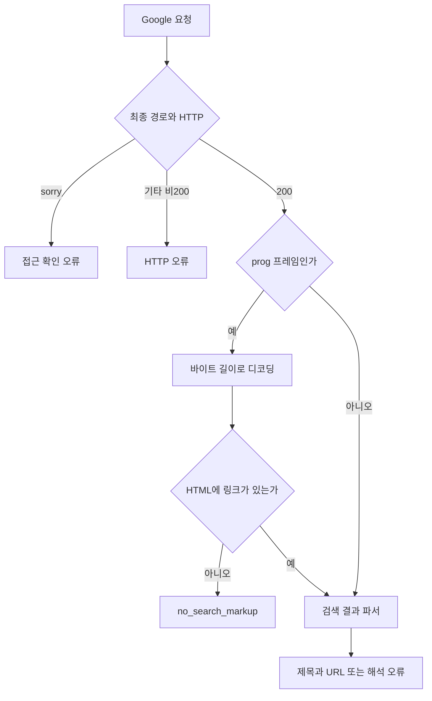

# 020: Google 실패를 요청·프로토콜·브라우저 단계로 나누다

이번 목표는 다른 엔진으로 결과를 얻는 것이 아니라 Google 경로 자체가 실패하는 이유를 찾는 것이다. 성공 기준은 실제 검색 결과의 제목과 URL을 확보하는 것이다. HTTP 200이나 파서 실행 완료만으로 성공 처리하지 않는다.

## 실제 검색과 응답

LLM을 호출하지 않고 프로젝트 검색 CLI에 다음 공개 검색어를 보냈다.

<callout icon="🔎" color="blue_bg">
	**실제 검색어**
	Python official website
</callout>

실제 프로그램이 반환한 오류:

> Google's prog payload contains no result links; result extraction has no search evidence

이 실행은 HTTP 200, 응답 2030바이트였지만 검색 링크와 h3가 모두 0개였다. web_search_performed=false다. 모델의 여행 답변이 아니라 검색 도구 자체의 실패 응답이다.

## 문제 분석: 서로 다른 실패가 섞여 있었다

원본 webserp의 Google.build_request는 일반 검색창 제출을 그대로 재현하지 않는다. q·num·hl=en과 asearch=arc, async의 _fmt:prog를 설정한다. 랜덤 arc_id는 요청 식별자이며 계정 인증 정보가 아니다. 고정 CONSENT 쿠키도 사용자의 로그인 세션이 아니다. 요청마다 Chrome 프로필을 선택하는 curl_cffi 경로는 HTTP/TLS 특성 재현이며 페이지 JavaScript를 실행하는 브라우저는 아니다.

첫째, prog 응답은 길이 접두어가 붙은 프레임 묶음이다. 원본 Google.parse_response는 이를 별도 디코딩하지 않고 HTML 파서로 넘긴다. 우리 어댑터도 이 부분을 재사용하고 있었다. 응답 형식을 풀어서 파싱하는 단계가 필요했다.

둘째, 실제 받은 프레임을 풀어보니 링크를 포함한 정상 검색 결과가 없었다. 보존한 2031바이트 응답의 프레임 크기는 51, 12, 1938, 12, 0이었다. HTML 프레임에는 script 1개, 링크 0개, h3 0개였다. 따라서 이 사례는 XPath만 고쳐서 제목과 URL을 복구할 수 있는 상태가 아니다. 스크립트의 존재만으로 Google의 내부 판정 원인까지 확정하지 않는다.

셋째, 별도 새 Chrome에서 홈페이지 검색창에 직접 입력하고 Enter를 눌러도 아래 순서로 이동했다.

| 순서 | 경로 | HTTP |
| --- | --- | --- |
| 1 | / | 200 |
| 2 | /search | 200 |
| 3 | /search | 302 |
| 4 | /sorry/index | 429 |

이 경로에서는 서버가 접근 확인 페이지로 보냈다. 검색 결과가 도착한 뒤 파서가 놓친 상황과 구분해야 한다. 앞선 진단 브라우저 응답에서는 unusual traffic 안내와 reCAPTCHA 요소도 확인했다.

평소 브라우저에서는 검색이 정상이라는 사용자 확인도 받았다. 이는 사용자 보고이며 해당 브라우저의 네트워크 응답을 직접 측정한 결과는 아니다. 새 진단 프로필과 평소 프로필의 차이가 남아 있으므로 컴퓨터 전체의 영구 IP 차단, 로그인 필수, 쿠키 하나의 누락으로 원인을 단정하지 않는다. 개인 프로필이나 로그인 쿠키는 읽지 않았다.

## 연구 과정: 요청의 의심 지점을 하나씩 확인

SearXNG 논의의 실제 요청 코드에는 ARC 식별자 끝이 _100인 예가 있었다. webserp의 _1과 달라 같은 검색어·고정 식별자 앞부분·chrome133a 조건에서 끝부분만 바꿨다.

| 변경 변수 | HTTP | 바이트 | 파싱 결과 | HTML 링크 |
| --- | --- | --- | --- | --- |
| suffix _1 | 200 | 2031 | 0 | 0 |
| suffix _100 | 200 | 2031 | 0 | 0 |

이 가설은 이번 환경의 실패를 해결하지 못했다. 모든 요청 인자가 정확하다는 증명은 아니다. 새 브라우저 실험도 단순 검색 URL 접속 외에 홈페이지 검색창 제출까지 확인했지만 429였다. Google 이외 엔진은 이번 실험에서 호출하지 않았다.

## 구현: 해석 실패와 접근 실패를 분리

기준은 변경 전 프로젝트 커밋 0eee781, 원본 webserp 커밋 e13148334995745f104a69ce7127179785ee741e다. 아래는 이번 변경의 실제 소스다.

google_protocol.py의 decode_prog는 16진수 길이를 **문자가 아닌 바이트**로 처리한다. 제어 프레임과 HTML 프레임을 구분하고, 잘림·종료 누락·과도한 크기를 거부한다.

```python
size = int(prefix[1], 16)
position += prefix.end()
if position + size > len(body):
    raise ValueError("Truncated Google prog frame")
frame = body[position:position+size]
position += size
```

webserp_provider.py의 search_google은 디코딩한 HTML만 원본 검색 결과 파서로 넘긴다. 링크가 없으면 더 구체적인 오류를 반환한다.

```python
document, framing = decode_prog(response.content)
metadata.update(framing)
dom = html.fromstring(document)
metadata["markup_link_count"] = len(dom.xpath('//a[@href]'))
metadata["markup_h3_count"] = len(dom.xpath('//h3'))
```

또한 최종 URL의 호스트·경로만 남기고 /sorry 이동을 access_interstitial로 분류한다. 쿼리 토큰·쿠키는 trace에 넣지 않는다. response_kind는 h3 검사보다 프레임 형식 검사를 먼저 하도록 수정했다. 프레임 안에 h3가 있다는 이유로 디코딩을 건너뛰던 순서 문제도 합성 테스트로 확인했다.



## 검증과 남은 한계

전체 단위 테스트 74개가 통과했다. 새 검증은 Unicode 바이트 길이, 잘린 프레임, 종료 누락, 스크립트를 HTML로 오인하지 않기, 정상 합성 프레임 전달, 링크 없는 응답, /sorry 쿼리 정보 제외를 확인한다. 합성 정상 프레임 통과는 실제 Google 검색 성공을 뜻하지 않는다.

보존한 실제 응답을 오프라인으로 재생했을 때 protocol_frame_count=5, markup_frame_count=1, markup_link_count=0, markup_h3_count=0, status=no_search_markup였다. 앞의 라이브 실행과 오프라인 재생은 구분한다.

수정한 것은 프로토콜 해석과 진단이다. Google 검색은 아직 해결되지 않았다. 다음에 분리할 변수는 정상 작동하는 브라우저와 진단 프로필 사이의 세션·실행 방식 차이다. 쿠키만 복사하면 해결된다고 결론 내릴 근거는 없다. LLM의 64K 컨텍스트는 이 HTTP 단계의 실패 원인과 별개다.

추가 비용은 Google 진단 요청과 별도 Chrome 실행 시간이며 LLM 추론 비용은 없었다. 유료 검색 API도 호출하지 않았다.

<details>
<summary>실제 툴콜·요청 로그와 실행 조건</summary>
	실행일: 2026-10-18 KST. 개별 초 단위 시각과 HTTP 요청 ID는 이번 진단 파일에 기록되지 않았다. 아래 번호는 기록 순서이며 모델 tool_call ID가 아니다. 로컬 모델 호출과 다음 모델 입력 전달은 없었다.
	1. Python 진단 → Google GET /search. query="Python official website", num=5, hl=en, asearch=arc, _fmt:prog, chrome133a. ARC 앞부분을 A 23개로 고정하고 suffix=_1, _100 순서로 요청. 두 실행 모두 HTTP200/2031바이트/결과0. 동적 토큰과 쿠키 값은 제외했다.
	2. Playwright의 새 headed Chrome → https://www.google.com/?hl=en → textarea/input[name=q]에 "Python official website" 입력 → Enter. / 200 → /search 200 → /search 302 → /sorry/index 429. h3=0, upstream_parsed_hits=[], heading_links=[]. 별도 프로필이며 사용자 기본 프로필은 사용하지 않았다.
	3. exec_command → .venv/Scripts/python.exe -m travel_agent web search "Python official website" --provider webserp --backend google. HTTP200/2030바이트, impersonate=chrome120, response_kind=async_framed, protocol_frame_count=5, markup_frame_count=1, markup_link_count=0, markup_h3_count=0, status=no_search_markup, web_search_performed=false. 종료코드1.
	4. Python 오프라인 재생 → 이전 진단에서 보존한 실제2031바이트 응답을 가짜 전송 객체로 공급. 신규 네트워크 요청 없음. decoded_response_kind=unclassified, status=no_search_markup. 재생 객체의 impersonate 값은 실제 네트워크 프로필의 관찰값이 아니므로 비교에서 제외했다.
	5. exec_command → .venv/Scripts/python.exe -m unittest discover -s tests -v. 74개 통과.
	6. web.run 조사: 검색어 site:github.com "google" "arc_id" "_fmt:prog" results 및 site:github.com "google" "enablejs" "sg_ss" search scraper. 원본 Google 소스와 SearXNG discussion5651의 실제 요청 코드를 확인했다. 다른 프로젝트 README의 성공 주장을 우리 환경의 성공으로 취급하지 않았다.
</details>

## 참고

- [webserp Google 요청·파서 소스](https://github.com/PaperBoardOfficial/webserp/blob/e13148334995745f104a69ce7127179785ee741e/src/webserp/engines/google.py)
- [webserp 클라이언트 소스](https://github.com/PaperBoardOfficial/webserp/blob/e13148334995745f104a69ce7127179785ee741e/src/webserp/client.py)
- [SearXNG의 Google 요청 코드 논의](https://github.com/searxng/searxng/discussions/5651)

