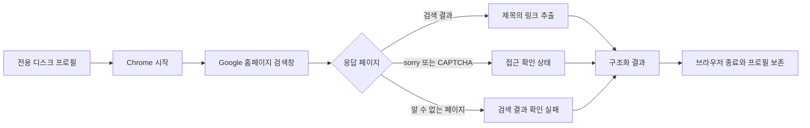

# 021: 직접 만드는 Google 검색기 — 전용 프로필과 첫 실행

## 문제 정의와 첫 단계

webserp 수리를 중단하고 Google 검색 흐름을 직접 구현하기 시작했다. 이번 단계의 범위는 전용 Chrome 프로필 생성·디스크 보존, 검색창 입력, 결과 제목과 URL 추출, 실패 상태 기록이다. 에이전트 연결과 병렬 검색은 아직 진행하지 않는다. 실제 검색 결과를 확인한 뒤 다음 단계로 간다.

## 실제 질문과 결과

<callout icon="🔎" color="blue_bg">
	**실제 검색어**
	Python official website
</callout>

실제 프로그램의 반환값 중 검색 결과 부분:

```json
{
  "web_search_performed": false,
  "hits": [],
  "status": "access_interstitial",
  "final_host": "www.google.com",
  "final_path": "/sorry/index",
  "elapsed_ms": 3675
}
```

LLM은 호출하지 않았다. 프로그램을 새로 작성해도 새 프로필의 Google 접근 확인 문제는 남았다. 검색 성공이나 답변 품질 개선으로 기록하지 않는다.

## 분석과 선택

평소 브라우저에서는 정상이라는 사용자 보고가 있고, 별도 새 브라우저에서는 429가 관찰됐다. 먼저 재사용 가능한 전용 프로필을 만들고 같은 브라우저 상태에서 반복 확인할 기반이 필요했다.

HTTP 요청의 Google 내부 비동기 파라미터를 다시 추측하는 대신 설치된 Chrome의 검색창을 사용한다. Playwright는 브라우저 제어 계층으로만 사용하고, 검색 요청 흐름·결과 추출·오류 분류는 프로젝트 코드에 직접 작성했다. webserp·DDGS를 가져오거나 호출하지 않는다. 새 Google 색인 엔진을 만드는 작업은 아니다.

프로필은 프로젝트의 Git 제외된 data/private 아래에 저장한다. 사용자 기본 Chrome 프로필을 복사하지 않는다. 별도 open 명령으로 사용자가 직접 확인한 브라우저 상태도 다음 실행에 재사용할 수 있다. 이 기능이 Google의 접근 판정을 해결한다는 것은 아직 검증하지 않았다.

## 실제 구현과 흐름

변경 전 기준 커밋은 049ca62다. 새 모듈 google_browser.py의 run은 다음 실제 코드로 프로필을 열고 닫는다.

```python
context = p.chromium.launch_persistent_context(str(profile), channel="chrome", headless=False,
                                              timeout=timeout * 1000)
```

context.close()로 Chrome을 종료할 때 프로필이 디스크에 보존된다. 별도 쿠키 JSON을 만들거나 쿠키 값을 출력하지 않는다.

결과 추출은 #search 아래의 보이는 h3에서 해당 제목을 감싼 a[href]를 찾는다. 블록의 첫 링크를 무조건 가져와 제목과 URL이 엇갈리는 문제를 피한다.

```javascript
const a = h.closest('a[href]');
const block = h.closest('.MjjYud, .g');
const snippet = block?.querySelector('.VwiC3b, [data-sncf]');
return {title: h.innerText, href: a?.href || '', body: snippet?.innerText || ''};
```

Google redirect URL을 풀고 내부 링크·자격증명이 붙은 URL·중복을 제외한다. 검색 요약을 찾지 못하면 빈 문자열로 남긴다. 현재 DOM 선택자는 모든 검색 유형을 포괄하지 않는다.



## 검증

전체 테스트 79개가 통과했다. 신규5개는 URL 정리, 실제 로컬 Chrome DOM에서 제목과 링크 대응, 링크 없는 제목의 실패 처리, 접근 확인 우선 처리, 두 번 실행한 전용 프로필의 합성 쿠키 보존을 검사한다. DOM·쿠키 테스트는 Google에 요청하지 않았고 합성 데이터만 사용했다.

실제 Google 요청은 한 번 실행했다. / 200 → /search 200 → /search 302 → /sorry/index 429였으며 결과는 없었다. 새 모듈의 실패 감지와 프로필 생성은 확인했지만 Google 검색 성공은 미확인이다. 로컬 프로필 저장과 인증 성공은 같은 의미가 아니다.

## 실행과 다음 단계

프로젝트 가상환경에서 실행한다. Playwright 1.64.0이 현재 환경에 이미 설치되어 있어 이번에 브라우저나 패키지를 추가 다운로드하지 않았다. 새 환경은 browser extra와 설치된 Chrome이 필요하다.

```powershell
python -m pip install -e ".[browser]"
python -m travel_agent.google_browser search "Python official website"
# 사용자 직접 확인용: 전용 창을 확인한 뒤 터미널 Enter로 닫고 저장
python -m travel_agent.google_browser open
```

open은 수동 사용을 위한 명령이다. 이번 자동 실험에서 실행하거나 인증을 완료하지 않았다. 전용 프로필을 동시에 여러 프로세스에서 열지 않는다. timeout은 개별 브라우저 작업 제한이며 전체 실행 시간의 상한은 아니다.

다음 검증은 전용 창에서 사용자가 확인한 뒤 같은 프로필로 다시 검색해 차이를 보는 것이다. 아직 검색 공급자로 연결하지 않아 기존 에이전트 실행 경로는 그대로다. 이전 webserp 코드는 비교 이력으로 남기며 추가 수리는 중단한다.

<details>
<summary>실제 툴콜·실행 로그</summary>
	모델 tool_call은 없었다. 아래는 개발 중 직접 실행한 도구 기록이다. 개인 쿠키·인증 헤더·페이지 전체 HTML은 기록하지 않았다.
	1. exec_command: .venv/Scripts/python.exe -m pip show playwright → 설치 버전1.64.0 확인.
	2. web.run: Playwright BrowserType의 launch_persistent_context 및 Authentication 공식 문서를 조회해 별도 프로필·상태 재사용 API를 확인했다.
	3. exec_command: .venv/Scripts/python.exe -m unittest discover -s tests -v → 79개, 5.826초, OK. Google 요청 없는 합성 DOM 테스트 포함.
	4. exec_command: Python에서 run('search', 'Python official website') 실행. 2026-10-18 01:45:51 KST 시작. 독립 로컬 진단이며 모델 호출 ID 없음. navigation: 1336ms / HTTP200, 2377ms /search HTTP200, 3044ms /search HTTP302, 3130ms /sorry/index HTTP429. 종료3675ms, status=access_interstitial, hits=[], 종료코드1. 다음 모델 입력으로 전달하지 않았다.
</details>

## 참고

- [Playwright 브라우저·영구 프로필 API](https://playwright.dev/python/docs/api/class-browsertype#browser-type-launch-persistent-context)
- [Playwright 상태 재사용](https://playwright.dev/python/docs/auth)
