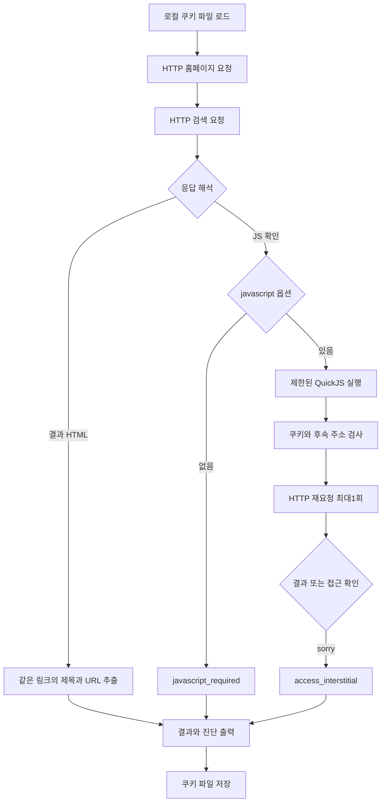

# 022: 브라우저 없이 Google HTTP 세션과 확인 스크립트를 구현하다

## 문제 정의

사용자는 브라우저를 호출하는 구현을 원하지 않았다. 021의 방향을 잘못 이해한 부분을 정정하고 Chrome 모듈·테스트·browser extra를 제거했다. 기록은 이력으로 남긴다.

이번 목표는 HTTP로 Google에 직접 요청하고, 쿠키를 로컬 파일에 저장해 별도 실행에서 재사용하며, 실제 검색 결과 또는 실패 원인을 확인하는 것이다. 성공 기준은 정상 결과의 제목·URL 확보다. 서버의 HTTP 200, 쿠키 저장, 확인 값 생성은 각각 중간 단계다.

## 같은 질문의 실제 실행

### 1. 직접 HTTP 요청

<callout icon="🔎" color="blue_bg">
	**실제 검색어**
	Python official website
</callout>

실제 응답 중 검색 결과 부분:

```json
"hits": [],
"web_search_performed": false,
"status": "javascript_required",
"cookies_saved": 4,
"elapsed_ms": 502
```

홈페이지와 검색 요청이 모두 HTTP200이었지만 검색 응답에는 h3가0개, script가5개였다. 확인 스크립트와 enablejs 안내가 있었고 검색 결과는 없었다.

### 2. 파일 쿠키를 재사용하고 basic 인자 추가

<callout icon="🔎" color="blue_bg">
	**같은 실제 검색어**
	Python official website
</callout>

별도 프로세스 실행에서 cookies_loaded=4를 확인했다. gbv=1만 추가한 basic 모드도 실제 결과는 다음과 같았다.

```json
"hits": [],
"web_search_performed": false,
"status": "javascript_required",
"cookies_saved": 4,
"elapsed_ms": 471
```

쿠키가 저장되지 않아 매번 완전히 새 세션이 된다는 문제는 분리했다. 하지만 홈페이지 쿠키 재사용만으로 Google의 검색 확인 단계를 통과하지는 못했다.

### 3. 브라우저 없는 JavaScript 실행 후 재요청

<callout icon="🔎" color="blue_bg">
	**같은 실제 검색어**
	Python official website
</callout>

받은 스크립트가 document.cookie에 SG_SS를 설정하고 검색 주소를 다시 요청하는 흐름임을 소스에서 확인했다. QuickJS에 작은 객체 환경을 제공해 스크립트를 실행하고 HTTP 클라이언트로 재요청했다. Chrome·Playwright를 이 검색 경로에서 사용하지 않았다.

정식 모듈의 실제 최종 응답 중 결과와 확인 스크립트 진단:

```json
"hits": [],
"web_search_performed": false,
"status": "access_interstitial",
"javascript": {
  "errors": [],
  "script_count": 5,
  "cookie_names": ["SG_SS"],
  "cookie_lengths": {"SG_SS": 1264},
  "redirect_count": 1
}
```

홈페이지200 → 검색200 → 확인 값으로 검색 재요청302 → /sorry/index 429였다. 전체1182ms. 앞선 임시 실험에서도1255자 SG_SS가 생성됐지만 재요청은302로 /sorry에 향했다.

**SG_SS 문자열이 생성됐다는 것과 Google이 유효한 세션으로 받아줬다는 것은 다르다.** QuickJS의 객체 환경은 실제 브라우저와 동등하지 않다. 값의 정확성, 수집된 환경 신호의 적합성, 전송 특성, 서버 정책 중 어느 요인이 거절을 일으켰는지 아직 분리하지 못했다. “인증 성공 후 IP가 차단됐다”고 결론 내리지 않는다.

## 구현과 선택 이유

변경 전 기준 커밋은 d7d44fb다. webserp 요청 생성·파서·쿠키를 가져오지 않고 직접 작성했다. curl_cffi0.16.3과 lxml6.1.3은 환경에 이미 있었으며 확인 스크립트 실험을 위해 QuickJS1.19.4를 가상환경에 추가했다. curl_cffi의 chrome133a는 HTTP 전송 프로필 이름이며 Chrome 실행을 뜻하지 않는다.

### google_http.py: 요청·파일 세션·파서

load_cookies는 LWP 형식의 쿠키 파일을 읽는다. 도메인·경로·Secure·만료를 보존하고 만료된 쿠키는 읽지 않는다. save_cookies는 임시 파일을 작성한 뒤 원자적으로 교체한다. 로그인 쿠키를 개인 브라우저에서 가져오지 않았다. 현재 세션은 익명 Google 응답에서 받은 값이다.

실제 저장 코드:

```python
saved = LWPCookieJar()
for cookie in jar:
    saved.set_cookie(cookie)
saved.save(temporary, ignore_discard=True, ignore_expires=False)
os.replace(temporary, path)
```

search는 같은 세션에서 홈페이지와 검색을 순서대로 요청한다. 프로세스가 달라도 같은 쿠키 파일을 사용한다. 파일은 Git 제외된 data/private/google-http 아래에 있다. 동시 프로세스의 쿠키 병합은 구현하지 않았으므로 현재는 단일 실행용이다.

실제 요청 코드:

```python
r = session.get(url, params=params, timeout=timeout, allow_redirects=False)
```

자동 리다이렉트를 끄고 요청별 HTTP 상태·호스트·경로·바이트·시각을 기록한다. 후속 대상은 지정한 Google HTTPS 호스트·기본 포트만 허용하며 자격증명 포함 주소와 외부 도메인은 요청하지 않는다. 쿼리의 동적 확인 값은 진단 출력에서 제외한다.

parse_page는 같은 a 태그에 속한 h3와 URL을 연결한다. Google의 /url 리다이렉트를 해제하고 내부 링크·중복을 제외한다. 검색 요약을 확인하지 못하면 빈 값으로 남긴다.

```python
for heading in dom.xpath('//h3'):
    anchors = heading.xpath('ancestor::a[@href][1]')
    if not anchors:
        continue
```

### google_javascript.py: 선택형 확인 스크립트 실험

--javascript에서만 실행한다. QuickJS에 document.cookie와 location.replace 등의 작은 객체를 제공해 쓰인 쿠키·후속 주소를 받는다. 실제 DOM·레이아웃·Chrome 환경을 구현한 것이 아니며 Google에 정상 환경으로 받아들여졌다는 검증도 없다.

실제 자원 제한:

```python
context = quickjs.Context()
context.set_memory_limit(64 * 1024 * 1024)
context.set_max_stack_size(512 * 1024)
context.set_time_limit(1)
```

Python 콜백·파일·네트워크 API를 JavaScript에 제공하지 않는다. 입력1MB, 스크립트20개, 작업100회, 루프의5초 기한을 둔다. 각각의 실행이 최대1초 제한을 가져 총 시간이5초에서 약간 넘어갈 수 있다. 쿠키 원문과 스크립트 예외 문자열은 공개 진단에 넣지 않는다. SG_SS는 스크립트가 쓴 실제 만료를 반영하며 이를 알 수 없을 때 영구 세션 쿠키로 저장하지 않는다.



## 검증과 한계

최종 테스트83개가 통과했다. 새9개는 제목·URL 대응, URL 정리, 접근 확인 분류, 쿠키 속성·만료 보존, 독립 실행의 쿠키 재사용, 외부 리다이렉트 거부, JS 쿠키·후속 주소 수집, 예외의 비밀 문자열 제외, 무한 계산 중단을 확인한다. 합성 응답의 파싱 성공은 실제 Google 검색 성공이 아니다. 최종 테스트에는 폐기한 브라우저 테스트가 없다.

실제 요청은 검색 성공0회다. 일반·basic·JS 후속 요청 모두 실패를 그대로 보존했다. 비용·품질 우위는 측정하지 않았고 LLM도 호출하지 않았다. 에이전트 공급자로 연결하지 않았다. 원본 응답은 선택형 --capture로 비공개 영역에 보존한다.

현재 파서는 대표적인 h3 결과와 일부 요약 선택자만 지원한다. 실제 정상 Google 응답을 확보한 뒤 현재 HTML 구조·광고와 일반 결과·한국어 결과를 검증해야 한다. 쿠키 파일 자체는 로그인 성공 증거가 아니다.

다음 연구 변수는 생성된 확인 값의 내용·일관성과 서버가 기대하는 후속 HTTP 요청의 차이다. 브라우저 실행이나 다른 검색 엔진으로 돌아가지 않는다.

## 실행

```powershell
# HTTP만
python -m pip install -e ".[google-http]"
python -m travel_agent.google_http "Python official website"
# 선택형 JS 실험, 브라우저 실행 없음
python -m pip install -e ".[google-http-js]"
python -m travel_agent.google_http "Python official website" --javascript
# 비공개 원본 응답도 보존
python -m travel_agent.google_http "Python official website" --javascript --capture
```

timeout은 개별 HTTP 요청 제한이며 전체 실행 시간 제한이 아니다. 현재는 병렬 실행·자동 무한 재시도·CAPTCHA 자동 처리를 구현하지 않는다.

<details>
<summary>실제 툴콜·HTTP 요청 로그</summary>
	모델 tool_call은 없으며 개발 중 직접 요청했다. 아래 ID는 HTTP 실행기의 실제 식별자다. 시각은 KST로 표기했다. 쿠키 값·동적 sei·확인 값·전체 URL은 제외했다. 모델 입력으로 전달하지 않았다.
	1. exec_command → python -m travel_agent.google_http "Python official website" --capture. 2026-10-18 02:11:19 시작. run_id=0229aacc28a7409cac6959e5fbcf3b74. :1 GET /?hl=en →200/226108바이트/320ms. :2 GET /search, q="Python official website", num=5, hl=en →200/92316바이트/497ms. profile=chrome133a, cookies_loaded=0, cookies_saved=4, javascript_required, 종료502ms·코드1.
	2. exec_command → 같은 질의 --mode basic --capture. 02:11:32 시작. run_id=7aee72f4c3184295afb496c1ec3ab95e. :1 GET /?hl=en →200/226449바이트/296ms. :2 GET /search, 같은 인자+gbv=1 →200/92497바이트/463ms. cookies_loaded=4, cookies_saved=4, javascript_required, 종료471ms·코드1.
	3. Python으로 첫 응답의 DOM을 오프라인 검사 → h3=0, anchor=3, script=5. SG_SS·emsg=SG_REL·enablejs·document.cookie·navigator 표식 확인. 새 네트워크 요청 없음.
	4. 임시 QuickJS 오프라인 실험 → 저장 응답 실행에서 쿠키 없이 sg_ss 쿼리로 재요청하는 분기도 관찰했다. 이후 신선한 HTTP 응답을 같은 환경에서 실행했을 때1255자 SG_SS 생성, 후속302의 /sorry 확인. 서로 다른 응답의 실험이며 결과를 동일 토큰의 반복 검증으로 취급하지 않는다.
	5. exec_command → python -m travel_agent.google_http "Python official website" --javascript --capture. 02:15:12 시작. run_id=138ba65acf3b48a7873ef3ee1677c4b1. :1 GET /?hl=en →200/65854바이트/216ms. :2 GET /search, q="Python official website", num=5, hl=en →200/92255바이트/377ms. JS errors=[], SG_SS 길이1264, 후속 주소1개. :3 GET /search, 같은 질의와 스크립트 후속 인자 →302/476바이트/1097ms. :4 GET /sorry/index →429/3420바이트/1176ms. access_interstitial, web_search_performed=false, 종료1182ms·코드1.
	6. exec_command → pip install --only-binary=:all: quickjs==1.19.4 → 설치 완료. pip show로 curl_cffi0.16.3·lxml6.1.3 확인.
	7. exec_command → python -m unittest discover -s tests →83개/1.902초/OK. 로컬 합성 테스트이며 Google 요청·브라우저 실행 없음.
	8. web.run → curl_cffi Cookies 공식 문서와 QuickJS PyPI 프로젝트 확인. GitHub의 SG_SS 관련 코드·연구 자료도 조사했지만 외부 README의 통과 주장을 이번 환경의 성공으로 사용하지 않았다.
</details>

## 참고

- [curl_cffi 쿠키 문서](https://curl-cffi.readthedocs.io/en/latest/cookies.html)
- [QuickJS Python 패키지](https://pypi.org/project/quickjs/)
