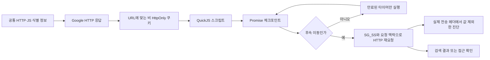

# 023: Google 확인 값과 후속 요청의 불일치를 검증하다

## 문제 정의

022에서는 SG_SS 문자열을 만들었지만 후속 요청이 /sorry의429였다. 다음 질문은 “값이 제대로 전송되지 않았는가, 스크립트 환경과 HTTP 요청 사이에 모순이 있는가?”였다. 정상 검색 결과 확보가 성공 기준이다. 값 생성과 전송은 별도 중간 단계다.

변경 전 기준 커밋은07b4e69다. 브라우저·다른 검색 엔진·LLM은 사용하지 않았다.

## 같은 검색어의 이전 결과

<callout icon="🔎" color="blue_bg">
	**실제 검색어**
	Python official website
</callout>

022의 실제 결과는 SG_SS1264자 생성, 후속 검색302, /sorry/index429, hits=[], web_search_performed=false였다.

## 코드와 실제 전송에서 발견한 차이

1. curl_cffi의 chrome133a가 실제로 보내는 User-Agent와 sec-ch-ua-platform은 macOS였다. QuickJS의 navigator는 Windows/Win32였다. 운영체제가 다른 입력을 동일한 실행에 제공하고 있었다.
2. 이전 작업 루프는 Promise 작업 하나마다 타이머를 즉시 실행했다. 응답에는2000ms 뒤 오류 안내를 표시하고 sg_trbl 비콘을 만드는 타이머가 있는데 지연을 무시했다. performance.now도 상대 시간이 아니라 epoch 밀리초였다.
3. QuickJS는 빈 document.cookie로 시작했다. 세션 쿠키를 넣도록 바꾼 첫 실험에서는 curl_cffi의 http_only=True 표기를 제대로 걸러내지 못했다. 실제 쿠키 메타데이터에서 AEC·NID는 http_only=True, 나머지2개는 False였다. HttpOnly 쿠키를 JavaScript에 노출하면 정상 페이지와 다른 상태가 된다.
4. 후속 HTTP 요청에는 원래 Referer가 없었고 기본 Sec-Fetch-Site=none이 사용됐다. 페이지에서 같은 출처로 이동하는 맥락을 추가했다.

이 차이들은 구현에서 확인한 문제다. Google이 이 항목을 이유로 거절했다고 확정하는 증거는 아니다.

## 실제 전송 확인

별도 libcurl HEADER_OUT 콜백으로 쿠키 값을 보존하지 않고 실제 헤더를 검사했다. 확인 값을 사용한 세 번째 요청에 SG_SS가1299자 길이로 들어갔으며 NID·AEC 등과 함께 전송됐다. Referer 경로는 /search, Sec-Fetch-Site는 same-origin이었다. macOS User-Agent와 Client Hint도 일치했다.

따라서 이 실행은 “값은 생성했지만 전송에서 빠졌다”는 가설에 해당하지 않는다. 이 요청도302로 /sorry에 향했다. 값 자체의 유효성이나 서버의 숨은 판정 원인은 아직 검증하지 못했다.

## 최종 수정 후 같은 질문

<callout icon="🔎" color="blue_bg">
	**같은 실제 검색어**
	Python official website
</callout>

최종 실제 실행의 반환 내용 중 검색 결과와 JS 진단:

```json
"hits": [],
"web_search_performed": false,
"status": "access_interstitial",
"javascript": {
  "errors": [],
  "script_count": 5,
  "cookie_names": ["SG_SS"],
  "cookie_lengths": {"SG_SS": 1039},
  "initial_cookie_count": 2,
  "microtasks_executed": 2,
  "timers_executed": 0,
  "beacon_codes": [],
  "redirect_count": 1
}
```

최종 실행은 홈페이지200 → 검색200 → 후속 검색302 → /sorry/index429였다. 전체1039ms. 깨끗한 별도 쿠키 파일에서 시작했고 기존 개인 세션은 읽지 않았다. 수정 중간의 별도 실행2회도 같은 경로로 실패했다.

오프라인에서는 보존한 같은 응답을 이전·수정 실행기에 각각 공급했다. 양쪽 모두1264자 SG_SS를 만들었다. 길이가 같다는 것만으로 내용의 동일성이나 유효성을 주장하지 않는다. 수정 실행기는 Promise2개를 처리하고 타이머0개·비콘0개를 기록했다. 이것은 재생 실험이며 Google에 재요청한 결과가 아니다.

## 실제 구현

### HTTP·JS 입력을 같은 설정에서 공급

google_identity.py의 PROFILE·USER_AGENT·PLATFORM·HTTP_HEADERS를 google_http.py와 google_javascript.py가 함께 사용한다. “Mac처럼 보이면 통과한다”는 선택이 아니라 기존 전송 프로필과 JS 입력의 모순을 없앤 것이다.

### 쿠키의 JavaScript 가시성

google_http.py의 document_cookies는 URL·경로·만료 조건을 적용하고 HttpOnly 표기를 제외한다. curl_cffi와 표준 CookieJar의 서로 다른 표기를 모두 검사한다.

```python
if not any(key.lower().replace("_", "").replace("-", "") == "httponly"
           and (value is None or str(value).lower() not in {"false", "0", ""})
           for key, value in cookie._rest.items()):
    visible.set_cookie(cookie)
```

쿠키의 실제 값은 JS 실행 입력과 비공개 쿠키 파일에만 남긴다. 공개 진단은 개수와 새로 쓴 쿠키 이름·길이만 보여준다.

### Promise와 타이머

google_javascript.py의 evaluate_challenge는 각 inline script 뒤와 타이머 작업 사이에 drain_microtasks로 Promise 작업을 처리한다. setTimeout은 실제 만료 시각을 저장하고 clearTimeout도 반영한다. 후속 주소가 생기면 이전 페이지의 지연 타이머를 더 실행하지 않는다.

```python
if not drain_microtasks():
    break
if context.eval("__redirects.length"):
    break
delay = context.eval("__timers.length ? Math.max(0,Math.min(...__timers.map(t=>t.due))-Date.now()) : -1")
```

이것은 제한된 실험용 작업 루프이며 완전한 브라우저 이벤트 루프나 DOM 구현은 아니다. JS 비콘은 수집만 하고 네트워크로 보내지 않는다. 명시된 자원 제한은 유지한다.

### 요청 맥락과 실제 전송 로그

google_http.py의 fetch는 같은 출처의 source가 있을 때 Referer와 Sec-Fetch-Site를 설정한다. request_context는 실행기가 설정한 맥락이다. --wire의 wire_requests는 libcurl이 실제 전송한 헤더 블록에서 추출하며 둘을 구분한다.

```python
if kind == 2:  # libcurl HEADER_OUT
    observed = sanitized_wire_headers(data)
    if observed is not None:
        observed["id"] = f"{run_id}:{len(report['wire_requests'])+1}"
        report["wire_requests"].append(observed)
```

sanitized_wire_headers는 Cookie 값을 출력하지 않고 이름·SG_SS 길이, User-Agent, platform, fetch-site, Referer 경로만 남긴다. 전체 Referer·검색 URL·동적 토큰은 제외한다.



## 검증과 남은 한계

테스트87개가 통과했다. 새4개는 실제 curl 쿠키 플래그와 가시성, Promise 우선순위와 이동 뒤 타이머 중단, 공통 식별 정보·상대 시계·타이머 취소, 전송 로그의 비밀 값 제외를 검증한다. 기존 HTTP 세션 테스트에도 Referer와 fetch-site 설정 검증을 추가했다.

모든 실제 검색은 여전히 실패했다. 여러 불일치를 순차 수정한 조사이며 각 항목의 품질 효과를 독립적인 A/B 실험으로 입증하지 않았다. HTTP 프로필·VM 환경·생성 값의 의미·서버 상태 중 무엇이 남은 실패 원인인지 아직 분리할 수 없다. 쿠키 전송 누락 가설을 검사하고 구현 모순을 수정했다는 것이 이번 결과다.

다음 단계는 확인 스크립트가 수집하는 입력과 생성 값의 구조를 오프라인으로 분석하는 것이다. 무작위 헤더·운영체제 변경을 성공 전략으로 간주하지 않는다. 에이전트 연결은 여전히 보류한다.

## 실행

```powershell
python -m travel_agent.google_http "Python official website" --javascript --wire --capture
```

--capture 원본은 비공개 저장 영역에 남는다. --wire의 값 제외 동작은 합성 테스트와 동일 방식의 실제 libcurl 관찰로 확인했다.

<details>
<summary>실제 도구·HTTP 호출 로그</summary>
	모델 tool_call은 없었다. 아래는 개발 도구에서 직접 실행한 기록이며, 다음 모델 입력으로 전달하지 않았다. HTTP ID는 실행별 실제 ID다. 시각은 KST다. 쿠키·인증 값·동적 sei 등은 제외했다.
	1. exec_command → curl_cffi Session(chrome133a)으로 GET https://www.google.com/?hl=en. HTTP200. 실제 HEADER_OUT: sec-ch-ua-platform="macOS", User-Agent=Chrome133/macOS, Sec-Fetch-Site=none. 검색이나 개인 쿠키 사용 없음.
	2. exec_command → 보존한 동일 응답의 이전·수정 QuickJS 오프라인 비교. 양쪽 errors=[], SG_SS 길이1264. 수정: microtasks=2, timers=0, beacon_codes=[]. 네트워크 호출 없음.
	3. exec_command → search("Python official website", javascript=True, capture=True), 별도 새 쿠키 파일. 02:23:04 시작. run_id=e21e969273364c7687bc300be4eb3463. :1 GET /?hl=en →200/221571바이트/333ms. :2 GET /search?q=Python official website&num=5&hl=en →200/92416바이트/501ms, Referer 경로/·same-origin. :3 JS 후속 GET /search →302/479바이트/971ms, Referer 경로/search·same-origin. :4 GET /sorry/index →429/3425바이트/1051ms. initial_cookie_count=4였으며 이후 HttpOnly 필터 오류를 확인했다. SG_SS1143자, 결과0, 전체1055ms.
	4. exec_command → 같은 질의·별도 새 쿠키 파일·실제 HEADER_OUT 콜백 검사. 02:23:38 시작. run_id=f32732ee8ca84838b948d0c7b694e535. :1 GET / →200/225403바이트/315ms. :2 GET /search →200/92396바이트/485ms. :3 JS 후속 GET /search →302/477바이트/947ms. 이 요청의 실제 Cookie 이름에는 SG_SS·SEARCH_SAMESITE·__Secure-STRP·NID·AEC가 있었고 SG_SS 길이1299였다. :4 GET /sorry/index →429/3423바이트/1024ms. 전체1029ms. 비공개 임시 진단 코드로 관찰했으며 아직 --wire CLI 실행은 아니었다.
	5. exec_command → HttpOnly 표기 수정 후 같은 질의·별도 새 쿠키 파일. 02:25:05 시작. run_id=a6f258f2f78b4443a31e966c55983075. :1 GET / →200/195802바이트/311ms. :2 GET /search →200/92362바이트/476ms. :3 JS 후속 GET /search →302/476바이트/957ms. :4 GET /sorry/index →429/3420바이트/1035ms. initial_cookie_count=2, microtasks=2, timers=0, SG_SS1039자, beacon_codes=[], access_interstitial, web_search_performed=false, 전체1039ms.
	6. exec_command → python -m unittest discover -s tests →87개/2.027초/OK. 합성 테스트이며 Google 요청·브라우저·LLM 호출 없음.
	7. web.run → MDN의 Sec-Fetch-Site 및 Microtasks in depth 문서 확인. 문서의 일반 동작 설명과 Google이 실제로 어느 조건을 검사하는지는 구분했다.
</details>

## 참고

- [MDN: Sec-Fetch-Site](https://developer.mozilla.org/en-US/docs/Web/HTTP/Reference/Headers/Sec-Fetch-Site)
- [MDN: Microtasks in depth](https://developer.mozilla.org/en-US/docs/Web/API/HTML_DOM_API/Microtask_guide/In_depth)
