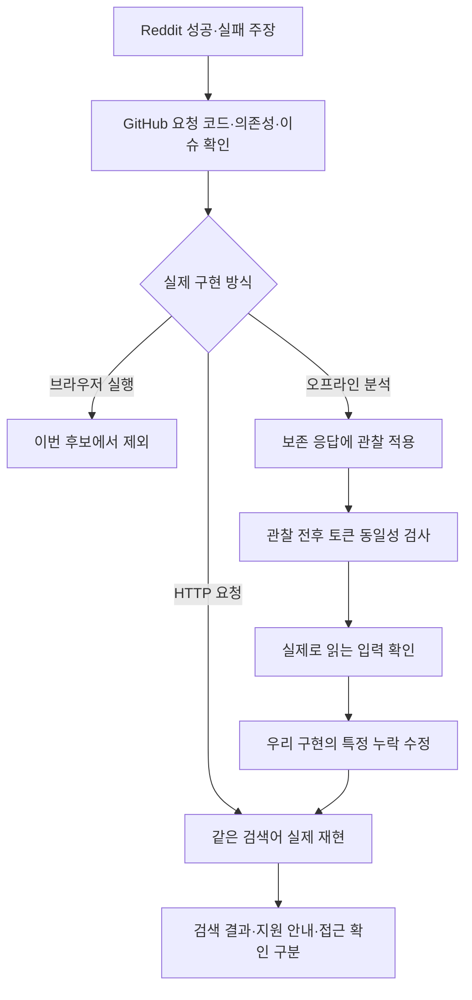

# 024: Reddit 사례에서 GitHub 소스와 실제 재현으로 이어가기

## 문제 정의

Chrome을 더 비슷하게 흉내 내는 추측에서 벗어나, 다른 사람이 정상 결과를 받았다는 요청 흐름을 소스와 실행으로 비교한다. 사용자의 조건은 Google·HTTP 직접 요청·로컬 세션이며 브라우저 실행과 유료 검색 API로 대체하지 않는다.

좋은 결과의 기준은 같은 공개 검색어에서 실제 제목과 URL을 확보하는 것이다. 후기의 성공 주장, HTTP200, 확인 값 생성, 오프라인 분석 성공을 구분한다. 변경 전 기준 커밋은15708f5다.

## 같은 질문으로 확인한 결과

아래 검색 실험은 모두 같은 검색어를 사용했다.

<callout icon="🔎" color="blue_bg">
	**실제 검색어**
	Python official website
</callout>

| 경로 | 실제 응답 | 검색 결과 |
| --- | --- | --- |
| Reddit 추천 tkattkat 원본 Axios 구현 | HTTP200,2434바이트, 지원하지 않는 브라우저 안내 | 0개 |
| 정상 Lynx 버전 문자열로 같은 요청 계열 재현 | HTTP200,2434바이트, unsupported_client | 0개 |
| SearXNG의 Nokia WML + chrome99_android 경로 재현 | HTTP403,1679바이트 | 0개 |
| jsdom으로 확인 스크립트 실행 후 HTTP 재요청 | SG_SS1239자 생성,302의 Location이 /sorry/index | 0개 |
| 관찰한 document URL 입력 누락 수정 후 기존 HTTP 구현 | SG_SS1307자 실제 전송,302→429 | 0개 |

tkattkat 응답에 표시된 실제 안내:

> Update your browser  
> Your browser isn't supported any more. To continue your search, upgrade to a recent version.

최종 프로젝트 실행의 실제 결과 부분:

```json
"hits": [],
"web_search_performed": false,
"status": "access_interstitial"
```

실제 검색 성공은 아직 없다. jsdom 실험은302의 /sorry 이동까지만 확인했으며 그 실험이429까지 따라갔다고 쓰지 않는다.

## 연구 과정: 후기에서 실행 코드까지

### Reddit의 HTTP 검색 사례와 tkattkat

[2025-03-06의 요청 기반 검색 소개](https://www.reddit.com/r/webscraping/comments/1j4kdrl/google_search_scraper_request_based/)와 [Google search url scraping 논의](https://www.reddit.com/r/webscraping/comments/1k2rezd/google_search_url_scraping/)에서 Lynx User-Agent와 tkattkat 구현을 찾았다. 과거 성공 주장은 현재 재현의 근거가 아니라 검증할 후보로 취급했다.

[tkattkat 소스](https://github.com/tkattkat/google-search-scraper/blob/c6d57a041c9a2303aa36308fe7a0245a9f52e8d5/src/googleSearch.ts)를 클론하고 Axios 요청 코드와 파서를 읽었다. 요청은 일반 /search, 랜덤 Lynx 계열 User-Agent, CONSENT·SOCS 상수 쿠키다. 프로젝트 원본의 makeRequest와 parseResults를 빌드 후 직접 실행했다. 원본 파서의 전체 HTML 출력은 비공개 보존으로 바꿔 관찰했다. 소스 파일은 수정하지 않았다.

원본에서 실제 생성한 Lynx2.9.2 계열 문자열은 브라우저 지원 안내를 받았다. 랜덤 버전 조합의 영향도 분리하려고 고정된 Lynx2.8.9rel.1 문자열로 별도 재현했지만 같은 안내였다. “Reddit 추천이니 지금도 된다”는 결론은 내리지 않는다.

### 무료 검색 MCP와 실제 브라우저 의존

[2026-05의 google-surf-mcp 소개](https://www.reddit.com/r/webscraping/comments/1t0kko0/free_google_search_mcps_are_broken_so_i_built_an/)도 읽고 현재 코드를 클론했다. 커밋b331d06fe261e62b1badc7575da542cb952bee16의 [browser.ts](https://github.com/HarimxChoi/google-surf-mcp/blob/b331d06fe261e62b1badc7575da542cb952bee16/src/browser.ts)는 Playwright와 실제 Chrome 경로를 사용한다. 이번 HTTP 전용 후보에서는 제외했고 실행하거나 브라우저를 설치하지 않았다. 현재 소스에 대한 판단이며 과거 글 당시의 코드를 소급 확정하지 않는다.

### 이슈와 병합된 변경 확인: SearXNG

[SearXNG6570](https://github.com/searxng/searxng/issues/6570)에는 Nokia 요청 실패와 chrome99_android 전송 프로필을 언급한 유지보수자 보고가 있었고, [6620 변경](https://github.com/searxng/searxng/pull/6620/files)은2026-09-04 병합됐다. 관련 google.py 변경과 현재 요청 인자 구성을 읽었다.

브라우저 실행이 아니라 curl_cffi의 전송 프로필을 쓰는 경로라 별도 재현했다. Nokia7610 User-Agent, /wml/search, sca_esv·hl·lr·cr·ie·oe와 CONSENT 구성으로 한 번 요청했지만 현재 환경에서는403이었다. SearXNG 전체 설치·가용성 평가가 아니라 해당 HTTP 요청 계열의 재현이다.

### 성공 주장과 원인 분석 도구를 구분

[Sec-CH-Lemon의 SearchGuard 분석 도구](https://github.com/Sec-CH-Lemon/google-search-guard-vm-reversing/tree/c617f4406ce1c373d5e071ae0f969de101ec4505)를 클론하고 실제 파서·실행·관찰 코드를 확인했다. 이것은 검색기나 통과 보장 도구가 아니라 저장된 Google 확인 코드의 입력과 출력 구조를 오프라인으로 분석하는 도구다.

기존 보존 응답을 입력해 실제로 다음을 얻었다.

```json
{
  "vm_build": "975569ac2bf2",
  "vm_characters": 62032,
  "token_length": 1039,
  "record_instrumentation_equal": true,
  "record_bytes": 604,
  "access_instrumentation_equal": true,
  "access_rows": 81,
  "server_acceptance_tested": false
}
```

81은 접근표의 행 수이며 고유 속성81개라는 뜻이 아니다. document·Math·navigator·screen·history·performance 표면의 접근이 관찰됐다. 공개한 기본 프로파일의 알려진 빌드 목록에 이번 VM 빌드는 없었다. 형태로 레코드를 찾는 단계와 접근 관찰은 실행됐지만 다른 빌드의 opcode 상수를 가져와 전체 해석이 끝났다고 간주하지 않는다.

관찰을 추가한 실행과 관찰 없는 실행의 토큰을 고정 입력에서 비교해 같았다. **이 검사는 분석 도구가 해당 실행을 바꾸지 않았다는 검사이며 Google 서버가 값을 받아줬다는 검사가 아니다.** 복원된604바이트의 필드 의미와 거절 원인은 아직 해석하지 못했다.

## 외부 코드에서 얻은 가설을 실제로 시험

### jsdom은 통과 보장이 아니었다

공개 분석 코드가 쓰는 jsdom29.1.1을 Node24에서 실행 환경 후보로 시험했다. Chromium·Firefox 프로세스를 띄우지 않았다. 현재 시각의 새 응답, 실제 요청 URL, JS에 보이는 쿠키와 일치하는 User-Agent를 공급했다. Google 원본 inline script를 실행하고 생성된 쿠키와 이동 주소로 curl_cffi가 후속 요청했다. 오프라인 분석의 고정 시간 토큰은 재사용하지 않았다.

이 실험도 SG_SS 생성 후 /sorry로 이동했다. DOM 구현을 더 많이 제공한다고 정상 검색이 보장된 것은 아니었다. 이 임시 실험은 운영 공급자로 연결하지 않았다.

### 실제 관찰한 입력 누락 수정

접근표에서 확인 코드가 document.location과 document.URL을 읽는 것을 확인했다. 우리 SHIM에는 해당 입력이 없었다. 추측으로 속성을 늘리는 대신 관찰한 누락을 수정했다.

google_javascript.py의 실제 변경:

```javascript
var document={location:location,readyState:'complete',visibilityState:'visible',documentElement:element('html'),body:element('body'),head:element('head'),createElement:element,
```

```javascript
Object.defineProperty(document,'URL',{get:function(){return location.href}});
```

document.location은 window.location과 같은 객체를 가리키고 document.URL은 실제 요청 URL을 읽는다. 해당 입력을 검사하는 합성 회귀 테스트를 추가했다. 수정 후 실제 실행에서도 검색은 여전히 실패했다.

또한 Google의 명시적인 브라우저 지원 안내를 no_search_markup에 묶지 않도록 parse_page에 unsupported_client 분류를 추가했다.

## 남긴 실행 도구

- scripts/probe_google_candidates.py: Lynx·SearXNG WML 요청 계열을 각1회 재현한다. 다른 엔진·자동 무한 재시도·묵시적 리다이렉트는 없다. 실제 응답은 비공개 영역에 저장한다.
- scripts/analyze_google_challenge.py와 CJS 어댑터: 검토한 toolkit 커밋을 확인하고 저장 응답을 오프라인 분석한다. Node24 이상을 명시하고 자식 프로세스의 읽기·쓰기 범위를 제한한다. 상세 토큰·레코드는 비공개 파일에 남기고 공개 요약에는 값 자체를 출력하지 않는다.



## 검증과 판단

전체 테스트88개가 통과했다. document의 URL·origin 입력 회귀와 지원하지 않는 브라우저 분류를 확인했다. 후보 HTTP 재현·jsdom 후속 요청·오프라인 분석도 실제 실행했다. LLM·유료 검색 API·다른 엔진은 호출하지 않았다. vendor 아래에 격리 의존성을 설치했지만 브라우저나 모델은 다운로드하지 않았다.

결과는 “아직 실패하지만 어려우니 포기”가 아니다. 이제 실제 접근표와604바이트 레코드라는 분석 입력이 있고, 관찰에 근거해 누락을 수정할 수 있다. 다음 과제는 이 레코드의 필드 의미와 입력별 변화를 통제된 오프라인 비교로 확인하는 것이다. 성공 후기의 임의 User-Agent 교체를 기본 구현으로 채택하지 않는다.

## 실행 상세

```powershell
python scripts/probe_google_candidates.py --case lynx
python scripts/probe_google_candidates.py --case searxng-wml
# toolkit을 아래 고정 커밋으로 별도 클론하고 part-2 의존성을 준비한 뒤:
python scripts/analyze_google_challenge.py <비공개 응답 파일> --node <Node24 실행 파일>
```

toolkit 고정 커밋: c617f4406ce1c373d5e071ae0f969de101ec4505. 의존성은 part-2-reverse-vm에서 npm ci --ignore-scripts로 설치했다. 분석기는 공개 요약과 비공개 상세를 분리한다. Node23 환경의 호환성 경고를 확인해 기존 앱 번들의 Node24.19.0을 사용했다.

<details>
<summary>실제 툴콜·요청·분석 로그</summary>
	모델 tool_call은 없었다. 아래는 개발 중 직접 실행한 기록이다. HTTP 실행 ID와 검색 인자는 실제 값이다. 시간은 KST이며 쿠키 값·Google 확인 값·개인 정보는 제외했다. 원본은 비공개 보존했다.
	1. web.run: Reddit의 request-based scraper, Google search url scraping, google-surf 소개를 조회하고 연결된 GitHub 소스·SearXNG6570 및6620·Firecrawl2139 이슈를 확인했다. 초기 검색의 유료 API 광고는 검증 근거로 쓰지 않았다.
	2. exec_command: tkattkat·google-surf-mcp·SearchGuard toolkit을 각각 artifacts/vendor 아래 shallow clone. 커밋은 본문에 명시했다. tkattkat50개·toolkit part-2의41개 의존성을 lifecycle script 없이 설치했다. 원본 TS는 Node24로 빌드했다.
	3. 원본 tkattkat makeRequest/parseResults: 02:45:15 시작, query="Python official website", q·num=7·hl=en·start=0·safe=active, 실제 랜덤UA=Lynx/2.9.2 libwww-FM/3.14 SSL-MM/1.4 OpenSSL/3.1.8, 쿠키 이름CONSENT·SOCS. HTTP200/2434바이트/hits=[]. 실제 페이지는 지원 중단 안내였다. 원본이 반환한 빈 배열을 성공으로 기록하지 않았다.
	4. 저장된 확인 응답의 toolkit build 식별 → VM62032자/빌드975569ac2bf2, payload16135자, ce30. 오프라인 record-recover 첫 실행은 결과 계산 후 출력 파일 쓰기 권한 제한으로 종료했다. 비공개 출력 디렉터리만 허용해 재실행했고604바이트 레코드와 관찰 전후 동일성 확인을 얻었다.
	5. toolkit 접근표: 저장 응답에 probe-proxy --json 적용 → invisible=true, access_rows=81. 분석 어댑터로 record·접근 관찰을 함께 재실행해 양쪽 동일성 검사를 통과했다. Google 네트워크 요청 없음.
	6. 임시 jsdom 실험 첫 실행: 홈페이지·검색은200이었으나 helper의 jsdom 내부 모듈 경로 오류로 JS 프로세스가 실패했다. 로컬 재생으로 경로를 수정하고 Secure 접두 쿠키 설정을 바로잡은 뒤 새 응답으로 재실행했다.
	7. 정상 실행된 jsdom HTTP 실험: 02:49:08 시작, 같은 query. 홈페이지200/225845바이트, 검색200/92250바이트, JS errors=[], SG_SS1239자, 이동1개. 후속 HTTP302/477바이트, Location 경로/sorry/index, hits=[]. /sorry로 추가 요청하지 않았다.
	8. probe_google_candidates.py --case lynx: 02:50:56 시작, run_id=4ea6e194d58d42688be20a88e536626c. GET /search, q="Python official website", num=7, hl=en, start=0, safe=active. 고정Lynx2.8.9rel.1, 전송 프로필 없음, CONSENT·SOCS. HTTP200/2434바이트, unsupported_client, 결과0, 종료코드1.
	9. probe_google_candidates.py --case searxng-wml: 02:50:56 시작, run_id=ba7dc446d09b4d4a9881030a7a6da2b8. GET /wml/search, 같은q, sca_esv=1, hl=en, lr="", cr="", ie=utf8, oe=utf8. Nokia7610·chrome99_android·CONSENT. HTTP403/1679바이트, http_error, 결과0, 종료코드1.
	10. 최종 CLI: 02:52:39 시작, run_id=a31805ced05f4f09af04122b69d50276, 같은query, --javascript --wire --capture. :1 GET / →200/65854바이트/227ms. :2 GET /search →200/92152바이트/394ms. :3 확인 후 GET /search →302/478바이트/1120ms. 실제 HEADER_OUT의 SG_SS 길이1307, Referer 경로/search, same-origin. :4 GET /sorry/index →429/3422바이트/1210ms. access_interstitial, web_search_performed=false, 전체1215ms, 종료코드1.
	11. python -m unittest discover -s tests →88개/1.973초/OK. 합성·로컬 테스트이며 Google 요청 없음.
</details>
