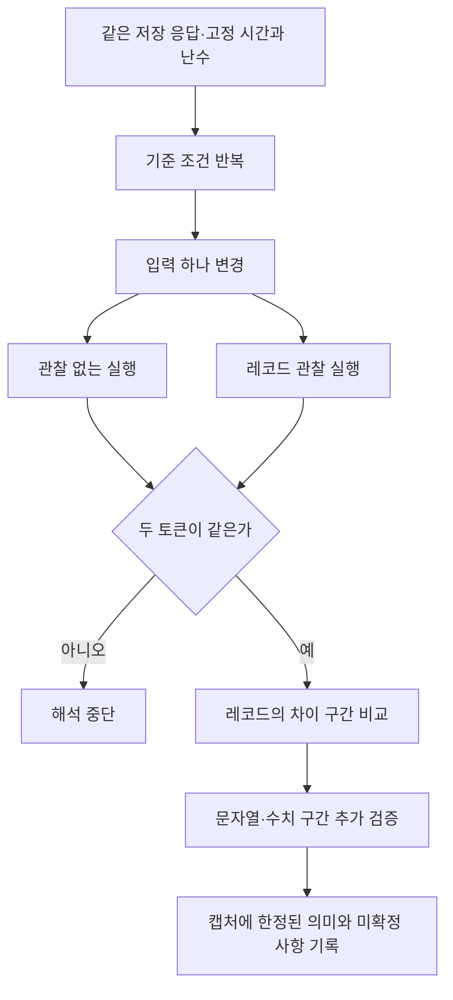

# 025: 같은 확인 응답의 입력을 하나씩 바꿔 레코드 구간을 찾다

## 문제 정의

024에서 암호화 전604바이트를 복원했지만 각 구간의 의미는 몰랐다. 이번 목표는 하나의 저장 응답과 고정된 시간·난수를 사용해 입력 하나가 바뀔 때 어느 구간이 달라지는지 관찰하는 것이다.

<callout icon="🔎" color="blue_bg">
	**이번 분석 질문**
	같은 Google 확인 응답에서 언어·화면 너비·CPU 병렬 처리 수·URL·User-Agent·객체 형태를 하나씩 바꾸면, 생성 레코드의 어느 부분이 달라지는가?
</callout>

이번에는 Google에 새 검색 요청을 보내지 않았다. 입력은024에서 사용한 저장 응답이며 원래 검색어는 Python official website였다. 기준 커밋은8276169, 대상 VM 빌드는975569ac2bf2다. 아래 위치는 이 캡처의0부터 시작하는 바이트 위치다. Google 전체에 고정된 프로토콜 오프셋으로 일반화하지 않는다.

## 실제 결과

첫 언어만 바꾼 실행의 실제 출력 중 해당 부분:

```json
"name": "language_first",
"instrumentation_equal": true,
"record_bytes": 604,
"positional_difference_count": 4,
"difference_ranges": [[525, 527], [528, 530]]
```

difference_ranges는 끝 위치를 포함하지 않는다. 해당 구간을 문자열로 읽어 확인한 결과:

| 조건 | 첫 언어 구간525–529 | 둘째 언어 구간533–534 |
| --- | --- | --- |
| 기준 | en-US | en |
| 첫 언어만 변경 | ko-KR | en |
| 둘째 언어만 변경 | en-US | ko |

문자열의 실제 위치를 확인했다. 단순히 토큰 길이가 바뀐 것을 언어 필드라고 추측한 결과가 아니다.

## 입력별 변화

| 바꾼 입력 | 관찰된 변화 | 현재 해석 |
| --- | --- | --- |
| 첫 언어 en-US→ko-KR | 525–526,528–529의4바이트 | 첫 언어 문자열 구간 |
| 둘째 언어 en→ko | 533–534의2바이트 | 둘째 언어 문자열 구간 |
| screen.width를1로 설정 | 379의1바이트 | 너비 입력에 의존하는 수치 구간 |
| hardwareConcurrency를1로 설정 | 428의1바이트 | 해당 입력에 의존함. 전체 필드 경계·인코딩은 미확정 |
| URL의 검색어만 변경 | 차이 없음 | 이번 레코드·실행 경로에서 변화 미관찰 |
| JS User-Agent만 변경 | 차이 없음 | 이번 레코드·실행 경로에서 변화 미관찰 |
| webdriver=true 대조군 | 335–338,444,481,587,592의8바이트 | 여러 구간이 해당 상태에 의존 |
| Navigator 생성자를 빈 함수로 대체 | 570–571,587,592의4바이트 | 생성자 대체가 레코드에 영향 |

webdriver와 생성자 대체가 공통으로 바꾼587·592가 무슨 필드인지는 아직 모른다. 이를 “차단 점수”나 “체크섬”으로 이름 붙이지 않는다. 대조군 값은 분석에만 사용했고 실제 검색 요청에 적용하지 않았다.

User-Agent와 검색어가 이 실험에서 변화를 만들지 않았다고 해서 HTTP 서버의 판정에서도 무관하다는 뜻은 아니다. HTTP 헤더는 서버가 별도로 볼 수 있고 다른 프로그램·분기는 결과가 달라질 수 있다. 적어도 이번 레코드 분석에서는 JS의 UA 문자열만 바꾸는 것보다 관찰된 객체·수치 입력이 더 직접적인 조사 대상이다.

## 너비 저장 방식 추가 확인

너비1 실험만으로 인코딩을 단정하지 않고256·257로 추가 실행했다. 실제378–379 구간:

| screen.width | 바이트378 | 바이트379 |
| --- | --- | --- |
| 0 | 00 | 00 |
| 1 | 00 | 01 |
| 256 | 01 | 00 |
| 257 | 01 | 01 |

시험한 범위에서는 이 구간이 상위 바이트부터 오는2바이트 정수 표현과 일치한다. 필드 전체의 폭, 부호, 범위를 넘겼을 때 동작까지 확정한 것은 아니다. 256·257 두 조건에서도 레코드 전체 길이는604바이트였다.

## 분석이 결과를 바꿨는지 확인

1. 기준 조건을 두 번 실행해 레코드가 바이트 단위로 같음을 확인했다.
2. 이번 호스트 실험기를 추가한 기준 레코드·토큰을024의 기존 결과와 비교해 둘 다 같음을 확인했다.
3. 각 조건을 관찰 없이 한 번, 레코드 관찰을 추가해 한 번 실행했다. 성공한14조건 모두 두 토큰이 같았다.
4. 처음의10조건 행렬은176655ms, 추가 너비4조건 행렬은71222ms였다. 각각 기준·반복 조건을 포함하며 합계28회 VM 실행이다. 제한에 걸린 예비 실행은 이 합계와 구분한다.

이 검사는 실험기의 관찰이 해당 결과를 바꾸지 않았는지와 반복 가능성을 확인한다. 생성 값의 Google 서버 유효성 검사는 아니다. 모든 출력에서 server_acceptance_tested=false를 유지했다.

## 실제 구현

### 호스트 실험기에만 입력 변경 지점 추가

scripts/google_record_matrix.cjs의 makeRunner는 검토한 toolkit의 호스트 run 함수에 fixture 적용 지점을 메모리에서 추가한다. Google의 VM 코드·암호화된 프로그램·vendor 파일은 수정하지 않는다. 예상한 소스 지점이 정확히 하나가 아니면 실행하지 않는다.

applyFixture의 실제 일부:

```javascript
if (fixture.url) dom.reconfigure({url:fixture.url});
if (fixture.languages) set(window.navigator,'languages',fixture.languages);
if (fixture.screenWidth !== undefined) set(window.screen,'width',fixture.screenWidth);
if (fixture.hardwareConcurrency !== undefined) set(window.navigator,'hardwareConcurrency',fixture.hardwareConcurrency);
```

각 조건은 한 입력만 바꾼다. 생성자 대체는 단일 수치 변경이 아닌 객체 형태의 대조 실험으로 구분한다.

### 관찰 없는 결과를 먼저 대조

```javascript
const control=await run(html,false,fixture),tapped=await run(html,true,fixture);
```

토큰이 같을 때만 레코드 변화 해석을 진행한다. 다르면 오류로 멈춘다. 시간·난수는 기존 toolkit의 고정값을 유지했다. 기준 URL은 toolkit의 q=anything이며 query_only만 q=synthetic으로 바꿨다. 실제 검색 질의를 다시 보낸 것이 아니다.

### 길이 변화와 위치 변화를 구분

compareRecords는 바이트 차이 구간, 공통 앞부분·뒷부분, 두 길이를 함께 기록한다. 삽입으로 뒷부분의 위치가 밀리는 경우를 단순한 대규모 필드 변경으로 오해하지 않도록 했다. 이번 성공한 조건에서는 모두 길이가604로 같았다.

각 조건 완료 때 비공개 상세를 임시 파일로 저장하고 교체한다. 전체 실행이 중단돼도 이전 완료 조건은 남는다. Python 실행기에 --matrix·--matrix-case를 추가해 조건을 나눠 실행할 수 있게 했다.



## 검증과 한계

Python 테스트88개와 Node24 테스트3개가 통과했다. 새 Node 테스트는 같은 배열, 연속 치환, 삽입으로 위치가 밀린 경우의 비교 결과를 검사한다. 단순히 “변경 바이트가 많다”는 이유로 필드 의미를 오해하지 않기 위한 검증이다.

행렬의 입력은 jsdom 환경에서 변경했다. 동일 입력을 QuickJS에 줬을 때 같은 레코드가 나오는지까지는 아직 검증하지 않았다. 604바이트 전체 스키마를 해석한 것도 아니고 이 입력들을 맞추면 검색이 열린다는 결론도 없다.

이번의 의미 있는 진전은 일부 구간을 실제 입력에 연결한 것이다. 다음은 생성자 대체에 민감한 구간과 두 실행 환경의 차이를 비교하는 것이다. 필드 의미가 확인되지 않은 비트를 수동으로 바꿔 통과시키는 방식은 선택하지 않는다.

외부 검색·로컬 LLM 추론은 호출하지 않았다. 완료한 두 행렬의 실행 시간만 합하면 약4분8초이며, 제한에 걸린 예비 실행과 개발 시간은 별도다. 주 비용은 로컬 실행 시간이었다.

## 실행

```powershell
# --node에는 Node24 이상 실행 파일을 지정
python scripts/analyze_google_challenge.py <비공개 응답> --node <Node24 실행 파일> --matrix
# 추가 수치 조건만 확인
python scripts/analyze_google_challenge.py <비공개 응답> --node <Node24 실행 파일> --matrix --matrix-case screen_width_256 --matrix-case screen_width_257
# Node24에서 비교기 테스트
node --test tests/test_google_record_matrix.cjs
```

기본 --matrix는 기준·반복과 첫 언어·둘째 언어·너비1 조건을 실행한다. 표의 다른 조건은 --matrix-case를 반복 지정한다. 행렬 전체 자식 프로세스 제한은240초다. 호스트 실행기의3초 타이머는 동기 JS 계산을 강제로 중단하는 CPU 제한이 아니며 전체 제한과 구분한다. 분석 상세와 토큰은 기존 비공개 영역에 보존한다.

<details>
<summary>실제 도구·분석 로그</summary>
	모델 tool_call과 Google HTTP 요청은 없었다. 입력은024의 저장 응답이다. 실행일은2026-10-18 KST다. 개별 조건의 경과 시간과 실행 순서를 기록했으며 개인 데이터·토큰·레코드 원문은 제외했다.
	1. 예비 전체 행렬: 기존55초 자식 프로세스 제한으로 analysis_timeout. 첫 버전은 완료 조건을 마지막에만 저장해 결과가 남지 않았다.
	2. 중간 저장 추가 후 예비 실행: 다시55초 제한에 도달했으나 기준·기준 반복의 완료 결과를 복구했다. 두 조건의 레코드604바이트·토큰1039자·관찰 전후 동일성은 확인됐다. 이 부분 결과를 전체 행렬 성공으로 기록하지 않았다.
	3. 전체8개 변경 조건+기준2조건: 로컬 실험9d30e2e4f6c14ea28ca23846c0b3f5f1. baseline→baseline_repeat→language_first→language_second→screen_width→hardware_concurrency→query_only→user_agent_only→webdriver_negative_control→navigator_constructor_stub 순서. 전체176655ms, 기준 재현=true, 모든 조건 instrumentation_equal=true, 모든 레코드604바이트. 실제 차이 구간은 본문 표에 기록했다.
	4. 너비 추가2조건+기준2조건: 로컬 실험19a41dc11ec146e3911169da61306604. baseline→baseline_repeat→screen_width_256→screen_width_257. 전체71222ms, 기준 재현=true, 모든 조건 instrumentation_equal=true. 256은[378,379),257은[378,380)만 달랐다.
	5. 별도 Python 확인: 새 기준과024의 원래 레코드·토큰 비교 → original_record_equal=true, original_token_equal=true. 언어 구간을 직접 읽어 en-US/en,ko-KR/en,en-US/ko를 확인했다.
	6. python -m unittest discover -s tests →88개/2.086초/OK. 앱 번들 Node24.19.0의 --test tests/test_google_record_matrix.cjs →3개/모두 통과. 기본 Node23 실행은 실패해 지원하는 Node24로 재검증했다.
</details>
