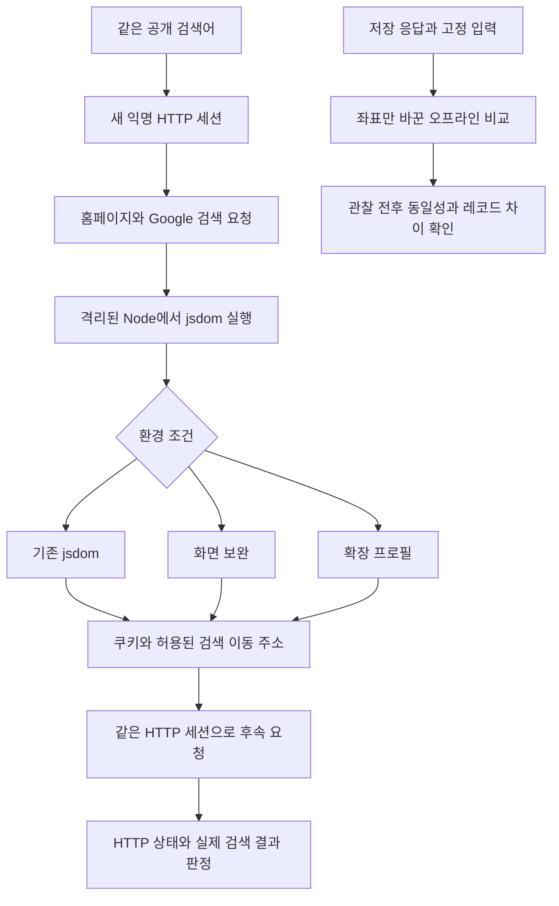

# 026: DOM 누락을 실제 HTTP 결과와 대조하다

## 질문과 현재 결과

앞선 실험은 Google의 확인 쿠키를 만들었지만 검색 결과를 얻지 못했다. 이번에는 공개 소스의 환경 보완 코드를 실제 요청에 적용하고, 그중 화면 좌표 누락에 대한 설명을 독립적으로 확인했다. 좋은 결과의 기준은 확인 쿠키 생성이 아니라 Google 응답에서 검색 제목과 URL을 확보하는 것이다.

<callout icon="🔎" color="blue_bg">
	**실제로 보낸 검색어**
	Python official website
</callout>

LLM을 호출한 실험은 아니다. 검색기에 직접 같은 질의를 보냈다. 기존 jsdom, 화면 정보 보완, 확장 프로필의 세 조건 모두 실제 반환 결과는 `http_error`, 검색 결과는 `[]`였다. 후속 HTTP 응답은 모두 `302`, 이동 목적지는 `/sorry/index`였다. 이 이동은 따라가지 않았다.

| 조건 | 검색 HTTP | JS 실행 오류 | SG_SS 길이 | 후속 HTTP | 검색 결과 |
|---|---:|---:|---:|---:|---:|
| 기존 jsdom | 200, JS 확인 필요 | 0 | 1019 | 302 → /sorry/index | 0 |
| 화면 정보 보완 | 200, JS 확인 필요 | 0 | 1056 | 302 → /sorry/index | 0 |
| 확장 프로필 | 200, JS 확인 필요 | 0 | 1075 | 302 → /sorry/index | 0 |

각 조건은 새 익명 HTTP 세션이며 실제 Google 응답도 서로 다르다. 이 표의 토큰 길이 차이만으로 어느 입력이 원인인지 판단하지 않는다. 세 조건의 결과를 합친 실행기는 실패 종료 코드1을 반환했다.

## 문제 정의와 분석

브라우저가 정상이라고 HTTP 클라이언트도 같은 응답을 받는 것은 아니다. 다만 차단 원인을 IP나 TLS 하나로 확정할 근거도 없다. 현재 확인한 사실은 HTTP 클라이언트가 받은 확인 프로그램을 실행하고 쿠키를 제출해도 검색 결과 대신 접근 확인 경로로 이동한다는 것이다.

새 후보는 [SearchGuard 분석 저장소의 envSource](https://github.com/Sec-CH-Lemon/google-search-guard-vm-reversing/blob/c617f4406ce1c373d5e071ae0f969de101ec4505/part-2-reverse-vm/tools/lib/challenge.js)다. 코드에는 jsdom의 screen.availLeft·availTop 누락과 레코드 길이 변화에 대한 설명이 있다. 설명을 사실로 바로 채택하지 않고 같은 저장 응답에서 확인하기로 했다. 이 저장소 자체도 분석 도구가 확인 절차를 해결해 준다고 주장하지 않는다.

## 연구 과정: 온라인 성공과 오프라인 차이를 분리

첫 비교는 실제 요청이었다. 기존 환경은 UA·플랫폼과 익명 쿠키만 맞췄다. 화면 조건은 너비·높이·가용 영역·좌표·색상 깊이를 추가했다. 확장 프로필은 공개 코드의 envSource를 호출해 언어·하드웨어 병렬 처리 수·메모리·터치·화면·창 크기·일부 Chrome API 등을 설정했다.

모두 합성 설정이며 사용자 브라우저에서 수집한 프로필이 아니다. 선택 사항인 연결 정보·메모리 통계·navigationTiming 등은 제공하지 않았다. 실제 브라우저 전체를 재현한 환경이라고 부르지 않는다.

다음에는 025와 같은 저장 응답, 고정 시각·난수로 오프라인 비교를 했다. 기준 두 번과 화면 좌표만 추가한 조건을 각각 관찰 코드 없이/있이 실행해 총6회 실행했다.

| 조건 | 평문 레코드 | 관찰 전후 토큰 | 기준과 비교 |
|---|---:|---|---|
| 기준 | 604바이트 | 동일 | 기준 |
| 기준 반복 | 604바이트 | 동일 | 레코드·토큰 동일 |
| availLeft=0, availTop=0 추가 | 609바이트 | 동일 | 길이 +5, 공통 앞부분387바이트 |

따라서 **이 캡처에서 두 속성의 존재가 확인 레코드 구조에 영향을 준다**는 주장은 재현했다. 달라진 모든 바이트가 화면 좌표 자체라는 뜻은 아니다. 뒤 필드의 위치 변화와 다른 의존 값이 함께 나타날 수 있다. 숫자 위치와 길이는 이번 캡처에 한정한다.

## 구현과 선택 이유

검증되지 않은 확장 프로필을 기존 에이전트의 기본 동작에 넣지 않았다. 연구용 HTTP 비교 실행기로 분리해 성공 여부를 확인한 뒤 채택할 수 있게 했다.



<details>
<summary>실제 코드와 재현 조건</summary>
	기준 커밋 ecbc8ff 이후의 이번 변경이다. Node24.19.0, curl_cffi0.16.3, 별도 클론의 jsdom29를 사용했다. 검토한 도구 커밋은 c617f4406ce1c373d5e071ae0f969de101ec4505다. 설치나 브라우저 실행은 하지 않았다.

	`scripts/probe_google_dom.cjs`의 `applyEnvironment`는 비교 조건을 분리한다. 원래 환경을 대조군으로 남겨 보완 자체의 효과를 확인한다.
	```javascript
	if (mode === 'baseline') return;
	const screen = {width:1920,height:1080,availWidth:1920,availHeight:1040,
	  availLeft:0,availTop:0,colorDepth:24,pixelDepth:24};
	if (mode === 'screen') {
	  for (const [key,value] of Object.entries(screen)) {
	    Object.defineProperty(w.screen,key,{configurable:true,get:()=>value});
	  }
	  return;
	}
	```

	`scripts/probe_google_dom.py`의 `run_case`는 쿠키 생성만으로 성공하지 않는다. 허용한 Google 검색 주소인지 확인하고 실제 후속 응답을 판정한다. JS 파일에는 네트워크 권한을 주지 않으며 jsdom의 외부 리소스 로딩도 켜지 않는다. Python HTTP 요청은15초, Node 프로세스는30초 제한이다. 허용된 검색 주소로만 한 번 후속 요청하며 /sorry를 자동 추적하지 않는다.
	```python
	if not token or not allowed_redirect(target, {'www.google.com'}) or urlsplit(target).path != '/search':
	    report['stopped'] = 'missing_token_or_allowed_search_redirect'
	    return report
	session.cookies.set('SG_SS', token, domain='www.google.com', path='/')
	_, hits = request(session, 'followup', target,
	    headers={'Referer': response.url, 'Sec-Fetch-Site': 'same-origin'})
	report['success'] = bool(hits)
	```

	`scripts/google_record_matrix.cjs`의 `applyFixture`에는 화면 좌표만 추가하는 조건을 넣었다. 기존 VM 프로그램이나 암호화된 입력은 수정하지 않는다.
	```javascript
	if (fixture.screenCoordinates) {
	  set(window.screen,'availLeft',0);
	  set(window.screen,'availTop',0);
	}
	```

	실행: `python scripts/probe_google_dom.py --node <Node24 실행 파일>`.
	오프라인 비교: `python scripts/analyze_google_challenge.py <저장 응답> --node <Node24 실행 파일> --matrix --matrix-case screen_avail_coordinates`.
</details>

<details>
<summary>실제 툴콜·HTTP 실행 로그</summary>
	검색 엔진은 모두 Google이며 모델 도구 호출과 다음 모델 입력은 없다. 실행기는 Python에서 직접 HTTP와 Node를 호출했다. 쿠키 값·전체 이동 URL·인증 정보는 제외했다. 시각은 UTC이며 한국 시각은9시간을 더한다.

	`exec_command`로 `python scripts/probe_google_dom.py --node <Node24 실행 파일>`을 실행했다. 종료 코드는1이었다. 아래 ID는 실행기가 각 실제 HTTP 요청에 부여한 ID다. 모든 검색 요청 인자는 `q=Python official website`, `num=5`, `hl=en`이다.

	| 호출 ID | 요청 시작 | 실제 요청 | 결과 |
	|---|---|---|---|
	| baseline-home | 2026-10-17 18:20:43.248702 | GET www.google.com/?hl=en | 200, 224917바이트 |
	| baseline-search | 18:20:43.556047 | GET /search, 위 검색 인자 | 200, javascript_required, 92428바이트 |
	| baseline-followup | 18:20:45.153379 | JS가 반환한 /search | 302, /sorry/index, 결과0 |
	| screen-home | 18:20:45.593990 | GET www.google.com/?hl=en | 200, 220936바이트 |
	| screen-search | 18:20:45.902057 | GET /search, 위 검색 인자 | 200, javascript_required, 92342바이트 |
	| screen-followup | 18:20:47.377835 | JS가 반환한 /search | 302, /sorry/index, 결과0 |
	| profile-home | 18:20:47.726162 | GET www.google.com/?hl=en | 200, 222082바이트 |
	| profile-search | 18:20:48.020465 | GET /search, 위 검색 인자 | 200, javascript_required, 92428바이트 |
	| profile-followup | 18:20:49.803165 | JS가 반환한 /search | 302, /sorry/index, 결과0 |

	각 검색·후속 요청 사이에 해당 환경의 Node 실행이 있었다. 세 실행 모두 종료 코드0, JS 오류0, 검색 이동 주소1개였다. 상태를 확인한 추가 실행에서 beacon 요청 목록은 셋 모두 비어 있었다. 온라인 전체 시간은 조건별2344ms·2125ms·2594ms였다.

	별도 `exec_command`로 `analyze_google_challenge.py`의 `screen_avail_coordinates` 조건을 실행했다. 기준·기준 반복·좌표 추가 순서로6회 VM 실행, 총51098ms, 종료 코드0이었다. 새로운 HTTP 요청은 없었다. 세 조건 모두 instrumentation_equal=true, baseline_reproducible=true였다. 이 결과의 server_acceptance_tested=false는 오프라인 분석에 한정한다. 위 온라인 실험은 별도로 서버 응답을 확인했고 모두 실패했다.
</details>

## 결과와 다음 판단

소스 설명 중 화면 좌표 누락의 실제 영향은 확인했다. 그러나 이를 채운 환경에서도 같은 검색어가 결과를 반환하지 않았으므로 **화면 누락 보완만으로 충분하다는 가설은 이번 조건에서 통과하지 못했다.** 모든 화면·DOM 문제를 배제한 것은 아니다.

Python88개, 기존 Node 비교 테스트3개 통과. 이 테스트 통과는 Google 검색 성공을 뜻하지 않는다. 온라인9회 HTTP 요청과 로컬6회 VM 실행의 비용이 추가됐고 유료 API나 모델 호출은 없었다. 반복적인 외부 재시도 대신 다음 후보는 실제로 접근하는 iframe·생성자·함수 동작의 차이를 먼저 설명해야 한다. IP·전송 계층·다른 입력이 최종 거부 원인인지는 여전히 확정하지 못했다.
