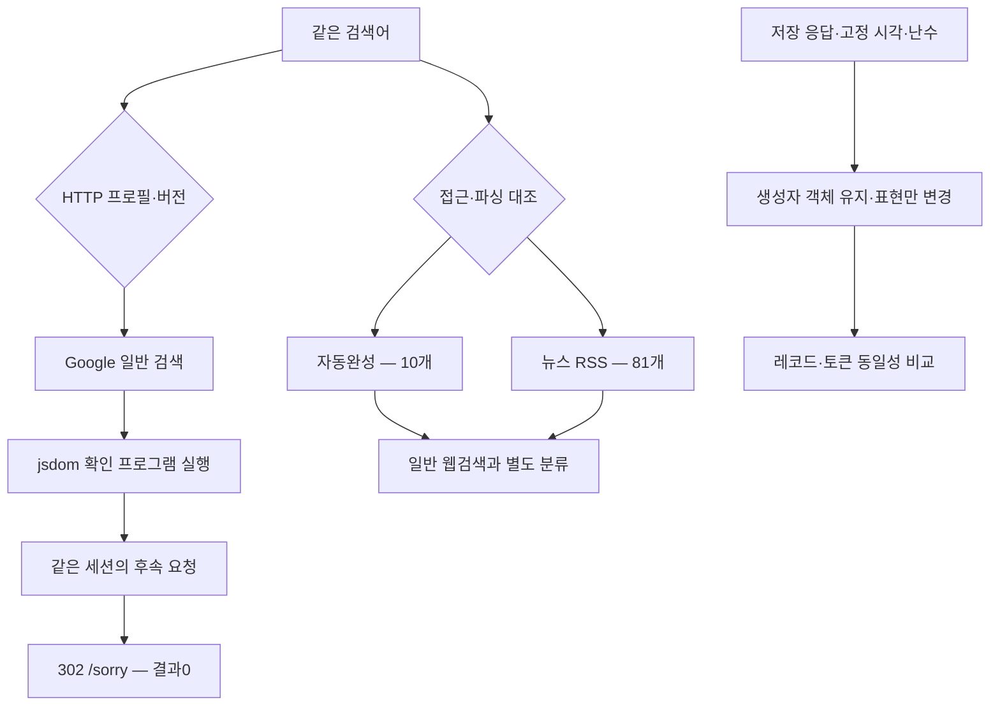

# 027: HTTP 계열·프로토콜·생성자와 Google 대조 경로를 나누어 검증하다

## 같은 질문과 실제 반환 결과

026의 화면 보완은 검색을 해결하지 못했다. 이번에는 전송 계열과 JS 실행 환경을 구분하고, 새로운 공개 저장소의 실제 구현과 역사적인 비-JS 요청도 확인했다. 좋은 결과의 기준은 일반 Google 웹검색에서 제목·URL을 확보하는 것이다.

<callout icon="🔎" color="blue_bg">
	**모든 온라인 실험에 보낸 검색어**
	Python official website
</callout>

LLM 답변 생성은 하지 않았다. 직접 실행한 검색기의 실제 반환은 다음과 같다.

| 조건 | 최초 검색 | 확인 스크립트 후속 요청 | 검색 결과 |
|---|---|---|---:|
| Chrome150 HTTP 프로필·기본 DOM | 200, javascript_required | 302 → /sorry/index | 0 |
| Firefox147 HTTP 프로필·기본 DOM | 200, javascript_required | 302 → /sorry/index | 0 |
| Safari26.0.1 HTTP 프로필·기본 DOM | 200, javascript_required | 302 → /sorry/index | 0 |
| Chrome150·HTTP/1.1 | 200, javascript_required | 302 → /sorry/index | 0 |
| Chrome150·부모 생성자 두 개의 문자열 표현 보정 | 200, javascript_required | 302 → /sorry/index | 0 |
| Chrome150·HTTP/2 명시·기본 DOM 재실행 | 200, javascript_required | 302 → /sorry/index | 0 |
| Chrome150·HTTP/2 명시·확장 프로필 | 200, javascript_required | 302 → /sorry/index | 0 |
| Whoogle의 역사적 Opera UA·gbv=1 조합 | 200, unsupported_client | 실행하지 않음 | 0 |

일반 검색 시도8개 모두 실패했다. 아래 두 건은 같은 질의의 **접근·파싱 대조 실험**이며 일반 웹검색의 성공으로 합산하지 않는다.

| 대조 경로 | 실제 응답 | 읽은 내용 |
|---|---|---|
| /complete/search, client=firefox | 200 | 자동완성10개 |
| news.google.com/rss/search | 200 | RSS 기사81개 |

자동완성의 실제 첫 세 문자열은 “python official website”, “python official website download”, “python official website login”이었다. 자동완성은 방문할 웹페이지의 검색 결과가 아니다. 뉴스 결과도 공식 홈페이지 탐색을 대신하지 않으며, 기사 개수는 관련성·신뢰성 점수가 아니다.

## 문제 분석

프록시 환경 변수와 운영체제에서 Python이 인식하는 프록시 설정이 있는지 확인했지만 발견하지 못했다. 이 관찰만으로 브라우저와 HTTP의 실제 출구 IP가 같다고 확정하지는 않는다.

Chrome133 설정에만 의존하지 않도록 curl_cffi의 Chrome150·Firefox147·Safari26.0.1 프로필을 비교했다. 실제 전송한 UA만 디버그 콜백에서 읽어 JS 입력에 전달했다. 다른 브라우저의 UA를 붙인다는 뜻으로 TLS 프로필과 JS 엔진 전체를 동일시하지 않는다. 세 경우의 JS 실행기는 계속 jsdom/V8이었다.

기존 실험에서 쓰던 HTTP 헤더의 고정 Chrome133 UA를 새 프로필에 덮어씌우지 않도록 제거했다. 프로필이 실제 전송한 UA에 맞춰 platform·vendor를 정한다. 첫 계열 비교 후 기본 DOM에서도 vendor를 적용하도록 보강했으며, 그 뒤 Chrome의 HTTP/1.1과 HTTP/2 조건을 다시 실행했다. 초기 세 조건과 후속 조건의 작은 설정 차이를 숨기지 않는다.

libcurl의 응답 버전 값3은 HTTP/3이 아니라 enum의 V2_0이다. 이후 실행에는 숫자와 이름을 함께 저장했다. HTTP/1.1 실험에서는 실제 V1_1을 확인했다. 둘 다 같은 접근 확인 경로로 이동했지만, 모든 TLS·HTTP 계층 원인을 배제하는 검증은 아니다.

## 공개 소스 추가 조사

[omkarcloud/google-scraper](https://github.com/omkarcloud/google-scraper/tree/11a5562251a8c330475a1fd312e5f572db85d7e8)를 클론해 README뿐 아니라 google_search/identity.py·fetch.py·serp.py를 읽었다. 일반 검색은 Camoufox로 쿠키·UA를 얻은 다음 HTTP로 재사용하고, 자동완성·뉴스 RSS 등의 경로는 HTTP로 조회한다. 일반 검색을 브라우저 없이 해결한 구현으로 채택하지 않았다. 브라우저나 의존성 설치·실행은 하지 않았다.

[Whoogle](https://github.com/benbusby/whoogle-search/tree/0543f86528678ab60a20b3049483975add6b6e40)도 클론했다. 개발 종료 공지와 request.py·ua_generator.py를 대조했다. 공지는 마지막 비-JS UA 접근이 막혔다고 설명한다. 실제 소스의 기본 대체 UA인 Opera/12.02와 gbv=1 조합을 한 번 재현했지만 지원 중단 안내를 받았다. Chrome TLS에 Opera UA를 붙인 역사적 요청 조합이며 완전한 Opera 실행 환경은 아니다. 프로젝트 전체 실행이나 모든 UA 검증으로 확대 해석하지 않는다.

[Reddit의 HTTP 검색 사례](https://www.reddit.com/r/webscraping/comments/1k2rezd/)도 다시 찾았지만, 이전024에서 이미 검증한 tkattkat 추천이었다. 중복 추천을 새 후보로 세지 않았다. Reddit의 성공 주장 자체는 현재 환경의 성공 증거로 사용하지 않는다.

## 생성자 가설을 분리한 연구

025에서 Navigator 객체를 새 함수로 교체하면 레코드가 달라졌다. 당시에는 객체·프로토타입·함수 표현 등이 동시에 바뀌어 원인을 구분할 수 없었다. 이번에는 **원래 생성자 객체와 동작은 유지하고 문자열 표현만** 바꾸는 실험 조건을 만들었다.

고정된 같은 저장 응답에서 기준·기준 반복·문자열 보정 조건을 관찰 코드 없이/있이 실행했다. 총6회, 51224ms였다. 세 조건 모두604바이트였고, 레코드와 토큰이 기준과 같았다. 관찰 전후의 토큰 동일성 검사도 통과했다.

이 조건에서는 부모 Navigator·HTMLMediaElement의 문자열 표현 두 개를 바꾸는 것만으로 레코드가 달라지지 않았다. 앞선 생성자 교체 효과를 단순히 native 문자열 때문이라고 설명할 근거가 줄었다. 모든 함수 표현이나 iframe 내부의 비교가 무관하다는 결론은 아니다.

온라인 조건은 확장 프로필 위에 이 표현 보정을 추가한 것이다. 직접 확인한 후속 요청은 여전히302였다. 오프라인 단일 조건 비교와 온라인 여러 설정 조합을 구분한다.

실행 완료 후의 별도 점검에서는 jsdom iframe이 문서에 붙기 전 contentWindow=null, 붙은 후 object였으며 부모와 다른 Function 객체를 가졌다. 문자열 보정은 부모 영역만 바꾸었고 iframe 안의 생성자 표현은 바뀌지 않았다. 기존 QuickJS 임시 DOM 소스에는 iframe.contentWindow와 별도 실행 영역이 없다. 이 차이가 서버 거부의 원인인지는 아직 확인하지 못했다.

추가로 iframe 안의 두 생성자 표현도 비교했다. 래퍼만 넣은 대조군과 래퍼+표현 보정군을 각각 관찰 코드 없이/있이 실행했다. 최초8회 실행 뒤 실제 대상 접근 여부를 세는 계수를 추가해8회 재실행했다. 첫 비교68760ms, 계수 포함 재검증67429ms였다.

계수 포함 조건에서 iframe 생성2회·contentWindow 읽기4회를 확인했고, 보정군에서는 실제 내부 실행 영역1개에 표현 보정을 적용했다. 그러나 **래퍼만 넣어도 기준 대비3바이트가 달라졌고, 표현 보정을 추가한 군은 래퍼 대조군과 레코드·토큰이 같았다.** 달라진 위치는 이번 캡처의0기준572·587·592였다. 이 위치의 의미를 점수·체크섬으로 단정하지 않는다.

표현 변경으로 생긴 효과와 관찰 장치의 효과를 구분해야 한다. 이 결과를 “iframe 보정으로 확인 데이터를 개선했다”라고 해석하지 않았다. 후속 실험에서는 원본 함수의 속성·프로토타입을 더 잘 보존하는 래퍼부터 기준 토큰 동일성을 확인해야 한다.

## 구현과 검증

에이전트 공급자 동작은 바꾸지 않았다. 연구 실행기에 HTTP 프로필·프로토콜 선택, 실제 UA 읽기, 완료 후 DOM 점검, 역사적 요청·대조 경로 진단을 추가했다. 대조 경로에서 정상 데이터를 받아도 general_web_search_success는 false로 남긴다.



<details>
<summary>실제 코드와 실행 조건</summary>
	기준 커밋38fca0c 이후의 변경이다. scripts/probe_google_dom.py의 run_case에서 실제 전송 UA만 수집한다. Cookie·Authorization 헤더는 수집하지 않는다.
	```python
	wire_identity = {}
	def observe(kind, data):
	    if kind == 2:
	        # Retain only the actual outgoing UA, never Cookie/Authorization.
	        for line in data.decode('latin-1').splitlines():
	            if line.lower().startswith('user-agent:'):
	                wire_identity['ua'] = line.split(':', 1)[1].strip()
	```

	scripts/probe_google_dom.cjs의 applyConstructorText는 생성자를 교체하지 않는다. 아래는 문자열 표현을 바꾼 실제 코드 일부다. 실제 native 구현으로 전환하는 코드가 아니다. 조사 보고서의 source_looks_native도 표현에 대한 검사일 뿐이다.
	```javascript
	const original = Function.prototype.toString;
	const sources = new Map([[Navigator,'function Navigator() { [native code] }'],
	  [HTMLMediaElement,'function HTMLMediaElement() { [native code] }']]);
	Object.defineProperty(Function.prototype,'toString',{configurable:true,writable:true,
	  value:function toString(){return sources.has(this)?sources.get(this):original.call(this);}});
	```

	scripts/probe_google_surfaces.py의 classify_control은 자동완성과 RSS를 명시적으로 구분하고 잘못된 JSON·HTML을 성공으로 처리하지 않는다. RSS의 외부 엔터티와 XML 네트워크 접근은 끈다.
	```python
	from lxml import etree
	parser = etree.XMLParser(resolve_entities=False, no_network=True)
	root = etree.fromstring(body, parser=parser)
	if root.tag != 'rss':
	    raise ValueError('not_rss')
	```

	실행: `python scripts/probe_google_dom.py --node <Node24 실행 파일> --mode baseline --transport chrome150 --transport firefox147 --transport safari2601`.
	프로토콜: `--transport chrome150 --mode baseline --http-version h1` 또는 h2.
	표현 조건: `--transport chrome150 --mode constructor-text`.
	오프라인: `python scripts/analyze_google_challenge.py <저장 응답> --node <Node24 실행 파일> --matrix --matrix-case constructor_text_only`.
	대조: `python scripts/probe_google_surfaces.py`.

	Python92개·Node4개 테스트 통과. 새 검사는 자동완성·RSS 분류와 잘못된 응답 거부, 문자열 보정 후 생성자 정체성·다른 함수 동작·잘못된 수신 객체의 TypeError 보존을 확인한다. 원본 HTML·쿠키·전체 이동 URL은 비공개로 보존한다.
</details>

<details>
<summary>실제 툴콜과 HTTP 로그</summary>
	모델 호출은 없다. exec_command로 Python 실행기가 직접 Google에 요청했다. 새 일반 검색 조건7개는 각 홈페이지→검색→확인값 후속 요청 순서로 실행됐다. 역사적 Opera 요청1개와 대조 요청2개를 더해 총24회 HTTP 요청이었다. 자동 재시도·/sorry 이동 추적·다른 검색 엔진 호출은 없었다. 시각은 UTC다.

	아래 HTTP 상세는 실제 저장 결과에서 생성했다. 초기 요청 ID는 baseline-home/search/followup처럼 조건 사이에 중복됐으므로 계열·시각을 함께 제시한다. 후속 실행부터 run·계열·환경·단계를 조합한 고유 ID를 사용한다.

	| 조건·호출 ID | 시작 시각 | 실제 요청 인자·단계 | HTTP·결과 |
	|---|---|---|---|
	| chrome150/baseline/auto; baseline-home | 2026-10-17 18:27:26.957073 | GET /?hl=en | 200 no_search_markup |
	| chrome150/baseline/auto; baseline-search | 2026-10-17 18:27:27.289358 | GET /search; q=Python official website, num=5, hl=en | 200 javascript_required |
	| chrome150/baseline/auto; baseline-followup | 2026-10-17 18:27:28.883041 | GET JS가 반환한 /search; 쿠키 값·확인 인자는 제외 | 302 http_error → /sorry/index |
	| firefox147/baseline/auto; baseline-home | 2026-10-17 18:27:29.252619 | GET /?hl=en | 200 no_search_markup |
	| firefox147/baseline/auto; baseline-search | 2026-10-17 18:27:29.609246 | GET /search; q=Python official website, num=5, hl=en | 200 javascript_required |
	| firefox147/baseline/auto; baseline-followup | 2026-10-17 18:27:31.284838 | GET JS가 반환한 /search; 쿠키 값·확인 인자는 제외 | 302 http_error → /sorry/index |
	| safari2601/baseline/auto; baseline-home | 2026-10-17 18:27:31.662551 | GET /?hl=en | 200 no_search_markup |
	| safari2601/baseline/auto; baseline-search | 2026-10-17 18:27:31.960585 | GET /search; q=Python official website, num=5, hl=en | 200 javascript_required |
	| safari2601/baseline/auto; baseline-followup | 2026-10-17 18:27:33.526181 | GET JS가 반환한 /search; 쿠키 값·확인 인자는 제외 | 302 http_error → /sorry/index |
	| chrome150/baseline/h1; baseline-home | 2026-10-17 18:28:40.920732 | GET /?hl=en | 200 no_search_markup |
	| chrome150/baseline/h1; baseline-search | 2026-10-17 18:28:41.308724 | GET /search; q=Python official website, num=5, hl=en | 200 javascript_required |
	| chrome150/baseline/h1; baseline-followup | 2026-10-17 18:28:43.011871 | GET JS가 반환한 /search; 쿠키 값·확인 인자는 제외 | 302 http_error → /sorry/index |
	| chrome150/constructor-text/auto; constructor-text-home | 2026-10-17 18:29:13.183204 | GET /?hl=en | 200 no_search_markup |
	| chrome150/constructor-text/auto; constructor-text-search | 2026-10-17 18:29:13.506138 | GET /search; q=Python official website, num=5, hl=en | 200 javascript_required |
	| chrome150/constructor-text/auto; constructor-text-followup | 2026-10-17 18:29:15.286846 | GET JS가 반환한 /search; 쿠키 값·확인 인자는 제외 | 302 http_error → /sorry/index |
	| chrome150/baseline/h2; 0e8a25c04f354de3891957cd642bb061:chrome150:baseline:home | 2026-10-17 18:29:50.744907 | GET /?hl=en | 200 no_search_markup |
	| chrome150/baseline/h2; 0e8a25c04f354de3891957cd642bb061:chrome150:baseline:search | 2026-10-17 18:29:51.082785 | GET /search; q=Python official website, num=5, hl=en | 200 javascript_required |
	| chrome150/baseline/h2; 0e8a25c04f354de3891957cd642bb061:chrome150:baseline:followup | 2026-10-17 18:29:52.707663 | GET JS가 반환한 /search; 쿠키 값·확인 인자는 제외 | 302 http_error → /sorry/index |
	| chrome150/profile/h2; 0e8a25c04f354de3891957cd642bb061:chrome150:profile:home | 2026-10-17 18:29:53.238848 | GET /?hl=en | 200 no_search_markup |
	| chrome150/profile/h2; 0e8a25c04f354de3891957cd642bb061:chrome150:profile:search | 2026-10-17 18:29:53.539790 | GET /search; q=Python official website, num=5, hl=en | 200 javascript_required |
	| chrome150/profile/h2; 0e8a25c04f354de3891957cd642bb061:chrome150:profile:followup | 2026-10-17 18:29:55.154076 | GET JS가 반환한 /search; 쿠키 값·확인 인자는 제외 | 302 http_error → /sorry/index |
	| whoogle-opera | 2026-10-17 18:29:10.471156 | GET https://www.google.com/search; q=Python official website, hl=en, num=5, gbv=1 | 200 unsupported_client |
	| autocomplete | 2026-10-17 18:29:10.687710 | GET https://www.google.com/complete/search; q=Python official website, client=firefox, hl=en | 200 suggestions 10개 |
	| news-rss | 2026-10-17 18:29:10.872780 | GET https://news.google.com/rss/search; q=Python official website, hl=en-US, gl=US, ceid=US:en | 200 news_articles 81개 |

	Node 실행은 각 일반 검색과 후속 요청 사이에 있었다. 모두 종료 코드0·스크립트 오류0·검색 이동 주소1개였지만 서버의 검색 결과 수용은 없었다. 일반 검색 시도8개를 포함한 두 진단 실행기는 모두 실패 종료 코드1이었다.

	별도 exec_command의 오프라인 constructor_text_only는6회 VM 실행, 종료 코드0, baseline_reproducible=true, 세 조건 instrumentation_equal=true였다. iframe_wrapper_control·iframe_constructor_text 비교는 최초8회와 계수 포함8회, 두 번 모두 종료 코드0이었다. 각 비교의 모든 조건에서 관찰 전후 토큰은 같았다. 계수 포함 재검증에서 iframe 생성2·읽기4·보정군의 내부 보정1회를 확인했다. 두 iframe 조건 사이의 레코드와 토큰도 직접 비교해 동일함을 확인했다. 이번 작업의 로컬 VM 실행 합계는22회였으며 추가 네트워크 요청은 없었다. 관찰 성공과 서버 성공을 섞지 않는다.
</details>

## 결과와 남은 문제

일반 Google 웹검색은 미해결이다. 이번 범위에서는 HTTP 계열 교체, HTTP/1.1 선택, 부모 생성자 두 개의 표현 보정, 역사적 Opera UA가 해결책이 되지 못했다. 자동완성·뉴스의 성공은 로컬 HTTP에서 Google의 일부 데이터를 정상적으로 받는다는 대조 근거다. 이를 여행 에이전트의 일반 검색으로 조용히 교체하지 않는다.

새로운 수치는 검색 품질 향상이 아니라 실패 조건과 가설의 범위를 좁힌 결과다. 다음에 iframe·프로토타입을 다루더라도 먼저 같은 입력에서 어떤 관찰값이 바뀌는지 확인해야 한다. 추가 비용은 로컬 실행과 네트워크·조사 시간이며 유료 API·모델 호출·새 모델 다운로드는 없었다.
