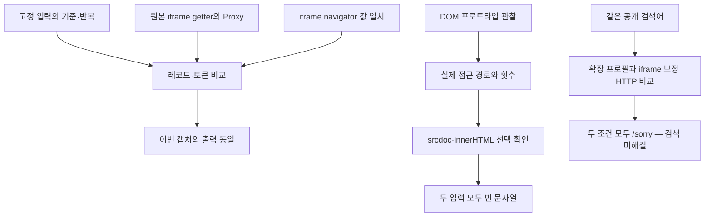

# 028: iframe 불일치를 검증하고 확인 데이터를 바꾸지 않는 DOM 관찰을 만들다

## 실제 질문과 반환 결과

027에서는 iframe 관찰용 함수 교체 자체가 확인 데이터3바이트를 바꿨다. 이 상태에서 환경 보정의 효과를 해석하기 어려워, 먼저 관찰 장치의 영향을 없애고 실제 DOM 사용을 확인하기로 했다. 좋은 결과의 기준은 여전히 Google 일반 검색의 제목·URL 확보다.

<callout icon="🔎" color="blue_bg">
	**실제로 보낸 검색어**
	Python official website
</callout>

LLM 답변 생성 없이 검색기에 직접 요청했다. Chrome150·HTTP/2·확장 프로필을 기준으로 iframe의 navigator 값을 부모와 맞춘 조건을 비교했다.

| 조건 | 최초 검색 | JS 실행 | 실제 후속 응답 | 검색 결과 |
|---|---|---|---|---:|
| 확장 프로필 | 200, javascript_required | 오류0·쿠키 생성 | 302 → /sorry/index, http_error | 0 |
| iframe navigator 일치 | 200, javascript_required | 오류0·쿠키 생성 | 302 → /sorry/index, http_error | 0 |

같은 질문의 두 조건 모두 실패했다. 쿠키 길이 차이를 품질 향상으로 해석하지 않는다. 계열·프로토콜은 같지만 각각 새로운 익명 세션과 새로운 확인 응답이므로, 정밀한 입력별 영향은 별도 고정 입력 실험으로 구분했다.

## 문제 분석

기존 확장 프로필은 부모 창의 navigator에만 값을 설정했다. 실제 온라인 실행에서 iframe 안에는 부모와 다른 userAgent·platform·vendor·hardwareConcurrency·deviceMemory·maxTouchPoints·pdfViewerEnabled가 남아 있었다. 이 차이가 존재하는 것과 Google 거부의 원인인 것은 별개다.

027의 document.createElement 교체 대신 HTMLIFrameElement.prototype.contentWindow의 원래 getter를 Proxy로 감쌌다. getter의 원형·이름·인자 수와 iframe 자체의 속성 구성을 보존하려는 선택이다. 숨겨진 원본 getter를 그대로 호출하고, 반환된 내부 창에 필요한 값만 설정한다.

단순히 Proxy를 썼다고 관찰 영향이 없다고 가정하지 않았다. 같은 저장 응답·고정 시각·고정 난수에서 다음 조건들을 실제로 비교했다.

| 오프라인 조건 | 레코드 | 기준 레코드·토큰과 비교 | 내부 창 보정 |
|---|---:|---|---:|
| 기본 기준과 반복 | 각604바이트 | 동일 | 없음 |
| 부모 UA·플랫폼·vendor 설정 | 604바이트 | 동일 | 없음 |
| 같은 부모 설정 + getter 관찰만 | 604바이트 | 동일 | 0 |
| 같은 부모 설정 + iframe navigator 일치 | 604바이트 | 동일 | 1 |

각 조건을 평문 관찰 코드 없이/있이 실행해10회 VM 실행, 78611ms였다. 모든 조건의 평문 관찰 전후 토큰도 같았다. getter는3회 읽혔고 실제 내부 창1개를 발견했다. 고정 입력에서는 UA·플랫폼·vendor 차이가 있었으며 보정군이 해당 창에 값을 실제로 적용했다.

따라서 이번 캡처에서 이 getter 관찰은 기준 출력을 바꾸지 않았으며, 시험한 iframe navigator 일치만으로도 레코드는 달라지지 않았다. 모든 iframe 기능이나 다른 버전의 Google 확인 프로그램이 무관하다는 뜻은 아니다. 온라인에서는 다른 확장 값까지 함께 맞췄지만 검색은 여전히 실패했다.

## 다음 가설: 어떤 DOM 동작을 쓰는가

값을 더 추측해서 채우기 전에 DOM 속성·메서드를 실제로 관찰했다. HTMLIFrameElement·HTMLAnchorElement·HTMLElement·Element·Node·CSSStyleDeclaration의 getter·setter·메서드479개를 원본을 호출하는 Proxy로 감쌌다.

기준·기준 반복·DOM 관찰 조건을 각2회 실행해6회, 41084ms였다. 관찰 조건은 기준과 레코드·토큰이 같았고 평문 관찰의 토큰 동일성도 통과했다. 관찰 기간에14종의 경로가 기록됐다. 여기에는 jsdom의 내부 처리도 포함되므로 모든 호출을 Google 프로그램의 직접 호출이라고 단정하지 않는다.

| 관찰 경로 | 연산 | 기록 횟수 |
|---|---|---:|
| HTMLElement.style | get | 2 |
| HTMLIFrameElement.contentWindow | get | 3 |
| Node.appendChild / removeChild | call | 각1 |
| HTMLElement.onclick | set | 1 |
| HTMLElement.click | call | 1 |
| HTMLIFrameElement.srcdoc | set | 1 |
| Element.innerHTML | set | 1 |

ownerDocument·nodeType·namespaceURI·localName·hasAttribute·prefix도 기록됐다. 인자·반환 문자열·URL·쿠키는 기본 관찰 로그에 넣지 않았다.

srcdoc을 발견한 뒤 jsdom29.1.1 소스를 확인했다. HTMLFrameElement-impl.js의 속성 변경 처리에는 src 경로가 있고, HTMLScriptElement-impl.js는 outside-only 설정에서 삽입된 script의 자동 실행을 허용하지 않는다. 이것만 보고 실행 누락이 원인이라고 판단할 수는 없다.

그래서 srcdoc·innerHTML에 쓰는 두 문자열만 비공개로 추가 확인했다. 기준·반복·선택적 문자열 수집 조건6회, 41411ms를 실행했고 레코드·토큰이 기준과 같았다. **두 값 모두 빈 문자열이었으며 script 태그가 없었다.** 이번 캡처에서 이 두 삽입에 포함된 스크립트 실행이 빠졌다는 가설은 뒷받침되지 않는다. 실행 모드를 바꾸거나 불필요한 스크립트 실행을 추가하지 않았다.

새 실제 응답과 저장 응답의 VM 코드를 비교하니 둘 다975569ac2bf2 빌드였다. VM 코드가 같다는 사실이 모든 암호화 입력이나 미래 응답의 동작까지 같다는 보장은 아니다.

## 구현과 구조

새 동작은 연구용 실행기에만 있다. 기존 에이전트 공급자나 기본 QuickJS DOM은 바꾸지 않았다.



<details>
<summary>실제 코드와 재현</summary>
	기준 커밋557740f 이후의 변경이다. scripts/probe_google_dom.cjs의 mirrorIframeNavigator는 기존 getter를 호출하며 내부 창은 한 번씩만 처리한다. 배열 값은 해당 iframe의 eval로 만들어 부모 배열 객체를 그대로 넘기지 않는다.
	```javascript
	const getter = new w.Proxy(descriptor.get,{apply(target,self,args){
	  stats.window_reads++;
	  const inner = Reflect.apply(target,self,args);
	```

	applyEnvironment의 새 iframe-mirror 조건은 기존 확장 프로필을 설정한 뒤 이 보정을 켠다. 실제 실행의 계수는 사후 DOM 점검이 추가하는 iframe이 섞이지 않도록 먼저 복사한다.
	```javascript
	const challengeFixtureStats = fixtureStats?JSON.parse(JSON.stringify(fixtureStats)):null;
	const runtime = auditRuntime(w);
	```

	observeDomAccess는 실제 반환값을 바꾸지 않고 예외를 그대로 다시 던진다. 기본 로그에는 경로·연산·횟수·예외 수·반환 타입만 남긴다. 선택적으로 수집한 DOM 문자열은 비공개 결과에 보존하되 공개 요약에서는 제거한다. scripts/google_record_matrix.cjs의 publicFixture 실제 코드다.
	```javascript
	function publicFixture(fixture) {
	  return JSON.parse(JSON.stringify(fixture,(key,value)=>key.startsWith('private_')?undefined:value));
	}
	```

	실제 HTTP 비교: `python scripts/probe_google_dom.py --node <Node24 실행 파일> --transport chrome150 --mode profile --mode iframe-mirror --http-version h2`.
	고정 입력: `analyze_google_challenge.py <저장 응답> --node <Node24 실행 파일> --matrix`에 다음 선택 조건을 붙인다.
	- `--matrix-case iframe_identity_baseline --matrix-case iframe_identity_proxy_control --matrix-case iframe_identity_mirror`
	- `--matrix-case dom_prototype_probe`
	- `--matrix-case dom_capture_setters`

	Python92개·Node8개 테스트 통과. 추가 검사는 getter의 원형·이름·인자 수·수신 객체 검사 보존, iframe 자체 속성 보존, 자식 영역의 배열 생성, 중복 보정 방지, 관찰 시 원래 호출·예외 보존, 비공개 문자열의 공개 요약 제외를 확인한다. 토큰 동일성과 실제 검색 성공은 별개다.
</details>

<details>
<summary>실제 툴콜·HTTP·오프라인 실행 로그</summary>
	모델 호출은 없었다. exec_command에서 Python이 직접 실행했다. 검색어는 두 경우 모두 Python official website이며 검색 인자는 q=Python official website, num=5, hl=en이다. 계열은 chrome150, 실제 HTTP 버전은 V2_0이었다. 시각은 UTC다. 쿠키 값·확인 인자·전체 이동 URL은 제외했다.

	| 실제 호출 ID | 시작 시각 | 실제 요청 | HTTP·결과 |
	|---|---|---|---|
	| 6077c1ac80274a35a66abc69df8cdafc:chrome150:profile:home | 2026-10-18 06:06:25.939923 | GET /?hl=en | 200 |
	| 6077c1ac80274a35a66abc69df8cdafc:chrome150:profile:search | 06:06:26.369194 | GET /search, 위 검색 인자 | 200, javascript_required |
	| 6077c1ac80274a35a66abc69df8cdafc:chrome150:profile:followup | 06:06:27.934097 | JS가 반환한 /search | 302 → /sorry/index, 결과0 |
	| 6077c1ac80274a35a66abc69df8cdafc:chrome150:iframe-mirror:home | 06:06:28.370448 | GET /?hl=en | 200 |
	| 6077c1ac80274a35a66abc69df8cdafc:chrome150:iframe-mirror:search | 06:06:28.792062 | GET /search, 위 검색 인자 | 200, javascript_required |
	| 6077c1ac80274a35a66abc69df8cdafc:chrome150:iframe-mirror:followup | 06:06:30.482963 | JS가 반환한 /search | 302 → /sorry/index, 결과0 |

	각 검색과 후속 요청 사이의 Node 실행은 종료 코드0, JS 오류0, 검색 이동 주소1개였다. 보정 조건에서는 contentWindow 읽기3회·내부 창1개·보정1회와 navigator의 불일치7종을 기록했다. 전체 실행기는 종료 코드1이었다. /sorry를 따라가거나 다른 검색 엔진을 호출하지 않았다.

	별도 exec_command로 고정 입력 비교10회·DOM 관찰6회·선택적 문자열 확인6회, 총22회 VM 실행을 수행했다. 세 실행 모두 종료 코드0, 기준 반복과 모든 관찰 전후 토큰 동일성을 통과했다. 각각78611ms·41084ms·41411ms였다. 추가 네트워크 요청은 없었다. 비공개 문자열 결과를 직접 확인했으며 srcdoc·innerHTML 값의 길이는 둘 다0이었다. 공개 요약에는 원문 DOM 문자열을 넣지 않았다.
</details>

## 결과와 한계

실제 iframe navigator 불일치와 이를 맞춰도 검색이 해결되지 않는다는 결과를 확인했다. 이전 래퍼의 영향은 제거했고, 기준 출력을 유지하는 DOM 관찰과 선택적 비공개 수집 방법을 만들었다. 발견한 속성을 곧바로 실패 원인으로 단정하지 않고 실제 전달값까지 확인해 한 가설을 내려놓았다.

일반 웹검색은 여전히 미해결이다. 이번 관찰은 고정된 한 캡처와 두 온라인 조건의 범위이며 실제 브라우저와의 모든 차이를 설명하지 못한다. 비용은 로컬 실행·HTTP6회와 조사 시간이고 유료 API·모델 호출·새 모델 설치는 없었다.
