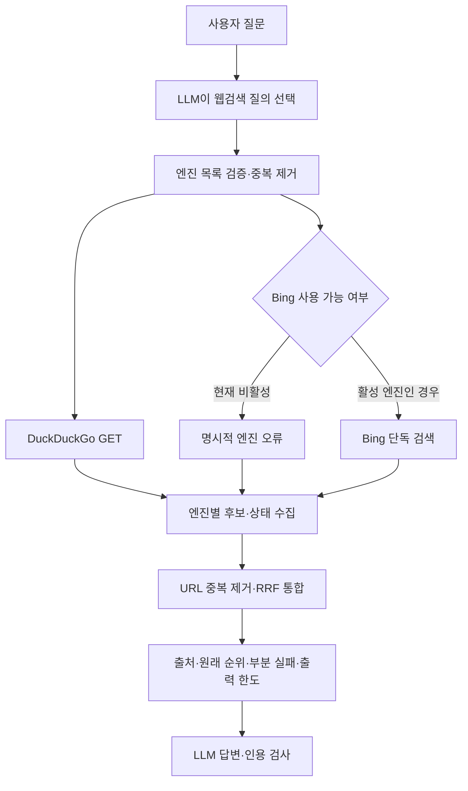

# 029: 덕덕고·Bing을 명시적으로 병렬 수집하고 결과를 통합하다

## 문제와 좋은 답변의 기준

사용자는 Google 직접 HTTP 연구를 중단하고 DuckDuckGo·Bing을 각각 검색해 종합하기로 했다. 좋은 결과는 두 엔진의 실행 여부를 확인할 수 있고, 중복 URL을 합치며, 한쪽 실패를 숨기지 않고 실제 근거로 답하는 것이다. 검색 엔진에 접근한 것과 질문에 맞는 결과를 얻은 것을 구분한다.

먼저 공개 질의3개를 같은 도구에 보내 초기 경로와 GET 변경 경로를 비교했다. LLM 답변이 아니라 실제 검색 도구 반환이다.

<callout icon="🔎" color="blue_bg">
	**실제 검색어1**
	Python official website
</callout>

초기에는 DuckDuckGo에서 Python.org 결과3개를 받았다. GET 변경 후에도 Python.org와 다운로드 페이지를 포함한3개가 반환됐다. 두 경우 모두 Bing은 비활성화 오류였고 search_complete=false였다.

<callout icon="🔎" color="blue_bg">
	**실제 검색어2**
	국립춘천박물관 공식 홈페이지
</callout>

초기 도구 반환은 “No search engine returned usable results”였다. GET 변경 후에는 “국립춘천박물관 - Museum”, https://chuncheon.museum.go.kr/kor/index.do 를 포함한3개가 반환됐다. 실제 엔진은 DuckDuckGo, HTTP200이었다. Bing은 계속 비활성화 오류였다.

<callout icon="🔎" color="blue_bg">
	**실제 검색어3**
	춘천 삼악산 호수케이블카 공식 홈페이지
</callout>

초기·GET 변경 후 모두 “No search engine returned usable results”였다. 최종 비교의 DuckDuckGo HTTP 상태는202였다. 앞선 개별 GET 진단에서는 이 질의의 검색 결과를 받았지만 최종 재실행에서 실패했다. 재현된 변동을 성공으로 덮어쓰지 않는다.

## 실제 에이전트에 같은 질문을 보내기

<callout icon="💬" color="blue_bg">
	**실제 사용자 질문**
	국립춘천박물관 공식 홈페이지를 찾아줘. 검색에 사용한 엔진과 실패한 엔진도 알려줘.
</callout>

처음에는 Ollama 연결 거부로 model_error가 발생해 답변이 없었고 도구 호출도0회였다. 설치된 Ollama 앱을 기동하고 같은 질문을 다시 보냈다. 모델의 최종 실제 답변은 다음과 같다.

국립춘천박물관 공식 홈페이지는 다음과 같습니다.

*   **홈페이지 URL**: https://chuncheon.museum.go.kr/kor/index.do
*   **검색 엔진**: DuckDuckGo (성공)
*   **실패한 엔진**: Bing (비활성화 또는 사용 불가)

[web:7dbf48b80cbb29b7]

두 번째 실행은 completed, 웹 도구1회·모델3회, 인용 검사 valid였다. 중간 답변에서 인용이 누락돼 기존 인용 보정이1회 추가됐다. 전체10.391초, 보고된 입력 토큰4818·출력 토큰199였다. 두 엔진 실검색 성공이나 일반 품질 우위를 입증한 결과는 아니다.

## 왜 DDGS에 엔진 목록을 한 번 넘기지 않았는가

[DDGS의 엔진 선택 코드](https://github.com/deedy5/ddgs/blob/main/ddgs/ddgs.py)는 같은 provider 분류와 결과 수에 따라 실행을 생략하거나 일찍 종료할 수 있다. 설치된9.16.0에서 DuckDuckGo와 Bing의 provider는 모두bing이었다. 지정 엔진이 없으면 auto로 다시 고르는 경로도 있어, 단순한 backend 문자열만으로 실제 두 엔진 실행을 보장할 수 없었다.

그래서 앱이 엔진을 각각 명시적으로 호출한다. 요청 엔진을 중복 제거하고 최대2개를 병렬 실행하며 결과를 모두 모은 다음 합친다. 모델 응답에 웹 도구가3개 있으면 엔진 작업은 최대6개가 겹칠 수 있다. 메모리 도구의 스레드 정책은 바꾸지 않는다.

## Bing은 왜 그대로 활성화하지 않았는가

[DDGS 이슈375](https://github.com/deedy5/ddgs/issues/375)와 [Bing 구현](https://github.com/deedy5/ddgs/blob/main/ddgs/engines/bing.py)을 확인했다. Bing은 무관한 검색 결과 문제로 disabled=True였다. 직접 저수준 엔진을 시험하니 “Python official website”에 Wikipedia 관련 결과가 나왔다. 박물관 질의에서도 국어원·도서관 등의 결과가 나왔다. HTML 제목·질의 입력에는 실제 요청 질의가 있었으므로 앱이 다른 질의를 보냈다고 단정하지 않는다.

별도 Bing RSS 요청도 두 질의에 무관하거나 목표와 다른 결과를 반환했다. Bing의 HTTP200과 목록 파싱을 실사용 품질 통과로 삼지 않았다. 정상 경로에서는 비활성화를 강제로 해제하지 않고 engine_disabled_or_unavailable로 보고한다. 현재 실제 검색 근거는 DuckDuckGo만 반환될 수 있으며, 두 엔진이 실제로 동시에 성공하는 상태는 아직 아니다.

## 덕덕고 요청 변경과 통합 방식

덕덕고의 엔진·파서는 DDGS 것을 재사용하고 HTTP 메서드만 GET으로 지정했다. 기본 POST 경로에서 한국어 질의가202를 반환한 뒤 GET 진단에서 결과를 받았기 때문이다. 다만 요청 시점·클라이언트 지문·응답 변동도 있어 GET이 항상 차단을 해결한다는 인과·안정성 주장은 하지 않는다.

HTTP202·접근 확인·파싱되지 않은200은 도구 오류다. DuckDuckGo의 /l/?uddg 링크는 목적지로 해석한 후 HTTP(S)·호스트·인증 정보·공백 검사를 적용한다.

두 엔진 결과가 있는 경우 URL의 프로토콜·호스트 표기와 fragment를 정리해 중복을 합친다. 순위는 [RRF 논문](https://doi.org/10.1145/1571941.1572114)의 순위 결합 방식으로 시작한다. 점수는 각 엔진의 1/(60+rank)를 더한다. 엔진별 점수 척도를 맞추거나 추가 LLM을 호출할 필요가 없다는 선택이다. 현재k=60을 여행 데이터로 최적화한 것은 아니다. 공통 URL이 높은 순위라는 것이 사실 검증이나 독립 색인의 합의를 뜻하지 않는다.

합성 테스트에서는 두 엔진의2위에 공통으로 나온 URL이 각 엔진의 단독1위보다 먼저 배치되고, engines·engine_ranks가 보존됨을 확인했다. 이것은 병합 동작 검증이며 실제 Bing 품질 검증이 아니다.



<details>
<summary>실제 구현 코드와 선택 이유</summary>
	기준 커밋6137fd0 이후의 변경이다. src/travel_agent/web.py의 _combined_search는 각각 별도 요청을 제출한다. 수집 순서는 완료 순서와 달라도 요청 엔진 순서로 유지한다.
	```python
	with ThreadPoolExecutor(max_workers=min(2, len(engines)), thread_name_prefix="web-engine") as executor:
	    futures = {engine: executor.submit(run, engine) for engine in engines}
	    outcomes = {engine: future.result() for engine, future in futures.items()}
	```

	한 엔진이 예외를 내도 다른 엔진의 결과를 버리지 않는다. _provider_search는 비활성 엔진을 DDGS auto로 바꾸지 않는다.
	```python
	engine_class = ENGINES.get("text", {}).get(backend)
	if engine_class is None or getattr(engine_class, "disabled", False):
	    raise WebSearchError("Requested engine is unavailable in DDGS",
	                         details={"reason": "engine_disabled_or_unavailable"})
	```

	RRF에는 엔진별 동일 URL이 한 번만 기여한다. 실제 _combined_search의 발췌다.
	```python
	item = merged.setdefault(url, {**row, "engine_ranks": {}, "_score": 0.0})
	item["engine_ranks"][engine] = rank
	item["_score"] += 1 / (60 + rank)
	```

	최종 출력은 기존 바이트 한도를 지키며 결과별 engines·engine_ranks를 보존한다. src/travel_agent/agent.py는 이 출처를 web_sources에도 전달하고, 부분 실패를 밝히도록 SYSTEM에 안내했다. 새로운 검색 질문 대본이나 추가 요약 LLM은 넣지 않았다.

	실행: `travel-agent web search "국립춘천박물관 공식 홈페이지" --backend duckduckgo,bing`.
	실제 비교: `python scripts/evaluate_search_fusion.py`.
	실제 에이전트: `travel-agent memory --user demo --session dual029 agent "국립춘천박물관 공식 홈페이지를 찾아줘. 검색에 사용한 엔진과 실패한 엔진도 알려줘."`.

	Python102개 테스트 통과. 새 테스트는 두 worker의 실제 동시 진입을 Barrier로 확인하고, 중복 제거·공통 URL 우선·원래 순위·한쪽 실패 보존·예상 밖 예외 격리·모두 실패 시 오류·비활성 엔진의 auto 금지·GET 전송·리다이렉트 해석·202와 잘못된200 거부를 검증한다. 합성 데이터와 실제 조회를 구분했다.
</details>

<details>
<summary>실제 툴콜·도구 반환 로그</summary>
	모델 없는 비교 실행의 도구는 web_search, 공급자는ddgs, 요청 backend는duckduckgo,bing이다. 모든 호출의 top_k는3이었다. 시각은 UTC다. Bing은 정상 통합 경로에서 HTTP 요청하지 않았으며 비활성 오류를 반환했다.

	| 단계·호출 ID | 시작 시각 | 실제 검색어 | 실제 반환 |
	|---|---|---|---|
	| 초기 da456e8b9ed84ab8b79ed54149016367 | 2026-10-18 06:23:16.477829 | Python official website | DuckDuckGo 결과3·부분 성공 |
	| 초기 47a4e2c9fb56467dbacaec4701531a6b | 06:23:17.436427 | 국립춘천박물관 공식 홈페이지 | 사용 가능한 결과 없음 |
	| 초기 e22228391eb74d8cb060aee8b10b7318 | 06:23:17.793674 | 춘천 삼악산 호수케이블카 공식 홈페이지 | 사용 가능한 결과 없음 |
	| GET c8f2086d7b2f493da19bb53c882bfdae | 06:24:30.801180 | Python official website | DuckDuckGo200·결과3·부분 성공 |
	| GET bed5f592ab1e467ebbf4474d0bc02106 | 06:24:31.780852 | 국립춘천박물관 공식 홈페이지 | DuckDuckGo200·결과3·부분 성공 |
	| GET 08ff20f987b6401fb429aab66bd420ed | 06:24:32.519133 | 춘천 삼악산 호수케이블카 공식 홈페이지 | DuckDuckGo202·도구 오류 |

	두 비교 실행 모두 종료 코드1이다. 평가기는 모든 질의에서 두 엔진 완료와 결과 확보를 요구하므로 부분 성공을 전체 통과로 표시하지 않는다. 초기 POST의 HTTP202는 앞선 저수준 직접 실행에서 관찰했으며 초기 통합 결과에는 HTTP 상태가 수집되지 않았다. 변경 후 결과에는 실제 HTTP 상태와 GET 메서드를 포함한다.

	초기 저수준 직접 진단의 실제 호출 ID는00a9c36444044457923748fce0fb2f1d(DuckDuckGo·Python·200), 24584dab84b446868e5dae9241e1ec2b(Bing·Python·200·무관한 결과), a90ae9293fc44e0080c6fe535140d2d1(DuckDuckGo·박물관·202), 65bb52f7d3c247a4b328a7ecad26891c(Bing·박물관·200)였다. 06:19:23.960347~06:19:25.237409에 실행했다. Bing RSS 추가 진단은 exec_command 출력23a26c에서 같은 두 질의와 format=rss,setlang=ko,cc=kr를 사용했고 HTTP200이었으나 목표와 다른 결과였다. 이 추가 진단은 개별 요청 시각을 수집하지 않았다.

	에이전트 실행 전 첫 같은 질문은 request_id=ce2ab8e4317a45228b995939d561e23c, model_error·tool_calls=0이었다. Ollama 앱을 숨김 실행한 뒤 /api/version=0.40.5, 설치된 정확한 모델 태그qwen3.5:4b-q4_K_M를 확인했다. 모델 다운로드·삭제·업데이트는 하지 않았다. 이후 /api/ps에서 해당 모델의 context_length=65536, size_vram=5216676084를 확인했다.

	두 번째 에이전트 실행은 request_id=6b5525d4e62f4595a3552e4decb21759였다. 실제 모델이 요청한 도구 호출 ID는call_nzvjlox0, 인자는 query="국립춘천박물관 공식 홈페이지", top_k=5였다.
	- 06:26:39.448858 tool_start: web_search, span1.1.
	- 06:26:40.335360 tool_end: DuckDuckGo GET200·후보5개·884ms, Bing 비활성 오류·90ms, search_complete=false. 출력 한도로4개를 모델에 전달했다.
	- 06:26:41.337415 citation_repair: 제공된 근거의 인용 누락으로 수정1회. 검색을 다시 호출하지 않았다.
	- 최종 completed, 인용ID web:7dbf48b80cbb29b7, 실제 답변은 본문에 표시했다.

	모델에게는 성공한 엔진의 실제 제목·URL·검색 요약·순위와 실패 상태를 전달했다. 외부 페이지 본문을 읽지는 않았다. 쿠키·인증 헤더·개인 대화는 연구일지에 넣지 않았다.
</details>

## 결과와 남은 한계

두 엔진을 명시적으로 호출하고 합치는 구조는 구현·합성 검증했다. 실제 실행은 DuckDuckGo의 일부 질의와 모델 답변까지 확인했지만 Bing은 비활성 상태이며 케이블카 재실행은202였다. 따라서 두 엔진 실검색 통합·장기 안정성·여행 추천 품질 향상은 아직 증명하지 못했다.

일부 실패가 다른 엔진의 결과까지 지우거나, 비활성 엔진 대신 auto가 다른 엔진을 조용히 호출하는 동작을 막았다. RRF는 두 엔진이 정상 결과를 낼 때 쓰는 현재 선택이며 독립 색인·사실 검증을 보장하지 않는다. 이 작업에서 수집한 검색 결과는 제목·URL·요약 범위다.

유료 검색 API는 사용하지 않았다. 엔진이 모두 활성화되면 질의당 외부 요청은 두 개이고 로컬 병렬 작업·후처리 비용이 있다. 실제 모델 검증에는 Ollama 호출3회가 들었으며 인용 보정1회가 추가 비용이었다.
