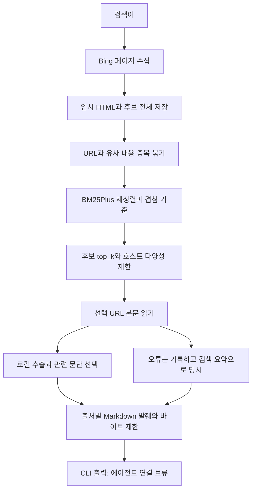

# 034: 에이전트보다 검색 툴부터 — 후보 수집·재정렬·발췌와 실제 품질 격차

## 문제 정의: 쿼리에서 좋은 검색 근거로

앞선 단계는 검색 결과를 받은 뒤 에이전트가 잘 답하는지까지 한꺼번에 보았다. 그런데 원래 후보가 무관한 경우와 모델이 근거를 잘못 쓴 경우가 섞여 있었다. 사용자는 에이전트 검증을 멈추고 검색 툴부터 충분히 검증하자고 했다.

<callout icon="💬" color="blue_bg">
	**개발 요청**
	검색 결과를 임시 파일에 로우 데이터로 둔 다음, 그 안에서 2차 검색으로 관련 자료를 고르고 묶어서 top_k를 정한다. 원문을 압축한 결과만 에이전트에 전달한다. 내장 웹검색과도 최대한 품질을 맞춘다.
</callout>

좋은 검색 툴의 기준은 후보를 많이 받은 것에 그치지 않는다. 질문의 핵심 개체와 조건에 맞는 자료를 확보하고, 출처를 유지하고, 필요한 근거가 최종 발췌에도 남아 있어야 한다. 압축 크기와 출처 개수는 품질의 대리 점수로 쓰지 않는다. 이번에는 LLM·에이전트를 실행하지 않고 검색 HTTP·추출·재정렬·출력만 검사했다.

## 실제 질문과 도구 출력

아래는 같은 공개 합성 질의의 수집 당시 첫3개와 재정렬·제외 후 실제 전달 패킷을 비교한 것이다. 새 조회끼리의 차이를 순위 개선으로 계산하지 않았다. 제목·요약은 길이를 줄여 발췌했다. 연결 페이지를 읽지 못한 검색 요약을 본문으로 표시하지 않았다.

<callout icon="🔎" color="blue_bg">
	**실제로 보낸 검색어**
	국립춘천박물관 관람시간 휴관일 교통
</callout>

**검색엔진 원래 첫3개**

| 순위 | 실제 제목·URL |
|---|---|
| 1 | [국립중앙도서관](https://www.nl.go.kr/) |
| 2 | [문화체육관광부 국립국어원](https://www.korean.go.kr/) |
| 3 | [국립국어원 표준국어대사전](https://stdict.korean.go.kr/main/main.do) |

**재정렬·출력 제한 후 실제 반환 자료**

반환 자료 없음. 패킷 상태는 `insufficient_candidates`였다. 이 실행에서는 기준을 통과하지 못한 후보를 억지로 채우지 않았다.

받은 카드 20개 → 중복 묶음 10개 → 전달 0개. 본문 발췌 0개, 패킷 350 UTF-8 바이트, 실행 636ms. 두 번째 페이지에서 새 URL이 없어 중단했다.

<callout icon="🔎" color="blue_bg">
	**실제로 보낸 검색어**
	강릉 비오는날 부모님 실내 여행 걷기 적은 곳
</callout>

**검색엔진 원래 첫3개**

| 순위 | 실제 제목·URL |
|---|---|
| 1 | [강릉 비오는날 가볼만한곳 BEST 15｜아이와·커플 실내 여행코스 ...](https://blog.naver.com/everydaygoodshot/224401655050) |
| 2 | [강릉 부모님 여행 코스 비 오는 날도 OK: 카페·시장·실내 코스로 ...](https://blog.naver.com/reallygoodchoice/224181000275) |
| 3 | [비 오는 날, 무조건 가봐야 할 강릉 실내 명소 BEST 5](https://goodtraveler.tistory.com/343) |

**재정렬·출력 제한 후 실제 반환 자료**

| 순위 | 실제 제목·URL | 전달 내용 발췌 | 구분 |
|---|---|---|---|
| 1 | [강릉 부모님 여행 코스 비 오는 날도 OK: 카페·시장·실내 코스로 ...](https://blog.naver.com/reallygoodchoice/224181000275) | May 22, 2026 · 바다 한 번 보고, 커피 … | search_snippet |
| 2 | [강릉 날씨 비오는날 갈만한곳 리스트! 실내 여행지 가볼만한곳 ...](https://m.blog.naver.com/yj5891_/224338070006) | **강릉 날씨부터 실내 여행지 가볼만한곳, 횟집 맛집, 카페**  **강릉 비오는날 갈만한곳 … | page_excerpt |
| 3 | [강릉 비오는날 가볼만한곳 BEST 15｜아이와·커플 실내 여행코스 ...](https://blog.naver.com/everydaygoodshot/224401655050) | 이번 글에서는 2026년 기준 강릉 비오는날 가볼만한곳 BEST 15를 완전 실내부터 비가 … | search_snippet |
| 4 | [강릉 비오는 날 가볼만한곳 추천 6곳, 2026년 최신 실내 여행지 ...](https://into365.kr/gangneung-rainy-day-spots) | 2 days ago · 2026년 따뜻한 봄비가 내리는 강릉, … | search_snippet |

받은 카드 20개 → 중복 묶음 10개 → 전달 4개. 본문 발췌 1개, 패킷 2982 UTF-8 바이트, 실행 1649ms. 두 번째 페이지에서 새 URL이 없어 중단했다.

<callout icon="🔎" color="blue_bg">
	**실제로 보낸 검색어**
	Python asyncio TaskGroup cancellation official documentation
</callout>

**검색엔진 원래 첫3개**

| 순위 | 실제 제목·URL |
|---|---|
| 1 | [Welcome to Python.org](https://www.python.org/) |
| 2 | [Download Python  /  Python.org](https://www.python.org/downloads/) |
| 3 | [Online Python - IDE, Editor, Compiler, Interpreter](https://www.online-python.com/) |

**재정렬·출력 제한 후 실제 반환 자료**

| 순위 | 실제 제목·URL | 전달 내용 발췌 | 구분 |
|---|---|---|---|
| 1 | [Python 3.15.0 documentation](https://docs.python.org/) | 1 day ago · This page is licensed under the Python Software Foundation License Version 2. Examples, … | search_snippet |

받은 카드 20개 → 중복 묶음 10개 → 전달 1개. 본문 발췌 0개, 패킷 629 UTF-8 바이트, 실행 669ms. 두 번째 페이지에서 새 URL이 없어 중단했다.

강릉은 여행 후보가 나왔지만 본문 발췌가 장소별 설명보다 도입부·마무리에 치우쳤다. 부모님의 걷기 부담을 판단할 근거를 확보했다고 할 수 없다. Python은 공식 문서의 일반 첫 화면만 남고 TaskGroup 상세 문서가 빠졌다. 춘천은 마지막 반복 실행에서 관련 후보를 확보하지 못했다. 세 질의의 의미적 검색 품질 통과를 선언하지 않았다.

## 내장 웹검색과 비교

같은 질의를 내장 `web.run`에도 각각 전송했다. 검색 결과에 보인 출처 중 다음을 비교 기준으로 기록했다. 내장 검색 결과 전체가 정답 데이터셋은 아니며, 특정 URL이 다르다고 곧바로 열등하다고 판정하지 않는다.

| 질의 | 내장 검색에서 확보한 자료 | 로컬 마지막 실행 |
|---|---|---|
| 춘천박물관 관람시간·휴관일·교통 | [박물관 공식 페이지](https://chuncheon.museum.go.kr/kor/index.do), 어린이박물관 안내 등 | 공식 페이지가 후보에 없었고 최종0개 |
| 강릉 우천·부모님·걷기 | [강릉 우천 동선 자료](https://gabolmap.com/magazine/gangneung-central-market-coffee-street-rainy-course-20260826) 등 | 다른 여행 자료4개, 관련성·보행 조건 충족은 별도 검토 필요 |
| Python TaskGroup cancellation | [TaskGroup 상세 공식 문서](https://docs.python.org/3/library/asyncio-task.html) 등 | 일반 문서 첫 화면1개, 상세 문서는 후보에 없음 |

이번 관찰에서는 춘천·Python의 자료 확보에 분명한 격차가 있었다. 내장 검색의 색인·검색 공급자·쿼리 변환·본문 수집·재정렬 내부는 이 비교에서 알 수 없다. 따라서 “둘 다 Bing이므로 같은 자료를 받는다”를 전제로 삼지 않았다.

## 문제 분석과 연구 과정

처음에는 다음 페이지 링크의 first만 이어받았다. 저장 HTML을 확인하니 FORM·FPIG도 있었다. 같은 쿼리와 Bing 경로를 검증한 뒤 허용한 매개변수만 전달하도록 바꿨다. 그 뒤 한 실행에서는 두 번째 페이지에 관련 춘천박물관 자료와 공식 홈페이지가 있었지만, 마지막 반복 실행에서는 다시 같은 무관한 페이지가 반복됐다. 단 한 번의 성공을 안정성 개선의 증거로 삼지 않았다.

후보에 답이 없을 때 BM25는 다른 국립 기관 중에서 순서를 정할 뿐이었다. 처음 춘천 실행에서는 국립중앙박물관을1위로 올렸다. 이후 쿼리 토큰 겹침0.25를 기본 제외 기준으로 추가했다. 이 값은 개발 중 설정한 휴리스틱이며 별도 평가셋으로 튜닝·검증한 값이 아니다. 모호한 질문·동의어·핵심 개체 오인·다국어 입력에서는 놓침과 오탐이 남는다.

[rank_bm25 공식 저장소](https://github.com/dorianbrown/rank_bm25)는 토큰 전처리를 호출 측에서 해야 한다고 설명한다. 여기서는 한국어 단어·문자 bigram과 영문 단어를 사용했다. BM25Plus 점수는 관련성 확률이 아니다. [Trafilatura 공식 문서](https://trafilatura.readthedocs.io/en/latest/corefunctions.html)를 참고해 기존 본문 추출기를 재사용했다. Markdown은 문서 형식이고, 내용 축소는 문단 선택과 출력 예산이 담당한다.

본문 처리에서는 짧은 제목만 선택되는 현상을 줄이기 위해 인접 제목과 문단을 묶었다. 실제 강릉 발췌는 여전히 도입부·마무리 중심이었다. 이는 선택기의 기능 동작과 필요한 근거 보존이 다른 문제라는 증거다. JS 의존 페이지의 추출 실패와302 응답도 남았다. 리다이렉트를 임의로 따라가거나 다른 검색엔진으로 대체하지 않았다.

## 구현과 데이터 흐름

기준 커밋은772d213이다. 새 `src/travel_agent/web_pipeline.py`의 `search_evidence`가 수집부터 출력까지 담당한다. 기본은 최대3검색 페이지·후보5개·본문5개·본문 읽기3worker·출력6000바이트다. 설정 범위와 실행법은 검색 파이프라인 문서에 둔다. 기존 에이전트 도구를 자동으로 교체하지 않았다.



`rank_candidates`는 전체 묶음에 대해 점수를 계산한다. 원래 순위를 보존하므로 같은 후보 집합에서 전후를 확인할 수 있다.

```python
def rank_candidates(query, groups):
    if not groups:
        return []
    q = list(dict.fromkeys(tokens(query)))
    corpus = [tokens(g['title'])*2+tokens(g['snippet']) for g in groups]
    scores = BM25Plus([doc or ['__empty__'] for doc in corpus]).get_scores(q)
    ranked = []
    for g, doc, score in zip(groups, corpus, scores):
        matched = sorted(set(q)&set(doc))
        ranked.append({**g, 'score':round(float(score), 6) if matched else 0,
                       'matched_terms':matched, 'query_coverage':round(len(matched)/max(1,len(q)), 3)})
    return sorted(ranked, key=lambda g:(-g['score'],g['original_rank']))

```

`pack_digest`는 URL·출처를 유지하면서 출력 크기를 제한한다. 아래는 현재 소스의 실제 발췌 선택 부분이다.

```python
        fair_share = (max_bytes-len(header.encode()))//max(1,len(sources))
        available = min(max_bytes-len((digest+base).encode())-len('\n[excerpt shortened]\n'.encode()),
                        fair_share-len(base.encode())-len('\n[excerpt shortened]\n'.encode()))
        if available < 60:
            continue
        body = source['text']
        shortened = len(body.encode()) > available
        text = body.encode()[:available].decode('utf-8',errors='ignore') if shortened else body
        digest += base+text+('\n[excerpt shortened]' if shortened else '')+'\n'
        included.append({**source, 'delivered_text':text, 'output_shortened':shortened})
```

원문·파싱 후보·묶음의 출처·전체 추출본·반환 발췌는 요청별로 구분한다. 기본 임시 파일은 종료 때 정리한다. 연구 실행의 보존 옵션은 비공개 경로에 저장하고 공개 Git에는 넣지 않는다. 문장 생성 요약·여러 출처의 주장 합성·임베딩·새 모델 다운로드·LLM 호출은 이번에 하지 않았다.

## 검증과 남은 과제

Python132개 테스트와 pip check가 통과했다. 새 검사는 낮은 원래 순위의 관련 후보 재정렬, 중복 출처 보존, 다음 링크의 쿼리·호스트 검증, 반복 페이지 중단, 본문 실패 표시, 낮은 토큰 겹침 제외, UTF-8 출력 예산을 확인한다. 이 검사는 실제 검색 관련성의 통과 점수가 아니다.

다음 품질 과제는 안정적인 관련 후보 확보, 정확한 개체 구분, JS·리다이렉트 본문의 수집 범위, 조건·예외를 보존하는 발췌다. 새 경로의 기계적 구현은 검증했지만 내장 검색 수준의 품질은 미달이다. 따라서 에이전트 최종 답변 평가와 자동 연결은 계속 보류한다.

<details>
<summary>실제 HTTP 호출·도구 실행 기록</summary>

	**검색 툴 실행 6c923684402f420386b427524f1698b1** — 국립춘천박물관 관람시간 휴관일 교통

	```json
	{"id": "3446424f789e40a4880b5ceb33d516a7", "tool": "bing_search_http", "query": "국립춘천박물관 관람시간 휴관일 교통", "page": 1, "first": 1, "started_at": "2026-10-18T08:49:55.428848+00:00", "method": "GET", "http_transport": "curl", "http_status": 200, "response_bytes": 123336, "pagination_param_names": [], "result_cards": 10, "parsed_results": 10, "new_urls": 10, "finished_at": "2026-10-18T08:49:55.849145+00:00"}
	```

	```json
	{"id": "b2743693d4d1488eb8cc3e544a8c00d2", "tool": "bing_search_http", "query": "국립춘천박물관 관람시간 휴관일 교통", "page": 2, "first": 11, "started_at": "2026-10-18T08:49:55.850576+00:00", "method": "GET", "http_transport": "curl", "http_status": 200, "response_bytes": 122224, "pagination_param_names": ["FORM", "FPIG"], "result_cards": 10, "parsed_results": 10, "new_urls": 0, "finished_at": "2026-10-18T08:49:56.060534+00:00"}
	```

	실제 출력: 350바이트, 출처 0개. 모델 호출과 다음 모델 입력은 없었다.

	**검색 툴 실행 1265cbca63de4df3b937481c7511f3e6** — 강릉 비오는날 부모님 실내 여행 걷기 적은 곳

	```json
	{"id": "9a4f92d9b79041efbb571ea83705d773", "tool": "bing_search_http", "query": "강릉 비오는날 부모님 실내 여행 걷기 적은 곳", "page": 1, "first": 1, "started_at": "2026-10-18T08:49:56.068679+00:00", "method": "GET", "http_transport": "curl", "http_status": 200, "response_bytes": 127224, "pagination_param_names": [], "result_cards": 10, "parsed_results": 10, "new_urls": 10, "finished_at": "2026-10-18T08:49:56.311073+00:00"}
	```

	```json
	{"id": "f257cd2a3e9c448f804c815c58421c74", "tool": "bing_search_http", "query": "강릉 비오는날 부모님 실내 여행 걷기 적은 곳", "page": 2, "first": 11, "started_at": "2026-10-18T08:49:56.312072+00:00", "method": "GET", "http_transport": "curl", "http_status": 200, "response_bytes": 122440, "pagination_param_names": ["FORM", "FPIG"], "result_cards": 10, "parsed_results": 10, "new_urls": 0, "finished_at": "2026-10-18T08:49:56.580408+00:00"}
	```

	```json
	{"id": "6a456381465848789403646a98e9aa62", "tool": "page_http_extract", "url": "https://blog.naver.com/reallygoodchoice/224181000275", "started_at": "2026-10-18T08:49:56.608499+00:00", "error": {"reason": "empty_extraction"}, "finished_at": "2026-10-18T08:49:57.153883+00:00"}
	```

	```json
	{"id": "fe321e8870f74ceb8d54314c47e8350b", "tool": "page_http_extract", "url": "https://m.blog.naver.com/yj5891_/224338070006", "started_at": "2026-10-18T08:49:56.609500+00:00", "method": "GET", "http_status": 200, "download_bytes": 166762, "extracted_bytes": 5026, "selected_blocks": [0, 4, 5], "excerpt_bytes": 1961, "finished_at": "2026-10-18T08:49:57.280021+00:00"}
	```

	```json
	{"id": "80ae7a7281bd4ad48cd6b40b1ace5e2e", "tool": "page_http_extract", "url": "https://blog.naver.com/everydaygoodshot/224401655050", "started_at": "2026-10-18T08:49:56.609500+00:00", "error": {"reason": "empty_extraction"}, "finished_at": "2026-10-18T08:49:57.095453+00:00"}
	```

	```json
	{"id": "990c950088844ecab30e6cd4641266bd", "tool": "page_http_extract", "url": "https://into365.kr/gangneung-rainy-day-spots", "started_at": "2026-10-18T08:49:57.095453+00:00", "error": {"reason": "http_error", "method": "GET", "http_status": 301}, "finished_at": "2026-10-18T08:49:57.717684+00:00"}
	```

	실제 출력: 2982바이트, 출처 4개. 모델 호출과 다음 모델 입력은 없었다.

	**검색 툴 실행 b24261d1c2ba4142be6618ce1746dd77** — Python asyncio TaskGroup cancellation official documentation

	```json
	{"id": "119beb5fc3b14c68b6955bce71164d7c", "tool": "bing_search_http", "query": "Python asyncio TaskGroup cancellation official documentation", "page": 1, "first": 1, "started_at": "2026-10-18T08:49:57.722288+00:00", "method": "GET", "http_transport": "curl", "http_status": 200, "response_bytes": 117681, "pagination_param_names": [], "result_cards": 10, "parsed_results": 10, "new_urls": 10, "finished_at": "2026-10-18T08:49:58.029555+00:00"}
	```

	```json
	{"id": "17e55b4bebe9460abe3c6f84c6cf61d4", "tool": "bing_search_http", "query": "Python asyncio TaskGroup cancellation official documentation", "page": 2, "first": 11, "started_at": "2026-10-18T08:49:58.031121+00:00", "method": "GET", "http_transport": "curl", "http_status": 200, "response_bytes": 116007, "pagination_param_names": ["FORM", "FPIG"], "result_cards": 10, "parsed_results": 10, "new_urls": 0, "finished_at": "2026-10-18T08:49:58.283395+00:00"}
	```

	```json
	{"id": "c85a590cc3d64fee8d40bff655e87097", "tool": "page_http_extract", "url": "https://docs.python.org/", "started_at": "2026-10-18T08:49:58.313813+00:00", "error": {"reason": "http_error", "method": "GET", "http_status": 302}, "finished_at": "2026-10-18T08:49:58.390726+00:00"}
	```

	실제 출력: 629바이트, 출처 1개. 모델 호출과 다음 모델 입력은 없었다.

	**내장 검색 비교**
	`web.run`: 각 질의를 별도 `search_query=[{q: 위 검색어}]`, `response_length=short`로 실행했다. 검색 결과 참조는 museum=turn91search0~11, rainy=turn92search0~7 등, technical=turn93search0~7 등이다. 도구 호출 ID와 개별 실행 시각은 응답에서 제공되지 않아 기록하지 못했다. 위 본문에는 관찰한 대표 출처만 소개했다. 인증 헤더·쿠키·추적 매개변수 값은 공개 기록에서 제외했다. 전체 응답과 개발 중 추가 조회는 비공개로 보존한다.

</details>
