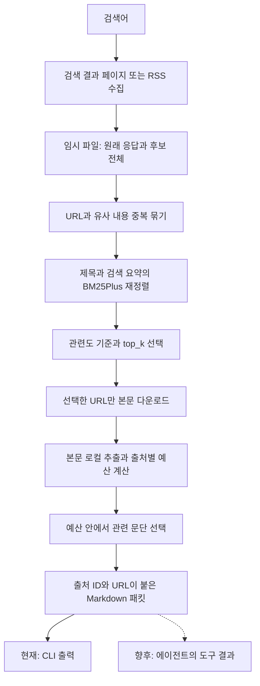
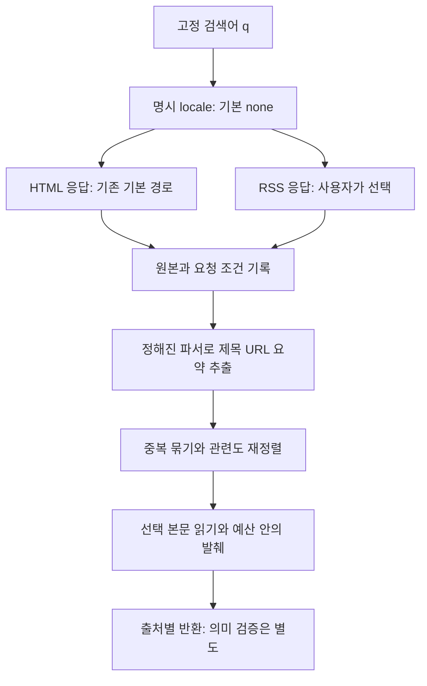

# 036: 같은 검색어가 달라지는 이유 — Bing 언어·지역 실패 재현과 RSS 대조

## 현재 구조 한눈에 보기

<callout icon="✅" color="green_bg">
	**구현 확인 — 기준 커밋 48e6970**
	새 web research는 검색 결과를 먼저 수집·보관한 다음 후처리하고, 출처가 붙은 발췌 패킷을 만든다. 지금은 독립 CLI로 검증 중이며 기존 에이전트 도구에는 연결하지 않았다.
</callout>



| 단계 | 실제로 처리하는 자료 | 구현 |
|---|---|---|
| 먼저 수집·보관 | 검색 HTML 또는 RSS 전체 응답, 제목·URL·검색 요약과 원래 순위 | search_evidence의 수집 루프·save |
| 2차 검색·정리 | 수집한 제목·요약 후보 전체; 중복 묶기 후 BM25Plus 순위와 토큰 겹침 검사 | group_candidates·rank_candidates |
| 선택 본문 수집 | top_k로 고른 URL의 HTML과 로컬 추출본 | fetch_public_page·extract_page |
| 압축·포장 | 전체 추출본에서 질문 관련 문단을 출처별 바이트 예산에 맞춰 선택 | passages·pack_digest |
| 최종 전달 경계 | 제목·출처 ID·URL·발췌·본문/검색 요약 구분이 있는 digest | web research의 stdout |

수집 루프가 끝난 뒤에 중복 묶기·재정렬·top_k가 실행되는 것을 현재 소스와 대조했다. 첫 수집은 검색 결과 전체이며, 모든 후보 사이트의 본문까지 미리 내려받는 구조는 아니다. 후보 본문은 1차 재정렬 후 선택한 것만 읽는다. 본문을 못 읽으면 검색 요약이라는 사실을 표시한다.

기본 HTML 수집은 최대3페이지이고 응답·중복에 따라 일찍 멈춘다. 페이지당10개는 관찰값이라 고유 후보30개를 보장하지 않는다. RSS는 이번에 관찰한 한 피드10개 범위에서 멈춘다. 이후 기본 최대5개를 선택·본문 조회하고 최종 출력은6000 UTF-8 바이트 이내로 제한한다.

현재 압축은 출처별 원문 발췌다. 임베딩 유사도 검색이나 LLM 문장 생성 요약, 여러 출처의 주장을 하나로 합성하는 단계는 아직 없다. 기본 임시 파일은 실행 후 정리하고, 연구 보존 옵션을 쓰면 비공개에 남긴다. Python 반환 보고서에는 디버깅용 상세 자료가 있고 CLI 출력은 digest만 보여준다. 실제 에이전트·LLM 전달은 아직 실행하지 않는다.

기존 기록에는 실제 검색어 콜아웃 바로 아래에 반환 제목·URL·요약 발췌와 전후 결과를 두었고, 문제 분석·코드 조각·흐름도·한계·접힌 호출 로그를 이어 배치했다. 아래의 실험 기록과 성공·실패 판정은 그대로 유지한다.


## 문제 정의

035에서는 같은 검색어로 성공과 실패가 바뀐다는 사실을 확인하고도 원인을 충분히 좁히지 못했다. 사용자는 왜 그렇게 동작하는지와 해결법을 공개 자료·실험으로 알아보라고 요청했다. 이번에는 압축이나 에이전트 성능 평가를 하지 않고, Bing이 원래 어떤 목록을 반환하는지에 집중했다.

<callout icon="💬" color="blue_bg">
	**개발 요청**
	같은 검색어도 달라지는 이유랑, 왜 그렇게 동작하는 건지, 해결법은 뭔지를 찾아보고 알아봐야지.
</callout>

좋은 결과는 요청 조건을 고정해 실패를 재현하고, 바꾼 조건의 효과를 반복 확인하며, 과거 실패 전체를 설명할 수 있는지와 특정 실패만 해결한 것인지를 구분하는 것이다. 한 번 잘 나온 옵션이나 HTTP200은 해결 판정으로 쓰지 않는다.

## 공개 자료에서 찾은 같은 증상

[SearXNG 이슈4964](https://github.com/searxng/searxng/issues/4964)에는 긴 쿼리의 첫 단어만 반영하거나 전혀 무관한 결과를 받는 증상이 보고돼 있다. 우리만의 현상은 아니지만 이 보고만으로 같은 원인이라고 확정하지 않았다.

관련 [수정6671](https://github.com/searxng/searxng/pull/6671)은2026년9월11일 병합됐다. 실제 [변경 코드](https://github.com/searxng/searxng/pull/6671/files)와 [현재 엔진 소스](https://github.com/searxng/searxng/blob/master/searx/engines/bing.py)를 확인했다. 웹검색의 mkt 지정 대신 setlang과 일부 cc를 사용하고, US·CN·RU의 cc는 제외하는 방향이었다. 토론에는 환경에 따라 효과가 다르거나 다시 문제가 나타났다는 보고도 있어 병합 자체를 보편 해결의 증거로 보지 않았다.

[과거 세션 재사용 이슈2977](https://github.com/searxng/searxng/issues/2977)도 조사했다. 다른 프로젝트의 클라이언트·TLS 재사용 문제이므로 우리 코드에 그대로 적용하지 않고 새 세션과 재사용 세션을 대조했다.

[Microsoft의 검색 설명](https://support.microsoft.com/en-us/bing/how-bing-delivers-search-results)은 q 외에도 지역·언어·이력·기기와 최신성 등이 결과에 영향을 준다고 설명한다. 따라서 일반적인 순위 변화는 가능하다. 다만 Python 질문에 그래픽카드·브라우저 목록을 보내는 현상을 정상적인 순위 변화로 설명하고 넘어가지는 않았다.

## 실험 설계와 조건

고정한 두 쿼리는 춘천박물관과 Python TaskGroup이다. 각 쿼리에서 q만 전송, mkt, setlang, setlang+cc, 같은 세션 재사용을 각각3회 실행했다. 별도 확인용 Docker·케이블카는 기존 요청과 안전한 locale 조합을 각3회 비교했다. 합계42회이며 시드20261018로 실행 순서를 섞어 시간 순서와 옵션이 겹치는 영향을 줄였다. 한 호스트·한 시간대이고 요청들이 같은 외부 IP 이력을 공유할 가능성은 통제하지 못했다.

프로그램이 확인한 프록시 환경변수와 시스템 프록시 설정은 없었다. q를 바꾸지 않았고 모델·브라우저·다른 엔진은 호출하지 않았다. 원래 결과와 헤더·쿠키 이름·세션 정책·요청 시작과 끝을 함께 보존했다. 쿠키 값과 인증정보는 공개하지 않았다.

## 실제로 재현한 실패

<callout icon="🔎" color="blue_bg">
	**모든 아래 요청에 그대로 사용한 q**
	Python asyncio TaskGroup cancellation official documentation
</callout>

| 요청 조건 | 목표 공식 상세 문서 확보 | 주제 표식이 있는 결과를 하나 이상 확보 |
|---|---|---|
| q만 전송·새 세션 | 3/3 | 3/3 |
| setlang=en·새 세션 | 3/3 | 3/3 |
| q만 전송·같은 세션 | 3/3 | 3/3 |
| mkt=en-US·새 세션 | 0/3 | 0/3 |
| setlang=en, cc=us·새 세션 | 0/3 | 0/3 |

주제 표식은 제목·검색 요약에 TaskGroup과 cancel이 함께 있는지를 센 단순 검사다. 표식0은 무관한 자료라는 판정이 아니므로, 목표 주소의 실제 존재와 별도로 기록했다. 의미적 적합도 점수로 쓰지 않았다.

다음은 첫 반복에서 받은 실제 첫 결과다. 검색창 q와 페이지 제목에는 올바른 전체 검색어가 남아 있었는데도 아래처럼 달랐다.

| 조건 | 실제 첫 제목·URL | 실제 검색 요약 앞부분 |
|---|---|---|
| baseline | [Coroutines and tasks — Python 3.15.0 documentation](https://docs.python.org/3/library/asyncio-task.html) | 3 days ago · TaskGroup provides stronger safety guarantees than gather for … |
| mkt | [RTX 5090 Staged a Fireworks Show on First Boot - abit.ee](https://abit.ee/en/hard/graphics-cards/rtx-5090-geforce-graphics-card-fire-msi-warranty-china-nvidia-rtx-5090-problems-en) | Feb 11, 2026 · His brand new MSI … |
| cc | [UC Browser](https://www.ucweb.com/download_index.shtml) | Download UC Browser today and enjoy a faster, safer, and more private online experience. With built-in VPN … |

이 구체적인 비교에서는 매개변수 변경이 실패를 일으키는 조건으로 재현됐다. 무관한 목록은 원본 검색 응답 안에 있었으므로 파서·BM25·top_k·모델의 쿼리 변형이 원인은 아니었다. 동일 q가 곧 동일 요청 맥락은 아니라는 것을 확인했다.

그러나 우리 기본 요청에는 원래 mkt나 cc=us가 없었다. 따라서034에서 q만 보냈는데 실패한 모든 과거 실행을 이 실험으로 설명할 수는 없다. 당시 서버의 지역 판정·분기·IP 이력·쿠키·실험 상태를 복원하지 못했다. Bing 내부가 왜 무관한 목록을 보내는지는 공개 정보와 클라이언트 관찰만으로 확정하지 못했다. 의도적인 봇 차별·가짜 결과 주입이라고 단정하지 않았다.

## 다른 원인 후보에 대해 확인한 것

| 후보 | 이번 관찰 | 결론 범위 |
|---|---|---|
| 로컬 쿼리 손상·파싱 오류 | 동일 q와 올바른 검색창을 유지한 채 원본부터 무관한 목록 | 재현한 locale 실패는 이 단계 이전 문제 |
| 세션·쿠키 재사용 | 새 세션과 재사용 모두 목표 주소3/3 | 이 시간대에는 재사용이 해결책이라는 증거 없음 |
| 지역·언어 매개변수 | Python mkt=en-US·cc=us만 각각0/3, q·setlang은3/3 | 특정 요청 조건의 실패를 재현 |
| 일반 순위 변동 | q만 보낸 Python의 URL 순서는3회 모두 달랐지만 목표 문서는 유지 | 순위 변동과 완전히 무관한 목록을 분리 |
| 캐시 | 응답에 private,max-age=0; Age·Via·x-cache 관찰 없음 | 캐시 적중·오염을 원인으로 확인하지 못함; 상위 캐시를 배제한 것은 아님 |
| TLS·HTTP 버전 | 대조 응답은 curl enum3, 라이브러리 정의는V2_0 | 해당 숫자는HTTP/2다. 프로토콜이 원인인지 별도 대조하지 않음 |

## 같은 Bing RSS 응답을 해결 후보로 대조

SearXNG 토론이 가리킨 [Microsoft의 RSS 안내](https://blogs.bing.com/search/2005/1/RSS-Feeds-for-Search-Results/)를 확인하고, 같은 Bing `/search`에 format=rss를 보내 실제 동작을 검사했다. 오래된 안내 문서만으로 현재 지원을 가정하지 않았다. 다른 검색엔진으로 갈아탄 것이 아니다.

<callout icon="🔎" color="blue_bg">
	**RSS에도 그대로 사용한 네 검색어**
	국립춘천박물관 관람시간 휴관일 교통
	Python asyncio TaskGroup cancellation official documentation
	how to install docker on debian
	춘천 삼악산 호수케이블카 이용요금 셔틀 운행 안내
</callout>

| 검색어 | HTTP200 | 목표 공식 주소 확보 | 3회 URL 순서 종류 |
|---|---|---|---|
| how to install docker on debian | 3/3 | 3/3 | 1 |
| 국립춘천박물관 관람시간 휴관일 교통 | 3/3 | 3/3 | 1 |
| 춘천 삼악산 호수케이블카 이용요금 셔틀 운행 안내 | 3/3 | 3/3 | 1 |
| Python asyncio TaskGroup cancellation official documentation | 3/3 | 3/3 | 1 |

이번 RSS12회는 검색어별 동일 URL 목록과 목표 주소를 확인했다. 각 피드에10개가 있었으며 수백 개를 받은 것이 아니다. 같은 시간대 HTML 기본 요청도 목표를 확보했으므로 RSS가 보편적으로 더 정확하다고 할 수 없다. 장기 안정성·다른 언어·IP·날짜·SafeSearch·페이지 필터는 보장하지 않는다.

## 적용한 해결 범위

기준 커밋37c7ad6에서 연구 CLI에 `--locale`과 `--serp-format rss`를 추가했다. HTML 기본값은 그대로다. locale을 명시하면 setlang과 허용한 cc만 보내고 mkt는 보내지 않는다. US는 직접 실패를 재현했고 CN·RU 제외는 외부 수정안을 따른 예방적 처리로 직접 검증하지 않았다. q를 줄이거나 바꾸지 않고, 언어도 자동 추측하지 않는다.

RSS는 명시적으로 고를 수 있는 별도 형식이다. XML 외부 엔티티와 DTD를 거부하고 같은 제목·URL·요약 자료 구조로 변환한 뒤 기존 중복 묶기·재정렬·본문 읽기·발췌로 넘긴다. 한 피드에서 멈추며 feed_limit과 retrieval_complete=false를 기록한다. 실패 후 몰래 다른 형식·엔진으로 대체하지 않고 기존 에이전트 도구도 교체하지 않았다.



`src/travel_agent/web.py`의 실제 `_bing_locale_params` 구현은 다음과 같다. 이는 이번 요청 정책이며 모든 Bing 내부 동작의 설명은 아니다.

```python
def _bing_locale_params(locale):
    """Keep locale explicit; do not equate web search with Bing API mkt."""
    if locale in (None, '', 'none'):
        return {}
    if not isinstance(locale,str) or not re.fullmatch(r'[a-z]{2}(?:-[A-Z]{2})?',locale):
        raise ValueError('Locale must be none, a two-letter language or language-COUNTRY')
    language, _, country = locale.partition('-')
    # Repeated direct-HTTP probes reproduced junk for cc=us. Other excluded
    # countries follow the upstream workaround and are not locally validated.
    return {'setlang':language, **({'cc':country.lower()} if country and country not in {'US','CN','RU'} else {})}

```

같은 파일의 `_parse_search_rss`는 XML로만 읽고 RSS 루트·DTD·목적지 URL을 검증한다. 실제 파서의 앞부분은 다음과 같다.

```python
def _parse_search_rss(text, engine='bing'):
    """Parse bounded RSS without external entities; titles are not fact checks."""
    parser=etree.XMLParser(resolve_entities=False,no_network=True)
    try:
        tree=etree.fromstring(text.encode('utf-8'),parser=parser)
    except etree.XMLSyntaxError as exc:
        raise ValueError('Response is not valid RSS XML') from exc
    if tree.tag!='rss' or tree.getroottree().docinfo.doctype:
        raise ValueError('Expected an RSS document without a DTD')
```

## 실제 파이프라인 연결 검사

모델 없이 RSS로 두 질의를 다시 실행했다. 다음은 실제 처리 개수다. RSS 반복 조사와는 별도의 새 네트워크 실행이며 모두 성공한 것으로 합산해 품질 점수를 만들지 않았다.

| 실제 q | 후보 | 묶음 | 전달 | 본문 발췌 | 출력 바이트 |
|---|---|---|---|---|---|
| Python asyncio TaskGroup cancellation official documentation | 10 | 10 | 5 | 3 | 3691 |
| 국립춘천박물관 관람시간 휴관일 교통 | 10 | 10 | 5 | 3 | 4331 |

박물관 공식 관람안내의 본문을 읽고 시간·휴관 관련 발췌를 반환했다. 반면 국립중앙박물관 같은 무관한 후보가 후순위에 남았고, Python은 TaskGroup 자체보다 다른 취소 라이브러리를 앞에 놓는 재정렬 문제가 있었다. 본문 발췌도 코드·문장을 중간에서 끊는 한계가 남았다. 따라서 후보 수집 경로의 작동과 최종 근거 품질 통과를 구분한다.

## 검증과 결론

Python137개 테스트와 pip check가 통과했다. 새 검사는 q·format·setlang이 실제 HTTP 요청 인자로 유지되는지, 위험한 URL·DTD·잘못된 형식의 거부, 한 피드에서 중단하며 깊이를 과장하지 않는지, locale 검증을 확인한다.

원인에 대해서는 정상적인 순위 변동과 비정상적인 무관한 목록을 나눴고, 후자의 특정 locale 매개변수 조건을 반복 재현했다. 해결책은 그 조건을 피한 명시 locale 처리와 실제로 시험한 선택형 RSS 경로다. 과거 기본 요청 실패의 전체 근본 원인과 Bing 내부 서버 분기는 아직 미확인이다. 무조건 세션을 영구 저장하거나 성공할 때까지 재시도하는 방식은 도입하지 않았다. 검색 품질 검증과 에이전트 연결 보류는 계속 유지한다.

<details>
<summary>실제 도구 호출·HTTP 조건·원래 결과 기록</summary>

	외부 자료 조사는 web.run으로 위 이슈·PR·현재 코드·Microsoft 설명을 검색하고 열었다. 브라우저·모델 호출은 없었다. 외부 도구의 개별 호출 ID·시각은 결과에 제공되지 않아 별도 기록하지 못했다. 아래는 실제 프로그램이 기록한 직접 HTTP 요청이다. 시각은 UTC다.

	**HTML 반복 대조**

	```json
	{"id": "8a9145f9f7f44a3794f9a74a2fa7d438", "tool": "bing_variance_http", "case": "heldout_docker", "profile": "safe_locale", "repetition": 1, "arguments": {"q": "how to install docker on debian", "setlang": "en"}, "session_policy": "new", "started_at": "2026-10-18T12:32:09.524112+00:00", "finished_at": "2026-10-18T12:32:09.996430+00:00", "http_status": 200, "response_bytes": 443115, "result_cards": 10, "parsed_results": 10, "topic_hits": 10, "target_found": true, "target_ranks": [1], "first_result_url": "https://docs.docker.com/engine/install/debian/"}
	```

	```json
	{"id": "ffe42854767c439e9ef8b6418177bb99", "tool": "bing_variance_http", "case": "museum", "profile": "session", "repetition": 1, "arguments": {"q": "국립춘천박물관 관람시간 휴관일 교통"}, "session_policy": "reuse_per_case", "started_at": "2026-10-18T12:32:10.003801+00:00", "finished_at": "2026-10-18T12:32:10.752951+00:00", "http_status": 200, "response_bytes": 666808, "result_cards": 10, "parsed_results": 10, "topic_hits": 7, "target_found": true, "target_ranks": [1, 2], "first_result_url": "https://chuncheon.museum.go.kr/kor/index.do"}
	```

	```json
	{"id": "f02b324629504d59ba47e40e1a90b045", "tool": "bing_variance_http", "case": "heldout_docker", "profile": "baseline", "repetition": 1, "arguments": {"q": "how to install docker on debian"}, "session_policy": "new", "started_at": "2026-10-18T12:32:10.754690+00:00", "finished_at": "2026-10-18T12:32:11.181757+00:00", "http_status": 200, "response_bytes": 426379, "result_cards": 10, "parsed_results": 10, "topic_hits": 10, "target_found": true, "target_ranks": [1], "first_result_url": "https://docs.docker.com/engine/install/debian/"}
	```

	```json
	{"id": "8019ef6396484056a7fe1ea992678777", "tool": "bing_variance_http", "case": "museum", "profile": "setlang", "repetition": 1, "arguments": {"q": "국립춘천박물관 관람시간 휴관일 교통", "setlang": "ko"}, "session_policy": "new", "started_at": "2026-10-18T12:32:11.181757+00:00", "finished_at": "2026-10-18T12:32:11.603037+00:00", "http_status": 200, "response_bytes": 354627, "result_cards": 10, "parsed_results": 10, "topic_hits": 9, "target_found": true, "target_ranks": [1, 2], "first_result_url": "https://chuncheon.museum.go.kr/kor/index.do"}
	```

	```json
	{"id": "1dedc7e08dc1424a854f5d5b5f63c6b7", "tool": "bing_variance_http", "case": "museum", "profile": "baseline", "repetition": 1, "arguments": {"q": "국립춘천박물관 관람시간 휴관일 교통"}, "session_policy": "new", "started_at": "2026-10-18T12:32:11.603037+00:00", "finished_at": "2026-10-18T12:32:12.074535+00:00", "http_status": 200, "response_bytes": 524219, "result_cards": 10, "parsed_results": 10, "topic_hits": 8, "target_found": true, "target_ranks": [1, 2], "first_result_url": "https://chuncheon.museum.go.kr/kor/index.do"}
	```

	```json
	{"id": "cc17bb429c4c444faf1303a0318e6f07", "tool": "bing_variance_http", "case": "technical", "profile": "cc", "repetition": 1, "arguments": {"q": "Python asyncio TaskGroup cancellation official documentation", "setlang": "en", "cc": "us"}, "session_policy": "new", "started_at": "2026-10-18T12:32:12.077074+00:00", "finished_at": "2026-10-18T12:32:12.240908+00:00", "http_status": 200, "response_bytes": 119011, "result_cards": 10, "parsed_results": 10, "topic_hits": 0, "target_found": false, "target_ranks": [], "first_result_url": "https://www.ucweb.com/download_index.shtml"}
	```

	```json
	{"id": "8990b330a7db47d4b4a98a9d5ef3859b", "tool": "bing_variance_http", "case": "technical", "profile": "mkt", "repetition": 1, "arguments": {"q": "Python asyncio TaskGroup cancellation official documentation", "mkt": "en-US"}, "session_policy": "new", "started_at": "2026-10-18T12:32:12.248859+00:00", "finished_at": "2026-10-18T12:32:12.421077+00:00", "http_status": 200, "response_bytes": 121750, "result_cards": 10, "parsed_results": 10, "topic_hits": 0, "target_found": false, "target_ranks": [], "first_result_url": "https://abit.ee/en/hard/graphics-cards/rtx-5090-geforce-graphics-card-fire-msi-warranty-china-nvidia-rtx-5090-problems-en"}
	```

	```json
	{"id": "192b504746c54cd4966be68aacb0521c", "tool": "bing_variance_http", "case": "technical", "profile": "session", "repetition": 1, "arguments": {"q": "Python asyncio TaskGroup cancellation official documentation"}, "session_policy": "reuse_per_case", "started_at": "2026-10-18T12:32:12.423195+00:00", "finished_at": "2026-10-18T12:32:12.861082+00:00", "http_status": 200, "response_bytes": 418928, "result_cards": 10, "parsed_results": 10, "topic_hits": 4, "target_found": true, "target_ranks": [1], "first_result_url": "https://docs.python.org/3/library/asyncio-task.html"}
	```

	```json
	{"id": "c66f2fdffbf14c0dbae4ed732a78794f", "tool": "bing_variance_http", "case": "technical", "profile": "setlang", "repetition": 1, "arguments": {"q": "Python asyncio TaskGroup cancellation official documentation", "setlang": "en"}, "session_policy": "new", "started_at": "2026-10-18T12:32:12.862121+00:00", "finished_at": "2026-10-18T12:32:13.257471+00:00", "http_status": 200, "response_bytes": 407746, "result_cards": 10, "parsed_results": 10, "topic_hits": 4, "target_found": true, "target_ranks": [1], "first_result_url": "https://docs.python.org/3/library/asyncio-task.html"}
	```

	```json
	{"id": "86579ff1478c4295bb70d63c71a2bf75", "tool": "bing_variance_http", "case": "museum", "profile": "mkt", "repetition": 1, "arguments": {"q": "국립춘천박물관 관람시간 휴관일 교통", "mkt": "ko-KR"}, "session_policy": "new", "started_at": "2026-10-18T12:32:13.258485+00:00", "finished_at": "2026-10-18T12:32:13.693376+00:00", "http_status": 200, "response_bytes": 537341, "result_cards": 10, "parsed_results": 10, "topic_hits": 8, "target_found": true, "target_ranks": [1, 2], "first_result_url": "https://chuncheon.museum.go.kr/kor/index.do"}
	```

	```json
	{"id": "af7a64ba7c944d8aa7909f8cc6ab0b55", "tool": "bing_variance_http", "case": "technical", "profile": "baseline", "repetition": 1, "arguments": {"q": "Python asyncio TaskGroup cancellation official documentation"}, "session_policy": "new", "started_at": "2026-10-18T12:32:13.695251+00:00", "finished_at": "2026-10-18T12:32:14.130689+00:00", "http_status": 200, "response_bytes": 467820, "result_cards": 10, "parsed_results": 10, "topic_hits": 4, "target_found": true, "target_ranks": [1], "first_result_url": "https://docs.python.org/3/library/asyncio-task.html"}
	```

	```json
	{"id": "ff15aa1aa9ef4b1099e16eeaa5c93bbc", "tool": "bing_variance_http", "case": "museum", "profile": "cc", "repetition": 1, "arguments": {"q": "국립춘천박물관 관람시간 휴관일 교통", "setlang": "ko", "cc": "kr"}, "session_policy": "new", "started_at": "2026-10-18T12:32:14.133830+00:00", "finished_at": "2026-10-18T12:32:14.701498+00:00", "http_status": 200, "response_bytes": 423828, "result_cards": 10, "parsed_results": 10, "topic_hits": 8, "target_found": true, "target_ranks": [1, 2], "first_result_url": "https://chuncheon.museum.go.kr/kor/index.do"}
	```

	```json
	{"id": "9ec3652c8399413fb0cbde70452823b5", "tool": "bing_variance_http", "case": "heldout_cablecar", "profile": "baseline", "repetition": 1, "arguments": {"q": "춘천 삼악산 호수케이블카 이용요금 셔틀 운행 안내"}, "session_policy": "new", "started_at": "2026-10-18T12:32:14.705043+00:00", "finished_at": "2026-10-18T12:32:15.515176+00:00", "http_status": 200, "response_bytes": 401268, "result_cards": 10, "parsed_results": 10, "topic_hits": 10, "target_found": true, "target_ranks": [1, 2], "first_result_url": "https://www.samaksancablecar.com/home/guide/charge.php"}
	```

	```json
	{"id": "f00aeab39c8341b2ab9b94d8af48beda", "tool": "bing_variance_http", "case": "heldout_cablecar", "profile": "safe_locale", "repetition": 1, "arguments": {"q": "춘천 삼악산 호수케이블카 이용요금 셔틀 운행 안내", "setlang": "ko", "cc": "kr"}, "session_policy": "new", "started_at": "2026-10-18T12:32:15.517717+00:00", "finished_at": "2026-10-18T12:32:16.011115+00:00", "http_status": 200, "response_bytes": 583588, "result_cards": 10, "parsed_results": 10, "topic_hits": 10, "target_found": true, "target_ranks": [1, 3], "first_result_url": "https://www.samaksancablecar.com/home/guide/charge.php"}
	```

	```json
	{"id": "1c93d569fda54ed0bc156811612ee574", "tool": "bing_variance_http", "case": "technical", "profile": "session", "repetition": 2, "arguments": {"q": "Python asyncio TaskGroup cancellation official documentation"}, "session_policy": "reuse_per_case", "started_at": "2026-10-18T12:32:16.011115+00:00", "finished_at": "2026-10-18T12:32:16.149726+00:00", "http_status": 200, "response_bytes": 116568, "result_cards": 10, "parsed_results": 10, "topic_hits": 5, "target_found": true, "target_ranks": [1], "first_result_url": "https://docs.python.org/3/library/asyncio-task.html"}
	```

	```json
	{"id": "c3be1a8fa9a24705b35776fd2179a9bf", "tool": "bing_variance_http", "case": "technical", "profile": "mkt", "repetition": 2, "arguments": {"q": "Python asyncio TaskGroup cancellation official documentation", "mkt": "en-US"}, "session_policy": "new", "started_at": "2026-10-18T12:32:16.152661+00:00", "finished_at": "2026-10-18T12:32:16.337323+00:00", "http_status": 200, "response_bytes": 122272, "result_cards": 10, "parsed_results": 10, "topic_hits": 0, "target_found": false, "target_ranks": [], "first_result_url": "https://www.reddit.com/r/retrogaming/comments/11wlvm5/mario_tennis_power_tour_on_gba_is_a_hidden_gem_it/"}
	```

	```json
	{"id": "a4a8456e878347ba87e2657a0100332f", "tool": "bing_variance_http", "case": "heldout_cablecar", "profile": "safe_locale", "repetition": 2, "arguments": {"q": "춘천 삼악산 호수케이블카 이용요금 셔틀 운행 안내", "setlang": "ko", "cc": "kr"}, "session_policy": "new", "started_at": "2026-10-18T12:32:16.337323+00:00", "finished_at": "2026-10-18T12:32:16.832231+00:00", "http_status": 200, "response_bytes": 573539, "result_cards": 10, "parsed_results": 10, "topic_hits": 10, "target_found": true, "target_ranks": [1, 3], "first_result_url": "https://www.samaksancablecar.com/home/guide/charge.php"}
	```

	```json
	{"id": "3e5578fd16fc4d2e99442f0dbd91d734", "tool": "bing_variance_http", "case": "technical", "profile": "baseline", "repetition": 2, "arguments": {"q": "Python asyncio TaskGroup cancellation official documentation"}, "session_policy": "new", "started_at": "2026-10-18T12:32:16.835927+00:00", "finished_at": "2026-10-18T12:32:17.006570+00:00", "http_status": 200, "response_bytes": 116616, "result_cards": 10, "parsed_results": 10, "topic_hits": 5, "target_found": true, "target_ranks": [1], "first_result_url": "https://docs.python.org/3/library/asyncio-task.html"}
	```

	```json
	{"id": "643766f368bf48afa34a9023165ff4f6", "tool": "bing_variance_http", "case": "technical", "profile": "setlang", "repetition": 2, "arguments": {"q": "Python asyncio TaskGroup cancellation official documentation", "setlang": "en"}, "session_policy": "new", "started_at": "2026-10-18T12:32:17.010553+00:00", "finished_at": "2026-10-18T12:32:17.448593+00:00", "http_status": 200, "response_bytes": 457897, "result_cards": 10, "parsed_results": 10, "topic_hits": 5, "target_found": true, "target_ranks": [1], "first_result_url": "https://docs.python.org/3/library/asyncio-task.html"}
	```

	```json
	{"id": "0b633b138bfd4678997932d00f757274", "tool": "bing_variance_http", "case": "museum", "profile": "session", "repetition": 2, "arguments": {"q": "국립춘천박물관 관람시간 휴관일 교통"}, "session_policy": "reuse_per_case", "started_at": "2026-10-18T12:32:17.453450+00:00", "finished_at": "2026-10-18T12:32:17.892638+00:00", "http_status": 200, "response_bytes": 656689, "result_cards": 10, "parsed_results": 10, "topic_hits": 7, "target_found": true, "target_ranks": [1, 2], "first_result_url": "https://chuncheon.museum.go.kr/kor/index.do"}
	```

	```json
	{"id": "e4aca501774842d496b81084665d050f", "tool": "bing_variance_http", "case": "heldout_docker", "profile": "baseline", "repetition": 2, "arguments": {"q": "how to install docker on debian"}, "session_policy": "new", "started_at": "2026-10-18T12:32:17.896136+00:00", "finished_at": "2026-10-18T12:32:18.181183+00:00", "http_status": 200, "response_bytes": 426399, "result_cards": 10, "parsed_results": 10, "topic_hits": 10, "target_found": true, "target_ranks": [1], "first_result_url": "https://docs.docker.com/engine/install/debian/"}
	```

	```json
	{"id": "87b2b515b0c347adbd208fc78d8a0577", "tool": "bing_variance_http", "case": "museum", "profile": "mkt", "repetition": 2, "arguments": {"q": "국립춘천박물관 관람시간 휴관일 교통", "mkt": "ko-KR"}, "session_policy": "new", "started_at": "2026-10-18T12:32:18.184442+00:00", "finished_at": "2026-10-18T12:32:18.779835+00:00", "http_status": 200, "response_bytes": 518395, "result_cards": 10, "parsed_results": 10, "topic_hits": 8, "target_found": true, "target_ranks": [1, 2], "first_result_url": "https://chuncheon.museum.go.kr/kor/index.do"}
	```

	```json
	{"id": "ea86e54983344129b1ac887477285772", "tool": "bing_variance_http", "case": "museum", "profile": "setlang", "repetition": 2, "arguments": {"q": "국립춘천박물관 관람시간 휴관일 교통", "setlang": "ko"}, "session_policy": "new", "started_at": "2026-10-18T12:32:18.783535+00:00", "finished_at": "2026-10-18T12:32:19.252481+00:00", "http_status": 200, "response_bytes": 476666, "result_cards": 10, "parsed_results": 10, "topic_hits": 10, "target_found": true, "target_ranks": [1, 2], "first_result_url": "https://chuncheon.museum.go.kr/kor/index.do"}
	```

	```json
	{"id": "63e99ec0b0eb4082b068d807f8c744da", "tool": "bing_variance_http", "case": "museum", "profile": "cc", "repetition": 2, "arguments": {"q": "국립춘천박물관 관람시간 휴관일 교통", "setlang": "ko", "cc": "kr"}, "session_policy": "new", "started_at": "2026-10-18T12:32:19.257190+00:00", "finished_at": "2026-10-18T12:32:19.657712+00:00", "http_status": 200, "response_bytes": 356246, "result_cards": 10, "parsed_results": 10, "topic_hits": 8, "target_found": true, "target_ranks": [1, 2], "first_result_url": "https://chuncheon.museum.go.kr/kor/index.do"}
	```

	```json
	{"id": "025f95e158db4271898d7f93d0ca7bd9", "tool": "bing_variance_http", "case": "museum", "profile": "baseline", "repetition": 2, "arguments": {"q": "국립춘천박물관 관람시간 휴관일 교통"}, "session_policy": "new", "started_at": "2026-10-18T12:32:19.666014+00:00", "finished_at": "2026-10-18T12:32:20.266999+00:00", "http_status": 200, "response_bytes": 528915, "result_cards": 10, "parsed_results": 10, "topic_hits": 8, "target_found": true, "target_ranks": [1, 2], "first_result_url": "https://chuncheon.museum.go.kr/kor/index.do"}
	```

	```json
	{"id": "12624d80177a40e09e1e7be6e0fc2c2f", "tool": "bing_variance_http", "case": "heldout_cablecar", "profile": "baseline", "repetition": 2, "arguments": {"q": "춘천 삼악산 호수케이블카 이용요금 셔틀 운행 안내"}, "session_policy": "new", "started_at": "2026-10-18T12:32:20.272232+00:00", "finished_at": "2026-10-18T12:32:20.742864+00:00", "http_status": 200, "response_bytes": 429387, "result_cards": 10, "parsed_results": 10, "topic_hits": 10, "target_found": true, "target_ranks": [1, 2], "first_result_url": "https://www.samaksancablecar.com/home/guide/charge.php"}
	```

	```json
	{"id": "9840c8c3a66145cd8fdd8da2d09a5191", "tool": "bing_variance_http", "case": "technical", "profile": "cc", "repetition": 2, "arguments": {"q": "Python asyncio TaskGroup cancellation official documentation", "setlang": "en", "cc": "us"}, "session_policy": "new", "started_at": "2026-10-18T12:32:20.747088+00:00", "finished_at": "2026-10-18T12:32:20.932452+00:00", "http_status": 200, "response_bytes": 119015, "result_cards": 10, "parsed_results": 10, "topic_hits": 0, "target_found": false, "target_ranks": [], "first_result_url": "https://www.linkedin.com/jobs/suez-dewatering-pumps-evaluation-jobs"}
	```

	```json
	{"id": "8ca37d5351c34ddaa67180a4f7d7fbcc", "tool": "bing_variance_http", "case": "heldout_docker", "profile": "safe_locale", "repetition": 2, "arguments": {"q": "how to install docker on debian", "setlang": "en"}, "session_policy": "new", "started_at": "2026-10-18T12:32:20.936690+00:00", "finished_at": "2026-10-18T12:32:21.346454+00:00", "http_status": 200, "response_bytes": 437878, "result_cards": 10, "parsed_results": 10, "topic_hits": 10, "target_found": true, "target_ranks": [1], "first_result_url": "https://docs.docker.com/engine/install/debian/"}
	```

	```json
	{"id": "b0c2bb8bc2fe48e78960368cbf177cd9", "tool": "bing_variance_http", "case": "technical", "profile": "mkt", "repetition": 3, "arguments": {"q": "Python asyncio TaskGroup cancellation official documentation", "mkt": "en-US"}, "session_policy": "new", "started_at": "2026-10-18T12:32:21.358211+00:00", "finished_at": "2026-10-18T12:32:21.571792+00:00", "http_status": 200, "response_bytes": 124704, "result_cards": 10, "parsed_results": 10, "topic_hits": 0, "target_found": false, "target_ranks": [], "first_result_url": "https://www.pokemon.com/us/play-pokemon/worlds/2026/event-results"}
	```

	```json
	{"id": "a77f6909c0164be889c592574b9a1ab7", "tool": "bing_variance_http", "case": "museum", "profile": "cc", "repetition": 3, "arguments": {"q": "국립춘천박물관 관람시간 휴관일 교통", "setlang": "ko", "cc": "kr"}, "session_policy": "new", "started_at": "2026-10-18T12:32:21.576612+00:00", "finished_at": "2026-10-18T12:32:22.021161+00:00", "http_status": 200, "response_bytes": 494779, "result_cards": 10, "parsed_results": 10, "topic_hits": 10, "target_found": true, "target_ranks": [1, 2], "first_result_url": "https://chuncheon.museum.go.kr/kor/index.do"}
	```

	```json
	{"id": "046a8548921341d49339bb05e889ad29", "tool": "bing_variance_http", "case": "museum", "profile": "setlang", "repetition": 3, "arguments": {"q": "국립춘천박물관 관람시간 휴관일 교통", "setlang": "ko"}, "session_policy": "new", "started_at": "2026-10-18T12:32:22.026744+00:00", "finished_at": "2026-10-18T12:32:22.587198+00:00", "http_status": 200, "response_bytes": 476182, "result_cards": 10, "parsed_results": 10, "topic_hits": 10, "target_found": true, "target_ranks": [1, 2], "first_result_url": "https://chuncheon.museum.go.kr/kor/index.do"}
	```

	```json
	{"id": "d0cbb9d9a3df4f1b8aff7c037f4a1aeb", "tool": "bing_variance_http", "case": "technical", "profile": "baseline", "repetition": 3, "arguments": {"q": "Python asyncio TaskGroup cancellation official documentation"}, "session_policy": "new", "started_at": "2026-10-18T12:32:22.591347+00:00", "finished_at": "2026-10-18T12:32:23.017697+00:00", "http_status": 200, "response_bytes": 440636, "result_cards": 10, "parsed_results": 10, "topic_hits": 4, "target_found": true, "target_ranks": [1], "first_result_url": "https://docs.python.org/3/library/asyncio-task.html"}
	```

	```json
	{"id": "7b54929df1fd4a33a049a2fea5ca5e94", "tool": "bing_variance_http", "case": "technical", "profile": "session", "repetition": 3, "arguments": {"q": "Python asyncio TaskGroup cancellation official documentation"}, "session_policy": "reuse_per_case", "started_at": "2026-10-18T12:32:23.022226+00:00", "finished_at": "2026-10-18T12:32:23.270574+00:00", "http_status": 200, "response_bytes": 408915, "result_cards": 10, "parsed_results": 10, "topic_hits": 4, "target_found": true, "target_ranks": [1], "first_result_url": "https://docs.python.org/3/library/asyncio-task.html"}
	```

	```json
	{"id": "491f8326cb7b4d0589d9fef11499adc9", "tool": "bing_variance_http", "case": "technical", "profile": "cc", "repetition": 3, "arguments": {"q": "Python asyncio TaskGroup cancellation official documentation", "setlang": "en", "cc": "us"}, "session_policy": "new", "started_at": "2026-10-18T12:32:23.275307+00:00", "finished_at": "2026-10-18T12:32:23.459666+00:00", "http_status": 200, "response_bytes": 123070, "result_cards": 10, "parsed_results": 10, "topic_hits": 0, "target_found": false, "target_ranks": [], "first_result_url": "https://blog.iq.dwellsy.com/nimby-vs-yimby-what-they-mean-and-why-the-debate-matters/"}
	```

	```json
	{"id": "6e07c0f5b8f34beda0fa88d867042d29", "tool": "bing_variance_http", "case": "museum", "profile": "session", "repetition": 3, "arguments": {"q": "국립춘천박물관 관람시간 휴관일 교통"}, "session_policy": "reuse_per_case", "started_at": "2026-10-18T12:32:23.466325+00:00", "finished_at": "2026-10-18T12:32:23.881016+00:00", "http_status": 200, "response_bytes": 656761, "result_cards": 10, "parsed_results": 10, "topic_hits": 7, "target_found": true, "target_ranks": [1, 2], "first_result_url": "https://chuncheon.museum.go.kr/kor/index.do"}
	```

	```json
	{"id": "07296cf31f01472d8e626cd0e17c00f8", "tool": "bing_variance_http", "case": "heldout_cablecar", "profile": "baseline", "repetition": 3, "arguments": {"q": "춘천 삼악산 호수케이블카 이용요금 셔틀 운행 안내"}, "session_policy": "new", "started_at": "2026-10-18T12:32:23.886513+00:00", "finished_at": "2026-10-18T12:32:24.514599+00:00", "http_status": 200, "response_bytes": 467684, "result_cards": 10, "parsed_results": 10, "topic_hits": 10, "target_found": true, "target_ranks": [1, 2], "first_result_url": "https://www.samaksancablecar.com/home/guide/charge.php"}
	```

	```json
	{"id": "aca375864c8641c88090f80e698015a2", "tool": "bing_variance_http", "case": "museum", "profile": "baseline", "repetition": 3, "arguments": {"q": "국립춘천박물관 관람시간 휴관일 교통"}, "session_policy": "new", "started_at": "2026-10-18T12:32:24.518374+00:00", "finished_at": "2026-10-18T12:32:24.902591+00:00", "http_status": 200, "response_bytes": 521987, "result_cards": 6, "parsed_results": 6, "topic_hits": 5, "target_found": true, "target_ranks": [1, 2], "first_result_url": "https://chuncheon.museum.go.kr/kor/index.do"}
	```

	```json
	{"id": "c2bd37b655fa471fb3f067c12012ac8c", "tool": "bing_variance_http", "case": "technical", "profile": "setlang", "repetition": 3, "arguments": {"q": "Python asyncio TaskGroup cancellation official documentation", "setlang": "en"}, "session_policy": "new", "started_at": "2026-10-18T12:32:24.909051+00:00", "finished_at": "2026-10-18T12:32:25.476442+00:00", "http_status": 200, "response_bytes": 477088, "result_cards": 10, "parsed_results": 10, "topic_hits": 4, "target_found": true, "target_ranks": [1], "first_result_url": "https://docs.python.org/3/library/asyncio-task.html"}
	```

	```json
	{"id": "8772a62508bd4072b7df07b6984c7e1c", "tool": "bing_variance_http", "case": "heldout_cablecar", "profile": "safe_locale", "repetition": 3, "arguments": {"q": "춘천 삼악산 호수케이블카 이용요금 셔틀 운행 안내", "setlang": "ko", "cc": "kr"}, "session_policy": "new", "started_at": "2026-10-18T12:32:25.486577+00:00", "finished_at": "2026-10-18T12:32:25.917481+00:00", "http_status": 200, "response_bytes": 607550, "result_cards": 10, "parsed_results": 10, "topic_hits": 10, "target_found": true, "target_ranks": [1, 3], "first_result_url": "https://www.samaksancablecar.com/home/guide/charge.php"}
	```

	```json
	{"id": "13c79c18c0e54ca6a25cadbba1af3375", "tool": "bing_variance_http", "case": "heldout_docker", "profile": "baseline", "repetition": 3, "arguments": {"q": "how to install docker on debian"}, "session_policy": "new", "started_at": "2026-10-18T12:32:25.922678+00:00", "finished_at": "2026-10-18T12:32:26.248899+00:00", "http_status": 200, "response_bytes": 426379, "result_cards": 10, "parsed_results": 10, "topic_hits": 10, "target_found": true, "target_ranks": [1], "first_result_url": "https://docs.docker.com/engine/install/debian/"}
	```

	```json
	{"id": "1e9e33d9236c42cb89254cfed04c9ea7", "tool": "bing_variance_http", "case": "museum", "profile": "mkt", "repetition": 3, "arguments": {"q": "국립춘천박물관 관람시간 휴관일 교통", "mkt": "ko-KR"}, "session_policy": "new", "started_at": "2026-10-18T12:32:26.248899+00:00", "finished_at": "2026-10-18T12:32:26.708340+00:00", "http_status": 200, "response_bytes": 542463, "result_cards": 10, "parsed_results": 10, "topic_hits": 8, "target_found": true, "target_ranks": [1, 2], "first_result_url": "https://chuncheon.museum.go.kr/kor/index.do"}
	```

	```json
	{"id": "549b55ab2bac451096cec1ac74eff776", "tool": "bing_variance_http", "case": "heldout_docker", "profile": "safe_locale", "repetition": 3, "arguments": {"q": "how to install docker on debian", "setlang": "en"}, "session_policy": "new", "started_at": "2026-10-18T12:32:26.708340+00:00", "finished_at": "2026-10-18T12:32:27.162413+00:00", "http_status": 200, "response_bytes": 438692, "result_cards": 10, "parsed_results": 10, "topic_hits": 10, "target_found": true, "target_ranks": [1], "first_result_url": "https://docs.docker.com/engine/install/debian/"}
	```

	**RSS 반복 대조**

	```json
	{"id": "5cc8fc481df64417a582e941cc69cd5b", "tool": "bing_variance_http", "case": "heldout_docker", "profile": "rss", "repetition": 1, "arguments": {"q": "how to install docker on debian", "format": "rss"}, "session_policy": "new", "started_at": "2026-10-18T12:35:01.741383+00:00", "finished_at": "2026-10-18T12:35:01.901147+00:00", "http_status": 200, "response_bytes": 5347, "result_cards": 10, "parsed_results": 10, "topic_hits": 10, "target_found": true, "target_ranks": [1], "first_result_url": "https://docs.docker.com/engine/install/debian/"}
	```

	```json
	{"id": "05dabab492ab4c58ae635d42f5df8ddf", "tool": "bing_variance_http", "case": "museum", "profile": "rss", "repetition": 1, "arguments": {"q": "국립춘천박물관 관람시간 휴관일 교통", "format": "rss"}, "session_policy": "new", "started_at": "2026-10-18T12:35:01.903891+00:00", "finished_at": "2026-10-18T12:35:02.116939+00:00", "http_status": 200, "response_bytes": 7669, "result_cards": 10, "parsed_results": 10, "topic_hits": 8, "target_found": true, "target_ranks": [1, 2], "first_result_url": "https://chuncheon.museum.go.kr/kor/index.do"}
	```

	```json
	{"id": "31c298a4e16a46518d06e728ad11d7c1", "tool": "bing_variance_http", "case": "heldout_cablecar", "profile": "rss", "repetition": 1, "arguments": {"q": "춘천 삼악산 호수케이블카 이용요금 셔틀 운행 안내", "format": "rss"}, "session_policy": "new", "started_at": "2026-10-18T12:35:02.118322+00:00", "finished_at": "2026-10-18T12:35:02.266332+00:00", "http_status": 200, "response_bytes": 7279, "result_cards": 10, "parsed_results": 10, "topic_hits": 10, "target_found": true, "target_ranks": [1, 2], "first_result_url": "https://www.samaksancablecar.com/home/guide/charge.php"}
	```

	```json
	{"id": "7d2276a9e1104088a4fb3439ea313a49", "tool": "bing_variance_http", "case": "technical", "profile": "rss", "repetition": 1, "arguments": {"q": "Python asyncio TaskGroup cancellation official documentation", "format": "rss"}, "session_policy": "new", "started_at": "2026-10-18T12:35:02.268851+00:00", "finished_at": "2026-10-18T12:35:02.484767+00:00", "http_status": 200, "response_bytes": 5623, "result_cards": 10, "parsed_results": 10, "topic_hits": 6, "target_found": true, "target_ranks": [1], "first_result_url": "https://docs.python.org/3/library/asyncio-task.html"}
	```

	```json
	{"id": "3caf3d2309dc44fc90a04506cf08ad23", "tool": "bing_variance_http", "case": "technical", "profile": "rss", "repetition": 2, "arguments": {"q": "Python asyncio TaskGroup cancellation official documentation", "format": "rss"}, "session_policy": "new", "started_at": "2026-10-18T12:35:02.486845+00:00", "finished_at": "2026-10-18T12:35:02.668851+00:00", "http_status": 200, "response_bytes": 5623, "result_cards": 10, "parsed_results": 10, "topic_hits": 6, "target_found": true, "target_ranks": [1], "first_result_url": "https://docs.python.org/3/library/asyncio-task.html"}
	```

	```json
	{"id": "ccc56d8344c04f3385258ac8d32eda27", "tool": "bing_variance_http", "case": "museum", "profile": "rss", "repetition": 2, "arguments": {"q": "국립춘천박물관 관람시간 휴관일 교통", "format": "rss"}, "session_policy": "new", "started_at": "2026-10-18T12:35:02.672246+00:00", "finished_at": "2026-10-18T12:35:02.812398+00:00", "http_status": 200, "response_bytes": 7669, "result_cards": 10, "parsed_results": 10, "topic_hits": 8, "target_found": true, "target_ranks": [1, 2], "first_result_url": "https://chuncheon.museum.go.kr/kor/index.do"}
	```

	```json
	{"id": "a67d1855150b4c4cb4586ac81578c4ef", "tool": "bing_variance_http", "case": "heldout_docker", "profile": "rss", "repetition": 2, "arguments": {"q": "how to install docker on debian", "format": "rss"}, "session_policy": "new", "started_at": "2026-10-18T12:35:02.814486+00:00", "finished_at": "2026-10-18T12:35:03.016771+00:00", "http_status": 200, "response_bytes": 5347, "result_cards": 10, "parsed_results": 10, "topic_hits": 10, "target_found": true, "target_ranks": [1], "first_result_url": "https://docs.docker.com/engine/install/debian/"}
	```

	```json
	{"id": "f92f5d71752848bd82a7b88f3bea1baa", "tool": "bing_variance_http", "case": "heldout_cablecar", "profile": "rss", "repetition": 2, "arguments": {"q": "춘천 삼악산 호수케이블카 이용요금 셔틀 운행 안내", "format": "rss"}, "session_policy": "new", "started_at": "2026-10-18T12:35:03.020034+00:00", "finished_at": "2026-10-18T12:35:03.280637+00:00", "http_status": 200, "response_bytes": 7279, "result_cards": 10, "parsed_results": 10, "topic_hits": 10, "target_found": true, "target_ranks": [1, 2], "first_result_url": "https://www.samaksancablecar.com/home/guide/charge.php"}
	```

	```json
	{"id": "acb821855c35434993e3791ce4e0baf0", "tool": "bing_variance_http", "case": "heldout_docker", "profile": "rss", "repetition": 3, "arguments": {"q": "how to install docker on debian", "format": "rss"}, "session_policy": "new", "started_at": "2026-10-18T12:35:03.284764+00:00", "finished_at": "2026-10-18T12:35:03.440692+00:00", "http_status": 200, "response_bytes": 5347, "result_cards": 10, "parsed_results": 10, "topic_hits": 10, "target_found": true, "target_ranks": [1], "first_result_url": "https://docs.docker.com/engine/install/debian/"}
	```

	```json
	{"id": "3326309a61854058b22b8d813c115e7d", "tool": "bing_variance_http", "case": "heldout_cablecar", "profile": "rss", "repetition": 3, "arguments": {"q": "춘천 삼악산 호수케이블카 이용요금 셔틀 운행 안내", "format": "rss"}, "session_policy": "new", "started_at": "2026-10-18T12:35:03.443429+00:00", "finished_at": "2026-10-18T12:35:03.646727+00:00", "http_status": 200, "response_bytes": 7279, "result_cards": 10, "parsed_results": 10, "topic_hits": 10, "target_found": true, "target_ranks": [1, 2], "first_result_url": "https://www.samaksancablecar.com/home/guide/charge.php"}
	```

	```json
	{"id": "f2fc71fa8ecd48eb99bbd8309af9e843", "tool": "bing_variance_http", "case": "museum", "profile": "rss", "repetition": 3, "arguments": {"q": "국립춘천박물관 관람시간 휴관일 교통", "format": "rss"}, "session_policy": "new", "started_at": "2026-10-18T12:35:03.648291+00:00", "finished_at": "2026-10-18T12:35:03.802962+00:00", "http_status": 200, "response_bytes": 7669, "result_cards": 10, "parsed_results": 10, "topic_hits": 8, "target_found": true, "target_ranks": [1, 2], "first_result_url": "https://chuncheon.museum.go.kr/kor/index.do"}
	```

	```json
	{"id": "35822c3b61934dfdba71d0a865e64944", "tool": "bing_variance_http", "case": "technical", "profile": "rss", "repetition": 3, "arguments": {"q": "Python asyncio TaskGroup cancellation official documentation", "format": "rss"}, "session_policy": "new", "started_at": "2026-10-18T12:35:03.806628+00:00", "finished_at": "2026-10-18T12:35:03.950135+00:00", "http_status": 200, "response_bytes": 5623, "result_cards": 10, "parsed_results": 10, "topic_hits": 6, "target_found": true, "target_ranks": [1], "first_result_url": "https://docs.python.org/3/library/asyncio-task.html"}
	```

	**RSS 파이프라인 8c62ad5e8dd6495298195ce24510c3d1** — Python asyncio TaskGroup cancellation official documentation

	```json
	{"id": "aea358e165b04850bbb526cc79e3b1ee", "tool": "bing_search_http", "query": "Python asyncio TaskGroup cancellation official documentation", "page": 1, "first": 1, "response_format": "rss", "locale": "none", "started_at": "2026-10-18T12:36:46.081440+00:00", "method": "GET", "http_transport": "curl", "locale_params": {}, "http_status": 200, "response_bytes": 5623, "pagination_param_names": [], "result_cards": 10, "parsed_results": 10, "new_urls": 10, "finished_at": "2026-10-18T12:36:46.439749+00:00"}
	```

	```json
	{"id": "c1f58efb48334cb083cbeae372fc5b67", "tool": "page_http_extract", "url": "https://asyncio-cancel-token.readthedocs.io/en/latest/cancel_token.html", "started_at": "2026-10-18T12:36:46.590556+00:00", "method": "GET", "http_status": 200, "download_bytes": 19708, "extracted_bytes": 3599, "selected_blocks": [0, 1], "excerpt_bytes": 850, "selection_status": "ok", "finished_at": "2026-10-18T12:36:46.871548+00:00"}
	```

	```json
	{"id": "e3d7bd0cff0e4550828c40be48d5f044", "tool": "page_http_extract", "url": "https://docs.python.org/3/library/asyncio-task.html", "started_at": "2026-10-18T12:36:46.590556+00:00", "method": "GET", "http_status": 200, "download_bytes": 177177, "extracted_bytes": 44421, "selected_blocks": [10, 16, 42], "excerpt_bytes": 855, "selection_status": "ok", "finished_at": "2026-10-18T12:36:47.106810+00:00"}
	```

	```json
	{"id": "dffe9ef44a0d4bdca59be4607b128b2b", "tool": "page_http_extract", "url": "https://docs.python.org/3/library/asyncio.html", "started_at": "2026-10-18T12:36:46.590556+00:00", "method": "GET", "http_status": 200, "download_bytes": 25411, "extracted_bytes": 2245, "selected_blocks": [1, 4], "excerpt_bytes": 800, "selection_status": "ok", "finished_at": "2026-10-18T12:36:46.795795+00:00"}
	```

	**RSS 파이프라인 9e381cde4c0d4bd09bad1fefe232d206** — 국립춘천박물관 관람시간 휴관일 교통

	```json
	{"id": "2adb4b73ff38454cab702340b316f74d", "tool": "bing_search_http", "query": "국립춘천박물관 관람시간 휴관일 교통", "page": 1, "first": 1, "response_format": "rss", "locale": "none", "started_at": "2026-10-18T12:36:48.600593+00:00", "method": "GET", "http_transport": "curl", "locale_params": {}, "http_status": 200, "response_bytes": 7669, "pagination_param_names": [], "result_cards": 10, "parsed_results": 10, "new_urls": 10, "finished_at": "2026-10-18T12:36:48.895821+00:00"}
	```

	```json
	{"id": "3fb235fdb19e4412ac4751e8d3d3a930", "tool": "page_http_extract", "url": "https://chuncheon.museum.go.kr/kor/sub01_0101.do", "started_at": "2026-10-18T12:36:48.955321+00:00", "method": "GET", "http_status": 200, "download_bytes": 146916, "extracted_bytes": 3979, "selected_blocks": [0, 1], "excerpt_bytes": 1238, "selection_status": "ok", "finished_at": "2026-10-18T12:36:49.536749+00:00"}
	```

	```json
	{"id": "9629350c7ae64bc3bc294f2feaa9fe6e", "tool": "page_http_extract", "url": "https://www.ktravelmate.com/ko/chuncheon-city/place/130654", "started_at": "2026-10-18T12:36:48.955826+00:00", "method": "GET", "http_status": 200, "download_bytes": 147956, "extracted_bytes": 2904, "selected_blocks": [1, 2], "excerpt_bytes": 2387, "selection_status": "ok", "finished_at": "2026-10-18T12:36:50.023205+00:00"}
	```

	```json
	{"id": "579306a8658746f2bb12f7f8d6c40a2f", "tool": "page_http_extract", "url": "https://m.blog.naver.com/jinnn25/223190041563", "started_at": "2026-10-18T12:36:48.956345+00:00", "method": "GET", "http_status": 200, "download_bytes": 90660, "extracted_bytes": 2342, "selected_blocks": [0, 1, 2], "excerpt_bytes": 2325, "selection_status": "ok", "finished_at": "2026-10-18T12:36:49.312073+00:00"}
	```

	모델 요청·다음 모델 입력은 없었다. 쿠키 값·인증 헤더·개인 대화·추적 매개변수 값은 공개하지 않았다. 원본 응답과 전체 파싱 결과는 비공개에 보존한다.

</details>
