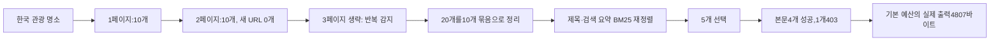

# 037: 검색어에서 모델에 넘길 데이터까지 — 실제 수집·후처리 내용을 펼쳐 보기

## 이번에 확인할 것

사용자가 보고 싶은 것은 모델을 호출했는지가 아니라, 어떤 검색어로 무엇을 받았고 어떻게 정리해서 어떤 문자열을 모델에 넘길 예정인지였다. 앞선 일지는 구조와 평가 결과를 설명했지만 원문부터 최종 데이터까지 이어서 보기 어려웠다. 이번에는 실제 한 실행을 처음부터 끝까지 펼쳤다.

<callout icon="🔎" color="blue_bg">
	**실제로 검색한 입력**
	한국 관광 명소
</callout>

실행 조건은 Bing HTML, locale=none, 최대3페이지, top_k=5, 본문 최대5개, 출력 예산6000바이트였다. 아래 원본·후처리 자료·최종 출력은 이 검색 실행에서 나온 것이다. 모델에 넣을 데이터의 형태를 보여주는 기록이다.



## 1. 실제로 받은 HTML 페이지

최대3페이지를 설정했지만 실제 HTTP 요청은2페이지였다. 두 번째가 이미 받은 URL만 돌려줘 세 번째는 요청하지 않았다. 아래는 각 HTML의 실제 title과 첫 결과 h2 발췌다. 결과 링크의 추적 속성은 표시에서 제외했다. 전체 HTML은 비공개에 보존하고, 본문에는 읽을 수 있는 원문 일부를 둔다.

### 1페이지 — first=1

HTTP 200, HTML 120067바이트, 카드 10개, 새 URL 10개.

```html
<title>한국 관광 명소 - Search</title>
<h2><a>대한민국 - 나무위키</a></h2>
```

### 2페이지 — first=11

HTTP 200, HTML 119552바이트, 카드 10개, 새 URL 0개.

```html
<title>한국 관광 명소 - Search</title>
<h2><a>대한민국 - 나무위키</a></h2>
```

### HTML에서 실제 추출한 검색 결과 목록

아래10개가 첫 페이지의 제목·목적지 URL이다. 두 번째도 같은 순서의 URL10개였으며 검색 요약의 더보기 표시 정도가 달랐다. 최종 전달 내용은 뒤의 패킷에서 확인할 수 있다.

| 원래 순위 | 실제 제목·URL | 등장 페이지 |
|---|---|---|
| 1 | [대한민국 - 나무위키](https://namu.wiki/w/%EB%8C%80%ED%95%9C%EB%AF%BC%EA%B5%AD) | 1, 2 |
| 2 | [한국 - 위키백과, 우리 모두의 백과사전](https://ko.wikipedia.org/wiki/%ED%95%9C%EA%B5%AD) | 1, 2 |
| 3 | [NAVER](https://www.naver.com/) | 1, 2 |
| 4 | [대한민국 - 위키백과, 우리 모두의 백과사전](https://ko.wikipedia.org/wiki/%EB%8C%80%ED%95%9C%EB%AF%BC%EA%B5%AD) | 1, 2 |
| 5 | [대한민국 구석구석 - VISITKOREA](https://korean.visitkorea.or.kr/main/main.do) | 1, 2 |
| 6 | [대한민국/문화 - 나무위키](https://namu.wiki/w/%EB%8C%80%ED%95%9C%EB%AF%BC%EA%B5%AD/%EB%AC%B8%ED%99%94) | 1, 2 |
| 7 | [세상을 보는 균형ㅣ한국일보](https://www.hankookilbo.com/) | 1, 2 |
| 8 | [한국 - Wikiwand](https://www.wikiwand.com/ko/%ED%95%9C%EA%B5%AD) | 1, 2 |
| 9 | [연합뉴스](https://www.yna.co.kr/) | 1, 2 |
| 10 | [한국 문화 \| Korean Kulture](https://koreankulture.com/ko/korean-culture) | 1, 2 |

## 2. 중복 검사의 실제 결과

20개를20개의 서로 다른 출처로 세지 않았다. 같은 URL의 두 발생 기록을 하나의 묶음에 보존해서 총10개가 됐다. 다음은 실제 묶음 하나의 중복 기록이다.

```json
[
  {
    "url": "https://koreankulture.com/ko/korean-culture",
    "page": 1,
    "rank": 10
  },
  {
    "url": "https://koreankulture.com/ko/korean-culture",
    "page": 2,
    "rank": 10
  }
]
```

## 3. 관련도 재정렬과5개 선택

검색엔진 순서를 그대로 앞에서5개 자르는 대신, 제목·검색 요약으로 BM25Plus 점수를 계산했다. 다음은 실제 점수와 선택 결과다. 원래 순위는 위 목록의 번호와 연결된다.

| 재정렬 순위 | 원래 순위 | BM25Plus | 쿼리 토큰 겹침 | 처리 |
|---|---|---|---|---|
| 1 | 10 | 1.304364 | 0.333 | 본문 조회 대상 |
| 2 | 8 | 1.281716 | 0.333 | 본문 조회 대상 |
| 3 | 6 | 1.198743 | 0.333 | 본문 조회 대상 |
| 4 | 4 | 1.167628 | 0.333 | 본문 조회 대상 |
| 5 | 2 | 1.150174 | 0.333 | 본문 조회 대상 |
| 6 | 9 | 0.911221 | 0.333 | 이번 선택에서 제외 |
| 7 | 1 | 0.8803 | 0.333 | 이번 선택에서 제외 |
| 8 | 3 | 0 | 0.0 | 이번 선택에서 제외 |
| 9 | 5 | 0 | 0.0 | 이번 선택에서 제외 |
| 10 | 7 | 0 | 0.0 | 이번 선택에서 제외 |

이 선택이 좋은 선택이었다는 뜻은 아니다. 이번 쿼리는 한국 일반 정보가 많이 섞였고, 재정렬도 관광 명소보다 일반 문화 자료를 앞에 올렸다. 관광공사 출처가 후보에 있었는데도0점으로 제외됐다. 현재 단독 단어와 복합어 bigram의 표현 차이도 영향을 주므로, 점수와 쿼리 토큰 겹침만으로 의미적 적합성을 보장하지 못한다. 이번 기록에서는 코드를 바꾸거나 잘 나온 결과로 교체하지 않았다.

## 4. 선택한 URL에서 본문을 읽고 추출

선택된5개만 추가로 조회했다. 다운로드한 전체 HTML은 로컬 추출기가 읽고, 질문과 관련된 문단을 출처별 출력 예산 안에서 골랐다. Wikiwand는403이라 본문 대신 앞서 받은 검색 요약을 표시했다.

| 원래 순위 | 본문 HTTP | 다운로드 바이트 | 로컬 추출본 바이트 | 최종 자료 종류 |
|---|---|---|---|---|
| 10 | 200 | 155072 | 27371 | page_excerpt |
| 8 | 403 | — | — | search_snippet |
| 6 | 200 | 320524 | 16109 | page_excerpt |
| 4 | 200 | 1449102 | 147565 | page_excerpt |
| 2 | 200 | 369535 | 24527 | page_excerpt |

## 5. 모델에 넘길 예정인 실제 데이터 내용

기본6000바이트 예산에서 실제 출력은 4807바이트였다. 아래는 그 실제 출력의 구조와 출처별 내용 발췌다. 제목·URL·출처 ID·상태는 실제 값이고, 긴 본문은 앞부분을 보여준다. ‘이후 내용은 노션 표시에서 생략’은 문서 표시용 표식으로 실제 패킷에는 없다. 원래 전체 패킷은 비공개 실행 기록에 보존했다. 다른 예산의 출력을 기본 출력처럼 바꿔 보여주지 않았다.

```text
# Web evidence
{"query": "한국 관광 명소", "collected": 20, "groups": 10, "shortlisted": 5, "response_format": "html", "locale": "none", "stop_reason": "repeated_page", "retrieval_complete": false, "ranking": "lexical_bm25plus", "min_query_coverage": 0.25, "evidence_status": "unverified_candidates", "facts_synthesized": false, "verified_current": false}

[web:49be3f075a1551da] 한국 문화 | Korean Kulture
https://koreankulture.com/ko/korean-culture
kind=page_excerpt; page_fetched=True; excerpt_only=true
**K-드라마는 세계 곳곳에서 한국 문화를 소개합니다. 음식, 생활 방식, 가족 가치** 등은 한국 드라마에서
[이후 내용은 노션 표시에서 생략]
[excerpt shortened]

[web:e29bbddd91393711] 한국 - Wikiwand
https://www.wikiwand.com/ko/%ED%95%9C%EA%B5%AD
kind=search_snippet; page_fetched=False; excerpt_only=true
2 days ago · 한국 (韓國), 조선 (朝鮮), 남북한 (南北韓), 코리아 (영어: Korea)는 동아시아의 한반도 (조선반도)에 위치한 지역
[이후 내용은 노션 표시에서 생략]

[web:4a58ba80362f0bc7] 대한민국/문화 - 나무위키
https://namu.wiki/w/%EB%8C%80%ED%95%9C%EB%AF%BC%EA%B5%AD/%EB%AC%B8%ED%99%94
kind=page_excerpt; page_fetched=True; excerpt_only=true
| **문화전반** |  | 
| **관광** |  | 
| **국가유산** |  | 
| **언어 · 문자** |  |
[이후 내용은 노션 표시에서 생략]
[excerpt shortened]

[web:4c5f72f5a62e223d] 대한민국 - 위키백과, 우리 모두의 백과사전
https://ko.wikipedia.org/wiki/%EB%8C%80%ED%95%9C%EB%AF%BC%EA%B5%AD
kind=page_excerpt; page_fetched=True; excerpt_only=true
|  | 
| 종교 |  | 
| 기타 |  | 
| ISO
[이후 내용은 노션 표시에서 생략]
[excerpt shortened]

[web:55b1f5aadce6eb97] 한국 - 위키백과, 우리 모두의 백과사전
https://ko.wikipedia.org/wiki/%ED%95%9C%EA%B5%AD
kind=page_excerpt; page_fetched=True; excerpt_only=true
# 한국

한편 중국어와 일본어권에서는 한국에 대해 '조선' (朝鮮)이란 명칭을 유지하고 있으며,
[이후 내용은 노션 표시에서 생략]
[excerpt shortened]
```

원래 패킷의 제목·URL·출처 ID·본문/검색 요약 구분·발췌가 모델에 넘길 자료다. 앞의 HTML 전체, 탈락한 후보 전체, 원본 로그 전체를 이 패킷에 넣지는 않는다. 기본 출력에도 한국 일반 정보와 표·소개 문단이 섞여 있었다. 잘 정리된 관광 답변의 근거라고 통과시킨 것이 아니라 현재 도구가 만든 데이터 자체를 보여준 것이다.

## 6. 처리 경로를 실제 코드와 연결

기준 커밋2022e34의 src/travel_agent/web_pipeline.py에서 search_evidence는 수집 루프를 마친 뒤 group_candidates와 rank_candidates를 실행한다. 선택한 출처를 읽은 뒤 마지막으로 pack_digest를 호출한다. 다음은 실제 코드의 연속된 두 부분이다.

```python
        groups = group_candidates(report['raw_rows'])
        ranked = rank_candidates(query,groups)
        report['ranked'] = ranked
        shortlist, domains = [], {}
        for row in ranked:
            host = urlsplit(row['url']).hostname.removeprefix('www.')
            if row['score'] <= 0 or row['query_coverage'] < min_coverage or domains.get(host,0) >= 2:
                continue
            domains[host] = domains.get(host,0)+1
            shortlist.append(row)
            if len(shortlist) == top_k:
                break
```

```python
        digest, delivered = pack_digest(query,sources,max_bytes,summary)
        report.update(summary,sources=delivered,digest=digest,digest_bytes=len(digest.encode()),
                      finished_at=datetime.now(timezone.utc).isoformat(),elapsed_ms=round((perf_counter()-started)*1000))
        save()
        return report
```

이번은 실제 검색·후처리 내용을 보여주는 문서 보강이다. 운영 검색 코드를 수정하지 않았고 에이전트 연결·모델 호출도 하지 않았다. 실제 질의와 페이지별 원문 일부, 추출 목록, 중복 묶음, 순위, 본문 처리, 최종 문자열을 한 흐름으로 읽을 수 있도록 정리했다.

<details>
<summary>이 예시의 실제 검색·본문 요청 로그</summary>

	```json
	{"id": "80f8f90ebabe4e2184a813b791005955", "tool": "bing_search_http", "query": "한국 관광 명소", "page": 1, "first": 1, "response_format": "html", "locale": "none", "started_at": "2026-10-18T12:56:51.627534+00:00", "method": "GET", "http_transport": "curl", "locale_params": {}, "http_status": 200, "response_bytes": 120067, "pagination_param_names": [], "result_cards": 10, "parsed_results": 10, "new_urls": 10, "finished_at": "2026-10-18T12:56:51.980507+00:00"}
	```

	```json
	{"id": "56eef558ecbe4391bb896f18dcbd6dfd", "tool": "bing_search_http", "query": "한국 관광 명소", "page": 2, "first": 11, "response_format": "html", "locale": "none", "started_at": "2026-10-18T12:56:51.982078+00:00", "method": "GET", "http_transport": "curl", "locale_params": {}, "http_status": 200, "response_bytes": 119552, "pagination_param_names": ["FORM", "FPIG"], "result_cards": 10, "parsed_results": 10, "new_urls": 0, "finished_at": "2026-10-18T12:56:52.263011+00:00"}
	```

	```json
	{"id": "86f5c6ff14db4214a1409548c8fddf42", "tool": "page_http_extract", "url": "https://koreankulture.com/ko/korean-culture", "started_at": "2026-10-18T12:56:52.277686+00:00", "method": "GET", "http_status": 200, "download_bytes": 155072, "extracted_bytes": 27371, "selected_blocks": [26, 27, 29], "excerpt_bytes": 2008, "selection_status": "ok", "finished_at": "2026-10-18T12:56:56.135978+00:00"}
	```

	```json
	{"id": "1e03a828bb19483ca6114630a6db4c58", "tool": "page_http_extract", "url": "https://www.wikiwand.com/ko/%ED%95%9C%EA%B5%AD", "started_at": "2026-10-18T12:56:52.279211+00:00", "error": {"reason": "http_error", "method": "GET", "http_status": 403}, "finished_at": "2026-10-18T12:56:52.543156+00:00"}
	```

	```json
	{"id": "0a7e2dc0a2bb49ccb1d27b46769728da", "tool": "page_http_extract", "url": "https://namu.wiki/w/%EB%8C%80%ED%95%9C%EB%AF%BC%EA%B5%AD/%EB%AC%B8%ED%99%94", "started_at": "2026-10-18T12:56:52.279720+00:00", "method": "GET", "http_status": 200, "download_bytes": 320524, "extracted_bytes": 16109, "selected_blocks": [3, 4], "excerpt_bytes": 1682, "selection_status": "ok", "finished_at": "2026-10-18T12:56:53.713486+00:00"}
	```

	```json
	{"id": "61cad2ae6ee34b26b5df1ae993d7e0e9", "tool": "page_http_extract", "url": "https://ko.wikipedia.org/wiki/%EB%8C%80%ED%95%9C%EB%AF%BC%EA%B5%AD", "started_at": "2026-10-18T12:56:52.543156+00:00", "method": "GET", "http_status": 200, "download_bytes": 1449102, "extracted_bytes": 147565, "selected_blocks": [3, 59], "excerpt_bytes": 1684, "selection_status": "ok", "finished_at": "2026-10-18T12:56:55.428594+00:00"}
	```

	```json
	{"id": "cf91b91fd3cb4eba904c8c1db5c51f0e", "tool": "page_http_extract", "url": "https://ko.wikipedia.org/wiki/%ED%95%9C%EA%B5%AD", "started_at": "2026-10-18T12:56:53.713486+00:00", "method": "GET", "http_status": 200, "download_bytes": 369535, "extracted_bytes": 24527, "selected_blocks": [0, 4], "excerpt_bytes": 1561, "selection_status": "ok", "finished_at": "2026-10-18T12:56:54.534102+00:00"}
	```

	모델 입력 예정 데이터는 위 문자열이다. 이 예시에서는 모델 호출이 없었으며, 인증 헤더·쿠키·추적 매개변수 값은 표시하지 않았다.

</details>
