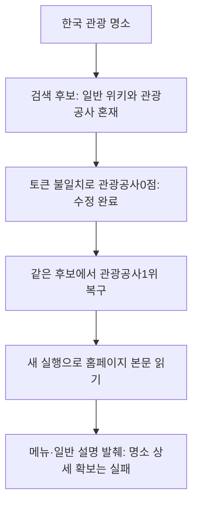

# 038: 위키만 모은 검색은 실패 — 한국어 토큰 불일치를 고치고 남은 문제를 확인하다

## 문제 정의와 실제 결과

037은 한국 관광 명소를 검색하고도 한국 일반 위키·문화 소개를 중심으로 반환했다. 사용자는 명소 데이터를 실제로 가져왔느냐고 지적했다. 이 실행은 명소 조사 목적을 달성하지 못한 실패다. 문서화나 파이프라인의 동작만으로 유용한 결과라고 할 수 없다.

<callout icon="🔎" color="blue_bg">
	**같은 검색어**
	한국 관광 명소
</callout>

037의 실제 출력은 일반 문화·국가 설명 위주였다. 명소 이름·위치·특징·방문 조건을 연결한 자료를 확보하지 못했다. 037의 실제 데이터는 그대로 보존하고, 이번에는 후보 수집과 재정렬에서 무엇이 잘못됐는지를 확인했다.

좋은 결과는 블로그인가 위키인가만으로 판정하지 않는다. 검색 목적에 맞는 구체적 장소와 출처가 있어야 한다. 위키·공식 문서도 유효한 자료가 될 수 있지만 이번의 한국 일반 설명·메뉴 목록은 그 기준을 충족하지 못한다.

## 분석: 수집 후보와 선택 오류를 분리

검색 결과에 관광공사 출처가 전혀 없었던 것은 아니다. 원래 첫 페이지5위에 관광공사 사이트가 있었으나, 후처리에서는0점으로 탈락했다. 현재 코드의 토큰을 직접 비교하니 다음 문제가 재현됐다.

```text
수정 전 쿼리: 한국 / 관광 / 명소
수정 전 복합어 쪽: 한국관광공사 / ko:한국 / ko:국관 / ko:관광 / ko:광공 / ko:공사
```

질문의 관광과 문서의 ko:관광을 서로 다른 문자열로 만들어 놓고, 같은 표현을 썼다고 기대했던 버그다. 두 글자 한국어도 같은 bigram 표현으로 맞추도록 수정했다. 두 글자 단어는 이미 하나의 bigram이므로 원래 단어를 추가해서 단독 단어에 중복 가중치를 주지 않았다.

## 같은 저장 응답의 수정 전후

Bing에 다시 물은 결과를 개선 전후로 비교하지 않았다. 037에서 받은 동일한20개를 그대로 묶고 새 토큰 규칙으로 재정렬했다.

| 대상 | 수정 전 순위 | 수정 후 순위 | 쿼리 일치 항목 |
|---|---|---|---|
| [관광공사 출처](https://korean.visitkorea.or.kr/main/main.do) | 9위·0점 | 1위 | ko:관광, ko:한국 |

분석용 점수도 보존했지만 토큰 체계가 달라진 전후의 BM25 수치 자체를 품질 향상 점수로 비교하지 않았다. 이번에 확인한 변화는 이미 수집한 관련 후보를 잘못0점 처리하던 오류가 사라진 것이다.

## 수정 뒤의 새 실제 실행

별도로 같은 검색어를 RSS 경로로 새 실행했다. 이것은 앞의 고정 응답 비교와 다른 실행이다. 받은 후보10개 중 관광공사 출처를1위로 선택해 본문을 읽었다. 하지만 전달한 내용의 시작은 다음과 같았다.

```text
본문 바로가기
완벽한 여행 준비를 위한
구석구석 서비스
디지털관광주민증
대한민국 반값여행
지역 인기 음식점
```

이는 명소 상세 정보가 아니라 홈페이지의 메뉴·서비스 소개다. 다른 출처에는 한국 일반 설명·문화 문서와 무관한 기사까지 남았다. 후보 선택 버그 수정과 명소 데이터 확보 성공은 다른 결과다. 이번 새 실행도 여행 명소 자료의 품질 통과로 기록하지 않았다.

## 해결한 코드와 남은 범위

기준 커밋9234c94에서 src/travel_agent/web_pipeline.py의 tokens를 수정했다. 수정한 실제 함수는 다음과 같다.

```python
def tokens(text):
    """Words plus Korean character bigrams: transparent lexical, not semantic."""
    result = []
    for word in re.findall(r'[a-z0-9]+|[가-힣]+', text.lower()):
        if re.fullmatch('[가-힣]{2,}', word):
            # A two-character word is already its complete bigram. Keeping
            # both would double-weight standalone words versus compounds.
            if len(word)>2:
                result.append(word)
            result.extend('ko:'+word[i:i+2] for i in range(len(word)-1))
        else:
            result.append(word)
    return result

```



Python138개 테스트가 통과했다. 새 회귀 검사는 단독 한국어 관광과 복합어 한국관광공사의 연결 및 관련 후보의 재정렬을 확인한다. 모델 호출·모델 다운로드·다른 엔진 연결은 하지 않았다.

남은 핵심은 검색어의 관광·명소 조건을 만족하는 후보 확보, 일반 국가 설명과 명소 자료의 구분, 홈페이지가 아니라 구체적 장소가 담긴 페이지의 본문 확보, 그 내용의 보존이다. 반환 개수나0이 아닌 점수만으로 좋은 자료를 확보했다고 판정하지 않는다. 현재 검색 툴은 아직 완성이 아니다.

<details>
<summary>새 실행의 실제 검색·본문 호출 로그</summary>

	```json
	{"id": "ae330ff9d4ab438c8e5b28857fbbd0c4", "tool": "bing_search_http", "query": "한국 관광 명소", "page": 1, "first": 1, "response_format": "rss", "locale": "none", "started_at": "2026-10-18T13:18:21.744404+00:00", "method": "GET", "http_transport": "curl", "locale_params": {}, "http_status": 200, "response_bytes": 5692, "pagination_param_names": [], "result_cards": 10, "parsed_results": 10, "new_urls": 10, "finished_at": "2026-10-18T13:18:22.031231+00:00"}
	```

	```json
	{"id": "8efd5ed415664e20978604af82526a60", "tool": "page_http_extract", "url": "https://korean.visitkorea.or.kr/main/main.do", "started_at": "2026-10-18T13:18:22.062117+00:00", "method": "GET", "http_status": 200, "download_bytes": 28051, "extracted_bytes": 790, "selected_blocks": [0], "excerpt_bytes": 790, "selection_status": "ok", "finished_at": "2026-10-18T13:18:22.552103+00:00"}
	```

	```json
	{"id": "d91b3d6ca6e744018e9624c56a83817b", "tool": "page_http_extract", "url": "https://koreankulture.com/ko/korean-culture", "started_at": "2026-10-18T13:18:22.063116+00:00", "method": "GET", "http_status": 200, "download_bytes": 155072, "extracted_bytes": 27371, "selected_blocks": [23, 26, 29], "excerpt_bytes": 1890, "selection_status": "ok", "finished_at": "2026-10-18T13:18:25.748700+00:00"}
	```

	```json
	{"id": "387e9156600e4282b44dd386271959c2", "tool": "page_http_extract", "url": "https://www.hankookilbo.com/", "started_at": "2026-10-18T13:18:22.063116+00:00", "method": "GET", "http_status": 200, "download_bytes": 356056, "extracted_bytes": 4500, "selected_blocks": [0, 1], "excerpt_bytes": 2302, "selection_status": "ok", "finished_at": "2026-10-18T13:18:22.684468+00:00"}
	```

	```json
	{"id": "431d5e66cfe24496b8486eab884ae8e8", "tool": "page_http_extract", "url": "https://www.wikiwand.com/ko/%ED%95%9C%EA%B5%AD", "started_at": "2026-10-18T13:18:22.552103+00:00", "error": {"reason": "http_error", "method": "GET", "http_status": 403}, "finished_at": "2026-10-18T13:18:22.740290+00:00"}
	```

	```json
	{"id": "9da1731340bb401cb85c57132789fbe0", "tool": "page_http_extract", "url": "https://ko.wikipedia.org/wiki/%EB%8C%80%ED%95%9C%EB%AF%BC%EA%B5%AD", "started_at": "2026-10-18T13:18:22.684468+00:00", "method": "GET", "http_status": 200, "download_bytes": 1449102, "extracted_bytes": 147565, "selected_blocks": [59, 108], "excerpt_bytes": 1957, "selection_status": "ok", "finished_at": "2026-10-18T13:18:24.309641+00:00"}
	```

	고정 응답 재정렬 비교는 새 HTTP 요청 없이 실행했다. 위 로그는 별도의 새 RSS 검색과 본문 조회다. 원본 전체는 비공개에 보존하고 쿠키·인증 정보는 공개하지 않는다.

</details>
