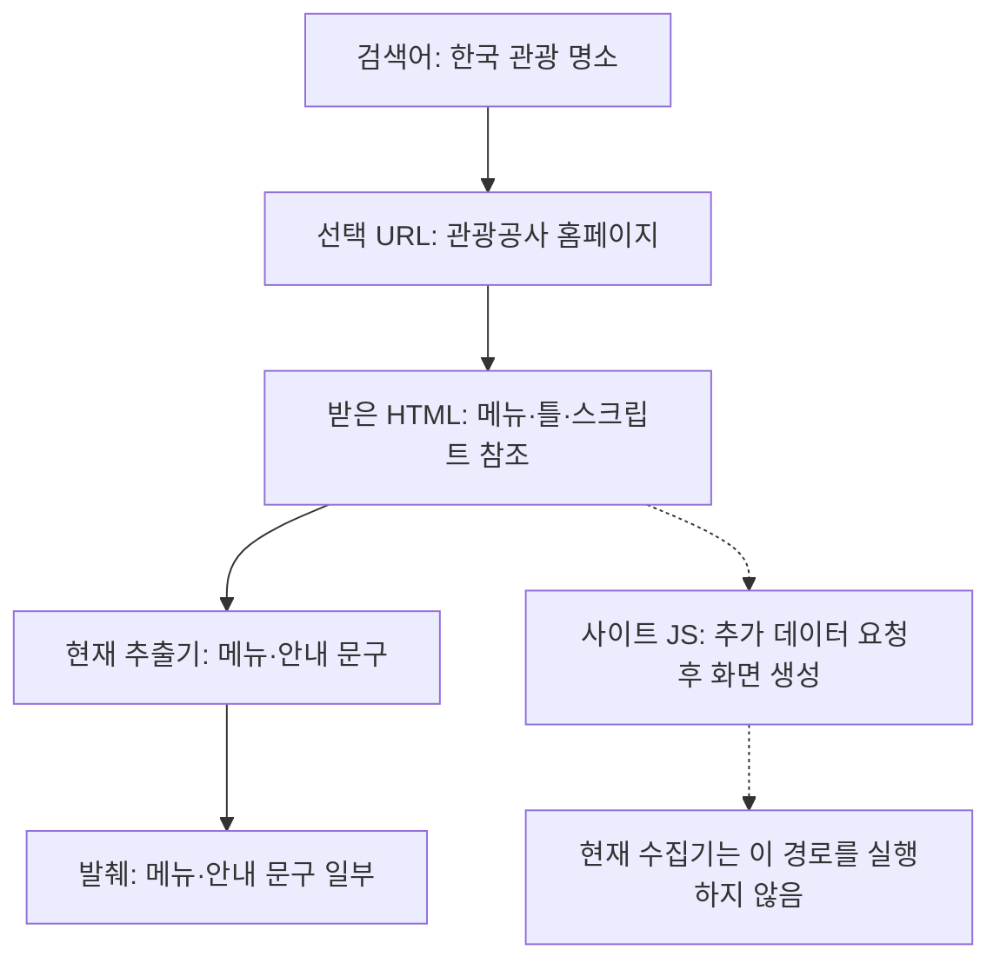

# 039: 명소 정보는 어디에서 빠졌나 — 원본·추출·전달을 같은 페이지로 대조

## 상황과 실제 출력

038에서 관광공사를 첫 출처로 선택했지만 메뉴 목록만 나왔다. 이번에는 검색을 다시 돌리지 않고 같은 저장 응답의 원본 HTML, 추출 결과, 전달 예정 발췌를 대조했다. 좋은 결과의 기준은 구체적 장소의 이름과 설명을 출처에 연결하는 것이다.

<callout icon="🔎" color="blue_bg">
	**실제 검색어**
	한국 관광 명소
</callout>

관광공사 출처에서 반환한 전달 예정 발췌의 시작은 다음과 같았다. 모델을 호출한 답변은 아니다.

```text
본문 바로가기
완벽한 여행 준비를 위한
구석구석 서비스
디지털관광주민증
대한민국 반값여행
지역 인기 음식점
```

## 단계별 진단

| 단계 | 같은 관광공사 페이지에서 확인한 결과 | 판단 |
|---|---|---|
| URL 선택 | 명소 상세 대신 사이트 홈페이지 | 출처가 공식이라는 이유만으로 내용이 충분하지 않음 |
| HTTP 수신 | 200, 28051바이트 HTML | 다운로드는 성공 |
| 본문 추출 | 790바이트, 메뉴·서비스 소개·안내 문구 | 명소 설명 확보는 실패 |
| 최종 발췌 | 571바이트, 같은 메뉴·안내 문구 | 일부 잘림도 있지만 명소 설명을 여기서 잃었다는 근거는 없음 |

원본 HTML에도 경복궁·성산일출봉·남산·불국사 예시 이름과 명소라는 표현이 없었다. 이 단어 검사만으로 모든 관광 콘텐츠의 부재를 증명하지는 않는다. 실제 추출문을 읽고, 홈페이지가 추가 데이터를 가져오는 자바스크립트도 확인해 수집 한계를 좁혔다. 추출문의 여행지는 장소 설명이 아니라 사용자 댓글 요약 기능의 안내에 등장한다.

최종 발췌의 마지막 문장은 중간에서 잘렸다. 전체 추출문에 있던 맞춤 코스·축제·이벤트 등의 메뉴도 최종 전달에서는 빠졌다. 따라서 압축 손실이 전혀 없다는 결론은 아니다. 다만 이 손실을 복구해도 구체적 명소의 이름·위치·방문 정보를 얻는 것은 아니다.

## 추가로 조사한 사이트 동작

[관광공사 홈페이지](https://korean.visitkorea.or.kr/main/main.do)의 저장 HTML은 initHomePc 호출을 포함한다. 그 HTML이 참조하는 실제 스크립트 3개를 직접 HTTP로 읽었다. 브라우저는 실행하지 않았다.

[home_pc.js](https://cdn.visitkorea.or.kr/resources/js/main/home/home_pc.js?v=20261013131522)의 initHomePc는 fetchPcComponent 등을 실행한다. fetchPcComponent는 /call에 GET_MOBILE_HOME_COMPONENT 명령을 보내 JSON을 받은 뒤 화면 구성 요소를 만든다. [home_recommend.js](https://cdn.visitkorea.or.kr/resources/js/main/home/home_recommend.js?v=20261013131522)도 별도 GET 응답의 contents로 추천 영역을 채우는 코드다. HTML 한 번의 수신과 사용자가 보는 완성된 페이지는 이 사이트에서 같지 않다.

현재 프로그램은 이 스크립트나 후속 데이터 요청을 실행하지 않는다. 이번 조사는 스크립트 소스만 읽었고 후속 API 응답이나 명소 상세 데이터를 확보하지 않았다. 홈페이지 원본과 스크립트 조회는 시각이 다른 요청이다. 현재 스크립트의 동작을 과거 응답 시점의 완전한 재현으로 주장하지 않는다.

## 우리 코드가 실제로 하는 일

기준 커밋 44dd791, src/travel_agent/web_read.py의 extract_page 실제 코드다. 전달받은 HTML에서 텍스트를 추출할 뿐 사이트 자바스크립트를 실행하지 않는다.

```python
def extract_page(body, url, output_format='markdown'):
    """Extraction, not LLM summarization or execution of website JavaScript."""
    text = extract(body, url=url, output_format=output_format, include_comments=False,
                   include_tables=True, include_links=False, include_images=False)
    if not text or not text.strip():
        raise WebSearchError('No readable page text', details={'reason':'empty_extraction'})
    return text.strip()
```

fetch_public_page도 HTML 응답을 내려받아 반환하는 함수다. 후속 스크립트·페이지 링크·API를 자동 수집하지 않는다. page_fetched=true는 HTTP 본문을 받았다는 뜻이며, 브라우저 화면의 콘텐츠를 모두 읽었다는 뜻이 아니다. selection_status=ok도 문단 선택 단계의 처리 상태이지 명소 조사 성공 판정이 아니다.



## 결론과 다음 수정의 기준

이 관광공사 사례는 압축 이전의 콘텐츠 수집이 불완전한 경우다. 잘못된 홈페이지 선택과 정적 HTML만 읽는 수집기의 한계가 겹쳤다. 앞서 수정한 한국어 토큰 불일치 버그와는 별개다. 그 버그는 후보 순위를 복구했지만 상세 본문을 만들어 주지는 않는다.

다른 출처까지 같은 이유로 묶지 않는다. 이번 실행의 Wikiwand는 HTTP403으로 본문 수신부터 실패했다. 한국 일반 위키·문화 문서는 별도로 받았으나 검색 목적과 다른 페이지라는 문제가 남는다. 이들 문서 전체의 관광 정보 보존 여부까지 이번 관광공사 대조로 판정하지 않는다.

다음 구현에서는 메뉴만 얻은 응답을 내용 확보 성공으로 취급하지 않고, 일반적으로 상세 페이지나 공개 데이터 경로를 찾을 수 있는지 검증해야 한다. 홈페이지라는 이유만으로 모두 버리거나 이 사이트 전용 코드를 바로 붙이기로 결정한 것은 아니다. 문장 중간 잘림도 별도로 개선할 대상이다. 이번에는 원인을 기록했으며 런타임 수정·품질 개선·모델 호출은 없었다. 새 비용은 공개 스크립트 3건의 HTTP 조회와 로컬 분석뿐이다.

<details>
<summary>실제 본문 수신과 추가 스크립트 조회 로그</summary>

	```json
	{"id": "8efd5ed415664e20978604af82526a60", "tool": "page_http_extract", "url": "https://korean.visitkorea.or.kr/main/main.do", "started_at": "2026-10-18T13:18:22.062117+00:00", "method": "GET", "http_status": 200, "download_bytes": 28051, "extracted_bytes": 790, "selected_blocks": [0], "excerpt_bytes": 790, "selection_status": "ok", "finished_at": "2026-10-18T13:18:22.552103+00:00"}
	```

	```json
	{"id": "6aaed4a99258480bb376a1f8fcf54499", "tool": "inspect_site_javascript_http", "url": "https://cdn.visitkorea.or.kr/resources/js/main/home/home_recommend.js?v=20261013131522", "started_at": "2026-10-18T13:29:37.205946+00:00", "http_status": 200, "bytes": 22220, "finished_at": "2026-10-18T13:29:37.268165+00:00"}
	```

	```json
	{"id": "47a487c95bd246b9a873b5a6119a5da7", "tool": "inspect_site_javascript_http", "url": "https://cdn.visitkorea.or.kr/resources/js/main/home/home_pc.js?v=20261013131522", "started_at": "2026-10-18T13:29:37.268165+00:00", "http_status": 200, "bytes": 88334, "finished_at": "2026-10-18T13:29:37.316650+00:00"}
	```

	```json
	{"id": "da57083fd34a4442b7fdc689653e926f", "tool": "inspect_site_javascript_http", "url": "https://cdn.visitkorea.or.kr/resources/js/main/home/home_common.js?v=20261013131522", "started_at": "2026-10-18T13:29:37.316650+00:00", "http_status": 200, "bytes": 7546, "finished_at": "2026-10-18T13:29:37.354837+00:00"}
	```

	첫 호출은 038의 기존 실행 기록이다. 이어지는 3건은 이번 소스 조사 요청으로, 실행 순서대로 표시했다. 모델 요청·다음 모델 전달은 없었고, 위 발췌는 전달 예정 데이터다. 쿠키·인증 헤더는 기록하지 않았다. 전체 원본은 비공개 보존한다.

</details>
