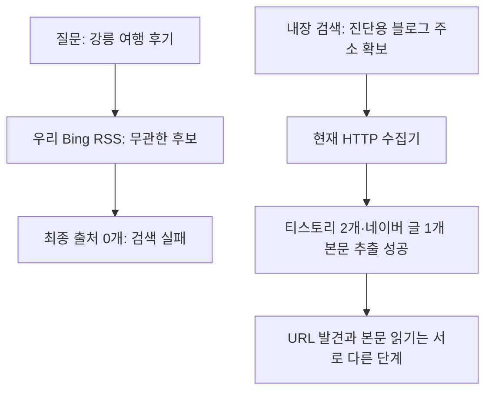

# 040: 블로그는 읽을 수 있나 — 검색 실패와 본문 읽기를 분리 검증

## 문제와 판정 기준

명소를 찾는 요청에 메뉴만 반환한 자료는 이번 목적의 근거로 쓸 수 없다. 블로그 본문을 읽는 기능 자체가 없는 것인지, 검색에서 블로그를 못 찾는 것인지 따로 확인했다. 장소 이름·이동 동선 등 실제 글 내용이 추출돼야 읽기 성공으로 판정한다. 글의 사실성이나 현재 운영 조건 검증은 별도다.

<callout icon="🔎" color="blue_bg">
	**우리 검색에 실제로 보낸 질문 1**
	강릉 여행 후기 블로그
</callout>

실제 후보 첫 세 개는 Wikipedia 홈페이지, 영문 Wikipedia 소개, 영문 Main Page였다. 후보10개를 받았지만 재정렬 조건을 통과한 출처는0개였다. 본문 요청도 없었다.

<callout icon="🔎" color="blue_bg">
	**우리 검색에 실제로 보낸 질문 2**
	강릉 여행 후기 site:tistory.com
</callout>

실제 후보 첫 세 개는 GitHub의 COGS108, awesome-datascience, Python 데이터 과학 프로젝트 정리 글이었다. 후보10개, 최종 출처0개였다. 검색어와 무관하고 site 조건도 지키지 않는 응답이다. HTTP200을 검색 성공으로 볼 수 없다.

두 질의 모두 Bing 직접 HTTP의 RSS 경로를 명시했다. 현재 기본 HTML 경로를 이번에 검사한 것은 아니며, RSS가 항상 더 안정적이라는 결론도 내리지 않는다. 검색어가 이상해서 블로그를 못 찾았다고 설명할 근거는 없다. 이 결과가 발생한 서버 측 원인은 아직 모른다.

## 별도 진단: 실제 블로그 URL을 주면 읽히는가

내장 검색에 같은 두 번째 질문과 네이버 블로그 한정 질문을 보내 실제 글 주소를 확보했다. 이 주소를 우리 수집기의 fetch_public_page → extract_page에 직접 넣었다. 제품 검색을 내장 검색으로 교체하거나 자동 대체한 것이 아니라, 읽기 단계만 분리한 진단이다.

| 실제 읽은 페이지 | HTTP | 받은 HTML 바이트 | 추출문 UTF-8 바이트 | 직접 확인한 본문 내용 |
|---|---|---|---|---|
| [블로그 글](https://haveubeenhere.tistory.com/6) | 200 | 77704 | 7367 | 경포해수욕장·중앙시장·카페 방문과 이동 설명 |
| [블로그 글](https://roadjournal.tistory.com/143) | 200 | 69724 | 3271 | 경포·중앙시장·카페가 등장하는 여행 서술 |
| [블로그 글](https://blog.naver.com/PostView.nhn?blogId=wpdls879&logNo=223048622262&redirect=Dlog&widgetTypeCall=true) | 200 | 418911 | 8630 | 강릉 올림픽 뮤지엄·강문 해변·시간대별 동선 |

첫 티스토리 글에서 실제로 추출한 짧은 문장이다.

> 강릉역에 도착하자마자 제일 먼저 한 일은 택시 잡기!

네이버 글에서도 실제 시간표가 추출됐다.

> 10 : 15 \~ 11:00 **② 강릉 올림픽 뮤지엄**

메뉴만 추출한 관광공사 사례와 달리 세 페이지 모두 여행 글 내용이 나왔다. 네이버 추출문 앞에는 저작권 안내도 섞여 있어 정제가 완벽한 것은 아니다. 예전 글의 교통·가격·운영 정보를 현재 사실로 확인한 결과도 아니다.

## 실행 경로와 구현 범위

기준 커밋 ccfd3f6의 src/travel_agent/web_read.py를 그대로 사용했다. extract_page의 실제 호출 부분은 다음과 같다.

```python
text = extract(body, url=url, output_format=output_format, include_comments=False,
               include_tables=True, include_links=False, include_images=False)
```

이 함수는 받은 HTML에서 글을 추출한다. 블로그라는 이유로 제외하는 코드는 없다. 이번 네이버 입력은 검색에서 얻은 PostView 글 주소다. 다른 형태의 네이버 주소, 리다이렉트·iframe·JS가 필요한 글까지 모두 읽을 수 있다는 검증은 아니다. 읽기 시험은 전체 추출문까지이며 최종 발췌 패킷의 내용 보존은 아직 비교하지 않았다.



## 결론과 남은 문제

블로그를 못 읽는 수집기는 아니다. 이번 세 글은 브라우저 없이 현재 코드로 읽었다. 그러나 우리 검색이 그 글을 스스로 확보하는 데는 실패했으므로, 전체 검색 도구가 해결됐다고 할 수 없다. 메뉴뿐인 출처를 유효한 여행 근거로 취급하지 않는 처리와 관련 글을 찾는 검색 단계가 계속 과제다.

이번에는 런타임 수정이 없고 진단·기록만 추가했다. 모델 호출은 없었다. 우리 검색2건, 내장 검색 한 번의 묶음 호출(2질의), 본문3건을 실행했다. API 종량 과금 모델은 호출하지 않았으며 전체 서비스 비용을0원으로 측정한 것은 아니다.

<details>
<summary>실제 검색·본문 호출 로그</summary>

	아래 Bing 로그는 실제 두 질의의 요청과 응답이다. 본문3건은 내장 검색에서 얻은 URL을 직접 입력한 별도 진단이다. 내장 검색 질의는 `강릉 여행 후기 site:tistory.com`, `강릉 여행 후기 site:blog.naver.com`이며 연결 도구가 제공하지 않은 HTTP 상태·서버 내부 호출 ID는 만들지 않았다. 모델에 전달한 답변은 없다. 쿠키·인증 헤더와 전체 글 원문은 공개하지 않는다.

	```json
	{"id": "3a99e14f4d3b4106936a297844a59ecd", "tool": "bing_search_http", "query": "강릉 여행 후기 블로그", "page": 1, "first": 1, "response_format": "rss", "locale": "none", "started_at": "2026-10-18T13:37:55.115792+00:00", "method": "GET", "http_transport": "curl", "locale_params": {}, "http_status": 200, "response_bytes": 5438, "pagination_param_names": [], "result_cards": 10, "parsed_results": 10, "new_urls": 10, "finished_at": "2026-10-18T13:37:55.461591+00:00"}
	```

	```json
	{"id": "67c51215526d45a9bab887c791af2197", "tool": "bing_search_http", "query": "강릉 여행 후기 site:tistory.com", "page": 1, "first": 1, "response_format": "rss", "locale": "none", "started_at": "2026-10-18T13:37:55.585590+00:00", "method": "GET", "http_transport": "curl", "locale_params": {}, "http_status": 200, "response_bytes": 5476, "pagination_param_names": [], "result_cards": 10, "parsed_results": 10, "new_urls": 10, "finished_at": "2026-10-18T13:37:55.761506+00:00"}
	```

	```json
	{"id": "f037638edd28473abad0d3d2c0b4775b", "tool": "blog_page_http_extract", "url": "https://haveubeenhere.tistory.com/6", "started_at": "2026-10-18T13:38:16.747533+00:00", "url_origin": "built_in_search_diagnostic_only", "method": "GET", "http_status": 200, "download_bytes": 77704, "extracted_bytes": 7367, "markers": {"경포": true, "중앙시장": true, "카페": true, "강문": false, "올림픽": false}, "finished_at": "2026-10-18T13:38:16.964240+00:00"}
	```

	```json
	{"id": "bdaf5a0c6b5246648a68797319088029", "tool": "blog_page_http_extract", "url": "https://roadjournal.tistory.com/143", "started_at": "2026-10-18T13:38:16.965148+00:00", "url_origin": "built_in_search_diagnostic_only", "method": "GET", "http_status": 200, "download_bytes": 69724, "extracted_bytes": 3271, "markers": {"경포": true, "중앙시장": true, "카페": true, "강문": false, "올림픽": false}, "finished_at": "2026-10-18T13:38:17.585271+00:00"}
	```

	```json
	{"id": "a03ee702cc7142c1ba05f37ecc28145e", "tool": "blog_page_http_extract", "url": "https://blog.naver.com/PostView.nhn?blogId=wpdls879&logNo=223048622262&redirect=Dlog&widgetTypeCall=true", "started_at": "2026-10-18T13:38:17.586776+00:00", "url_origin": "built_in_search_diagnostic_only", "method": "GET", "http_status": 200, "download_bytes": 418911, "extracted_bytes": 8630, "markers": {"경포": false, "중앙시장": false, "카페": true, "강문": true, "올림픽": true}, "finished_at": "2026-10-18T13:38:18.261296+00:00"}
	```

</details>
