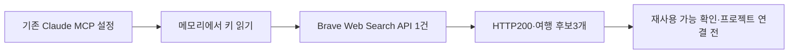

# 041: 기존 Claude MCP의 Brave 연결을 재사용할 수 있는가

## 확인 요청과 실제 검색 결과

기존 Claude MCP에 연결한 Brave 설정과 키를 재사용할 수 있는지 확인했다. 로컬 설정의 키 값은 출력하거나 프로젝트로 복사하지 않았다.

<callout icon="🔎" color="blue_bg">
	**키 유효성 확인에 실제로 보낸 검색어**
	강릉 여행 후기 블로그
</callout>

기존 키로 Brave Web Search API에 한 번 요청했고 HTTP200, 결과3개를 받았다.

1. [강릉 여행 코스 볼거리 강원도 강릉 2박3일 여행 후기 — 네이버 블로그](https://m.blog.naver.com/suk4408/222966716918)
2. [강릉 뚜벅이 당일치기 여행코스와 맛집 후기 — 티스토리](https://yub-storry.tistory.com/entry/%EA%B0%95%EB%A6%89-%EC%97%AC%ED%96%89-%EA%B0%95%EB%A6%89-%EB%9A%9C%EB%B2%85%EC%9D%B4-%EB%8B%B9%EC%9D%BC%EC%B9%98%EA%B8%B0-%EC%97%AC%ED%96%89%EC%BD%94%EC%8A%A4-%EB%A7%9B%EC%A7%91-%ED%9B%84%EA%B8%B0-%EA%B8%88%EC%9A%94%EC%9D%BC-%EB%A8%B9%ED%88%AC%EC%96%B4)
3. [강릉 여행 정보와 후기 — Expedia](https://www.expedia.co.kr/Gangneung.dx1751)

제목·주소 수준에서 여행 관련 후보를 확보했다. 이 세 페이지의 본문은 이번에 읽지 않았으며 검색·최종 답변의 일반 품질 통과로 해석하지 않는다. 040의 같은 첫 검색어는 Bing RSS에서 무관한 위키를 반환했다. 공급자 외에도 요청 시각·옵션이 다른 소규모 관찰이므로 통제된 성능 비교는 아니다.

## 설정 확인과 결정 범위

사용자 홈의 .claude/settings.json에서 brave-search 서버 설정을 확인했다. 명령은 npx, 패키지는 @brave/brave-search-mcp-server, 환경 변수 이름은 BRAVE_API_KEY다. 키가 비어 있지 않고 실제 API 인증에 사용 가능한 값임을 확인했다. Claude Desktop 설정과 Claude의 다른 설정도 확인했으며 해당 연결은 위 파일에서 발견했다.



프로젝트 런타임·환경 설정·MCP 연결은 변경하지 않았다. 기존 MCP 서버를 실행한 시험도 아니다. 서버 설정에서 읽은 키로 API를 직접 호출해 인증과 검색 응답을 확인했다. 모델 호출·키 신규 발급·가입·결제 설정 변경은 없었다. 계정의 플랜·무료 크레딧 잔액·이 요청의 실제 청구 여부는 확인하지 않았다.

<details>
<summary>실제 호출 기록 — 인증 값 제외</summary>

	실행 순서는 로컬 설정 존재 확인 → 서버명·환경 변수 이름만 확인 → 키를 메모리에서 읽어 아래 API 요청1건이다. 아래는 실제 실행 인자와 관찰 결과다. HTTP 전용 호출 ID·시작/종료 시각·과금 헤더는 이번 진단에서 별도로 수집하지 않았다. 명령 실행 결과 식별자는 7c05d8이다. 인증 헤더 값은 출력·기록하지 않았다.

	```json
	{"tool":"Brave Web Search API direct HTTP diagnostic","method":"GET","endpoint":"https://api.search.brave.com/res/v1/web/search","params":{"q":"강릉 여행 후기 블로그","count":3,"country":"KR","search_lang":"ko"},"authentication_header":"X-Subscription-Token (value omitted)","http_status":200,"returned_results":3,"model_invoked":false,"project_config_changed":false}
	```

</details>
