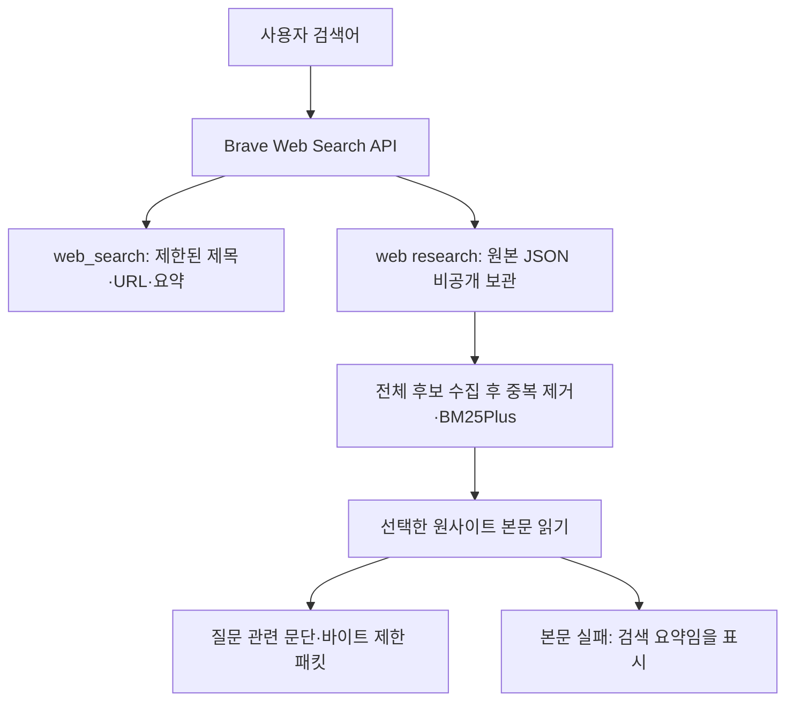

# 042: Brave를 기본 검색 공급자로 연결하다

## 문제 정의와 선택 이유

직접 Bing HTTP 검색에서 질문과 무관한 후보가 반복됐다. 040의 강릉 여행 후기 검색은 위키·GitHub 결과를 받아 최종 출처가0개였다. 반면 블로그 URL을 별도로 주면 현재 수집기로 본문을 읽을 수 있었다. 사용자가 기존 Claude MCP의 Brave 연결을 사용하기로 결정했다. 검색엔진 응답을 재현하는 조사에서 벗어나 관련 후보 확보와 에이전트 개발을 진행하려는 선택이다.

기존 키는 로컬 비공개 파일로 옮겨 재사용했다. Claude나 MCP 서버를 호출하는 대신 Python에서 Brave Web Search API를 직접 호출한다. 기존 코드의 제목·URL·요약 계약으로 변환하면 뒤의 중복 제거·BM25Plus·본문 읽기·발췌를 유지할 수 있기 때문이다. 모델에는 인증 값을 전달하지 않는다.

좋은 결과의 기준은 질문에 맞는 후보 URL을 확보하고 실제 장소·동선이 든 본문을 읽어 전달 예정 발췌에 남기는 것이다. 단순 HTTP200·후보 개수·테스트 통과를 답변 품질로 보지 않는다.

## 같은 질문의 실제 실행

<callout icon="🔎" color="blue_bg">
	**검색어 1**
	강릉 여행 후기 블로그
</callout>

일반 web_search는 검색 요약3개를 반환했다. 별도의 web research 실행에서는 API2페이지를 읽어40개 후보를 모았고 URL 묶음은39개였다. BM25Plus·호스트 제한으로5개를 선택해 읽었다. 세 페이지는 본문을 추출했고 KKday 두 페이지는403으로 읽지 못해 검색 요약임을 표시했다. 최종 전달 예정 패킷은4,552 UTF-8바이트다.

[네이버 여행 후기](https://m.blog.naver.com/suk4408/222966716918)의 실제 전달 예정 발췌 일부:

```text
1.정동진

주소 :강원 강릉시 강동면 정동진리
```

[티스토리 후기](https://yub-storry.tistory.com/entry/%EA%B0%95%EB%A6%89-%EC%97%AC%ED%96%89-%EA%B0%95%EB%A6%89-%EB%9A%9C%EB%B2%85%EC%9D%B4-%EB%8B%B9%EC%9D%BC%EC%B9%98%EA%B8%B0-%EC%97%AC%ED%96%89%EC%BD%94%EC%8A%A4-%EB%A7%9B%EC%A7%91-%ED%9B%84%EA%B8%B0-%EA%B8%88%EC%9A%94%EC%9D%BC-%EB%A8%B9%ED%88%AC%EC%96%B4))에는 실제 여행 동선도 남았다.

```text
강릉 뚜벅이 당일치기 코스는 "강릉역 - 금학칼국수 - 갤러리밥스 - 강문해변 및 스타벅스 - 원인숙고성생선찜 - 황금오징어순대 & 강릉중앙시장 - 강릉역"이다. 아래 사진 참고 바란다.
```

다만 다른 네이버 후보는 호텔 홍보성 글로, 날짜·인원에 따라 달라지는 과거 가격과 제휴 링크 안내가 섞였다. 블로그를 확보했다는 사실만으로 후기의 신뢰성과 추천 품질을 보장하지 않는다.

<callout icon="🔎" color="blue_bg">
	**검색어 2**
	한국 관광 명소
</callout>

API1페이지20개를 모아5개를 선택했고 본문3개를 읽었다. Agoda는202, Travelodge는429여서 검색 요약만 전달했다. 최종 패킷은4,511 UTF-8바이트였다. 명소 이름이 들어간 정부 기사와 관광 소개가 확보됐으나2019~2020 한국관광100선처럼 오래된 자료도 있었다.

[정부 기사](https://www.korea.kr/news/policyNewsView.do?newsId=148856929)의 실제 전달 예정 발췌 일부:

```text
## 문체부, 서울로 7017 및 마린시티 등 2019∼2020 한국관광 100선 선정·발표
```

039의 메뉴뿐인 관광공사 홈페이지와 달리 이번에는 구체적인 명소가 든 페이지를 찾았다. 하지만 오래된 선정 자료를 현재 추천이나 현재 운영 조건으로 바꿔 해석해서는 안 된다. 최종 답변 생성은 하지 않았으며, 위 내용은 모델에 보낼 예정인 도구 패킷 일부다.

## 구현과 데이터 흐름

기준 커밋 d394afe 이후 이번 작업에서 src/travel_agent/brave_provider.py를 추가하고 web.py·web_pipeline.py를 수정했다. 새 외부 패키지 없이 urllib를 사용한다. request_search의 실제 요청 부분은 다음과 같다.

```python
params = {'q':query.strip(), 'count':count, 'offset':offset,
          'country':os.environ.get('BRAVE_SEARCH_COUNTRY','KR'),
          'search_lang':os.environ.get('BRAVE_SEARCH_LANG','ko')}
request = Request('https://api.search.brave.com/res/v1/web/search?' + urlencode(params),
                  headers={'Accept':'application/json', 'X-Subscription-Token':api_key()})
```

api_key는 프로세스 환경 BRAVE_API_KEY를 먼저 확인하고, 없으면 BRAVE_API_KEY_FILE이 가리키는 로컬 파일을 읽는다. 기본 파일은 Git 제외 영역이다. 키를 가져온 Claude 설정은 실행 중 의존하지 않는다. 공개 .env.example에는 변수 이름과 기본 경로만 적었다. .env 자동 로딩은 추가하지 않았다.

web_search는 한 번 요청해 기존 hit ID·검색 요약·출력 바이트 제한·추적 형식으로 반환한다. 에이전트의 기존 web_search도 이제 기본 공급자가 Brave다. 병렬 도구 실행 구조는 유지한다. 연구용 web research는 별도 경로로 원본 JSON을 비공개 보관하고 기존 후처리로 넘긴다. 연구 파이프라인 전체를 에이전트 도구로 교체하지는 않았다.



[공식 Web Search 문서](https://api-dashboard.search.brave.com/app/documentation/web-search/response-headers)는 count 최대20, offset0~9와 more_results_available를 통한 다음 페이지 판정을 설명한다. 연구 기본 최대3페이지는 최대60개를 요청한다는 뜻이며 실제60개·고유60개 확보를 보장하지 않는다. 다음 페이지는 플래그가 true인 경우에만 요청하고, 반복·오류·미확인 상태에서는 중단한다. Bing은 명시적 비교 옵션으로 남고 자동 대체하지 않는다.

## 검증과 남은 한계

Python148개 테스트가 통과했다. 새 검사는 기본 공급자 분기, 키 우선순위·누락 시 네트워크 차단, 질의·페이지 인자 보존, 키 비노출,401·429 오류의 무재시도·무대체, 잘못된 JSON 결과와 정상 빈 결과 구분, 응답 크기 제한, 원본 JSON 보관과 페이지 중단을 확인한다. 기존 Bing 검사는 공급자를 명시해 그대로 유지했다. CLI 도움말에서도 새 옵션을 확인했다.

실제 검증은 API 검색4건(검색 요약1건, 연구의2페이지+1페이지)과 원사이트10건이다. 모델 호출은 없었다. 계정 플랜·크레딧 잔액·실제 청구 금액은 확인하지 않았다. 무료 사용이나 비용 절감을 입증한 결과가 아니다.

여행 관련 후보와 본문을 확보했지만 광고성 글, 오래된 자료, 검색 요약의 HTML 강조 태그, 본문403·429·202 실패, 문장 중간 잘림 등 기존 문제가 남는다. 메뉴뿐인 본문을 자동 판별하는 기능은 아직 없다. 이번 작업은 공급자 전환과 실제 자료 확보 검증이며 자율 에이전트 최종 답변 평가는 계속 보류한다.

<details>
<summary>실제 도구 호출 로그 — 기본 접힘</summary>

	아래는 연구용 두 실행의 실제 검색어·인자·호출 ID·시각·응답 또는 오류다. 원사이트 요청은 각 실행의 페이지 수집 후 최대3개 worker로 진행했다. 이벤트 목록은 수집 순서이며 동시 실행은 시각으로 구분한다. 첫 별도 web_search는 같은 첫 질문으로 count3·offset0·KR·ko를 요청했고 HTTP200·검색 요약3개를 받았다. 이 호출의 별도 시작/종료 ID는 수집하지 않았다. 인증 헤더·쿠키는 기록하지 않았고 원본은 비공개 보존한다. 모델 호출 및 다음 모델 전달은 없었다.

	```json
	{"id": "b2f55be3f7e14beba0ac8e19c46999a1", "tool": "brave_search_api", "query": "강릉 여행 후기 블로그", "page": 1, "response_format": "json", "locale": "none", "started_at": "2026-10-18T13:52:38.976328+00:00", "method": "GET", "http_transport": "urllib", "request_params": {"q": "강릉 여행 후기 블로그", "count": 20, "offset": 0, "country": "KR", "search_lang": "ko"}, "http_status": 200, "response_bytes": 68395, "result_cards": 20, "parsed_results": 20, "more_results_available": true, "pagination_param_names": [], "new_urls": 20, "finished_at": "2026-10-18T13:52:39.750220+00:00"}
	```

	```json
	{"id": "332f27e406654a91aabe383002447952", "tool": "brave_search_api", "query": "강릉 여행 후기 블로그", "page": 2, "response_format": "json", "locale": "none", "started_at": "2026-10-18T13:52:39.750935+00:00", "method": "GET", "http_transport": "urllib", "request_params": {"q": "강릉 여행 후기 블로그", "count": 20, "offset": 1, "country": "KR", "search_lang": "ko"}, "http_status": 200, "response_bytes": 55627, "result_cards": 20, "parsed_results": 20, "more_results_available": true, "pagination_param_names": [], "new_urls": 19, "finished_at": "2026-10-18T13:52:40.808103+00:00"}
	```

	```json
	{"id": "1694623b659d4fda997fab8520e34ea6", "tool": "page_http_extract", "url": "https://m.blog.naver.com/suk4408/222966716918", "started_at": "2026-10-18T13:52:41.529075+00:00", "method": "GET", "http_status": 200, "download_bytes": 158406, "extracted_bytes": 8223, "selected_blocks": [0, 1], "excerpt_bytes": 2012, "selection_status": "ok", "finished_at": "2026-10-18T13:52:41.948798+00:00"}
	```

	```json
	{"id": "dbf107b2886f4508b4bca7c3b195d72d", "tool": "page_http_extract", "url": "https://m.blog.naver.com/verygoodays/223551232153", "started_at": "2026-10-18T13:52:41.529578+00:00", "method": "GET", "http_status": 200, "download_bytes": 119984, "extracted_bytes": 1045, "selected_blocks": [0, 1], "excerpt_bytes": 1026, "selection_status": "ok", "finished_at": "2026-10-18T13:52:41.868772+00:00"}
	```

	```json
	{"id": "70da36e7fb2a4a3988db1565a165e3b1", "tool": "page_http_extract", "url": "https://www.kkday.com/ko/blog/15978/asia-korea-gangneung-beach-spots", "started_at": "2026-10-18T13:52:41.530095+00:00", "error": {"reason": "http_error", "method": "GET", "http_status": 403}, "finished_at": "2026-10-18T13:52:41.648407+00:00"}
	```

	```json
	{"id": "2091e21823704f16a980ea72388688d2", "tool": "page_http_extract", "url": "https://yub-storry.tistory.com/entry/%EA%B0%95%EB%A6%89-%EC%97%AC%ED%96%89-%EA%B0%95%EB%A6%89-%EB%9A%9C%EB%B2%85%EC%9D%B4-%EB%8B%B9%EC%9D%BC%EC%B9%98%EA%B8%B0-%EC%97%AC%ED%96%89%EC%BD%94%EC%8A%A4-%EB%A7%9B%EC%A7%91-%ED%9B%84%EA%B8%B0-%EA%B8%88%EC%9A%94%EC%9D%BC-%EB%A8%B9%ED%88%AC%EC%96%B4", "started_at": "2026-10-18T13:52:41.648407+00:00", "method": "GET", "http_status": 200, "download_bytes": 111862, "extracted_bytes": 6429, "selected_blocks": [0, 6], "excerpt_bytes": 1588, "selection_status": "ok", "finished_at": "2026-10-18T13:52:42.015428+00:00"}
	```

	```json
	{"id": "1bfefa2c28994b888dafe6bb015aaf64", "tool": "page_http_extract", "url": "https://www.kkday.com/ko/blog/13944/asia-korea-gangneung-travel-spots-5", "started_at": "2026-10-18T13:52:41.868772+00:00", "error": {"reason": "http_error", "method": "GET", "http_status": 403}, "finished_at": "2026-10-18T13:52:41.925261+00:00"}
	```

	```json
	{"id": "c9710e38a3ac45e8a4b95d42aeaec304", "tool": "brave_search_api", "query": "한국 관광 명소", "page": 1, "response_format": "json", "locale": "none", "started_at": "2026-10-18T13:52:42.027050+00:00", "method": "GET", "http_transport": "urllib", "request_params": {"q": "한국 관광 명소", "count": 20, "offset": 0, "country": "KR", "search_lang": "ko"}, "http_status": 200, "response_bytes": 74378, "result_cards": 20, "parsed_results": 20, "more_results_available": true, "pagination_param_names": [], "new_urls": 20, "finished_at": "2026-10-18T13:52:43.109145+00:00"}
	```

	```json
	{"id": "e37dbbeb3b59409897fc230ac75b619e", "tool": "page_http_extract", "url": "https://digitalchosun.dizzo.com/site/data/html_dir/2019/01/09/2019010910119.html", "started_at": "2026-10-18T13:52:43.252649+00:00", "method": "GET", "http_status": 200, "download_bytes": 14399, "extracted_bytes": 3291, "selected_blocks": [0], "excerpt_bytes": 1293, "selection_status": "ok", "finished_at": "2026-10-18T13:52:43.406201+00:00"}
	```

	```json
	{"id": "7c90b83227934d2bb474e6c08cd98ee5", "tool": "page_http_extract", "url": "https://www.agoda.com/ko-kr/travel-guides/south-korea/top-10-tourist-attractions-in-south-korea-festivals-fun", "started_at": "2026-10-18T13:52:43.253655+00:00", "error": {"reason": "http_error", "method": "GET", "http_status": 202}, "finished_at": "2026-10-18T13:52:43.527065+00:00"}
	```

	```json
	{"id": "3914e848743048fc9c55e19c0cb2561f", "tool": "page_http_extract", "url": "https://travelodgehotels.asia/kr/the-ultimate-guide-to-must-see-south-korea-tourist-attractions", "started_at": "2026-10-18T13:52:43.253655+00:00", "error": {"reason": "http_error", "method": "GET", "http_status": 429}, "finished_at": "2026-10-18T13:52:43.412790+00:00"}
	```

	```json
	{"id": "aa7a32522160439f8e4bc10d130927cd", "tool": "page_http_extract", "url": "https://ko.skyticket.com/guide/14948", "started_at": "2026-10-18T13:52:43.407207+00:00", "method": "GET", "http_status": 200, "download_bytes": 79548, "extracted_bytes": 21397, "selected_blocks": [0, 7], "excerpt_bytes": 1946, "selection_status": "ok", "finished_at": "2026-10-18T13:52:43.665488+00:00"}
	```

	```json
	{"id": "6ecb3c064fe3432392593a9d9a2638c8", "tool": "page_http_extract", "url": "https://www.korea.kr/news/policyNewsView.do?newsId=148856929", "started_at": "2026-10-18T13:52:43.412790+00:00", "method": "GET", "http_status": 200, "download_bytes": 154921, "extracted_bytes": 3695, "selected_blocks": [0, 1, 4], "excerpt_bytes": 1812, "selection_status": "ok", "finished_at": "2026-10-18T13:52:44.011812+00:00"}
	```

</details>
