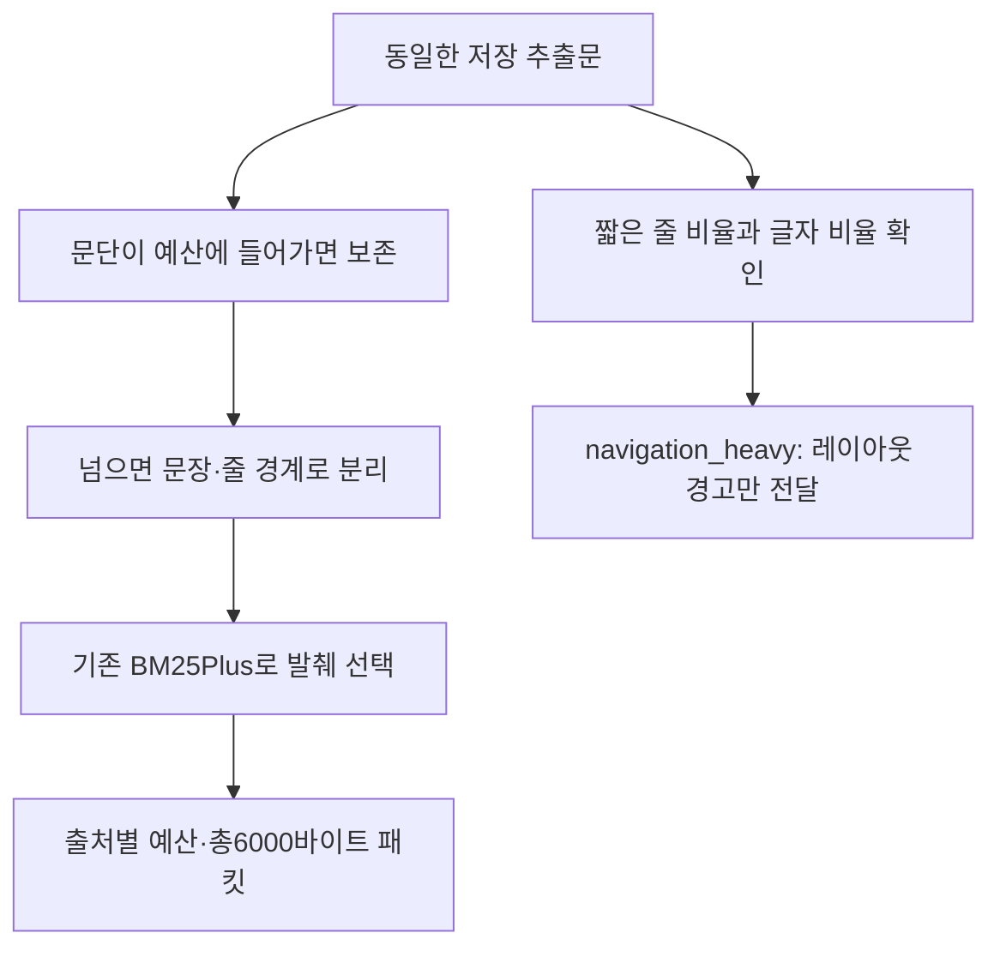

# 043: 같은 본문으로 발췌를 다시 검증하다 — 문장 경계와 메뉴 의심 표시

## 문제 정의와 기준

Brave 연결 뒤 관련 글은 찾았지만, 최종 도구 패킷에 필요한 정보가 남는지는 별도 문제다. 이전 발췌기는 문단을 일정 글자 위치로 잘랐고 바이트 예산에서도 일부 문자열을 잘랐다. 실제 관광공사 발췌가 문장 중간에서 끝났다. 이번에는 이미 받은 원본 HTML에서 추출해 둔 동일한 본문을 사용해 수정 전후를 비교했다. 검색 결과가 바뀐 효과를 섞지 않았다.

좋은 발췌의 기준은 출처·장소·동선과 조건을 보존하고, 잘린 문장이 완성된 근거처럼 보이지 않으며,6000바이트 한도를 지키는 것이다. 장소 추천 자체의 정답이나 전체 근거 보존을 이번 검사로 확정하지 않는다.

## 실제 질문과 출력 비교

<callout icon="🔎" color="blue_bg">
	**038에 실제 보냈던 검색어 — 이번에는 저장 본문만 재사용**
	한국 관광 명소
</callout>

관광공사 출처의 수정 전 발췌 마지막 줄:

```text
※ 최근 3년 이내 작성된 댓글이 일
```

같은 본문으로 다시 구성한 발췌에는 이 안내가 끊기지 않고 남았다.

```text
※ 최근 3년 이내 작성된 댓글이 일정 개수 이상일 경우 제공
```

하지만 이것은 명소 정보가 아니라 메뉴·기능 안내다. 문장을 복구해도 쓸모 있는 명소 근거로 바뀌지는 않는다. 해당 출처에는 navigation_heavy 경고를 추가했다. 기존 수집 한계는 그대로 남는다.

<callout icon="🔎" color="blue_bg">
	**042의 Brave 실행 검색어 — 같은 블로그 본문 재사용**
	강릉 여행 후기 블로그
</callout>

[네이버 여행 후기](https://m.blog.naver.com/suk4408/222966716918)는 이전 패킷에 정동진과 주소는 남았으나 첫날·둘째 날 이동을 설명한 앞 문단이 빠졌다. 같은 본문을 다시 구성하니 다음 문장도 포함됐다.

```text
1일차는 썬크루즈호텔에서 머물며 정동진해수욕장 주변 관광지 둘러보았구요.
```

이전 패킷과 수정 후 모두 정동진 주소가 남았으며, 티스토리의 강릉역·금학칼국수·갤러리밥스·강문해변으로 이어지는 동선도 유지됐다. 블로그가 주장한 방문 경험을 현재 운영 조건이나 검증된 추천으로 바꿔 해석하지 않는다.

<callout icon="🔎" color="blue_bg">
	**042의 두 번째 검색어 — 같은 기사·관광 설명 재사용**
	한국 관광 명소
</callout>

정부 기사에서는 서울로7017·마린시티·소금산 출렁다리·만천하스카이워크 등 이름이 들어간 본문이 유지됐다. 원래2019~2020 선정 자료라는 한계는 변하지 않았다. 실제 본문을 못 받은 Agoda·Travelodge·KKday 출처도 이번 오프라인 작업으로 읽힌 것이 아니다.

## 고정 데이터 결과

| 기존 실행 | 수정 전 패킷 바이트 | 수정 후 패킷 바이트 | 출처 수 전→후 |
|---|---|---|---|
| 038 한국 관광 명소 | 4454 | 4851 | 5→5 |
| 042 강릉 여행 후기 블로그 | 4552 | 4020 | 5→5 |
| 042 한국 관광 명소 | 4511 | 4412 | 5→5 |

세 패킷 모두6000바이트 이내였으며, 재사용한 실제 본문10개에서 수정 후 각 발췌 구간이 저장 원문에 존재함을 검사했다.10개 모두 통과했다. 이는 원문에 없는 문장을 생성하지 않았다는 검사이며, 모든 중요 정보가 남았다거나 인접하지 않은 문장을 이어도 의미가 정확하다는 검증은 아니다. 줄이거나 늘어난 바이트를 토큰·API 비용 절감으로 계산하지 않았다.

## 분석과 구현

기준 커밋09b06d1 이후 독립 web research의 발췌 부분을 수정했다. 기존 에이전트 web_read는 이번 수정 대상이 아니다. 새 evidence_text.py의 bounded_blocks는 문단이 예산에 들어가면 보존하고, 넘으면 문장·줄 경계로 나눈다. 나눌 수 없는 긴 조각은 중간을 잘라 단정문처럼 보여주지 않고 제외한다. 가능한 문단을 묶은 뒤 기존 BM25Plus로 최대3개를 선택한다.

다음은 src/travel_agent/evidence_text.py에서 가져온 실제 함수다.

```python
def bounded_blocks(text, max_chars, max_bytes=None):
    def fits(value):
        return len(value) <= max_chars and (max_bytes is None or len(value.encode()) <= max_bytes)

    blocks, current = [], ''
    for paragraph in units(text):
        # Only break a paragraph when it cannot fit. This keeps headings,
        # addresses and itinerary lists intact under the available budget.
        pieces = [paragraph] if fits(paragraph) else re.split(r'(?<=[.!?。！？])\s+|\n', paragraph)
        for piece in pieces:
            piece = piece.strip()
            if not piece:
                continue
            if not fits(piece):
                # An oversized indivisible sentence is omitted, not silently
                # sliced into an apparent complete statement.
                if current:
                    blocks.append(current)
                    current = ''
                continue
            trial = current + ('\n\n' if current else '') + piece
            if current and not fits(trial):
                blocks.append(current)
                current = ''
            current += ('\n\n' if current else '') + piece
    if current:
        blocks.append(current)
    return blocks
```

web_pipeline.py의 passages와 pack_digest가 이 함수를 사용한다. 검색 요약의 마지막 부분은 bounded_prefix가 문장·줄·단어 경계에서 멈추도록 했다. byte 경계가 소수점에 걸렸다고 문장이 끝난 것으로 오인하지 않도록 원문에서 경계를 판정한다. 완전한 자연어 문장 분석은 아니므로 약어·인용 부호·긴 문장의 처리에는 한계가 있다.



메뉴 의심 신호는12줄 이상,35자 미만 줄이90% 이상이면서 짧은 줄이 전체 글자의80% 이상인 레이아웃에 붙인다. 숫자는 개발용 휴리스틱이며 일반 검증된 분류 기준이 아니다. 짧은 줄 개수만 봤을 때 긴 기사가 메뉴로 표시되는 사례가 있어, 실제 글자 비중도 확인하도록 보완했다. 이 고정 비교에서 관광공사 메뉴와 짧은 호텔 홍보성 글에 신호가 붙었지만 이를 광고 탐지 성공으로 해석하지 않는다. 일정표·주소 목록도 경고될 수 있어 자동 삭제하지 않는다. text_extracted도 의미적 품질 통과가 아니다.

## 검증과 남은 일

Python154개 테스트가 통과했다. 새 검사는 휴관 예외 문장 보존, 분할 불가능한 긴 문장의 비절단, 일정·주소 줄 유지, 소수점·단어 경계, 긴 기사와 짧은 메뉴의 구분, 경고 때문에 유효할 수 있는 목록을 지우지 않는 동작을 확인한다.

새 API·웹 요청과 모델 호출은0건이다. scripts/repack_search_boundaries.py로 같은 저장 본문을 재구성하며 원본 보고서를 덮어쓰지 않는다. 비교는 과거에 전달됐던 출처만 대상으로 하며, 이전에 제외된 후보를 복구하거나 순위를 다시 평가하지 않았다. 메뉴 자동 제외·광고/오래된 자료 판별·원사이트 접근 실패 회복은 남은 과제다. 이번 결과는 발췌 경계의 수정과 경고 추가이며 검색 툴 전체나 최종 여행 답변의 품질 통과가 아니다.

<details>
<summary>실제 로컬 분석 실행과 도구 호출 기록</summary>

	검색 도구·본문 HTTP·LLM 호출은 이번에 없었다.038·042의 실제 HTTP 로그는 해당 연구일지에 그대로 남아 있다. 이번 최종 비교는 아래 로컬 명령으로 실행했으며 명령 결과 식별자는46d7de다. 새 HTTP 호출 ID나 모델 답변은 만들지 않았다.

	```powershell
	python scripts/repack_search_boundaries.py data/private/search-pipeline/038-live/16d1cabb645b4666b16c6d554bb8f40f/report.json data/private/search-pipeline/042-brave/7123c301b88d4292bfb321c7c66a6ec7/report.json data/private/search-pipeline/042-brave/03c20a0943354590b8310f40830fc858/report.json
	```

	실행 결과의 핵심 필드:

	```json
	{"query": "한국 관광 명소", "network_calls": 0, "model_invoked": false, "before_bytes": 4454, "after_bytes": 4851, "before_count": 5, "after_count": 5}
	```

	```json
	{"query": "강릉 여행 후기 블로그", "network_calls": 0, "model_invoked": false, "before_bytes": 4552, "after_bytes": 4020, "before_count": 5, "after_count": 5}
	```

	```json
	{"query": "한국 관광 명소", "network_calls": 0, "model_invoked": false, "before_bytes": 4511, "after_bytes": 4412, "before_count": 5, "after_count": 5}
	```

</details>
