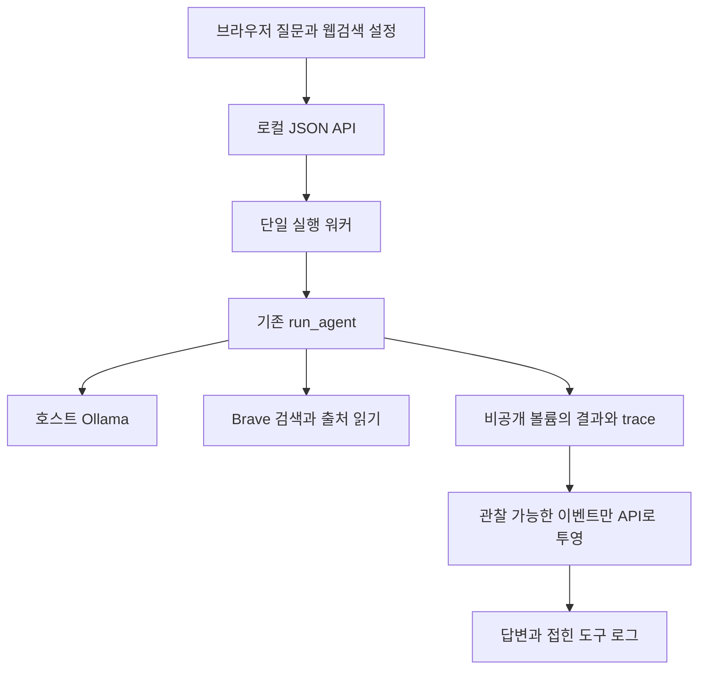

# 045: 직접 질문하고 실제 실행을 확인하는 로컬 웹 화면

2026-10-19 · 구현 기준: `0a22e98` 이후 이번 변경.

## 문제 정의와 판정 기준

CLI에서 개발자가 실행한 결과만으로는 사용자가 직접 모델을 시험하기 번거롭다. 질문을 입력하고 실제 답변·검색어·도구 결과·오류를 같은 화면에서 확인하는 인터페이스를 요청했다. 기존 에이전트를 그대로 호출하고, Docker의 빈 로컬 포트에서 실행하며, 재시작해도 기록을 다시 볼 수 있으면 이번 기능은 통과다. 여행 답변의 품질 개선은 별도 평가다.

## 실제 질문과 답변

기존 모델 qwen3.5:4b-q4_K_M을 사용했다. 첫 질문은 웹검색을 끄고, 두 번째는 켜서 브라우저 입력부터 최종 답변까지 확인했다.

### 실험1

> 질문: 안녕! 한 문장으로 인사해줘.

안녕하세요, 여행 준비를 도와드릴 한국어 에이전트입니다.

모델 호출1회, 도구 호출0회. 누적 입력775토큰·출력16토큰.

### 실험2

> 질문: 웹검색을 실제로 사용해서 국립춘천박물관 공식 홈페이지 URL 하나를 출처와 함께 알려줘.

현재 제공된 웹 검색 요약만으로는 **요금, 시간표, 이동시간, 관람 제약** 등의 세부 정보는 확인할 수 없습니다. 요약에는 공식 홈페이지 URL과 위치는 명시되었으나, 운영상의 구체적인 조건은 포함되어 있지 않습니다.

따라서 요청하신 대로 확인되지 않은 세부 사항들은 **미확인**으로 남겨두겠습니다.

*   **확인된 정보:**
    *   공식 홈페이지: https://chuncheon.museum.go.kr/kor/index.do ([web:7dbf48b80cbb29b7])
    *   위치: 강원특별자치도 춘천시 우석로 70

*   **미확인 정보 (요금, 시간표, 이동시간, 관람 제약 등):**
    *   현재 확인되지 않았습니다. 필요시 [web:7dbf48b80cbb29b7] 또는 [web:dd939b5944193796] 에서 본문 내용을 추가로 읽어야 합니다.

모델 호출3회, 도구 호출1회. 누적 입력4885토큰·출력325토큰.

두 번째는 공식 URL을 실제 검색으로 확보했다. 다만 URL 하나를 묻는 질문에도 요금·시간표 설명을 덧붙여 장황했다. 본문 읽기는 호출하지 않았다. UI와 검색 연결을 확인한 결과이며,044의 여행 답변 실패를 해결했다고 해석하지 않는다. 같은 질문의 전후 품질 개선 비교는 이번 범위에서 실행하지 않았다.

## 문제 분석과 선택

별도 챗봇 구현을 만들면 CLI와 다른 경로를 시험할 위험이 있다. 따라서 기존 run_agent를 호출하고 기존 trace를 읽어 화면에 전달했다. GPU8GB의 로컬 모델에 요청이 겹치지 않도록 실행은1개, 대기는2개로 제한했다. 질문마다 빈 메모리 DB를 만들어 기존 개인 기록이 섞이지 않게 했다. 현재 요청 간 대화 연결은 없다.

Python 표준 HTTP 서버와 정적 JavaScript로 구현했다. 추가 웹 프레임워크·프런트 빌드 환경을 도입하지 않았고 Docker에는 웹 실행에 필요한 최소 의존성만 설치했다. Ollama는 호스트에서 그대로 실행한다. Brave 키는 읽기 전용 Docker secret으로 전달한다. 화면 갱신은 폴링이며 토큰 단위 스트리밍은 아직 없다.

## 해결과 실행 흐름



<details>
<summary>실제 구현과 실행 설정</summary>

src/travel_agent/web_app.py의 RunManager._execute는 아래처럼 실제 에이전트를 호출한다. 기준은0a22e98 이후 이번 변경이다. 실행별 저장 공간과 빈 DB를 사용해 사용자 기록의 범위를 나눈다.

```python
            with MemoryStore(folder/'memory.sqlite3') as store:
                result=run_agent(store,'local-web',run_id,job['query'],mode='bm25',
                                 enable_web=job['enable_web'],trace_dir=folder/'traces',timeout=180)
```

compose.yaml의 실제 포트 설정은 다음과 같다. 비어 있는 호스트 포트는 Docker가 배정하며127.0.0.1에서만 접속한다.

```yaml
ports:
  - "127.0.0.1::8000"
```

scripts/start_web.ps1은 빌드·실행 후 준비 상태를 확인하고 주소를 출력한다. 최종 확인 주소는 http://127.0.0.1:50729 이며 컨테이너 재생성 시 달라질 수 있다. 현재 주소는 docker compose port web 8000으로 확인한다. 컨테이너 시간대는Asia/Seoul로 맞췄다.

</details>

## 검증 결과와 비용

- 전체 Python 테스트164개 통과. API 입력·Host/Origin 검사·대기열·재시작 복원·trace 투영·불완전 로그 읽기를 검증했다.
- JavaScript 구문 검사와 컨테이너 의존성 검사 통과. 컨테이너는UID10001로 실행하고 키는 이미지에 포함하지 않는다.
- 설치돼 있던 Edge에서 실제 입력·응답·검색 도구 로그를 확인했다. 새 브라우저 설치는 없었다.
- 모바일414px에서 가로 넘침 없음. 모델 HTML·스크립트는 텍스트로 처리되고 브라우저 실행 오류 없음.
- 새로고침과 컨테이너 재생성 후 두 실행 복원. 완료 시간 고정과 이벤트 표시 개수도 확인했다. 복원 확인은 모델·검색을 다시 호출하지 않았다.
- 실제 추론 테스트는 총4회 모델 호출, Brave 검색1회다. 검색은 기존 API 계정의 사용량을 소모하며 이번 비용 금액은 측정하지 않았다.

질문과 원본 trace는 비공개 Docker 볼륨에 남긴다. 최근30개를 화면에서 다시 볼 수 있고 오래된 파일의 자동 삭제는 없다. 앞으로 사용자가 입력하는 질문은 자동으로 노션이나 공개 Git에 올리지 않는다. 공개 다중 사용자 서비스·로그인·중단 버튼·요청 간 대화 메모리는 후속 범위다.

## 실제 도구 호출

실험1은 도구 호출이 없었다. 아래는 실험2의 실제 호출이며 인증정보는 포함하지 않았다. 시각은UTC, 한국 시각으로는10월19일00시07분이다.

<details>
<summary>실험2의 실제 검색 요청과 반환 결과</summary>


모델이 선택한 도구 요청을 실행:

```json
{
  "sequence": 5,
  "timestamp": "2026-10-18T15:07:39.174553+00:00",
  "name": "web_search",
  "tool_call_id": "call_mfs1yq3b",
  "arguments": {
    "query": "국립춘천박물관 공식 홈페이지 URL",
    "top_k": 3
  }
}
```

실제 검색 반환 결과(요약 문장은 생략):

```json
{
  "sequence": 6,
  "timestamp": "2026-10-18T15:07:40.206401+00:00",
  "name": "web_search",
  "span": "1.1",
  "elapsed_seconds": 1.031532,
  "result": {
    "provider": "brave",
    "engine_status": {
      "brave": {
        "status": "ok",
        "method": "GET",
        "http_transport": "urllib",
        "response_format": "json",
        "request_params": {
          "q": "국립춘천박물관 공식 홈페이지 URL",
          "count": 3,
          "offset": 0,
          "country": "KR",
          "search_lang": "ko"
        },
        "http_status": 200,
        "response_bytes": 24938,
        "result_cards": 3,
        "parsed_results": 3,
        "more_results_available": true
      }
    },
    "content_kind": "search_snippet",
    "page_fetched": false,
    "returned_results": 3,
    "hits": [
      {
        "id": "web:7dbf48b80cbb29b7",
        "title": "Chuncheon National Museum - 국립춘천박물관",
        "url": "https://chuncheon.museum.go.kr/kor/index.do"
      },
      {
        "id": "web:8e4093eafe5adf4a",
        "title": "국립춘천박물관 - 위키백과, 우리 모두의 백과사전",
        "url": "https://ko.wikipedia.org/wiki/%EA%B5%AD%EB%A6%BD%EC%B6%98%EC%B2%9C%EB%B0%95%EB%AC%BC%EA%B4%80"
      },
      {
        "id": "web:dd939b5944193796",
        "title": "관광지·명소(상세) | 무장애 관광정보 | 열린관광 모두의 여행",
        "url": "https://access.visitkorea.or.kr/ms/detail.do?cotId=dd691326-12e6-467d-b6a2-8ce3ae4963f9"
      }
    ]
  }
}
```

같은 span1.1의 검색은 HTTP200으로 결과3개를 반환했다. 다음 모델에는 기존 compact_md 도구 포맷으로 제목·URL·검색 요약과 출처 ID가 전달됐다. 위 토글은 호출 진단과 출처 목록이며, 모델 입력 문자열 전체를 재현한 것은 아니다. 원문 페이지는 읽지 않았으므로 page_fetched=false다.

</details>
