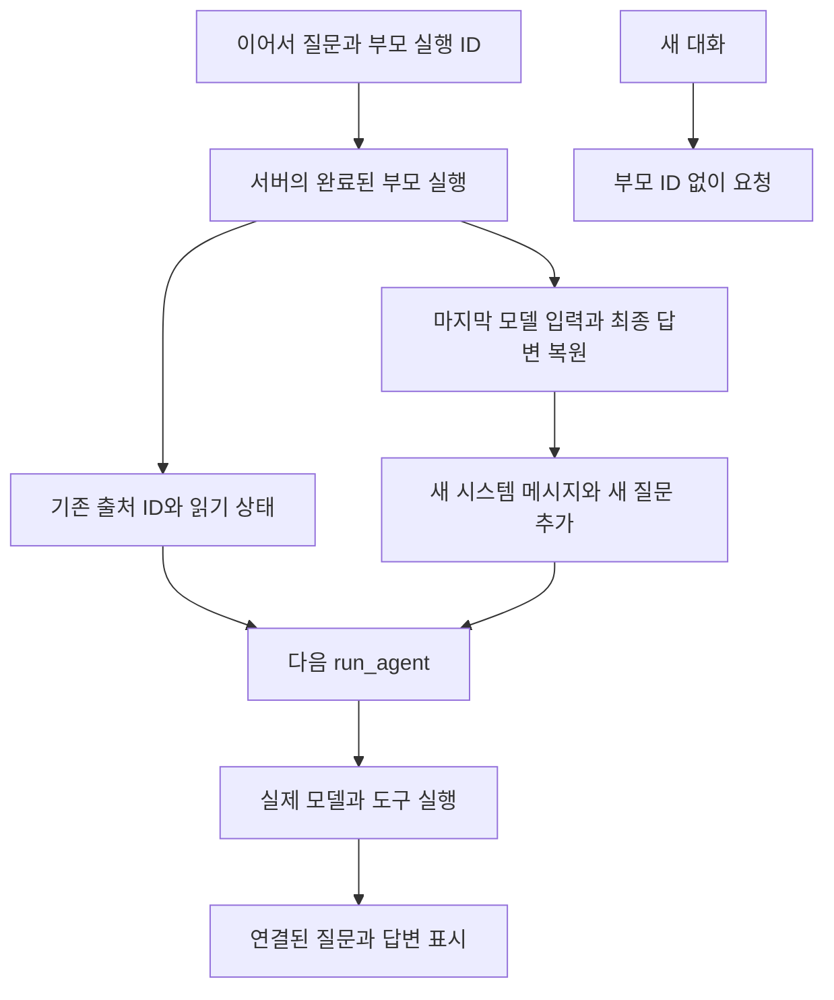

# 046: 조건을 수정하며 이어서 질문하는 대화

2026-10-19 · 기준 커밋27cde31 이후 이번 변경.

## 문제 정의

045의 웹 화면은 매번 질문을 독립 실행했다. 여행 조건을 덧붙이거나 수정할 때 앞선 내용을 다시 입력해야 하므로 실제 대화로 쓰기 불편했다. 사용자가 이어서 질문하도록 수정해 달라고 요청했다. 좋은 동작의 기준은 이전 인원 유지·새 예산 반영·새 대화 분리·새로고침 복원이다.

## 실제 질문과 답변

웹검색을 끄고 같은 화면에서 연속으로 입력했다. 아래는 실제 로컬 모델 답변이다.

> 질문: 이번 여행은 두 명이고 총예산은25만원이야. 이 조건만 한 문장으로 확인해줘.

두 명이 이번 여행에 참여하며 총 예산은 25 만 원입니다.

> 질문: 예산만30만원으로 바꿀게. 앞에서 말한 인원과 수정한 총예산을 한 문장으로 말해줘.

두 명이 이번 여행에 참여하며 총 예산은 30 만 원입니다.

인원을 다시 말하지 않은 두 번째 질문에서도 두 명을 유지하고 예산을30만원으로 수정했다. 045의 독립 실행은 구조상 앞선 질문을 전달하지 않았으며, 이번 수정 전 같은 두 질문의 모델 답변 비교는 실행하지 않았다. 이 검증은 대화 조건 유지에 한정하고 여행 추천 품질 향상으로 확대하지 않는다.

## 문제 분석과 해결

답변 문자열만 연결하면 이미 찾은 출처와 도구 반환값이 빠진다. 서버의 부모 실행 trace에서 마지막 실제 모델 입력을 읽고 최종 답변을 붙였다. 시스템 메시지는 새 요청에서 생성하고, 이전 user·assistant·tool 메시지는 이어서 전달한다. 출처 ID와 메타데이터도 넘겨 이전 검색 출처를 다시 읽거나 인용할 수 있게 했다. 브라우저는 부모 실행 ID만 보내고 임의의 모델 메시지·출처를 지정하지 않는다.



<details>
<summary>실제 코드와 입력 범위</summary>

src/travel_agent/web_app.py의 RunManager.continuation, 기준27cde31 이후 이번 변경:

```python
    def continuation(self,parent):
        messages=None
        for path in (self.directory/parent['id']/'traces').glob('*.jsonl'):
            for line in path.read_text(encoding='utf-8').splitlines():
                event=json.loads(line)
                if event['kind']=='model_start':
                    messages=event['messages']
        if messages is None:
            raise ValueError('이전 대화의 모델 입력 기록을 찾을 수 없습니다.')
        return [m for m in messages if m['role']!='system']+[
            {'role':'assistant','content':parent['result']['answer']}]
```

src/travel_agent/agent.py의 run_agent는 history를 새 시스템 메시지와 현재 질문 사이에 놓는다. prior_sources로 출처를 복원하므로 이전 출처 ID는 다음 호출에서도 유효하다. 이전 도구 결과까지 포함하므로 대화가 길어질수록 입력 비용은 증가한다. 자동 요약이나 조용한 잘라내기를 추가하지 않았다. 기존 입력 바이트 제한과 최대100턴 제한을 사용한다.

브라우저에는 지난 질문·답변과 현재 실행 로그를 표시한다. 이전 도구 로그는 최근 실행에서 해당 실행을 선택해 확인한다. 정상 완료된 답변에서 이어갈 수 있고, 과거 답변을 선택한 뒤 질문하면 그 지점에서 갈라진다. 새 대화 버튼은 부모 연결·입력·현재 화면 선택을 초기화하며 저장된 기록을 지우지는 않는다.

</details>

## 검증과 남은 한계

- Python 테스트166개 통과, JavaScript 구문 검사 통과.
- 서버 저장 기록을 통한 부모 복원, 실제 user/assistant/tool 메시지 전달, 출처 ID 유지, 임의 부모 경로 거부를 테스트했다.
- 실제 브라우저·Ollama 연속 응답2건, 새로고침 복원, 새 대화 초기화, 모바일 가로 넘침 없음, 브라우저 오류 없음.
- 웹검색을 끈 실제 테스트라 추가 검색 호출은0회다. 출처 재사용 경로는 테스트 fixture로 검증했고, 실제 외부 검색을 동반한 연속 대화는 이번에 추가 실행하지 않았다.
- 기존50729 포트로 Docker를 다시 실행했다. WEB_UI_PORT를 지정하면 재생성 시 해당 포트를 사용할 수 있다.
- 긴 대화의 자동 압축·메모리 RAG 연결·여행 답변 품질은 별도 과제다. 사용자 실제 개인 질문은 공개 기록에 옮기지 않았다.

<details>
<summary>실제 모델 실행과 도구 호출 기록</summary>

이번 두 질문에는 도구 호출이 없었다. 가상의 툴콜 로그를 추가하지 않는다. 아래는 각 모델 호출의 관찰 가능한 시각과 토큰 수다.

질문: 이번 여행은 두 명이고 총예산은25만원이야. 이 조건만 한 문장으로 확인해줘.

```json
[
  {
    "sequence": 2,
    "timestamp": "2026-10-18T15:26:12.594095+00:00",
    "kind": "model_start"
  },
  {
    "sequence": 3,
    "timestamp": "2026-10-18T15:26:13.275582+00:00",
    "kind": "model_end",
    "prompt_tokens": 789,
    "output_tokens": 18
  }
]
```

질문: 예산만30만원으로 바꿀게. 앞에서 말한 인원과 수정한 총예산을 한 문장으로 말해줘.

```json
[
  {
    "sequence": 2,
    "timestamp": "2026-10-18T15:26:14.104419+00:00",
    "kind": "model_start"
  },
  {
    "sequence": 3,
    "timestamp": "2026-10-18T15:26:14.472941+00:00",
    "kind": "model_end",
    "prompt_tokens": 851,
    "output_tokens": 18
  }
]
```

</details>
