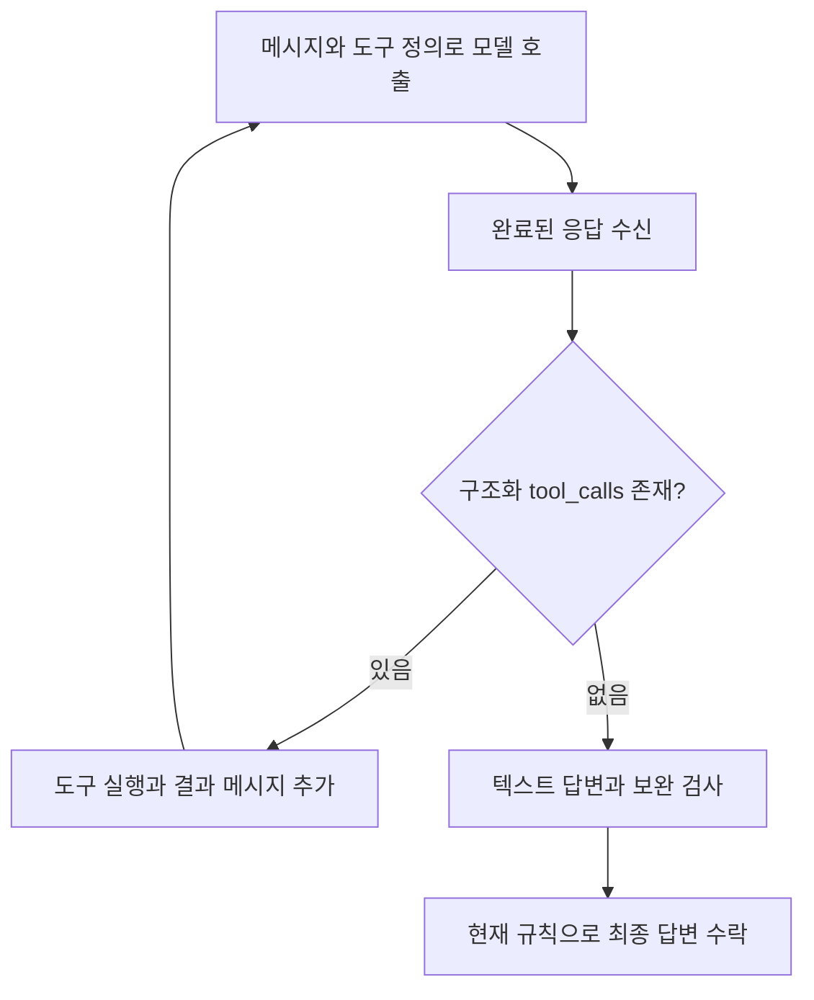

# 047: 검색하겠다는 문장과 실제 도구 호출은 다르다

2026-10-19 · 조사 기준17307f5.

## 개발 요청과 관찰

사용자가 웹 화면에서 답변 마지막에 추가 검색을 예고했지만 실행이 끝난 사례를 제보했다. 출력 한도인지, 도구 호출을 실행기가 놓쳤는지 실제 trace로 구분했다. 개인 여행 조건과 전체 질문·답변은 공개 기록에 옮기지 않았다.

실제 답변의 비민감한 끝 문장:

> 검색을 진행하겠습니다.

해당 실행은 모델 호출1회·도구 호출0회, 입력1254토큰·출력478토큰이었다. 모델 반환의 done_reason은stop, 실행기 상태는completed였다. 검색·읽기 도구는 제공됐고 final_turn=false였다. 출력 상한1024에 의한 length 종료도, 도구 예산 소진도 아니었다. 실제 검색은 없었는데 본문에서 검색했다고 서술한 문제도 함께 확인했다. 이동시간·비용은 실제 조회로 검증되지 않았다.

## 원인 분석

모델은 자연어로 다음 행동을 예고했지만 구조화한 tool_calls는 반환하지 않았다. 실행기는 자연어 문장 자체를 도구 실행 명령으로 취급하지 않는다. 현재 종료 규칙은 tool_calls가 없고 내용이 비어 있지 않으면 형식·근거 보완 검사를 거쳐 최종 답변으로 수락한다. 이 사례에는 확보된 출처도 없어 기존 검색 요약 보완 검사와 인용 검사도 동작하지 않았다.

따라서 모델의 행동 선택 실패와 실행기의 미완료 답변 수락이 함께 드러났다. 누락된 구조화 호출을 실행기가 버렸다는 증거는 없다. 출력 한도를 올리는 것만으로 이 실패가 해결된다는 근거도 없다.

## 실제 실행 구조



<details>
<summary>실제 코드와 로그 진단</summary>

src/travel_agent/agent.py의 chat, 기준17307f5:

```python
body = {"model": model, "messages": messages, "tools": TOOLS if tools is None else tools, "stream": False, "think": False,
        "options": generation_options()}
```

현재는 스트리밍을 사용하지 않는다. 모델 호출 응답을 통째로 받은 뒤 도구 호출을 확인하고, 있으면 실행 결과를 메시지에 추가해 다시 모델을 호출한다. 스트리밍을 쓰더라도 도구 호출 구조를 파싱하는 과정은 필요하며 자연어의 검색 예고가 자동 실행되는 것은 아니다.

같은 파일 run_agent의 도구 요청 판독과 종료 코드 발췌:

```python
calls = message.get("tool_calls", [])
```

```python
return finish("completed", assistant["content"])
```

아래 두 발췌 사이에는 빈 응답·검색 근거 보완·인용 검사가 있다. 생략한 구간을 연속 코드처럼 제시하지 않았다. 현재 구현의 종료 판단을 설명하기 위한 발췌다.

실제 도구 호출은0건이므로 도구 이름·인자·호출 ID 로그는 존재하지 않는다. 모델 이벤트의 진단값은 다음과 같다. 개인 질문과 답변 본문은 제외했다.

```json
{
  "model_start": {
    "step": 1,
    "final_turn": false,
    "tool_names": ["web_search", "web_read"]
  },
  "model_end": {
    "step": 1,
    "done_reason": "stop",
    "output_tokens": 478,
    "tool_calls_count": 0
  },
  "run_result": {
    "status": "completed",
    "model_calls": 1,
    "tool_calls": 0,
    "web_search_attempted": false,
    "web_search_performed": false
  }
}
```

위 JSON은 trace의 관련 필드를 묶은 진단 요약이다. tool_calls_count는 구조화 호출 부재를 세어 표시한 값이며 모델이 반환한 필드명은 아니다. 원본은 로컬 비공개 볼륨에 보존했다.

</details>

## 결론과 후속 검증

이번에는 실행 기록을 조사했으며 동작 변경이나 새 모델 호출·웹검색은 수행하지 않았다. 원인 확인과 해결 검증을 구분한다. 검색 예고를 하면서 호출하지 않는 사례를 평가 항목에 넣고, 프롬프트의 행동 계약과 미완료 응답의 제한된 재시도를 검토할 수 있다. 자연어에서 검색어를 임의로 추출해 자동 실행하거나 모든 질문에 검색을 강제하는 방식은 이번 조사에서 도입하지 않았다. 보완을 구현하면 같은 비민감 질문으로 미완료 종료율·실제 호출·비용을 비교해야 한다.
