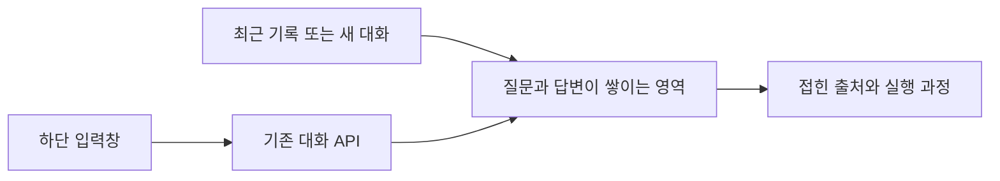

# 048: 입력창을 아래에 둔 대화 화면

2026-10-19 · 기준0d1e184 이후 이번 변경.

## 개발 요청과 문제 정의

기존 화면은 입력과 결과가 분리된 실험 대시보드였다. 사용자는 ChatGPT처럼 질문·답변이 위에 쌓이고 아래에서 계속 입력하는 대화 화면을 요청했다. 좋은 동작의 기준은 입력창이 계속 보이고, 긴 대화만 스크롤되며, 모바일에서도 입력과 이전 기록 탐색이 가능한 것이다.

## 분석과 해결

사이드바·상단 헤더·스크롤 가능한 메시지 영역·하단 입력창으로 나눴다. 질문은 오른쪽 말풍선, 답변은 왼쪽 본문으로 표시한다. 실제 도구 로그와 토큰 수는 답변 아래의 기본 접힌 실행 과정으로 옮겼다. 최근 실행·새 대화·연속 질문·출처 확인 기능을 유지했다. 최근 기록은 기존 실행 목록이며 대화별 제목 생성·자동 묶기는 이번에 추가하지 않았다.

Enter 전송·Shift+Enter 줄바꿈을 적용하고 한글 입력 조합 중 Enter는 전송하지 않는다. 입력창은 내용에 따라 최대160px까지 늘어난다. 새 질문이나 기록 선택 시 최신 메시지로 이동하고, 실행 중 사용자가 위를 읽고 있으면 폴링으로 스크롤을 강제하지 않는다. 모바일은 사이드바를 메뉴로 열고 배경 클릭·닫기·Escape로 닫는다.



<details>
<summary>실제 레이아웃과 입력 코드</summary>

src/travel_agent/static/style.css의 실제 핵심 선언, 기준0d1e184 이후 이번 변경:

```css
.chat-shell{flex:1;min-width:0;display:flex;flex-direction:column;height:100dvh}
```

```css
.chat-scroll{flex:1;min-height:0;overflow-y:auto;overscroll-behavior:contain}
```

두 영역에 역할을 나누므로 하단 입력창은 남고 긴 메시지 영역만 스크롤된다. 전체 실제 CSS에는 배경·여백·모바일 조건이 추가돼 있다.

src/travel_agent/static/app.js의 실제 키 처리:

```javascript
$('question').addEventListener('keydown',event=>{if(event.key==='Enter'&&!event.shiftKey&&!event.isComposing){event.preventDefault();if(!$('send').disabled)$('question-form').requestSubmit();}});
```

같은 파일의 showConversation은 앞선 질문·답변을 그리고, 내용이 바뀌지 않았으면 폴링마다 다시 만들지 않는다. 기존 Markdown의 안전한 DOM 렌더링을 그대로 사용한다.

</details>

## 검증

기존 공개 합성 사례인 두 명·25만원에서 예산만30만원으로 바꾼 대화 결과를 불러와 화면을 확인했다. 새 모델 답변을 생성한 실험이 아니므로 새로운 질문·답변이나 품질 비교를 만들지 않았다.

- Edge 데스크톱1440×960·모바일390×844에서 시각 확인.
- 하단 입력창 노출·긴 대화의 독립 스크롤·가로 넘침 없음.
- Enter 전송·Shift+Enter 줄바꿈·IME 조합 중 전송 방지 확인. 전송 검증은 합성429 응답을 브라우저에서 반환해 실제 추론을 호출하지 않았다.
- 부모 실행 ID 전달·새로고침 대화 복원·접힌 도구 로그·모바일 사이드바 열기와 닫기 확인. 브라우저 실행 오류 없음.
- 기존 Python 테스트166개와 JavaScript 구문 검사 통과. UI 변경에 맞춘 브라우저 검증을 함께 수행했다.
- 새 모델 호출0회·검색 호출0회. 실시간 도구 동작 자체는 이번에 새로 시험하지 않았다.

진행 중인 실행이0개임을 확인한 뒤 Docker를 재생성했고 기존 http://127.0.0.1:50729 주소를 유지했다. 이번 변경은 화면과 입력 동작에 한정하며047의 검색 예고 후 종료 문제를 수정한 것으로 해석하지 않는다. 실제 모바일 기기의 가상 키보드는 이번 데스크톱 브라우저 뷰포트 검증 범위 밖이다. 개인 대화가 보이는 화면 캡처는 공개하지 않는다.

<details>
<summary>도구 호출 기록</summary>

이번 화면 검증에서는 에이전트의 실제 도구 호출이 없었다. 기존 저장 결과 조회와 합성 입력 이벤트만 사용했으며 툴콜 로그를 새로 만들지 않는다.

</details>
