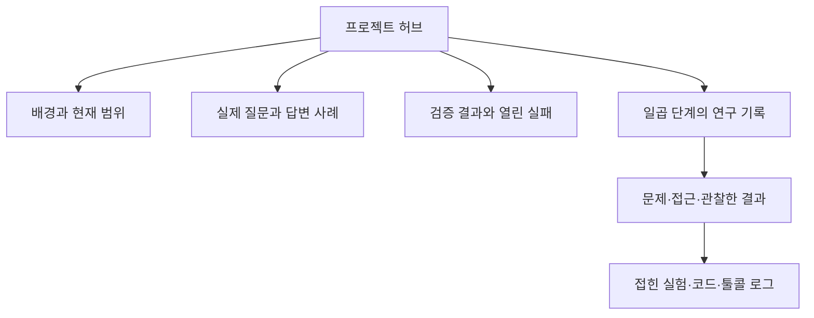

# 049: 노션을 연구 목록에서 발표 흐름으로 정리하다

2026-10-19 · 편집 기준48d7c5f 이후. 문서 편집이며 프로그램 동작 변경은 없다.

## 개발 요청과 문제 정의

노션에서 겹치는 내용을 정리하고 페이지 자체를 발표자료처럼 읽히게 해 달라는 요청이었다. 먼저 기존 허브와 하위50개 페이지를 모두 읽었다. 같은 실험을 중복 생성한 페이지는 확인되지 않았고, 허브에 단계별 요약을 계속 덧붙이면서 과거의 DDGS·Bing 설정이 여러 개의 현재 구현처럼 보이는 문제가 있었다. 초기 기술 결정도 아직 Docker·RAG가 후속인 상태로 읽혔다.

좋은 편집의 기준은 처음 읽는 사람이 프로젝트 배경·선택·실패·현재 상태를 순서대로 이해하고, 실제 질문·답변·코드·도구 로그를 필요할 때 확인할 수 있는 것이다. 기록의 길이나 꾸밈을 모델 품질 개선으로 설명하지 않는다.

## 정리한 구조

허브는 여섯 부분으로 구성했다.

1. 어떤 문제에서 시작했나: 실제 여행 준비 중 겪은 불편과 아직 측정하지 않은 비교를 구분한다.
2. 어디까지 만들었나: 로컬 모델·Brave 검색·메모리 CLI·Docker 대화 화면의 실제 범위를 보여준다.
3. 쿼리에서 좋은 답변으로:007의 제외 이유 복원과046의 예산 정정을 실제 질문·답변으로 보여준다.
4. 검색 시행착오: 접근·후보·본문·발췌·근거 사용 실패를 나눠 설명한다.
5. 실제 평가:044의 여행 보완본0/3과047의 미해결 툴콜 오류를 남긴다.
6. 데모와 다음 검증: 현재 화면에서 확인할 행동과 아직 하지 않은 일을 구분한다.

기존50개 하위 페이지는 출발·메모리·웹 도구·Google 연구·Bing 연구·본문/Brave·실제 평가/화면의 일곱 묶음으로 접었다. 허브에 중복되던 긴 요약과 오래된 현재 상태는 제거하고 각 실험의 고유 근거는 해당 페이지에 남겼다. 기존 하위 페이지를 삭제하거나 새 허브를 만들지 않았다.

연구일지001~048은 핵심 메시지와 문제·접근·관찰한 결과를 먼저 배치했다. 실제 초기·수정 답변을 이동한 대표 사례는 본문에서 읽고, 긴 조사·추가 사례·코드·로그는 접힌 상세에서 확인한다. 도구 로그의 기존 토글도 보존했다. 번호는 유지하고 제목을 핵심 판단 중심으로 줄였다. 설계 결정 문서는 현재 적용과 초기 이력을 나눴고, 작성 기준은 발표 요약과 실험 상세를 분리하도록 보강했다.

## 실제 편집 예

이전 허브에는 ‘현재 검색 — Bing 단독’, ‘현재 검색 구현 — DDGS 없는 직접 HTTP’, ‘현재 검색 방향 — DDGS 엔진별 수집과 통합’이 함께 있었다. 지금은 최신 기본 검색을Brave로 한 곳에서 밝히고 이전 경로는 연구 이력으로 분류한다. 당시 실험의 관찰을 최신 상태로 덮어쓰지는 않았다.

이전 설계 결정의 ‘웹 API·Docker 배포는 후속’은 초기 결정 상세로 옮겼다. 현재 적용 표에는 Python 표준 HTTP 서버·호스트 Ollama·Docker 앱·Brave·메모리 CLI를 반영했다. 초기 FastAPI 검토가 실제 채택된 것처럼 읽히지 않게 구분했다.

## 검증과 한계

- 허브와 하위50개 페이지의 편집 전 내용을 비공개로 보관했다.
- 수정한 연구일지48개를 다시 읽어 핵심 요약·세 열 구성·접힌 상세를 확인했다.
- 기존 코드·출력 블록473개를 재조회 결과와 대조했다. 각 블록의 들여쓰기 표현 차이를 제외한 내용 누락은 없었다.
- 원래 본문의 긴 문장도 재조회 결과와 대조해 누락이 없음을 확인했다. 코드·답변을 새로 생성하거나 더 좋은 문장으로 고쳐 쓰지 않았다.
- 허브의 기존 하위 페이지50개는 모두 하나씩 남아 있고 일곱 묶음 순서를 재확인했다. 설계·작성 기준 페이지도 재조회했다.
- 현재 기본Brave, 여행 보완본0/3, 미해결 툴콜 진단을 확인했다. 허브에 현재Bing이라는 이전 제목은 남기지 않았다.
- 새 모델·검색 호출은0회다. 따라서 새로운 쿼리·답변·에이전트 툴콜 로그는 없다. 이번 검증은 노션 문서 재조회와 내용 대조이며, 브라우저에서의 실제 발표 리허설은 수행하지 않았다.

노션 네이티브 열·콜아웃·토글을 사용했고 모바일에서의 실제 발표 가독성은 별도 사용자 확인이 필요하다. 발표 본문의 로컬 사본은 [프로젝트 발표 흐름](notion-presentation.md)에 남겼다. 기존 연구일지 파일은 당시 실행 근거로 유지한다.

노션 반영 위치: [여행 에이전트 · 문제에서 검증까지](https://app.notion.com/p/3fcd058c022e81dda6eff44a0bb29d4f). 이번 편집 기록은 허브의 접힌 문서 정리 기록에 통합했다.
