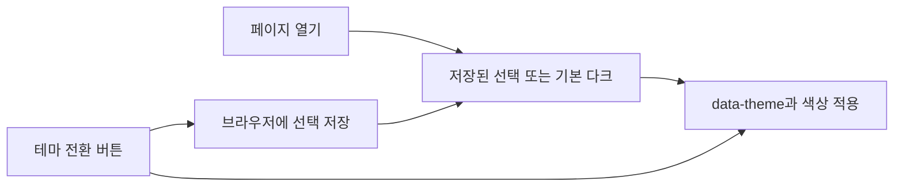

# 050: 눈부심을 줄이는 다크모드

2026-10-19 · 기준c399feb 이후 이번 변경.

## 개발 요청과 결과

사용자가 다크모드를 우선 빠르게 적용해 달라고 요청했다. 기본 테마를 다크로 바꾸고 오른쪽 위 버튼에서 라이트·다크를 전환하도록 했다. 대화·입력창·사이드바·출처·코드·도구 로그·오류 색상을 함께 조정했다. 브라우저에 선택을 저장해 새로고침해도 유지한다.

## 구현과 확인

src/travel_agent/static/theme.js는 스타일을 그리기 전에 테마를 결정한다. 기준c399feb 이후 추가한 실제 코드다.

```javascript
let savedTheme = 'dark';
try { savedTheme = localStorage.getItem('travel-agent-theme') || 'dark'; } catch { }
document.documentElement.dataset.theme = savedTheme === 'light' ? 'light' : 'dark';
```

저장소 접근이 거부돼도 기본 다크로 표시한다. theme.css는 data-theme 조건의 색상만 바꾸고, 웹 서버의 정적 경로 허용 목록에 두 파일을 추가했다.



Edge의 데스크톱1440×960·모바일390×844에서 실제 화면을 확인했다. 기본 다크·라이트/다크 전환·양쪽 선택의 새로고침 유지·모바일 버튼과 가로 넘침 없음을 확인했고 브라우저 오류는 없었다. JavaScript 구문 검사도 통과했다. 저장된 공개 합성 대화만 불러왔으며 새 모델·검색 호출은0회다. 실제 도구 호출이 없으므로 툴콜 로그를 만들지 않는다. 개인 대화가 보이는 캡처는 공개하지 않는다.

기존50729 포트의 Docker에 반영했다. 모델 응답 품질이나047의 툴콜 실패를 바꾸는 작업은 아니다.
