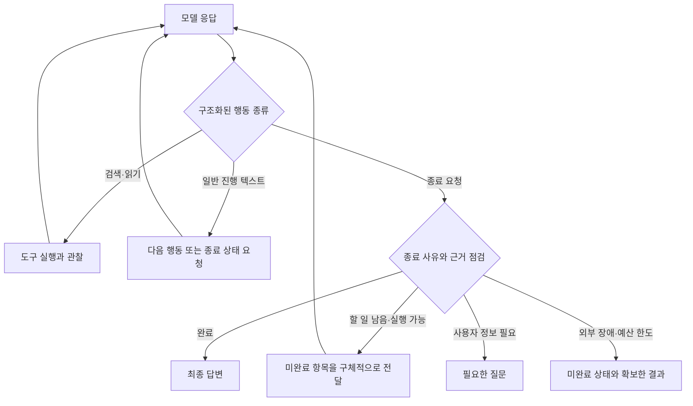

# 051: 텍스트 응답과 작업 완료를 분리하는 종료 설계

2026-10-19 · 조사 기준0e1a22f. 실제 실행 진단과 후속 설계 제안이며 런타임 변경은 없다.

## 핵심 판단

사용자는 답변이 다음 확인 단계를 안내하면서 종료하는 현상을 제보하고, ReAct 재설계·하네스 재실행·명시적인 최종 태그를 질문했다. 이번 실행은 컨텍스트·시간·호출 한도 소진이 아니라 모델의 자발적 텍스트 종료와 제한적인 보완 경로가 원인이었다.

좋은 완료는 답변 문장이 생성된 것만을 뜻하지 않는다. 요구한 결과를 확보했는지, 부족한 정보는 도구로 더 찾을 수 있는지, 사용자 입력이 필요한지, 외부 접근이 막혔는지를 구분해야 한다. 개인 여행 조건과 전체 질문·답변은 공개 기록에 옮기지 않았다.

## 실제 실행에서 확인한 흐름

| 순서 | 모델과 실행기의 실제 행동 |
| --- | --- |
| 모델1회차 | web_search 두 개를 한 응답에 요청 |
| 도구 실행 | Brave HTTP200 두 건, 결과4개·3개 수신 |
| 모델2회차 | 도구 호출 없이 답변 초안 생성 |
| 하네스 보완 | 본문 읽기0건을 알리고 추가 근거 검토 요청 |
| 모델3회차 | 새 도구 없이 답변을 다시 작성 |
| 하네스 보완 | 제공한 출처 ID를 이용한 인용 수정 요청 |
| 모델4회차 | 새 도구 없이 최종 텍스트를 반환하고 completed |

총 모델4회·도구2회, elapsed76.537초였다. 도구 호출은 처음 검색2개뿐이며 web_read는0회다. 답변의 ‘본문 내용을 바탕으로’라는 주장은 실제 행동과 일치하지 않는다. 인용 ID가 존재해도 본문을 읽었다거나 주장을 검증했다는 뜻은 아니다.

컨텍스트 설정65536, 입력 바이트 제한196608, 모델 호출 한도6회·도구 한도8회·시간180초였다. 마지막 입력은20063 UTF-8바이트로 앱 입력 한도 미만이었고 final_turn=false였다. 마지막 출력565토큰·done_reason=stop이며, 강제 예산 마무리도 아니었다. 입력14518토큰은4회 호출의 누적 합계이므로 마지막 문맥 길이로 해석하지 않는다. 실제64K 길이의 품질 시험도 아니다.

현재 think=false라는 설정도 확인했다. 다만 사고 모드·모델 크기·컨텍스트의 원인별 대조 실험을 하지 않았으므로 어느 설정을 바꾸면 해결된다고 확정하지 않는다.

## 원인: 루프는 있지만 완료 판단이 약하다

src/travel_agent/agent.py의 run_agent는 구조화 tool_calls가 있으면 실제 도구를 실행하고 결과를 다시 모델에 전달한다. 이 기본 왕복은 [Ollama 공식 다중 턴 도구 호출](https://docs.ollama.com/capabilities/tool-calling)의 형태와 같다.

문제는 도구 없는 텍스트를 사실상 완료 후보로 받아들이는 것이다. 본문 읽기가 없는 웹 근거 초안에는 검토1회를 허용하지만 재조사를 강제하거나 목표 달성을 확인하지는 않는다. 이후 인용 보완은 ‘새 사실을 추가하지 말라’고 요청해 실행을 답변 재작성으로 좁힌다. 이 흐름은 잘못된 인용 수정에는 도움을 줄 수 있으나 미완료 조사 계속하기와는 목적이 다르다.

실제 코드 발췌, 기준0e1a22f:

```python
calls = message.get("tool_calls", [])
```

```python
return finish("completed", assistant["content"])
```

두 발췌는 연속 코드가 아니다. 사이에는 빈 응답·근거 검토·인용 수정 검사 등이 있다. 이번은 코드를 바꾸지 않고 실제 종료 지점을 확인했다.

## 제안: 명시적인 종료 요청과 하네스 검사를 둔다

ReAct의 도구 왕복을 교체하기보다 종료 프로토콜을 보강한다. 일반 assistant 텍스트는 진행 설명으로 취급하고, 명시적인 finish 도구 같은 구조화 출력으로 완료를 요청하게 하는 방안을 우선 실험할 수 있다. XML 최종 태그도 가능하지만 태그 존재가 정답이나 목표 달성을 증명하지는 않는다.

아래는 아직 구현하지 않은 제안이다.



종료 상태의 제안은 completed·needs_input·blocked다. 하네스는 존재하는 출처 ID·실제 본문 읽기 여부·도구 오류·제한 준수처럼 기계적으로 확인할 수 있는 조건을 먼저 검사한다. 의미적 충족 여부는 추가 모델 평가나 사람이 작성한 기준으로 비교할 수 있으나, 같은 모델의 자기평가만으로 사실 검증이 끝났다고 간주하지 않는다.

미완료면 필요한 다음 조회를 모델이 선택하도록 돌려보낸다. 모델에 검색어·사이트·고정 질문 대본을 박아 넣지는 않는다. 숙박 날짜 등 사용자에게만 있는 정보가 부족하면 질문해야 하고, 접근 불가·새 근거 없음·반복 호출·실행 한도에는 미완료 사유를 남겨야 한다. ‘원하는 답이 나올 때까지’ 무한 반복하는 설계는 아니다. 에이전트의 반복과 종료 제한을 함께 두는 원칙은 [Anthropic의 에이전트 설계 설명](https://www.anthropic.com/engineering/building-effective-agents)도 참고했다. 이 문헌이 제안한 finish 계약의 품질 향상을 입증하는 것은 아니다.

## 실제 툴콜 진단

개인 여행 검색어는 제외했다. 원본 인자와 반환 자료는 비공개 실행 trace에 보존한다. 아래는 같은 실행의 실제 호출 ID·순서·시각·개수이며 새 실험 로그가 아니다. 시각은UTC다.

<details>
<summary>검색2회의 실제 요청·실행·다음 모델 전달</summary>

| 시각 | span / 호출 ID | 실행 |
| --- | --- | --- |
| 2026-10-18T17:54:28.731420+00:00 | 1.1 / call_oqfnqopl | web_search, top_k5, 검색어는 개인 조건이라 생략 |
| 2026-10-18T17:54:28.732228+00:00 | 1.2 / call_i9p12c41 | web_search, top_k3, 검색어는 개인 조건이라 생략 |
| 2026-10-18T17:54:29.773359+00:00 | 1.2 | Brave HTTP200, status ok, hits3 |
| 2026-10-18T17:54:29.936948+00:00 | 1.1 | Brave HTTP200, status ok, hits4 |

완료 순서와 관계없이 기존 실행기는 요청 순서의 도구 결과를 다음 모델 메시지로 전달한다. 이 실행의 공급자는Brave, 전달 자료는 검색 요약이며 페이지 본문이 아니다. 이후 근거 검토·인용 수정 모델 호출에서도 새 도구 요청은 없었다.

</details>

## 다음 실험의 기준

현재 방식과 명시적 종료 계약을 같은 비민감 질문으로 비교한다. 행동 예고 후 실제 호출 여부·미완료 종료율·필수 정보 확인·추가 질문 적절성·환각·호출 수·토큰·시간을 함께 측정한다. finish 호출 성공률과 실제 과제 성공률은 따로 본다. 모델의 사고 모드·출력 한도·생성 모델 변경은 종료 계약 효과와 섞지 않고 별도 대조한다.

이번에는 기존 실제 기록과 공식 자료를 조사했다. 새로운 여행 질의의 모델·검색 호출은0회이며, 제안한 종료 도구·검증기·재실행은 아직 구현하지 않았다.
