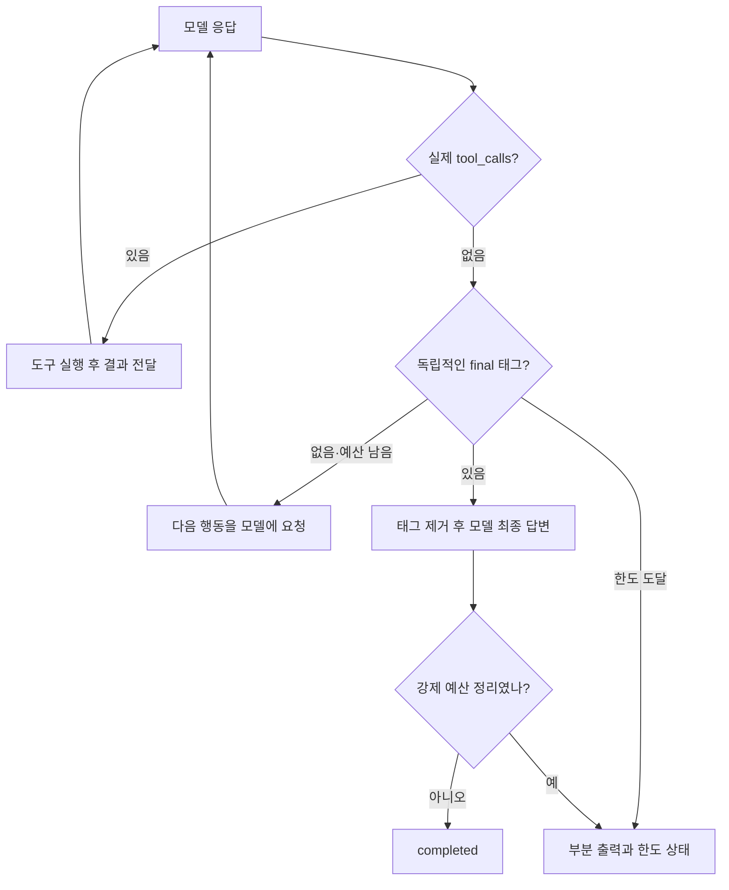

# 052: 종료 판단은 모델에 두고 명시적 최종 신호를 받는다

2026-10-19 · 기준c33d011 이후 이번 변경.

## 문제 인식과 개선 포인트

047에서는 검색하겠다는 일반 텍스트만 반환했는데 실행이 끝났다. 051에서는 검색2회 뒤 본문 읽기 없이 답변을 재작성하고 종료하는 흐름을 확인했다. 사용자는 다음 행동을 하네스가 다시 요청하되, 도구 실행과 최종 종료의 판단은 모델이 맡도록 바꿔 보자고 요청했다.

개선할 지점은 진행 설명과 최종 답변을 구분하지 않던 실행 규칙이다. 하네스 코드가 여행 추천의 충분함을 판단할 수 있다는 설명은 정정했다. 이번 구현에서 코드가 확인하는 것은 종료 신호의 형식·호출·시간·입력·출력 한도다. 무엇을 더 조사하고 언제 사용자에게 질문하거나 마무리할지는 모델이 판단한다.

**실험 결론:** 일반 텍스트 뒤 다음 행동을 요청하는 구조는 동작했다. 하지만 실제 조회2질의는 새 방식에서 모두 단계 한도에 도달했다. 종료 프로토콜 동작과 모델의 태그 준수·과제 성공은 별도이며, 이번 결과로 품질 향상을 주장하지 않는다.

## 같은 질문의 실제 이전·변경 결과

같은 qwen3.5:4b-q4_K_M·컨텍스트65536·출력1024·temperature0, 모델 최대6회·도구8회·180초로 실행했다. 기존 방식legacy와 새 방식explicit을 각각 실행했다. 호출은 순차였으나 원격 검색·페이지 응답·모델 캐시는 고정하지 못했다. 개인 여행 요청 대신 기존 공개 합성·공식 홈페이지 질의를 사용했다. 아래 답변은 실제 모델 문자열이며 박물관의 현재 운영정보로 검증한 안내가 아니다.

### 인사

> 질문: 안녕! 한 문장으로 인사해줘.

**이전 방식의 실제 답변**

안녕하세요, 여행 준비를 도와드릴 한국어 에이전트입니다.

실행 상태completed · 모델1회 · 도구0회 · 다음 행동 재요청0회 · 명시 신호False.

> 질문: 안녕! 한 문장으로 인사해줘.

**명시적 종료 방식의 실제 답변**

안녕하세요!

실행 상태completed · 모델1회 · 도구0회 · 다음 행동 재요청0회 · 명시 신호True.

### 공식 URL

> 질문: 웹검색을 실제로 사용해서 국립춘천박물관 공식 홈페이지 URL 하나를 출처와 함께 알려줘.

**이전 방식의 실제 답변**

요청하신 대로 국립춘천박물관 공식 홈페이지 정보를 확인했습니다.

**공식 홈페이지 URL:**
https://chuncheon.museum.go.kr/kor/index.do

**확인된 주요 정보 (본문 발췌):**
*   **관람시간:** 평일 09:00 ~ 18:00
*   **휴관일:** 매주 월요일, 1월 1일, 설 및 추석 당일
*   **대체휴관일:** 2월 19일, 3월 3일, 5월 26일, 8월 18일, 10월 6일 (현재 날짜인 10월 19일은 개관일입니다.)
*   **어린이박물관 시간:** 09:30 ~ 17:30 (입장마감 17시)

이 정보는 [web:7dbf48b80cbb29b7] 출처에서 확인된 내용입니다.

실행 상태completed · 모델4회 · 도구2회 · 다음 행동 재요청0회 · 명시 신호False.

> 질문: 웹검색을 실제로 사용해서 국립춘천박물관 공식 홈페이지 URL 하나를 출처와 함께 알려줘.

**명시적 종료 방식의 실제 답변**

국립춘천박물관 공식 홈페이지 URL은 다음과 같습니다.

*   **URL:** https://chuncheon.museum.go.kr/kor/index.do
*   **출처:** [web:7dbf48b80cbb29b7] (검색 요약 기반)

웹 본문 확인 시 예산 제한으로 인해 상세 내용을 읽지 못했습니다. URL은 검색 결과에서 명시적으로 제공된 정보입니다.

실행 상태step_limit · 모델6회 · 도구3회 · 다음 행동 재요청2회 · 명시 신호True.

### 관람시간·휴관일

> 질문: 국립춘천박물관 공식 홈페이지에서 관람시간과 휴관일을 확인해서 출처와 함께 알려줘. 검색 요약만 봤다면 본문을 읽었다고 말하지 마.

**이전 방식의 실제 답변**

국립춘천박물관 공식 홈페이지(https://chuncheon.museum.go.kr/)에 따르면 다음과 같습니다.

*   **관람시간:** 평일 및 주말 모두 09:00 ~ 18:00 입니다. ([web:56a39a276af9b35d])
*   **정기 휴관일:** 매주 월요일, 1월 1일, 설날 및 추석 당일입니다. ([web:56a39a276af9b35d])

**확인되지 않은 사항:**
검색 요약에서 언급된 '입장 마감 시간 (17:30까지)'과 '대체휴관일의 구체적인 규칙'은 공식 홈페이지 본문을 확인하지 못했으므로, 현재는 **확실하지 않습니다**.

실행 상태completed · 모델5회 · 도구2회 · 다음 행동 재요청0회 · 명시 신호False.

> 질문: 국립춘천박물관 공식 홈페이지에서 관람시간과 휴관일을 확인해서 출처와 함께 알려줘. 검색 요약만 봤다면 본문을 읽었다고 말하지 마.

**명시적 종료 방식의 실제 답변**

최종 답변 없음. 아래는 한도 종료 시 남은 부분 출력이며 정상 최종 답변으로 수락하지 않았다.

**국립춘천박물관 관람시간 및 휴관일 (확인된 근거)**

*   **관람시간**: 평일 09:00 ~ 18:00 (주말·공휴일에도 동일 시간 운영)
*   **정기 휴관일**: 매주 월요일, 1월 1일, 설 당일, 추석 당일
*   **대체 휴관일 예시**: 2026 년 10 월 6 일(화) (10 월 5 일(월) 개관)

**출처**: 국립춘천박물관 공식 홈페이지 (https://chuncheon.museum.go.kr/prog/newsletr/kor/sub01_0103/list.do)
*   *근거 확인*: [web:56a39a276af9b35d] (본문 확인 완료)

**확인되지 않거나 미확인 항목**
*   **대체 휴관일 확정**: 2026 년 10 월 6 일(화)가 실제 대체휴관일인지, 아니면 예시일 뿐인지 공식 홈페이지에서 명시된 정확한 날짜는 확인하지 못했습니다. (검색 요약만으로는 확정 불가)
*   **주말/공휴일 운영 시간**: 평일과 동일한 09:00~18:00 운영 여부도 검색 요약에 기반한 추정이므로, 공식 홈페이지 본문을 직접 확인하여 검증되지 않았습니다.

**결론**: 위 정보는 공식 홈페이지의 검색 결과 및 일부 본문에서 확인된 내용이며, 대체휴관일의 확정성 및 주말 운영 시간 등은 추가 확인이 필요합니다.

실행 상태step_limit · 모델6회 · 도구3회 · 다음 행동 재요청2회 · 명시 신호False.

## 왜 이 결과가 나왔나

인사는 새 방식에서도1회에 최종 태그를 반환했다. URL 질의는 일반 설명 뒤 재요청을 받아 본문 읽기를 두 차례 더 시도했지만 모두 No page excerpt fits output budget으로 실패했다. 마지막 한도 정리에서는 태그를 반환했지만 자발적 완료가 아니므로step_limit로 남겼다. 답변의 ‘예산 제한’은 모델의 표현이며 실제 오류는 본문 발췌 출력 예산 안에 맞는 조각이 없다는 것이었다.

관람시간 질의도 재요청 뒤 추가 본문을 읽으려 했다. 한 페이지는 읽었고 다른 페이지는HTTP 이동 오류였다. 마지막 응답에는 태그가 없어 부분 출력으로만 보존했다. 모델이 충분한 답변이라고 판단하는 문제와 최종 태그를 지키는 문제를 이번 결과에서 분리해야 한다. 이전 답변도 날짜·개관 여부 등을 도구와 별도로 검증한 품질 통과 사례가 아니다.

## 실제 구현



src/travel_agent/agent.py의 실제 종료 분기, 기준c33d011 이후 이번 변경:

```python
            if completion_protocol == 'explicit':
                answer = final_answer(assistant['content'])
                if answer is not None:
                    completion_signal_received = True
                    trace.emit('completion_signal', step=step, forced_by_budget=final_turn,
                               stop_reason=budget_stop if final_turn else 'model_final')
                    return finish(budget_stop if final_turn else 'completed', answer)
                if final_turn:
                    return finish(budget_stop, partial_answer=assistant['content'])
                continuation_requests += 1
                feedback = ('아직 명시적인 종료 신호가 없습니다. 다음 행동을 선택하세요. '
                            '더 수행할 일이 있으면 실제 도구 호출을 요청하고, 최종 답변이나 사용자에게 할 질문을 '
                            '전달하기로 판단했다면 전체 답변을 <final>...</final>로 감싸세요. '
                            '진행 설명만으로는 실행이 종료되지 않습니다.')
                trace.emit('continuation_requested', step=step, feedback=feedback)
                messages.extend([assistant, {'role':'user', 'content':feedback}])
                continue
```

일반 텍스트와 재요청을 메시지에 보존한다. 태그는 전체 응답을 감싼 정확한 형식만 받으며 빈 답변·중첩·앞뒤 설명이 있으면 종료 신호로 받지 않는다. API에서 생성이 length로 끝난 출력은 태그가 있어도output_limit다. 숨은 사고 과정은 기록하거나 요구하지 않는다.

기존의 본문 검토·인용 수정 자동 재요청은legacy 비교 경로에만 남겼다. 새 기본 경로에서는 명시적 최종 답변의 충분함을 하네스가 재판정하지 않는다. 제공된 출처 ID와 답변 인용 상태는 계속 계산·표시하지만 그 지표가 사실 검증이나 자동 수정의 근거는 아니다. 다음 행동 요청과 최종 신호는 웹 실행 과정에도 표시한다.

## 검증 범위와 추가 비용

- Python 테스트177개 통과. 새 기본 종료의 진행→재요청→실제 도구→최종, 사용자에게 질문하며 종료, 태그 형식, 잘림, 한도 종료, 동일 진행 문장의 이전/새 방식 차이를 검증했다.
- 기존 실행·검색·본문 테스트는legacy 경로로 명시해 회귀를 확인하고 새 기본 경로는 별도 테스트로 확인했다. 이전 테스트를 새 의미의 품질 통과처럼 해석하지 않는다.
- Docker 웹 화면에서 실제 인사1건을 추가 실행해explicit·completed·최종 신호를 확인했다. 사용자 답변에 태그가 남지 않고 실행 과정에서 모델 최종 종료 이벤트가 보였다. 브라우저 오류 없음.
- 본 비교6건의 모델 호출23회·도구10회다. 도구는Brave 검색4회·본문 읽기6회 시도이며 읽기 성공3회·실패3회다. 웹 화면 인사1건까지 실제 모델 호출은총24회다. API 사용량과 호출 지연이 추가됐으며 금액은 측정하지 않았다.
- 새 방식은 인사1건에서 자발적으로 종료하고 조회2건은 한도에 도달했다. 따라서 이번은 종료 규칙 적용·실패 확인이며 여행 추천 품질 개선 완료가 아니다.
- 기존50729 포트에 반영했다. 모델·컨텍스트·출력 상한·기본 실행 예산을 늘리지 않았다.

## 실제 호출 기록

아래 도구 인자·ID·결과/오류는 공개 질의의 실제 실행이다. 검색 결과의 전체 요약과 본문은 비공개 원본에 보존하고, 여기서는 출처 목록·결과 상태·발췌 길이만 기록한다. 다음 모델에는 기존compact_md 도구 메시지로 전달됐다. 인사 두 실행과 웹 화면 인사에는 도구 호출이 없었다.

<details>
<summary>official · legacy 실제 실행 로그</summary>

```json
[
  {
    "sequence": 5,
    "timestamp": "2026-10-18T18:13:47.782478+00:00",
    "kind": "tool_start",
    "step": 1,
    "name": "web_search",
    "span": "1.1",
    "tool_call_id": "call_5zga6j4g",
    "arguments": {
      "query": "국립춘천박물관 공식 홈페이지 URL",
      "top_k": 3
    }
  },
  {
    "sequence": 6,
    "timestamp": "2026-10-18T18:13:48.784891+00:00",
    "kind": "tool_end",
    "step": 1,
    "name": "web_search",
    "span": "1.1",
    "result": {
      "status": "ok",
      "page_fetched": false,
      "content_kind": "search_snippet",
      "searched_at": "2026-10-18T18:13:48.784364+00:00",
      "hits": [
        {
          "id": "web:7dbf48b80cbb29b7",
          "title": "Chuncheon National Museum - 국립춘천박물관",
          "url": "https://chuncheon.museum.go.kr/kor/index.do"
        },
        {
          "id": "web:8e4093eafe5adf4a",
          "title": "국립춘천박물관 - 위키백과, 우리 모두의 백과사전",
          "url": "https://ko.wikipedia.org/wiki/%EA%B5%AD%EB%A6%BD%EC%B6%98%EC%B2%9C%EB%B0%95%EB%AC%BC%EA%B4%80"
        },
        {
          "id": "web:dd939b5944193796",
          "title": "관광지·명소(상세) | 무장애 관광정보 | 열린관광 모두의 여행",
          "url": "https://access.visitkorea.or.kr/ms/detail.do?cotId=dd691326-12e6-467d-b6a2-8ce3ae4963f9"
        }
      ],
      "engine_status": {
        "brave": {
          "status": "ok",
          "method": "GET",
          "http_transport": "urllib",
          "response_format": "json",
          "request_params": {
            "q": "국립춘천박물관 공식 홈페이지 URL",
            "count": 3,
            "offset": 0,
            "country": "KR",
            "search_lang": "ko"
          },
          "http_status": 200,
          "response_bytes": 24930,
          "result_cards": 3,
          "parsed_results": 3,
          "more_results_available": true
        }
      }
    }
  },
  {
    "sequence": 8,
    "timestamp": "2026-10-18T18:13:48.786282+00:00",
    "kind": "tool_message_prepared",
    "step": 1,
    "name": "web_search",
    "span": "1.1",
    "format": "compact_md",
    "full_result_bytes": 2006,
    "model_content_bytes": 1374
  },
  {
    "sequence": 15,
    "timestamp": "2026-10-18T18:13:51.172624+00:00",
    "kind": "tool_start",
    "step": 3,
    "name": "web_read",
    "span": "3.1",
    "tool_call_id": "call_15s5ewbp",
    "arguments": {
      "source_id": "web:7dbf48b80cbb29b7",
      "query": "홈페이지 URL 및 공식 정보 확인"
    }
  },
  {
    "sequence": 16,
    "timestamp": "2026-10-18T18:13:52.046226+00:00",
    "kind": "tool_end",
    "step": 3,
    "name": "web_read",
    "span": "3.1",
    "result": {
      "id": "web:7dbf48b80cbb29b7",
      "page_fetched": true,
      "truncated": false,
      "content_kind": "page_excerpt"
    }
  },
  {
    "sequence": 18,
    "timestamp": "2026-10-18T18:13:52.047732+00:00",
    "kind": "tool_message_prepared",
    "step": 3,
    "name": "web_read",
    "span": "3.1",
    "format": "compact_md",
    "full_result_bytes": 1208,
    "model_content_bytes": 1022
  }
]
```

</details>

<details>
<summary>official · explicit 실제 실행 로그</summary>

```json
[
  {
    "sequence": 5,
    "timestamp": "2026-10-18T18:13:56.134614+00:00",
    "kind": "tool_start",
    "step": 1,
    "name": "web_search",
    "span": "1.1",
    "tool_call_id": "call_xf4an3cu",
    "arguments": {
      "query": "국립춘천박물관 공식 홈페이지 URL",
      "top_k": 3
    }
  },
  {
    "sequence": 6,
    "timestamp": "2026-10-18T18:13:56.759362+00:00",
    "kind": "tool_end",
    "step": 1,
    "name": "web_search",
    "span": "1.1",
    "result": {
      "status": "ok",
      "page_fetched": false,
      "content_kind": "search_snippet",
      "searched_at": "2026-10-18T18:13:56.759362+00:00",
      "hits": [
        {
          "id": "web:7dbf48b80cbb29b7",
          "title": "Chuncheon National Museum - 국립춘천박물관",
          "url": "https://chuncheon.museum.go.kr/kor/index.do"
        },
        {
          "id": "web:8e4093eafe5adf4a",
          "title": "국립춘천박물관 - 위키백과, 우리 모두의 백과사전",
          "url": "https://ko.wikipedia.org/wiki/%EA%B5%AD%EB%A6%BD%EC%B6%98%EC%B2%9C%EB%B0%95%EB%AC%BC%EA%B4%80"
        },
        {
          "id": "web:dd939b5944193796",
          "title": "관광지·명소(상세) | 무장애 관광정보 | 열린관광 모두의 여행",
          "url": "https://access.visitkorea.or.kr/ms/detail.do?cotId=dd691326-12e6-467d-b6a2-8ce3ae4963f9"
        }
      ],
      "engine_status": {
        "brave": {
          "status": "ok",
          "method": "GET",
          "http_transport": "urllib",
          "response_format": "json",
          "request_params": {
            "q": "국립춘천박물관 공식 홈페이지 URL",
            "count": 3,
            "offset": 0,
            "country": "KR",
            "search_lang": "ko"
          },
          "http_status": 200,
          "response_bytes": 24930,
          "result_cards": 3,
          "parsed_results": 3,
          "more_results_available": true
        }
      }
    }
  },
  {
    "sequence": 8,
    "timestamp": "2026-10-18T18:13:56.761385+00:00",
    "kind": "tool_message_prepared",
    "step": 1,
    "name": "web_search",
    "span": "1.1",
    "format": "compact_md",
    "full_result_bytes": 2006,
    "model_content_bytes": 1374
  },
  {
    "sequence": 11,
    "timestamp": "2026-10-18T18:13:57.875256+00:00",
    "kind": "continuation_requested",
    "step": 2,
    "feedback": "아직 명시적인 종료 신호가 없습니다. 다음 행동을 선택하세요. 더 수행할 일이 있으면 실제 도구 호출을 요청하고, 최종 답변이나 사용자에게 할 질문을 전달하기로 판단했다면 전체 답변을 <final>...</final>로 감싸세요. 진행 설명만으로는 실행이 종료되지 않습니다."
  },
  {
    "sequence": 15,
    "timestamp": "2026-10-18T18:13:58.710367+00:00",
    "kind": "tool_start",
    "step": 3,
    "name": "web_read",
    "span": "3.1",
    "tool_call_id": "call_71qj5wws",
    "arguments": {
      "source_id": "7dbf48b80cbb29b7",
      "query": "홈페이지 URL 확인"
    }
  },
  {
    "sequence": 16,
    "timestamp": "2026-10-18T18:13:59.047140+00:00",
    "kind": "tool_error",
    "step": 3,
    "name": "web_read",
    "span": "3.1",
    "result": {
      "error": "No page excerpt fits output budget",
      "error_type": "WebSearchError"
    }
  },
  {
    "sequence": 18,
    "timestamp": "2026-10-18T18:13:59.049131+00:00",
    "kind": "tool_message_prepared",
    "step": 3,
    "name": "web_read",
    "span": "3.1",
    "format": "compact_md",
    "full_result_bytes": 140,
    "model_content_bytes": 140
  },
  {
    "sequence": 21,
    "timestamp": "2026-10-18T18:14:00.096036+00:00",
    "kind": "continuation_requested",
    "step": 4,
    "feedback": "아직 명시적인 종료 신호가 없습니다. 다음 행동을 선택하세요. 더 수행할 일이 있으면 실제 도구 호출을 요청하고, 최종 답변이나 사용자에게 할 질문을 전달하기로 판단했다면 전체 답변을 <final>...</final>로 감싸세요. 진행 설명만으로는 실행이 종료되지 않습니다."
  },
  {
    "sequence": 25,
    "timestamp": "2026-10-18T18:14:00.970471+00:00",
    "kind": "tool_start",
    "step": 5,
    "name": "web_read",
    "span": "5.1",
    "tool_call_id": "call_eus8seme",
    "arguments": {
      "source_id": "7dbf48b80cbb29b7",
      "query": "홈페이지 주소 확인"
    }
  },
  {
    "sequence": 26,
    "timestamp": "2026-10-18T18:14:01.437054+00:00",
    "kind": "tool_error",
    "step": 5,
    "name": "web_read",
    "span": "5.1",
    "result": {
      "error": "No page excerpt fits output budget",
      "error_type": "WebSearchError"
    }
  },
  {
    "sequence": 28,
    "timestamp": "2026-10-18T18:14:01.439097+00:00",
    "kind": "tool_message_prepared",
    "step": 5,
    "name": "web_read",
    "span": "5.1",
    "format": "compact_md",
    "full_result_bytes": 140,
    "model_content_bytes": 140
  },
  {
    "sequence": 31,
    "timestamp": "2026-10-18T18:14:03.571156+00:00",
    "kind": "completion_signal",
    "step": 6,
    "stop_reason": "step_limit",
    "forced_by_budget": true
  }
]
```

</details>

<details>
<summary>hours · legacy 실제 실행 로그</summary>

```json
[
  {
    "sequence": 5,
    "timestamp": "2026-10-18T18:14:04.536057+00:00",
    "kind": "tool_start",
    "step": 1,
    "name": "web_search",
    "span": "1.1",
    "tool_call_id": "call_h8vq9mej",
    "arguments": {
      "query": "국립춘천박물관 공식 홈페이지 관람시간 휴관일"
    }
  },
  {
    "sequence": 6,
    "timestamp": "2026-10-18T18:14:05.551381+00:00",
    "kind": "tool_end",
    "step": 1,
    "name": "web_search",
    "span": "1.1",
    "result": {
      "status": "ok",
      "page_fetched": false,
      "content_kind": "search_snippet",
      "searched_at": "2026-10-18T18:14:05.551381+00:00",
      "hits": [
        {
          "id": "web:200f84e5001f58a2",
          "title": "국립춘천박물관",
          "url": "https://chuncheon.museum.go.kr/"
        },
        {
          "id": "web:56a39a276af9b35d",
          "title": "대관안내 > 이용안내 > 관람정보 > 국립춘천박물관",
          "url": "https://chuncheon.museum.go.kr/prog/newsletr/kor/sub01_0103/list.do"
        },
        {
          "id": "web:76d018aede127530",
          "title": "국립춘천박물관 - 나무위키",
          "url": "https://namu.wiki/w/%EA%B5%AD%EB%A6%BD%EC%B6%98%EC%B2%9C%EB%B0%95%EB%AC%BC%EA%B4%80"
        }
      ],
      "engine_status": {
        "brave": {
          "status": "ok",
          "method": "GET",
          "http_transport": "urllib",
          "response_format": "json",
          "request_params": {
            "q": "국립춘천박물관 공식 홈페이지 관람시간 휴관일",
            "count": 3,
            "offset": 0,
            "country": "KR",
            "search_lang": "ko"
          },
          "http_status": 200,
          "response_bytes": 16882,
          "result_cards": 3,
          "parsed_results": 3,
          "more_results_available": true
        }
      }
    }
  },
  {
    "sequence": 8,
    "timestamp": "2026-10-18T18:14:05.553393+00:00",
    "kind": "tool_message_prepared",
    "step": 1,
    "name": "web_search",
    "span": "1.1",
    "format": "compact_md",
    "full_result_bytes": 1916,
    "model_content_bytes": 1265
  },
  {
    "sequence": 15,
    "timestamp": "2026-10-18T18:14:10.715233+00:00",
    "kind": "tool_start",
    "step": 3,
    "name": "web_read",
    "span": "3.1",
    "tool_call_id": "call_dwacm5w5",
    "arguments": {
      "source_id": "web:56a39a276af9b35d",
      "query": "관람시간 마감 시간 및 휴관일 규칙"
    }
  },
  {
    "sequence": 16,
    "timestamp": "2026-10-18T18:14:11.150374+00:00",
    "kind": "tool_end",
    "step": 3,
    "name": "web_read",
    "span": "3.1",
    "result": {
      "id": "web:56a39a276af9b35d",
      "page_fetched": true,
      "truncated": false,
      "content_kind": "page_excerpt"
    }
  },
  {
    "sequence": 18,
    "timestamp": "2026-10-18T18:14:11.151877+00:00",
    "kind": "tool_message_prepared",
    "step": 3,
    "name": "web_read",
    "span": "3.1",
    "format": "compact_md",
    "full_result_bytes": 1284,
    "model_content_bytes": 1112
  }
]
```

</details>

<details>
<summary>hours · explicit 실제 실행 로그</summary>

```json
[
  {
    "sequence": 5,
    "timestamp": "2026-10-18T18:14:28.333722+00:00",
    "kind": "tool_start",
    "step": 1,
    "name": "web_search",
    "span": "1.1",
    "tool_call_id": "call_gc5rrlic",
    "arguments": {
      "query": "국립춘천박물관 공식 홈페이지 관람시간 휴관일",
      "top_k": 3
    }
  },
  {
    "sequence": 6,
    "timestamp": "2026-10-18T18:14:28.948096+00:00",
    "kind": "tool_end",
    "step": 1,
    "name": "web_search",
    "span": "1.1",
    "result": {
      "status": "ok",
      "page_fetched": false,
      "content_kind": "search_snippet",
      "searched_at": "2026-10-18T18:14:28.946590+00:00",
      "hits": [
        {
          "id": "web:200f84e5001f58a2",
          "title": "국립춘천박물관",
          "url": "https://chuncheon.museum.go.kr/"
        },
        {
          "id": "web:56a39a276af9b35d",
          "title": "대관안내 > 이용안내 > 관람정보 > 국립춘천박물관",
          "url": "https://chuncheon.museum.go.kr/prog/newsletr/kor/sub01_0103/list.do"
        },
        {
          "id": "web:76d018aede127530",
          "title": "국립춘천박물관 - 나무위키",
          "url": "https://namu.wiki/w/%EA%B5%AD%EB%A6%BD%EC%B6%98%EC%B2%9C%EB%B0%95%EB%AC%BC%EA%B4%80"
        }
      ],
      "engine_status": {
        "brave": {
          "status": "ok",
          "method": "GET",
          "http_transport": "urllib",
          "response_format": "json",
          "request_params": {
            "q": "국립춘천박물관 공식 홈페이지 관람시간 휴관일",
            "count": 3,
            "offset": 0,
            "country": "KR",
            "search_lang": "ko"
          },
          "http_status": 200,
          "response_bytes": 16882,
          "result_cards": 3,
          "parsed_results": 3,
          "more_results_available": true
        }
      }
    }
  },
  {
    "sequence": 8,
    "timestamp": "2026-10-18T18:14:28.950109+00:00",
    "kind": "tool_message_prepared",
    "step": 1,
    "name": "web_search",
    "span": "1.1",
    "format": "compact_md",
    "full_result_bytes": 1916,
    "model_content_bytes": 1265
  },
  {
    "sequence": 12,
    "timestamp": "2026-10-18T18:14:33.067156+00:00",
    "kind": "tool_start",
    "step": 2,
    "name": "web_read",
    "span": "2.1",
    "tool_call_id": "call_xp39rjjf",
    "arguments": {
      "source_id": "56a39a276af9b35d",
      "query": "관람시간과 휴관일 확인"
    }
  },
  {
    "sequence": 13,
    "timestamp": "2026-10-18T18:14:33.517389+00:00",
    "kind": "tool_end",
    "step": 2,
    "name": "web_read",
    "span": "2.1",
    "result": {
      "id": "web:56a39a276af9b35d",
      "page_fetched": true,
      "truncated": false,
      "content_kind": "page_excerpt"
    }
  },
  {
    "sequence": 15,
    "timestamp": "2026-10-18T18:14:33.519895+00:00",
    "kind": "tool_message_prepared",
    "step": 2,
    "name": "web_read",
    "span": "2.1",
    "format": "compact_md",
    "full_result_bytes": 1269,
    "model_content_bytes": 1097
  },
  {
    "sequence": 18,
    "timestamp": "2026-10-18T18:14:42.044561+00:00",
    "kind": "continuation_requested",
    "step": 3,
    "feedback": "아직 명시적인 종료 신호가 없습니다. 다음 행동을 선택하세요. 더 수행할 일이 있으면 실제 도구 호출을 요청하고, 최종 답변이나 사용자에게 할 질문을 전달하기로 판단했다면 전체 답변을 <final>...</final>로 감싸세요. 진행 설명만으로는 실행이 종료되지 않습니다."
  },
  {
    "sequence": 22,
    "timestamp": "2026-10-18T18:14:45.536782+00:00",
    "kind": "tool_start",
    "step": 4,
    "name": "web_read",
    "span": "4.1",
    "tool_call_id": "call_3mljck81",
    "arguments": {
      "source_id": "200f84e5001f58a2",
      "query": "관람시간과 휴관일 확인"
    }
  },
  {
    "sequence": 23,
    "timestamp": "2026-10-18T18:14:45.692738+00:00",
    "kind": "tool_error",
    "step": 4,
    "name": "web_read",
    "span": "4.1",
    "result": {
      "error": "Page HTTP failure; redirects are not followed",
      "error_type": "WebSearchError"
    }
  },
  {
    "sequence": 25,
    "timestamp": "2026-10-18T18:14:45.695855+00:00",
    "kind": "tool_message_prepared",
    "step": 4,
    "name": "web_read",
    "span": "4.1",
    "format": "compact_md",
    "full_result_bytes": 171,
    "model_content_bytes": 171
  },
  {
    "sequence": 28,
    "timestamp": "2026-10-18T18:14:54.274972+00:00",
    "kind": "continuation_requested",
    "step": 5,
    "feedback": "아직 명시적인 종료 신호가 없습니다. 다음 행동을 선택하세요. 더 수행할 일이 있으면 실제 도구 호출을 요청하고, 최종 답변이나 사용자에게 할 질문을 전달하기로 판단했다면 전체 답변을 <final>...</final>로 감싸세요. 진행 설명만으로는 실행이 종료되지 않습니다."
  }
]
```

</details>

## 후속 판단

먼저 사용자가 직접 새 종료 흐름을 확인할 수 있게 적용했다. 다음에는 태그 준수율과 무진전 재요청을 줄이는 방안을 별도로 비교할 수 있다. 구조화된finish 도구나 별도 종료 JSON은 후보이며 이번에는 구현하지 않았다. 추가 호출 수·실제 근거 확보·태그 준수·과제 성공을 따로 측정하고 결과가 나쁠 때도 그대로 기록한다. 자기평가나 종료 신호만으로 사실성을 보장한다고 쓰지 않는다.
