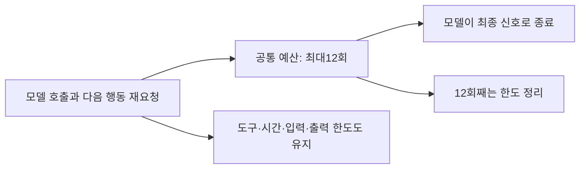

# 053: 모델 호출 기본 한도를6회에서12회로 늘리다

2026-10-19 · 기준06b5ac5 이후 이번 변경.

## 문제와 선택

052의 명시적 종료 프로토콜은 일반 텍스트 뒤 다음 행동을 다시 요청한다. 이 요청도 모델 호출 예산을 소모한다. 후속 실제 실행에서는 모델6회 중 다음 행동 재요청이2회였고, 검색·본문 도구3회 실행 뒤 마지막 호출에서 예산상 강제 정리했다. 그 실행의 출력은 호출당 최대361토큰, 마지막 입력3492토큰이었으므로 출력1024·컨텍스트65536이 먼저 부족해진 사례는 아니었다. 개인 질문과 전체 답변은 공개하지 않았다.

사용자가 모델 호출 한도를12회로 두 배 늘리자고 요청했다. Python run_agent와 CLI의 기본값을 함께12로 바꿨다. 웹 화면도 run_agent의 기본값을 사용하므로 동일하게 적용된다. 최종 정리를 포함한12회이며 도구 호출 기본8회·웹 시간180초·출력1024·컨텍스트65536은 바꾸지 않았다. 별도 한도에 먼저 도달하면12회까지 실행하지 않을 수 있다.

## 실제 변경

src/travel_agent/agent.py의 run_agent 기본 인자, 기준06b5ac5 이후 변경:

```python
max_steps=12, max_tool_calls=8, timeout=120, max_input_bytes=None,
```

timeout120은 Python 함수 기본값이고 웹 실행기는 기존처럼180을 명시한다.

src/travel_agent/memory_cli.py의 실제 CLI 설정:

```python
action.add_argument("--max-steps", type=int, default=12, help="Maximum model calls including final answer")
```



## 검증과 한계

Python 테스트178개 통과. 모의 모델이 진행 설명6회를 반환하고7회째 최종 답변을 주는 경우 정상 완료함을 확인했다. 계속 진행 설명만 반환하는 경우 정확히12회에서step_limit로 종료함을 확인했다. 실제 모델 답변을 생성한 품질 비교가 아니라 실행 예산의 회귀 테스트다.

진행 중 웹 실행이0개임을 확인한 뒤 기존50729 포트로 Docker를 재생성했다. 컨테이너 안의 Python 함수와CLI 파서 기본값도 확인했다. 이번에는 새 여행 질문·실제 모델 추론·검색을 실행하지 않았다. 따라서 새 질문·답변이나 에이전트 툴콜 로그는 없다. 호출 여유를 늘린 것이 조사 품질 개선을 보장하지 않으며 사용자가 다음 실제 질문으로 확인할 수 있다. 실제 실행이 늘어나면 지연·누적 토큰·검색 사용량도 증가할 수 있다.
