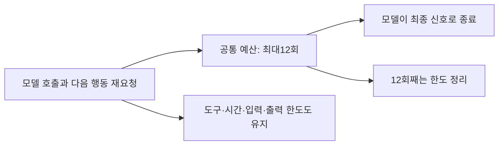

# 053: 모델 호출 기본 한도를6회에서12회로 늘리다

2026-10-19 · 기준06b5ac5 이후 이번 변경.

## 문제와 선택

052의 명시적 종료 프로토콜은 일반 텍스트 뒤 다음 행동을 다시 요청한다. 이 요청도 모델 호출 예산을 소모한다. 후속 실제 실행에서는 모델6회 중 다음 행동 재요청이2회였고, 검색·본문 도구3회 실행 뒤 마지막 호출에서 예산상 강제 정리했다. 그 실행의 출력은 호출당 최대361토큰, 마지막 입력3492토큰이었으므로 출력1024·컨텍스트65536이 먼저 부족해진 사례는 아니었다. 개인 질문과 전체 답변은 공개하지 않았다.

사용자가 모델 호출 한도를12회로 두 배 늘리자고 요청했다. Python run_agent와 CLI의 기본값을 함께12로 바꿨다. 웹 화면도 run_agent의 기본값을 사용하므로 동일하게 적용된다. 최종 정리를 포함한12회이며 도구 호출 기본8회·웹 시간180초·출력1024·컨텍스트65536은 바꾸지 않았다. 별도 한도에 먼저 도달하면12회까지 실행하지 않을 수 있다.

## 실제 변경

src/travel_agent/agent.py의 run_agent 기본 인자, 기준06b5ac5 이후 변경:

```python
max_steps=12, max_tool_calls=8, timeout=120, max_input_bytes=None,
```

timeout120은 Python 함수 기본값이고 웹 실행기는 기존처럼180을 명시한다.

src/travel_agent/memory_cli.py의 실제 CLI 설정:

```python
action.add_argument("--max-steps", type=int, default=12, help="Maximum model calls including final answer")
```



## 검증과 한계

Python 테스트178개 통과. 모의 모델이 진행 설명6회를 반환하고7회째 최종 답변을 주는 경우 정상 완료함을 확인했다. 계속 진행 설명만 반환하는 경우 정확히12회에서step_limit로 종료함을 확인했다. 실제 모델 답변을 생성한 품질 비교가 아니라 실행 예산의 회귀 테스트다.

진행 중 웹 실행이0개임을 확인한 뒤 기존50729 포트로 Docker를 재생성했다. 컨테이너 안의 Python 함수와CLI 파서 기본값도 확인했다. 이번에는 새 여행 질문·실제 모델 추론·검색을 실행하지 않았다. 따라서 새 질문·답변이나 에이전트 툴콜 로그는 없다. 호출 여유를 늘린 것이 조사 품질 개선을 보장하지 않으며 사용자가 다음 실제 질문으로 확인할 수 있다. 실제 실행이 늘어나면 지연·누적 토큰·검색 사용량도 증가할 수 있다.

## 후속: 사용자가 실행한12회 기록 확인

변경 후 사용자가 직접 시험한 실행을 확인했다. 앞 절은 변경 당시의 회귀 검증이며, 이 절은 이후 실제 사용 기록 진단이다. 개인 질문·숙소·출발지·예산·검색어·전체 답변은 공개하지 않는다. 새 추론이나 외부 검색을 추가 실행한 것은 아니다.

실제 모델12회·다음 행동 요청5회·도구 요청6회, elapsed158.5초로step_limit였다. 검색 요청4회 중 마지막1회는 앞선 질의와 동일해 로컬에서 차단됐고, 실제 검색은3회다. 본문 읽기2회는 모두 반환됐다. 마지막12회차는 예산상 강제 정리였고 그때 최종 태그를 반환했다. 자발적 완료로 판정하지 않는다.

| 모델 호출 | 실제 행동 |
| --- | --- |
| 1 | 웹검색 |
| 2 | 태그 없는 답변 → 다음 행동 요청 |
| 3 | 본문 읽기 |
| 4 | 설명과 함께 추가 웹검색 |
| 5 | 태그 없는 답변 → 다음 행동 요청 |
| 6 | 본문 읽기 |
| 7 | 태그 없는 답변 → 다음 행동 요청 |
| 8 | 추가 웹검색 |
| 9 | 태그 없는 답변 → 다음 행동 요청 |
| 10 | 8회차와 같은 검색 요청 → 중복 차단 |
| 11 | 태그 없는 답변 → 다음 행동 요청 |
| 12 | 강제 정리 요청 뒤 최종 태그 |

마지막 입력6797토큰·27937 UTF-8바이트, 호출당 최대 출력587토큰이며 모델 응답은 모두stop이었다. 누적 입력51624토큰은12회 합계로 마지막 문맥 길이가 아니다. 컨텍스트65536·출력1024·앱 입력196608바이트·시간180초가 먼저 소진된 실행은 아니다.

**관찰:** 추가 호출이 추가 조사로 이어진 부분은 있지만, 중간 답변을 최종 태그로 마무리하지 못하고 유사한 장문을 재작성하는 흐름이 반복됐다. 12회로 늘리는 것만으로 정상 종료를 해결하지 못했다. 모델의 의미적 완료 판단과 태그 형식 준수는 구분해서 평가해야 한다. 구조화된finish 도구는 후속 비교 후보이며 이번에 구현하지 않았다. 최종 숙박 정보의 사실성·현재 가격은 이 진단에서 별도 검증하지 않았다.

<details>
<summary>실제 도구 요청의 순서·ID·결과 — 개인 인자 제외</summary>

시각은UTC다. 실제 인자와 반환 본문은 비공개 원본trace에 보존하고 아래에는 개인 검색어·여행 조건을 제외했다. 검색 결과는compact_md, 본문 읽기는 질문 관련 발췌로 다음 모델 입력에 전달됐다. 아래 목록은 전체 모델 입력 문자열을 재현한 것은 아니다.

| 요청 시각 | span · 호출 ID | 도구·결과 |
| --- | --- | --- |
| 2026-10-18T18:30:14.882186+00:00 | 1.1 · call_kch1vfeg | web_search · 결과3개 |
| 2026-10-18T18:30:21.706887+00:00 | 3.1 · call_d8yqlyiy | web_read · 반환 성공·truncated=true |
| 2026-10-18T18:30:25.670948+00:00 | 4.1 · call_sj4irmtu | web_search · 결과3개 |
| 2026-10-18T18:30:34.091285+00:00 | 6.1 · call_aykroc76 | web_read · 반환 성공·truncated=false |
| 2026-10-18T18:30:57.236706+00:00 | 8.1 · call_6ws1rszu | web_search · 결과3개 |
| 2026-10-18T18:31:40.448386+00:00 | 10.1 · call_m5my83x1 | web_search · Identical tool call already attempted; change query or answer from available evidence |

truncated는 도구 발췌의 제한 표식이며 모델 생성의length 종료가 아니다.

</details>
