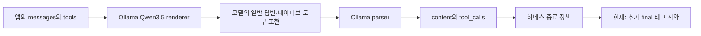

# 054: 모델의 기본 도구 프로토콜과 우리가 추가한 종료 규칙을 구분하다

2026-10-19 · 조사 기준524af01. 공식 모델 안내·고정 커밋 소스·이슈·로컬 설정을 확인했다. 실행 방식을 바꾸거나 새 모델 추론을 실행하지 않았다.

## 질문과 핵심 판단

사용자는 에이전트 용도로 학습된 모델이 왜 반복하는지, 실제 하네스가 최종 태그를 쓰는지, 다른 구현을 먼저 살펴야 하는지 질문했다. 052의 명시적 태그는 프로젝트에서 추가한 실험 규칙이다. 이를 모델의 원래 종료 프로토콜이나 모든 에이전트의 기본 방식으로 설명하면 안 된다. 053의 실제12회 실행에서는 태그 없는 답변5개를 진행 설명으로 처리하며 재호출했고 마지막 예산 정리에서 태그를 받았다.

**조사 결론:** Qwen-Agent와 Ollama의 공식 도구 루프는 추가 도구 호출이 없으면 종료한다. smolagents처럼 명시적인 최종 도구를 요구하는 구현도 있다. 최종 도구로 바꾸면 해결된다는 보장은 없으며 실제 관련 반복 이슈도 있다. 모델 교체나 한도 추가 확대보다 기본 종료·최종 태그·최종 도구를 동일 조건에서 비교하는 것이 다음 실험이다.

## 실제 하네스의 종료 코드

| 구현 | 확인한 종료 동작 | 판단 |
| --- | --- | --- |
| Qwen-Agent FnCallAgent | 한 응답에서 도구를 사용하지 않으면 break | 사용자 정의 final 태그를 필수로 요구하지 않는다 |
| Ollama 공식 agent loop 예시 | 응답에 tool_calls가 없으면 break | 네이티브 도구 호출과 일반 답변을 구분한다 |
| smolagents ToolCallingAgent | final_answer 도구 결과를 최종으로 처리 | 명시적 종료의 실제 사례지만 태그 방식과는 다르다 |
| 현재 프로젝트 explicit | 독립적인 final 태그가 없으면 다음 행동 요청 | 우리 실험 계약이며12회 사용에서 반복 종료 실패가 남았다 |

[Qwen-Agent의 실제 코드](https://github.com/QwenLM/Qwen-Agent/blob/31a4d36d123688581a9e9744427272b33ce940e0/qwen_agent/agents/fncall_agent.py#L93-L107), 기준31a4d36d123688581a9e9744427272b33ce940e0:

```python
if not used_any_tool:
    break
```

이 조건 앞에서 응답별 도구 호출을 감지해 실행하고 결과를 메시지에 추가한다. 코드가 여행 과제의 의미적 충족을 판정하는 것은 아니다.

[Ollama 공식 다중 턴 예시](https://docs.ollama.com/capabilities/tool-calling)는 tool_calls를 실행하고 결과를 다시 입력에 넣으며, 추가 호출이 없는 응답에서 루프를 끝낸다. 우리 초기 종료 형태가 일반 도구 루프와 다르다고 볼 근거는 없었다. 일찍 끝난 답변의 품질과 루프 구현의 결함은 분리해야 한다.

[smolagents 최종 도구 정의](https://github.com/huggingface/smolagents/blob/96f33faaf028479119ec8d34507b47694cf14e34/src/smolagents/default_tools.py#L83-L90)와 [실제 ToolCallingAgent](https://github.com/huggingface/smolagents/blob/96f33faaf028479119ec8d34507b47694cf14e34/src/smolagents/agents.py#L1327-L1358), 기준96f33faaf028479119ec8d34507b47694cf14e34:

```python
name = "final_answer"
```

이 이름의 도구 출력을 최종 결과로 표시하며, 최종 도구와 다른 도구를 같은 묶음으로 호출하는 것도 검사한다. 다만 [이슈1231](https://github.com/huggingface/smolagents/issues/1231)에는 최종 도구를 호출하지 않아 반복하는 보고와 지시 준수 한계에 대한 유지관리자의 답변이 있다. 이것은 가능한 실패의 실제 사례이며 모든 모델·버전에서 같은 비율로 발생한다는 자료는 아니다.

## 학습된 에이전트 모델인데 왜 그럴 수 있나

[Qwen3.5-4B 공식 모델 카드](https://huggingface.co/Qwen/Qwen3.5-4B#agentic-usage)는 후학습 모델과 에이전트 사용 경로를 안내하며 Qwen-Agent 사용을 권한다. 이는 특정 여행 요청의 충분한 조사나 임의의 종료 규칙 준수를 보장하는 계약은 아니다. 도구 스키마를 받아 호출하는 것, 관련 후보·근거를 찾는 것, 언제 답할지 결정하는 것, 별도로 추가한 태그를 지키는 것은 나눠 평가해야 한다.

우리 실제 기록에는 네이티브 검색·본문 도구 호출이 존재한다. 따라서 도구 호출 자체를 전혀 못 하는 모델이거나 모든 호출이 파서에서 사라진다고 단정할 수 없다. 동시에 좋은 도구 선택이나 사실성까지 통과했다는 뜻도 아니다.

## 로컬 템플릿과 생성 설정

Ollama API에서 확인한 서버는0.40.5, 모델은qwen3.5:4b-q4_K_M, 메타데이터는4.2B·Q4_K_M이고 tools·thinking capability가 있다. 설치돼 있지만 상태 조회 시점에는 메모리에 로드돼 있지 않았다. 새로운 모델을 받거나 바꾸지 않았다.

ollama show의 template은 Prompt 전달 형태지만 Modelfile에는RENDERER qwen3.5·PARSER qwen3.5가 명시돼 있다. 설치 버전v0.40.5의 소스를 찾아 [renderer](https://github.com/ollama/ollama/blob/d919272e53593d1d55d40e1180eaa06dfbede3ac/model/renderers/qwen35.go)와 [parser](https://github.com/ollama/ollama/blob/d919272e53593d1d55d40e1180eaa06dfbede3ac/model/parsers/qwen35.go)를 확인했다. 전용 코드가 도구 표현과 결과 메시지를 만들고 네이티브 호출을 해석한다. 템플릿 한 줄만 보고 도구 템플릿이 누락됐다고 판단하지 않는다. 모델 내부 토큰열 전체를 실제 요청별로 캡처한 검증은 아니다.



프로젝트는think=false·temperature0을 명시한다. 모델에 저장된 기본temperature1은 앱에서0으로 덮어쓴다. 공식 카드의 비사고 일반 작업 권장값은temperature0.7·top_p0.8 등으로 현재 요청과 차이가 있다. 카드에는 비사고 모드도 있으므로 think=false 자체를 잘못된 사용이라고 단정하지 않는다. 샘플링·사고 모드·양자화·하네스 중 무엇이 원인인지 분리 대조하지 않았고 임의로 설정을 바꾸지 않았다. 일반적인 장문 출력 권장값을 모든 여행 질의의 필수값으로 가져오거나 이번 반복을 출력 한도 문제로 바꾸어 설명하지 않는다.

## 설명을 정정한 부분과 다음 비교

최종 태그를 추가하면 의미적 완료 판단이 해결될 것처럼 설명한 부분은 성급했다. 실제 구현은 종료 형식을 강제했고, 태그가 없는 완성형 답변을 다시 진행 설명으로 돌려보내는 비용이 생겼다. 최종 도구는 후보이지 검증된 해결책이 아니다.

다음에는 동일한 모델·도구·기본 요청·예산에서 네이티브 종료, 추가 태그, 최종 도구를 비교한다. 조사 없이 검색했다고 말하는 실패·근거 확보·중복 호출·완료 신호 누락·토큰·시간을 따로 측정한다. 네이티브 종료가 빠르다는 이유만으로 품질 통과로 보거나, 최종 도구를 호출했다는 이유만으로 과제가 끝났다고 보지 않는다. 프레임워크 전체를 설치·교체하기 전에 종료 루프와 메시지 전달의 작은 차이를 검증할 수 있다.

## 실제 조사 기록

<details>
<summary>공식 소스 조회와 로컬 읽기 점검 — 에이전트 실행 아님</summary>

- 공식 모델 카드·Ollama 도구 문서를 조회했다.
- GitHub API로Qwen-Agent·smolagents의main 커밋을 확인한 뒤 위 고정 커밋의 원본 파일을 내려받아 종료 분기를 읽었다. 패키지를 설치하거나 해당 에이전트를 실행하지 않았다.
- Ollama 원본 파일 경로를 추정한 첫 조회2건은404였다. 실제 저장소 트리에서model/renderers/qwen35.go·model/parsers/qwen35.go를 찾고 설치 버전v0.40.5 커밋d919272e53593d1d55d40e1180eaa06dfbede3ac의 파일을 확인했다. 최초 실패와 올바른 경로 조회를 구분한다.
- 로컬/api/version·/api/tags·/api/ps·/api/show와CLI template·parameters·Modelfile을 읽었다. 인증정보·개인 대화는 수집하지 않았다.
- 새 모델 추론·여행 웹검색 도구 실행은0회다. 따라서 새로운 사용자 쿼리·모델 답변·에이전트 툴콜 로그는 없다. 기존053의 실제12회 기록은 관찰 근거로 참조한다. 프로그램 실행 경로·모델·배포 상태는 변경하지 않았다.

</details>
